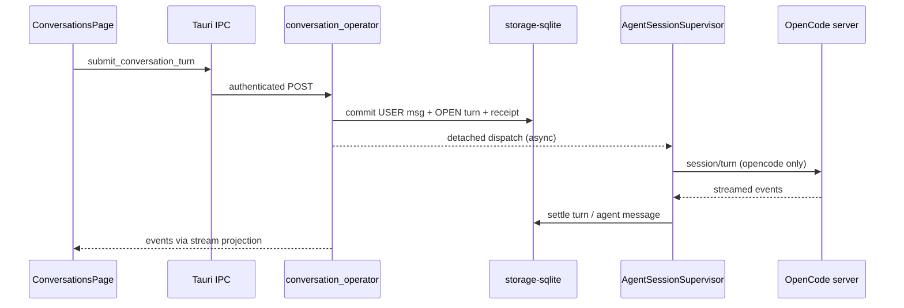

# LiteCowork — Principal Product, Architecture, Runtime, Security & UX Audit

**Audit date:** 2026-11-08 (UTC)  
**Auditor mode:** Evidence-first, adversarial, read-only (no source/spec/schema changes)  
**Authority hierarchy used:** `ARCHITECTURE.md` → `docs/PRODUCT.md` / `docs/V1-PRODUCT-RELEASE-CONTRACT.md` → owner specs/ADRs → `docs/schemas` → `docs/IMPLEMENTATION-STATUS.md` → this audit prompt (where docs disagree, contradictions are logged in Section J)

---

## A. Executive verdict

| Item | Finding |
|---|---|
| **Verdict class** | **(c) Prototype requiring architectural or integration rework** — strong domain/storage/IPC substrate and a broad desktop UI, but core product journeys (qualified chat, Task execution, Workbench providers, LiteSPM, trust-at-effect-boundary) are not end-to-end proven. |
| **Current maturity** | **Pre-release development** (explicit in `docs/IMPLEMENTATION-STATUS.md`); not V1 release-qualified. |
| **Three strongest reasons** | (1) Large, tested Rust workspace with 173 composed Operator routes and SQLite domain machinery (`docs/schemas/served-route-inventory.json`, `storage-sqlite` tests per status doc). (2) Real Conversation persistence, OpenCode supervisor branch, and desktop UI wired through Tauri IPC (`apps/litecoworkd/src/conversation_operator.rs`, `apps/litecowork-ui/src/conversations/ConversationsPage.tsx`). (3) Documentation and contract discipline are unusually rigorous (258 active doc files, passing structural validators). |
| **Overall confidence** | **Medium** — deep doc/code cross-check on WSL2; **no** packaged Tauri USER journey or full Windows workspace re-run in this session; dynamic failure injection largely **unrun**. |
| **Most important caveat** | **Route count ≠ product capability:** many surfaces are SERVED/read-only or fail-closed; the UI can still imply progress (Tasks READY, automation materialization) without integrated execution. |

---

## B. Repository and audit provenance

| Field | Value |
|---|---|
| **Path** | `/mnt/c/users/sonali/desktop/projectwork/business_Dev/litecowork` |
| **Remote** | *(none configured on this checkout)* |
| **Branch / commit** | `master` @ `2e85f037bfa653b642b8c4a9b7fee5c80c438b2b` |
| **Working tree** | Clean (`git status -sb` → `## master` only) |
| **Audit environment** | WSL2 Linux 6.18.54, `rustc 1.98.1`, `cargo 1.98.1`, `node v24.22.1` |
| **User changes** | None modified; audit outputs only under `audit-output/principal-audit-2026-11-08/` |

### Inventory scope (read)

- **Normative:** `ARCHITECTURE.md`, `docs/IMPLEMENTATION-STATUS.md`, `docs/V1-PRODUCT-RELEASE-CONTRACT.md`, `docs/V1-UI-SCREEN-CONTRACT.md`, `specs/README.md` (features 001–011), `docs/schemas/served-route-inventory.json`, prior `docs/audit/*` mechanical audits (used as navigation, verified against source).
- **Runtime:** `apps/litecoworkd/` (Operator routers, agents supervisor, conversation operator), `apps/litecowork-ui/` (`App.tsx` shell, `ConversationsPage.tsx`, `WorkbenchPanel.tsx`, `SettingsView.tsx`, Discover/Coworkers/Work/Automations pages), selected `crates/storage-*`, `apps/litecowork-ui/tests/*`.
- **Excluded from deep line-by-line read:** `node_modules/`, `target/`, `dist/`, `repo_take/`, `archives/`, full 9900+ file UI tree (sampled by route/components/tests), generated bundle assets.

### Commands run (this audit)

| Command | Result |
|---|---|
| `git rev-parse`, `git status -sb`, `git log -1` | Clean `master` @ `2e85f037` |
| `uv run --locked python scripts/audit_v1_contracts.py` | **PASS** — `errors=0 openapi=229 served=173 outside=1 target=56` |
| `node --test apps/litecowork-ui/tests/workbench-truthfulness.test.mjs` | **6/6 pass** (13859 ms) |
| `pnpm test tests/workbench-truthfulness.test.mjs ...` (mis-invoked full suite) | **Failed** — browser harness timeouts (Chrome DevTools / Vite WS) on WSL; not a product assertion |
| `CARGO_BUILD_JOBS=2 cargo test -p storage-sqlite` | **Incomplete** — still compiling/running at report time (>11 min); prior evidence: 555 tests PASS on Windows per `docs/IMPLEMENTATION-STATUS.md` |
| Tauri desktop launch / OpenCode USER E2E | **Not run** — no qualified daemon+UI pairing exercised in this session |

### Runtime / platform limitations

- WSL2 is **not** proof of native Windows desktop qualification (`AGENTS.md`, `IMPLEMENTATION-STATUS.md`).
- Browser-based UI tests requiring Chrome CDP **failed to start** in this environment.
- Full `cargo test --workspace` not re-executed here (Windows evidence cited from status doc).

---

## C. Scorecard

| Dimension | Weight | Score (0–5) | Confidence | Key evidence | Deductions |
|---|---:|---:|---|---|---|
| Product experience & UI/UX | 20% | **2** | Med | Full shell in `App.tsx`; 4 Settings categories; Workbench honesty tests pass; composer gaps in `ConversationsPage.tsx` | Inert composer affordances; Home still “New task”; hidden pages (Goals/Ideas); no qualified E2E screenshots |
| Agent & knowledge-work capability | 20% | **1.5** | Med | OpenCode supervisor branch; binding/registry partial; `dispatch_available=false` for Tasks | Single dispatch branch; OpenCode binding blocked in UI; no retrieval on send |
| Runtime, architecture & engineering | 20% | **3.5** | Med–High | 173 served routes; storage-core/sqlite depth; automation trigger host worker | Trust/effect path unwired; 56 target-only ops; execution vertical slice missing |
| Security, trust & recovery | 15% | **2** | Med | Windows IPC/security unit tests (per status doc); policy modules `dead_code` | No enforced effect boundary; conversation dispatch durability gaps |
| Product completeness & integrations | 15% | **1.5** | Med | Resources, approvals, automations materialize Tasks | LiteSPM 503; Connections target-only; browser/terminal/computer providers absent |
| Competitive viability & differentiation | 10% | **1.5** | Med | Coherent *design* for multi-agent workspace + durable Tasks | Competitors ship qualified terminal/browser/scheduling today |

**Weighted overall: ~2.1 / 5** (prototype tier, not contender tier).

---

## D. Product-area status matrix (V1 ten areas)

Status labels: **IT** implemented & tested · **IU** implemented untested · **PS** partial/stubbed · **SO** specified only · **AB** absent  
Confidence: H/M/L

| Area | Journey / subfeature | Status | Conf | Evidence (paths) | UI | Runtime | Persistence / recovery | Gaps |
|---|---|---|---|---|---|---|---|---|
| **1 Universal Chat** | Create Conversation w/o Task/Coworker | **IU** | H | `ConversationsPage.tsx`, conversation_operator routes | Yes | Served | SQLite conversation records | — |
| | Send → native response (OpenCode) | **PS** | M | `agents/supervisor.rs`, `conversation_operator.rs` | Send wired | OpenCode branch only | Commits before async dispatch | No USER qualification; durability/outbox gaps per status doc |
| | Stop / cancel / retry | **PS** | H | `ConversationsPage.tsx:757-769` (`expectedVersion: 1`); stream turn only | Broken/partial | CANCEL semantics weak | OPEN turns can stall | Critical findings K-001–003 |
| | Attachments / @ / slash | **PS** | H | `resourceRefs: []` hard-coded; placeholder placeholder copy | Inert controls | — | — | — |
| | Agent relay A→B→A | **PS** | H | PATCH agent-binding served; supervisor one branch | Picker UI | No second adapter | Portable context code unused E2E | Feature 004 DRAFT |
| **2 BYOA** | Discovery / install / auth | **PS** | H | `AgentCatalogSettings`, registry NO_ADAPTER | Catalogue | Probes Codex/OpenCode | Bindings persisted | Install/auth 503; OpenCode offer incompatible |
| | Multi-harness dispatch | **PS** | M | Only `opencode` in supervisor | Misleading catalog breadth | — | — | Codex bound but not dispatched |
| **3 Coworkers** | Quick Create → first chat | **PS** | H | No Conversation `coworker_id` on create | Home onboarding card | Coworker CRUD served | Revisions stored | No Coworker-owned Conversation |
| | Memory / learning | **SO** | H | `coworker_learning.rs` pure gates only | Disclosure copy | No routes | No store | Feature 009 DRAFT |
| **4 Workbench** | Files preview | **IU** | M | Resource list + text preview | Yes | Resource read routes | Resource revisions | Not live FS browser |
| | Terminal | **PS** (honest unavailable) | H | `WorkbenchPanel.tsx` `TerminalPane` | Unavailable notice | No PTY service | — | Correct UX; provider AB |
| | Browser | **PS** | H | Embedded preview pane | iframe | No CDP | — | Not automation |
| | Computer / Diffs / Activity | **PS/AB** | H | Review unavailable; activity tab type orphan | Partial | `dead_code` modules | — | Feature 008 DRAFT |
| **5 Capabilities / LiteSPM** | Discover UI | **IU** | M | `DiscoverPage` | 4 tabs | Read projections | — | Actions disabled |
| | Install/adopt/manage | **SO** | H | `503 LITESPM_PACKAGE_SERVICE_NOT_QUALIFIED` | Managed tab says disconnected | Fail-closed | — | — |
| **6 Tasks** | Create / edit objective | **IT** | M | Work UI, task routes, unit tests | Yes | Served | Task + spec revisions | — |
| | Plan → Attempt → Effect | **SO** | H | `planning_available=false`; admission dead | Readiness panel only | Storage primitives only | — | **Core gap** |
| **7 Automations** | Schedule → occurrence | **IU** | M | `AutomationTriggerHostWorker` started in daemon | AutomationsPage | 30s poll host | Cursors/tasks materialized | No execution; notifications unsent |
| **8 Memory / knowledge** | Grounded retrieval API | **IU** | M | `POST /v1/resources/retrieval` | No Context Used UI | Lexical provider | Read-only | Not on send path |
| **9 Library / artifacts** | Text artifact edit | **IU** | M | `ArtifactWorkbench`, append route | Library | Plain text only | Immutable versions | No artifact create route |
| **10 Desktop shell** | Tauri + daemon IPC | **IU** | M | `litecoworkd`, Operator IPC crate | Full shell | Linux systemd path | SQLite | Windows USER unproven here |
| | Settings (187-control target) | **PS** | H | **4 categories** in `SettingsView.tsx` | Partial | Workspace/agent/runtime real | General prefs ephemeral | 011 spec vs UI mismatch |

---

## E. UI/UX screen and interaction audit

### Navigation model

- **Router:** state machine in `apps/litecowork-ui/src/App.tsx` (`Page` type), not URL router.
- **Primary sidebar (reachable):** New Chat, Recent Chats, Needs You, Work, Coworkers, Automations, Library, Discover, Settings (`App.tsx` ~2384–2472).
- **Secondary pages (routed, limited nav):** Goals, Notifications, Ideas, Routines, Home (“New task”) — defined in `Page` union and `requestPageNavigation`, not all in sidebar.

### Screen coverage matrix

| Screen | Reachable | Backend wiring | Empty/error | Status |
|---|---|---|---|---|
| Conversations | Yes (default path) | Tauri `submit_conversation_turn` | Partial | **PS** — send real; stop/retry weak |
| Home / New task | Yes | Task create | Yes | **PS** — not promoted from chat |
| Work | Yes | Task list/detail/readiness | Honest readiness labels | **PS** — no execution controls |
| Coworkers | Yes | CRUD + settings | Operator gate | **PS** — no chats |
| Needs You | Yes | Approvals/user-requests | Documented limits | **IU** |
| Automations / Routines | Yes | Automation API | Stale copy noted in status doc | **PS** |
| Library | Yes | Artifacts/resources | ZIP notice | **PS** |
| Discover | Yes | Catalog read | Actions disabled | **PS** |
| Settings | Yes | 4 categories | — | **PS** |
| Goals / Ideas / Notifications | Programmatic | Read APIs | Empty states | **SO/PS** — peripheral |

### Workbench (right panel)

- **Default visibility:** desktop `workbenchDesktopVisible = workbenchLayoutByWorkspace[key] !== false` → **visible by default** unless user hid per-workspace (`App.tsx:580–590`, `2233`).
- **Width:** default 480px, resizable 320–75% (`workbenchWidth` localStorage).
- **Truthfulness:** `workbench-truthfulness.test.mjs` **passes** — no fabricated ConPTY/exit-code claims; terminal/diff show `UnavailableNotice` (`WorkbenchPanel.tsx:166–200`).
- **Contradiction:** `docs/V1-UI-SCREEN-CONTRACT.md` §9 “Current Workbench source boundary” still describes **fake terminal/diff** — **stale vs code** (see Section J).

### Composer (`ConversationsPage.tsx`)

- Send requires `operatorReady`, blocks on `isTurnRunning` (stream states + `RUNNING`) — **does not** gate on qualified binding (status doc aligned).
- `resourceRefs: []` always; attachment UI inert.
- Cancel uses `expectedVersion: 1` hard-coded; targets stream turns only — **likely no-op** for OpenCode operator path.

### Accessibility / responsive

- Responsive tests exist and pass per status doc (24 tests).
- `settings-accessibility.test.mjs` **failed** in this environment (harness timeout, not asserted WCAG failure).

### Screenshots

**Not captured** — Tauri app not launched in audit session; no fabricated screenshots.

### Dead / placeholder controls (sample)

- Composer: Turbo static, voice/add-context/more-options without handlers (per `IMPLEMENTATION-STATUS.md`).
- Discover: all row actions disabled via `connectActionOutcome()`.
- Workbench Activity tab: type exists, no launcher row (files/terminal/browser/review only).

---

## F. Architecture and runtime trace

### Journey 1: Send message (partial)

**Breaks:** no durable outbox/worker claim; pre-dispatch commit; cancel/retry UI not aligned; non-OpenCode providers fail closed after persist.

### Journey 2: Task execution (absent)

UI (Work) → planning readiness GET → `dispatch_available: false` → **no** path to `admit_step_attempt` in production daemon (grep: no production caller per status doc).

### Journey 3: Automation due → Task READY

TriggerHost worker (30s) → occurrence settlement → **READY Task** without planning/Attempt — scheduler only.

### Ownership observations

| Boundary | Intended | Actual |
|---|---|---|
| LiteSPM vs LiteCowork | Package lifecycle vs grants | LiteCowork Discover read-only; bridge 503 |
| Trust/Effects | Mediated ops only | Evaluator compiled `dead_code` (`main.rs` per specs) |
| Environment / terminal | Daemon-owned PTY | UI explicitly unavailable — **honest** |
| UI vs durable truth | Projections from Operator | Some Task/automation states imply work without workers |

---

## G. Security and trust report

### Threat model (summary)

Local-first desktop: threats include malicious repo content (prompt injection), path traversal on workspace roots, shell command exfiltration **if** terminal were connected, IPC spoofing from local processes, capability confused-deputy, approval replay, stale grants, credential logging.

### Enforcement level

| Control | Level | Evidence |
|---|---|---|
| Authenticated local IPC | **Enforced** (design + Windows tests cited) | `operator-ipc` tests in status table |
| Workspace scoping on routes | **Enforced** (storage tests) | storage-sqlite route tests |
| Trust evaluator at invocation | **Advisory / absent** | Unwired; grants narrow read-only planning |
| Terminal command policy | **N/A** | No PTY |
| Browser SSRF / egress | **N/A** | No managed browser |
| Prompt injection in indexed files | **Partial** | Retrieval read-only; not wired to send |
| Approval digest binding | **Implemented** | Approval resolve checks digest (status doc) |
| Secret redaction in learning gates | **Unit-tested pure** | `coworker_learning.rs` tests only |

### Tests executed here

- No destructive injection tests run (read-only audit).
- Workbench truthfulness: **no fabricated security claims** in terminal UI.

### Residual risk (High)

Conversation durability and cancel semantics can leave **durable OPEN turns** without living workers — integrity/availability issue with security implications (user believes turn active/stopped).

---

## H. Competitive parity matrix (verified 2026-11-08)

| Capability | Competitor baseline (source, date) | LiteCowork | Gap | Stakes vs diff |
|---|---|---|---|---|
| Native coding agent in desktop | Claude Code desktop: parallel sessions, terminal, diff, browser preview, computer use ([code.claude.com/docs/en/desktop](https://code.claude.com/docs/en/desktop/), 2026) | OpenCode branch **code-level** only | No qualified multi-surface workbench | **Table stakes** |
| BYOA / multi-model | OpenWork: OpenCode + 50+ providers, local files, skills/MCP ([github.com/different-ai/openwork](https://github.com/different-ai/openwork/)) | Registry + bindings partial | Install/auth/dispatch gap | **Table stakes** |
| Sandbox execution | Open Cowork: WSL2/Lima VM ([github.com/opencoworkai/open-cowork](https://github.com/opencoworkai/open-cowork)) | Job Object **types**; isolation unqualified | No VM/sandbox UX | Table stakes for “safe agent desktop” |
| Durable task / audit | LiteCowork **target** (Task-centric) | Task **records** only | No execution/receipt pipeline | **Differentiator (unproven)** |
| LiteSPM package plane | LiteCowork target interop | 503 not qualified | No install/adopt | Differentiator (unproven) |
| Scoped Coworkers + trust receipts | Cowork products emerging | Coworker config without execution | No memory inbox | Differentiator (unproven) |

**Strategic read:** LiteCowork’s *documented* moat (durable Task truth, effect reconciliation, LiteSPM boundary) is **not yet demonstrable** in USER journeys; today it competes below OpenWork/Claude Code/Open Cowork on table stakes.

---

## I. Benchmark and dynamic test results

| Suite | Setup | Run? | Result |
|---|---|---|---|
| Core journey 1–16 (prompt §8.1) | — | **No** | Not executed |
| Agent coding tasks (§8.2) | — | **No** | Not executed |
| Failure injection (§8.3) | — | **No** | Not executed |
| `workbench-truthfulness.test.mjs` | Node 24, Vite SSR load | **Yes** | 6/6 pass |
| `audit_v1_contracts.py` | uv locked | **Yes** | errors=0 |
| Full `pnpm test` / browser suites | WSL | **Partial** | Harness timeouts |
| Windows `cargo test --workspace` | Per IMPLEMENTATION-STATUS | **Not re-run** | Cited: PASS 1383s |

**Pass rate for executed tests:** 100% of narrowly scoped tests; **0%** of full USER/E2E matrix.

---

## J. Documentation / spec reconciliation ledger

| ID | Contradiction | Docs claim | Code/tests | Proposed decision | Blocks release? |
|---|---|---|---|---|---|
| J-01 | Workbench terminal/diff | `V1-UI-SCREEN-CONTRACT.md` §186–187 fake terminal/diff | `WorkbenchPanel.tsx` unavailable panes; tests pass | **Current truth = honest unavailable**; update UI contract + IMPLEMENTATION-STATUS terminal section | No (doc hygiene) |
| J-02 | Workbench default | Contract: compact visible by default | `workbenchLayoutByWorkspace` default visible on desktop | **Aligned** unless localStorage hides | — |
| J-03 | Feature 001 lifecycle | `specs/README.md`: IN_REVIEW | Implementation partial; not VERIFIED | Remain IN_REVIEW until USER qualification | Yes |
| J-04 | Settings breadth | Historical 30 groups / 187 controls | `SettingsView.tsx`: 4 categories; General ephemeral | **Current UI = 4 categories**; target remains in 011 SPEC | Yes for V1 settings promise |
| J-05 | Automations pause copy | UI message says triggers unavailable | Host worker running (status doc) | Fix UI copy | Low |
| J-06 | Coworker memory learning | UI: review required | No persistence/inbox | **Disclosure only** until Feature 009 | Yes for memory area |
| J-07 | OpenCode binding vs dispatch | Dispatch exists | Probe marks offer incompatible | Product decision: qualify OpenCode path OR hide Send | **Yes** |
| J-08 | Release readiness | V1 contract = TARGET | IMPLEMENTATION-STATUS pre-release | **Not production-ready** | — |

---

## K. Critical findings (ranked)

| ID | Sev | S/F | Area | Evidence | User impact | Root cause | Fix | Acceptance test |
|---|---|---|---|---|---|---|---|---|
| K-001 | **Critical** | Structural | Chat | IMPLEMENTATION-STATUS §Conversation gaps; no outbox | Stuck OPEN turns after crash | Commit-before-dispatch | Durable dispatch admission + sweep | Kill daemon mid-dispatch; restart; turn completes or fails clearly |
| K-002 | **High** | Fixable | Chat UI | `ConversationsPage.tsx:767` `expectedVersion: 1` | Stop ineffective | UI/backend contract drift | Wire cancel to aggregate version + native interrupt | USER stops OpenCode turn; turn CANCELLED with quiescence |
| K-003 | **High** | Structural | Tasks | planning `dispatch_available=false`; no `admit_step_attempt` caller | “Work” does not work | Execution vertical not wired | Feature 005 slice | One file edit with effect receipt + verification |
| K-004 | **High** | Structural | BYOA | OpenCode dispatch but incompatible offer in catalog | Cannot configure advertised agent | Cross-feature mismatch | Qualify binding probe OR remove Send | USER binds OpenCode and gets reply |
| K-005 | **Medium** | Fixable | Trust | Trust evaluator `dead_code` | Approvals don’t execute granted writes | Incomplete Feature 006 | Wire broker + effect path | Golden connection write reconciled |
| K-006 | **Medium** | Fixable | LiteSPM | connect-or-install 503 | Discover non-functional | Bridge not qualified | Qualified LiteSPM RPC | Install preview→apply→receipt |
| K-007 | **Medium** | Fixable | Coworkers | No Conversation ownership field | Coworker ≠ chat hub | Model gap | Add origin + scoped conv list | Quick Create opens persisted chat |
| K-008 | **Low** | Fixable | Docs | J-01 stale Workbench prose | Engineer mistrust | Doc lag | Sync contracts | Contract audit mentions truthfulness |

---

## L. Spec-vs-reality (major capabilities)

| Promise (V1 contract) | Spec | Shipped | Partial | Deferred |
|---|---|---|---|---|
| Ordinary chat without Task | TARGET | | X (OpenCode path) | |
| Multi-agent relay | 004 DRAFT | | X (binding only) | X |
| Task execution + verification | 005 DRAFT | | X (records) | X |
| Real terminal/browser/computer | 008 DRAFT | | X (honest N/A UI) | X |
| LiteSPM lifecycle | LLD TARGET | | X (read catalog) | X |
| Coworker memory | 009 DRAFT | | X (config) | X |
| Professional artifacts | 007 DRAFT | | X (plain text) | X |
| 16 Settings categories | 011 DRAFT | | X (4 cats) | X |

---

## M. Roadmap (reliability-first)

### First 30 days

1. **Conversation dispatch durability** (K-001) — structural; 2–3 senior Rust engineers.
2. **OpenCode vertical USER qualification on Windows** (K-004) — fixable; depends on (1).
3. **Cancel/retry UI correctness** (K-002) — fixable; 1 FE + 1 BE.
4. **Doc sync Workbench truth** (J-01) — 0.5d technical writer.

### First 90 days

5. **Feature 005 minimal Task slice** — one Environment, one mediated file effect, verification (K-003).
6. **Trust + golden write** (K-005, Feature 006).
7. **LiteSPM observe→plan→apply** with receipts (K-006).
8. **Coworker Conversation origin** (K-007).

### First 180 days

9. **Workbench Feature 008 providers** (PTY, managed browser decision).
10. **Second native agent adapter** (Codex or Claude Code qualified path).
11. **Settings expansion toward 011 contract** with per-control persistence matrix.
12. **Packaged CI USER gates** per `ACCEPTANCE-AND-E2E-PLAN.md`.

**Team assumption:** 4–6 engineers (2 Rust runtime, 1–2 UI, 1 trust/storage, 1 QA/devrel for qualification). **Time-to-parity** with Claude Code desktop / OpenWork on table stakes: **12–18 months** at that staffing if architectural bets hold; **not** achievable by UI polish alone.

---

## N. Open questions / unverifiable

1. Full Windows `cargo test --workspace` at this commit on auditor machine — **not re-run** (trusted status doc).
2. OpenCode USER journey with real credentials — **not attempted** (no secrets).
3. macOS folder scan / Windows root add — platform-specific qualification open.
4. Production Settings control count vs 187-target — needs automated UI ledger script.
5. Whether `storage-sqlite` Linux run completes identical to Windows — run was **incomplete** at report time.
6. Owner acceptance for Feature 001 B-01–B-10 — **IN_REVIEW**, not evidenced.

---

## O. Final release gate (V1 complete checklist)

Non-negotiable before “V1 complete”:

- [ ] **Qualified** ordinary Conversation Send/Stop/Retry on ≥1 declared OS/agent/auth tuple with USER evidence.
- [ ] **Qualified** Task slice: plan acceptance → Attempt → mediated Effect → independent verification → Artifact.
- [ ] **Qualified** LiteSPM install/adopt with preview and receipt reconciliation.
- [ ] **Qualified** one Connection OAuth + one consequential write OR explicit V1 deferral in release contract amendment.
- [ ] Workbench: **real** terminal **or** contract-amended exclusion; browser/computer per Feature 008 decision.
- [ ] No UI state implying RUNNING/COMPLETE without owner service proof (automations, tasks, notifications).
- [ ] Crash/restart matrices pass for Conversation dispatch and Task admission.
- [ ] Packaged Tauri + daemon installer tests on declared platforms.
- [ ] Settings: each visible control persisted **or** hidden.

**Explicit V2 (remain out):** cloud Runtime continuation, multi-user org, mobile dispatch, remote enrollment replication.

---

## Red flags explicitly observed

1. **173 routes ≠ 173 features** — documented, still a social risk for stakeholders.
2. **READY Task without worker** — automations and manual materialization.
3. **Feature packages all DRAFT/IN_REVIEW** — no VERIFIED package.
4. **Trust unwired** while approval UX exists.
5. **Composer enabled without binding qualification** (status doc).
6. **Stale normative UI contract** on Workbench terminal (J-01) despite code fix.
7. **Structural validators pass** while USER journeys fail — “V1 contract audit 0 findings” is structural only (`IMPLEMENTATION-STATUS.md`).

---

## Appendix: evidence index (quick)

| Topic | Path |
|---|---|
| Implementation truth | `docs/IMPLEMENTATION-STATUS.md` |
| Served routes | `docs/schemas/served-route-inventory.json` |
| Conversation submit | `apps/litecoworkd/src/conversation_operator.rs`, `ConversationsPage.tsx` |
| Supervisor | `apps/litecoworkd/src/agents/supervisor.rs` |
| Workbench honesty | `apps/litecowork-ui/src/workbench/WorkbenchPanel.tsx`, `tests/workbench-truthfulness.test.mjs` |
| Shell navigation | `apps/litecowork-ui/src/App.tsx` |
| Settings surface | `apps/litecowork-ui/src/settings/SettingsView.tsx` |
| Feature register | `specs/README.md` |

---

*End of principal audit report.*
