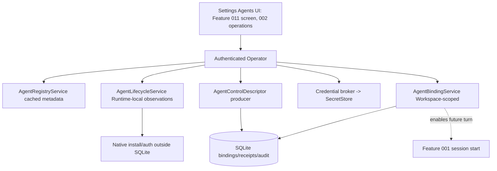

# 002 - Native Agent Install, Auth and Binding

**ID:** 002
**Status:** ACCEPTED/LOCKED
**Owners:** Agent Runtime, Security/Trust, Desktop UI, Product
**Updated:** 2026-11-09
**Revision:** 1.0 (revision 1.0 adds V1 gap coverage per owner acceptance 2026-11-09: OpenCode binding admission fix, AgentControlDescriptor producer, native sign-in observation, descriptor-declared composer options/commands and Claude Code CLI as the second module; new AC-013 to AC-017)
**Owner acceptance:** accepted 2026-11-09 by the repository owner (sarv-projects) via [docs/OWNER-ACCEPTANCE-REVIEW-PACKET.md](../../docs/OWNER-ACCEPTANCE-REVIEW-PACKET.md) (PR #1), including each "ACCEPT (scoped)" caveat as a binding condition.
**Change control:** this contract is locked. Any change to a locked decision, interface or acceptance criterion requires a new revision and renewed owner approval (docs/SPECIFICATION-STANDARD.md §7).
**Target release:** V1 local desktop
**Dependencies:** root ARCHITECTURE.md, docs/V1-PRODUCT-RELEASE-CONTRACT.md, docs/IMPLEMENTATION-MASTER-PLAN.md, and the owner documents named in RESEARCH.md. Feature 001 remains the Conversation send authority.

## 1. Problem

Universal Chat cannot start until one native agent is observed, authenticated and bound without collapsing those states into a single connected flag, and without a LiteCowork model router substituting for the harness.

Observable outcome: The owner detects a real native agent, completes that agent's own sign-in, and gets an enabled AgentBinding whose install, auth, descriptor freshness and session readiness stay separate.

## 2. Goals

- Observe installation separately from authentication, descriptor freshness and session readiness.
- Persist an enabled Workspace AgentBinding only after the selected AgentModule reports a fresh non-secret control descriptor.
- Fail new admission when a selected model or session option is stale, and keep the composer draft.
- Show Settings > Agent Registry controls only for adapter-reported affordances.

## 3. Non-goals

- A universal Providers screen or cost router.
- Silent rewrite of native CLAUDE.md, AGENTS.md, Codex config, hooks, skills or MCP settings.
- LiteSPM package install as a substitute for native account sign-in.
- Qualifying every agent in one release; V1 qualifies one exact route first, then a second for relay.

## 4. Current evidence

The active checkout has partial, source-backed Agent Registry, installation-inventory, profile-probe and AgentBinding surfaces. It does not implement the complete install/auth/control-descriptor lifecycle promised by this target. The matrix below is a code/route/UI audit, not owner acceptance or release qualification.

| Capability | Current source evidence | Limitation / release meaning |
|---|---|---|
| ACP Registry discovery | CODE/SERVED: `GET /v1/agent-registry` and `POST /v1/agent-registry/refresh`; remote snapshot is bounded, cached and stale-labelled | Read-only metadata. ACP entries are always projected as `NO_ADAPTER`; registry presence is not installation or support. |
| Local installation inventory | CODE/SERVED: `GET /v1/agent-installations`; bounded version-only inventory probes and Cline package metadata cover the curated candidate set | Auth is always UNKNOWN and session readiness NOT_PROBED. There is no install/update action. |
| Workspace profile discovery | CODE/SERVED: `GET /v1/agent-profiles`; explicit `POST /v1/agent-profiles/probe` supports CODEX and OPENCODE after local Runtime enrollment | Probe creates/updates profile, endpoint binding and Runtime offer observations; it does not prove inference or a usable Conversation session. Other curated candidates have no profile probe. |
| Codex probe | CODE for App Server initialize/account/model-list observations; compatibility and readiness are separate | Conversation safety eligibility is separately reported. Feature 001's active Conversation supervisor does not dispatch Codex, so a Codex binding is not a working Conversation route. |
| OpenCode probe | CODE for bounded provider/model catalogue observation and process-stop observation | It always records `compatible=false`; endpoint capability flags are false. UI correctly blocks creation of a new Workspace binding. Feature 001 has an OpenCode dispatch code path, but the current UI cannot create the binding needed to reach it. |
| AgentControlDescriptor | GET descriptor and POST refresh routes are mounted | Both deliberately return `503 DEPENDENCY_UNAVAILABLE`; no qualified AgentModule descriptor producer is wired. |
| Credential submission | POST credential-slot route is mounted with no-store, bounded body and request validation | It checks for a fresh descriptor and then deliberately returns `503`; SecretStore is not mutated because durable exact replay is not implemented. Native auth-begin and native-config-open are served through ID-only Tauri commands but fail closed without a qualified module action. |
| AgentBinding | List/get/create/enable/disable are CODE/SERVED; creation is disabled by default; mutations use version checks, idempotency receipts and audit events | Storage checks a fresh compatible Runtime endpoint offer. Enable does not currently require a fresh AgentControlDescriptor, contrary to AC-004. `auth_ref` is rejected on create. |
| Install/update and native config | OpenAPI target operations exist | `POST /agent-registry/{id}/install`, `/update`, native-config open and auth-begin have no served handlers in the active composed router. |
| Desktop UI | `AgentCatalogSettings` renders 15 curated candidates, ACP Registry results, local inventory, Codex/OpenCode probes, observed profiles, Workspace bindings/default lead and worker-profile controls | No install/update or native sign-in flow. Auth remains explicitly unknown; Inspect native controls reaches the unavailable descriptor route. This is a catalogue/probe/binding surface, not a complete agent lifecycle UI. |

Code or a route alone does not qualify the feature. The §5 decisions are owner-accepted and this package is ACCEPTED/LOCKED; implementation and qualification status are unchanged by acceptance and are tracked in this §4 and in [docs/IMPLEMENTATION-STATUS.md](../../docs/IMPLEMENTATION-STATUS.md).

### 4a. Source-verified detail of the OpenCode binding break (checked 2026-11-09)

The OpenCode row above was re-traced through source for the V1 P1 prerequisite. These are current-state facts, not fixes:

- `probe_local_opencode_profile` in `apps/litecoworkd/src/operator.rs` always publishes its `RuntimeOfferRecord` with `compatible: false`, and with readiness `DEGRADED` even for a complete probe (otherwise `UNAVAILABLE`). `opencode_endpoint_capabilities()` declares every capability `false` and `protocol_version: null`. `OpenCodeProfileProbe::profile_admission_supported` in `apps/litecoworkd/src/agents/opencode_profile_probe.rs` is fixed `false`, and the OpenAPI/generated TypeScript type (`apps/litecowork-ui/src/api/operator-api.ts`) declares it as the constant `false`.
- Binding create and enable (`create_agent_binding_transaction`, `enable_agent_binding_transaction` in `crates/storage-sqlite/src/lib.rs`) call `has_fresh_compatible_endpoint`, whose query requires `runtime_offers.compatible = 1` and readiness `AVAILABLE`, `STARTABLE` or `READY`. Conversation admission (`resolve_conversation_session_host_in_transaction` in `crates/storage-sqlite/src/conversations.rs`) applies the same filter. Both gates therefore reject every OpenCode offer, and `AgentCatalogSettings.tsx` disables Create binding when `observation.compatible === false`.
- The probe records the profile with `provider_key: "OPENCODE"`, but `execute_agent_turn` in `apps/litecoworkd/src/agents/supervisor.rs` matches the lowercase literal `"opencode"`. If only the offer flag were flipped, dispatch would still fall into the `other =>` unsupported arm.
- The probe resolves the executable with `resolve_local_executable("opencode")`, which joins the bare name onto each `PATH` entry, so on Windows an npm `opencode.cmd` or `opencode.exe` is not found and the probe returns `404 AGENT_UNAVAILABLE`. The supervisor separately re-resolves the executable with `find_opencode_executable` (which does check `.exe`/`.cmd`) and ignores the `endpoint_ref` the probe registered through `register_local_endpoint_binding`. The probed and dispatched executables can therefore differ.
- The probe accepts OpenCode 2.0.26, 2.0.28 and 2.0.32 (`OpenCodeServerProtocol::for_cli_version`), while the supervisor always dispatches with `OpenCodeServerProtocol::V2_0_32`. Only 2.0.32 is the accepted first route.

002-T01 is the first implementation task and closes all five points without weakening the storage gates.

## 5. LOCKED and FLEXIBLE decisions

### LOCKED

- No global provider/model catalog (AGENT-CONTROL §2.1).
- Registry listing is not readiness (§2.3–2.4).
- Secret bytes never enter ordinary configuration, events, bindings or logs (§2.6).
- No silent option substitution (§2.8).
- LiteSPM owns package lifecycle; LiteCowork owns scoped use (§2.10).
- Installed != authenticated != bound != granted != session-ready (ARCHITECTURE).

### FLEXIBLE

- Module file layout and private helper names, provided the transactions and secret boundaries stay intact.
- Presentation copy, provided state distinctions remain visible.

### Previously open decisions (resolved 2026-11-09)

- First GA route (shared with Feature 001 B-02, owner rider): Windows 11/10 `x86_64-pc-windows-msvc` with **OpenCode v2.0.32**, the only harness the supervisor dispatches today, wrapped behind the target Adapter 1.0 framed transport contract. Claude Code CLI is the second module (B-11). Codex is a later module. The Linux x86_64 desktop row (0600/0700 socket) is the second release-matrix row (B-28).
- Credential slot ownership per module is pinned in that module's conformance fixture during 002-T03. The closed rules are already locked: a NATIVE_AGENT slot is never a SecretRef; a LITECOWORK_SECRET_STORE slot stores bytes only in SecretStore. For OpenCode v2.0.32 and Claude Code CLI the expected default is harness-managed native pass-through auth (NATIVE_AGENT) per the B-02 text.

### ACCEPTED DECISIONS AND ARCHITECTURAL CONTRACTS (owner-accepted 2026-11-09)

These resolutions were accepted as written by the repository owner on 2026-11-09 through [docs/OWNER-ACCEPTANCE-REVIEW-PACKET.md](../../docs/OWNER-ACCEPTANCE-REVIEW-PACKET.md); "ACCEPT (scoped)" caveats are binding conditions. The register of record is [docs/CONTRADICTION-AND-ALIGNMENT-REGISTER.md](../../docs/CONTRADICTION-AND-ALIGNMENT-REGISTER.md) (maintained by the orchestrator). B-02 is shared with Feature 001 and stays owned there.

| ID | Topic | Accepted resolution and architectural contract | Canonical authority and consequence |
|---|---|---|---|
| B-11 | Additional V1 AgentModules after the first qualified native route | **ACCEPTED (2026-11-09), scoped: OpenCode v2.0.32 is the first route and Claude Code CLI is the second module; Codex is a later module, not V1.** Original resolution: Qualify exactly one additional module after the first route, matching the Feature 001 B-02 pair (if OpenCode is first, Claude Code CLI is the second), and no more in V1.** Each additional module repeats the full independent lifecycle (installation, auth, descriptor freshness, binding, session readiness); none inherits qualification from the first route. The V1 matrix is therefore two modules, each separately qualified on the declared OS/Runtime. | [AGENT-CONTROL.md](../../docs/AGENT-CONTROL.md), [AGENT-ACCOUNT-ROUTE-MATRIX.md](../../docs/AGENT-ACCOUNT-ROUTE-MATRIX.md). Prevents catalog-wide claims from one route; the exact second module stays owner-pinned (and aligns with Feature 004 B-16 relay). |
| B-12 | Descriptor freshness TTL and probe budget by AgentModule | **ACCEPTED (2026-11-09).** Resolution: A per-module `AgentControlDescriptor` TTL of 15 minutes with a bounded probe budget of at most 3 descriptor refresh probes per minute per module, both module-overridable downward in the conformance fixture.** A descriptor older than its TTL is stale: it blocks new binding admission and new session readiness and offers refresh while preserving the composer draft. The TTL and probe budget are pinned per module in its conformance fixture; a generic value is never inferred from a brand. | [AGENT-CONTROL.md](../../docs/AGENT-CONTROL.md) §12, [V1-AGENT-DISCOVERY-AND-CATALOG-LLD.md](../../docs/V1-AGENT-DISCOVERY-AND-CATALOG-LLD.md). The promoted TTL/budget values land in the owner doc and conformance fixture together (002-T02, 002-T03). |

Both rows are owner-accepted and the package is ACCEPTED/LOCKED. Acceptance authorizes implementation only; no route, module or behavior becomes SERVED, INTEGRATED or QUALIFIED by acceptance. Current status stays in §4 and docs/IMPLEMENTATION-STATUS.md.

### Settings surface ownership (A-35, ACCEPTED 2026-11-09)

Per the A-35 accepted resolution in [docs/CONTRADICTION-AND-ALIGNMENT-REGISTER.md](../../docs/CONTRADICTION-AND-ALIGNMENT-REGISTER.md), the normative **Settings -> Agents screen surface** (control table, layout, categories, shell wiring) is owned by **Feature 011**. Feature 002 owns only the agent install/auth/binding **operations** that the screen invokes. The §18 UI and lifecycle material below is feature-specific operation/lifecycle design that LINKS to Feature 011's normative control table; it does not republish or compete with that owner. Where this SPEC lists control rows, treat them as the operations Feature 002 supplies, not the screen's normative control contract. The screen itself is specified in [Feature 011](../011-desktop-shell-ipc-settings-runtime/SPEC.md); 002 tasks link to it and do not republish it.

## 6. High-level design

Desktop UI talks only to the authenticated Operator. AgentRegistryService caches distribution metadata. AgentLifecycleService records Runtime-local installation observations. AgentBindingService commits Workspace-scoped bindings. Native sign-in stays outside SQLite. Session start is feature 001, not this package.

### Feature-specific component diagram



Install, auth, descriptor freshness and session readiness are four independent axes; the diagram keeps each on its own service so no single connected flag collapses them. Session start is Feature 001.

### Trust boundaries

The desktop UI is untrusted; the authenticated Operator is the only command path. Native credential material stays in the harness or SecretStore; descriptors store non-secret digests only; the opaque native handle stays in the Runtime-local host binding. Registry metadata never generates a shell command. SQLite transactions make no network or process call; install/auth/probe run outside the transaction and then persist a Runtime-local observation.

### Actor sequence (target)

1. Owner searches the registry; results are discoverable distributions, not installed/authenticated/ready.
2. A lifecycle probe records a Runtime-local installation observation (not a binding).
3. Owner completes the module's own native sign-in; a cancelled/failed sign-in persists no secret bytes and leaves any prior binding unchanged.
4. The descriptor producer returns a fresh non-secret `AgentControlDescriptor` for that exact module version.
5. Owner creates a disabled binding, then enables it as a separate CAS step that requires the fresh descriptor.
6. A fresh descriptor and enabled binding still do not enable Send; session start and Send remain Feature 001 and fail closed without a qualified supervisor.

### Ownership

| Owner | Responsibility | Excluded responsibility |
|---|---|---|
| Desktop UI (screen owned by Feature 011) | Independent status axes, honest unavailable states, real actions | Executing native installs/auth itself |
| Operator | Auth, Workspace scope, route validation | Native process/credential custody |
| AgentRegistryService | Cached distribution metadata | Treating metadata as installability |
| AgentLifecycleService | Runtime-local install/update/probe observations | Creating bindings or profiles |
| Descriptor producer | Fresh non-secret descriptor per module version | Storing secret bytes |
| Credential broker | SecretStore custody, replay-safe submit | Echoing secrets to UI/events |
| AgentBindingService | Disabled-create then CAS enable with fresh descriptor | Starting a Conversation session |
| Storage | Atomic binding/receipt/audit commits | External process/network calls |

Trust boundary: the desktop UI is untrusted; the authenticated Operator is the only command path; native credentials and OS handles stay outside public events; SQLite transactions do not perform network or process calls.

## 7. Low-level design

Operator routes in docs/AGENT-CONTROL.md §12 and docs/API.md are the authority. This package does not invent operationIds. The active checkout already mounts partial registry, inventory, profile-probe and binding routes. Proposed work must close the missing install/update/auth-begin/native-config operations and the unavailable descriptor/credential producers without duplicating existing routes. Any new field is an accepted target interface (not yet in source) until promoted into AGENT-CONTROL and the OpenAPI document in the same reviewed change.

Ordering: authorize, compare expected version, commit the durable receipt, then perform any external call, then reconcile. Accepted target payload fields stay target-only until the canonical owner document and machine schema change together.

### 7.1 Existing signatures (CODE)

- Served: `GET /v1/agent-registry`, `POST /v1/agent-registry/refresh`, `GET /v1/agent-installations`, `GET /v1/agent-profiles`, `POST /v1/agent-profiles/probe` (Codex/OpenCode), binding list/get/create/enable/disable.
- Mounted but fail-closed: `GET`/`POST` AgentControlDescriptor and credential-slot routes return `503 DEPENDENCY_UNAVAILABLE`; served native-config-open and native-auth-begin routes also fail closed because no qualified action target/method is declared.
- Target-only: `POST /agent-registry/{id}/install`, `/update`, `getAgentSessionOptions` and `getAgentHarnessCapabilities` exist in `docs/schemas/operator-api.openapi.yaml` but are listed as target-only in `docs/schemas/served-route-inventory.json`.
- Relevant existing symbols: `probe_local_opencode_profile`, `opencode_endpoint_capabilities` and `resolve_local_executable` (`apps/litecoworkd/src/operator.rs`); `probe_opencode_profile`, `OpenCodeProfileProbe` (`apps/litecoworkd/src/agents/opencode_profile_probe.rs`); `AgentControlDescriptor` and its validator (`apps/litecoworkd/src/agents/control_descriptor.rs`); `AgentModuleRegistry`, `AgentModuleManifest` (`apps/litecoworkd/src/agents/module_registry.rs`, currently `dead_code`); `get_control_descriptor`, `refresh_control_descriptor`, `unavailable_descriptor` (`apps/litecoworkd/src/agent_control_operator.rs`); `CurrentAgentDescriptorSource` with the stub `NoAgentDescriptorSource` (`apps/litecoworkd/src/agent_credentials_routes.rs`); `submit_agent_credential` (`apps/litecoworkd/src/agent_credentials_operator.rs`); `has_fresh_compatible_endpoint` (`crates/storage-sqlite/src/lib.rs`); `CLAUDE_CODE` inventory candidate (`apps/litecoworkd/src/agents/native_cli.rs`).

### 7.2 Accepted target signatures (not yet in source)

Every signature below is an accepted target interface (not yet in source). It is promoted only when AGENT-CONTROL and the OpenAPI/schema change together.

```rust
// Accepted target: fresh descriptor gate for enable (AC-004).
pub struct EnableBindingWithDescriptor {
    pub principal_id: String,
    pub workspace_id: String,
    pub binding_id: String,
    pub expected_binding_version: u64,
    pub descriptor_revision: DescriptorRevision,   // must be fresh per B-12 TTL
    pub idempotency_key: String,                   // 1..=200 printable ASCII
}

// Accepted target: replay-safe credential submission into SecretStore.
pub trait CredentialBroker: Send + Sync {
    fn submit_slot(
        &self, slot_id: &str, bytes: SecretBytes, idempotency_key: &str,
    ) -> Result<SecretRef, CredentialError>;   // same key + changed body => conflict
}

// Accepted target: per-module descriptor freshness (B-12).
pub struct AgentControlDescriptorFreshness {
    pub module_version: String,
    pub issued_at: Timestamp,
    pub ttl_seconds: u32,                       // accepted default 900 (B-12)
    pub probe_budget_per_minute: u8,            // accepted default 3 (B-12)
}

// Accepted target (002-T01): closed provider identity parsed once at the boundary,
// replacing the string match in agents/supervisor.rs::execute_agent_turn.
pub enum NativeProviderKey { OpenCode, ClaudeCode, Codex }
impl NativeProviderKey {
    pub fn from_profile_key(stored: &str) -> Option<Self>; // canonical stored form is upper case
}

// Accepted target (002-T01): offer compatibility is computed, never hard-coded.
fn opencode_offer_admission(probe: &OpenCodeProfileProbe) -> OfferAdmission; // compatible only for 2.0.32 + Complete + host stop observed

// Accepted target (002-T05): replaces NoAgentDescriptorSource.
pub struct StoredAgentDescriptorSource { /* Runtime-local descriptor store + AgentModuleRegistry */ }
impl CurrentAgentDescriptorSource for StoredAgentDescriptorSource { /* fresh, validated, digest-bound */ }

// Accepted target (002-T07): native sign-in observation, never secret bytes.
pub struct AgentAuthObservation {
    pub agent_profile_id: String,
    pub auth_method_id: String,
    pub state: AgentAuthState,                  // existing closed enum in control_descriptor.rs
    pub observed_at: Timestamp,
    pub expires_at: Timestamp,
}
```

Typed errors (accepted target, not yet in source): `BindingError::{DescriptorStale, OfferIncompatible, NotLeadEligible}`; `CredentialError::{DescriptorStale, ReplayConflict, Unsupported}`; `AuthError::{MethodNotDeclared, Cancelled, Expired, Denied}`.

## 8. Data

See [DATA-MODEL.md](DATA-MODEL.md). This feature does not create a second source of truth beside the domain owner.

## 9. Wiring

See [WIRING.yaml](WIRING.yaml). Requests enter through the Operator. External calls sit outside transactions.

## 10. Security

Principal is the authenticated local IPC peer. Binding changes are Workspace-scoped compare-and-swap. Native credential material stays in the harness or SecretStore. Descriptors store normalized non-secret digests only. Unsupported OS or missing module returns unavailable, not a fake binding.

## 11. Errors and recovery

Stale descriptor, expired auth, missing binary, unsupported version and cancelled native login are distinct typed failures. A failed probe does not delete a prior binding. Retry re-probes; it does not replay secret bytes. Crash mid-probe leaves the last committed binding and a failed observation.

Races use compare-and-swap or a single-writer occurrence identity. Timeout after an external effect reconciles. Duplicate retries return the original receipt when the idempotency key matches and fail when the payload conflicts.

## 12. Crash and restart

Reload the last committed owner records. Do not infer success from an intent. Reconcile in-flight external work before a new side effect. Cancellation fences late results.

## 13. Configuration and compatibility

Per-AgentModule conformance fixture pins protocol version, auth method enum and descriptor expiry. Unsupported platforms fail closed. No silent fallback agent.

OS qualification is per native desktop. WSL2 does not qualify Windows or Linux GUI behavior.

## 14. Observability

Log ids, versions, statuses and denial reasons. Do not log secret bytes, native handles, private locators or raw credentials. Audit commits include actor, workspace and receipt id.

## 15. EARS acceptance

Positive:
- **AC-001:** WHEN the owner requests an agent registry search, THE SYSTEM SHALL return discoverable distributions without marking them installed, authenticated or session-ready. Verify: registry projection test.
- **AC-002:** WHEN a lifecycle probe observes an installed binary, THE SYSTEM SHALL record a Runtime-local installation observation that is not by itself an AgentBinding. Verify: inventory observation test.
- **AC-004:** WHEN the owner enables a binding, THE SYSTEM SHALL require a fresh non-secret AgentControlDescriptor for that exact module version. Verify: enable-gate test.

Negative:
- **AC-003:** IF native sign-in is cancelled or fails, THEN THE SYSTEM SHALL leave any existing binding unchanged and SHALL NOT persist secret bytes. Verify: cancelled-auth negative test.
- **AC-005:** IF a previously selected model or session option is no longer in the fresh descriptor, THEN THE SYSTEM SHALL reject new admission and preserve the composer draft. Verify: stale-option rejection test.

Recovery:
- **AC-006:** WHEN the desktop restarts, THE SYSTEM SHALL revalidate install, auth and descriptor freshness independently before showing the binding as usable. Verify: restart revalidation matrix.

Boundary:
- **AC-007:** IF the module reports native-only MCP or hooks outside LiteSPM, THEN THE SYSTEM SHALL label them as native harness state and SHALL NOT claim a Core Effect. Verify: native-state labeling test.
- **AC-008:** WHEN a descriptor is older than its per-module TTL (accepted default 15 minutes, B-12), THE SYSTEM SHALL treat it as stale, block new binding admission and offer refresh while preserving the draft. Verify: TTL-boundary test.

Security:
- **AC-009:** WHEN a credential slot is submitted, THE SYSTEM SHALL store bytes only in SecretStore for a `LITECOWORK_SECRET_STORE` slot, never echo them, and a `NATIVE_AGENT` slot SHALL never become a SecretRef. Verify: secret-custody and redaction tests.

Concurrency:
- **AC-010:** WHEN the same credential idempotency key replays with an unchanged body, THE SYSTEM SHALL return the original SecretRef, and a changed body with the same key SHALL conflict. Verify: replay/conflict test.

UI and accessibility:
- **AC-011:** WHEN the Settings Agents surface renders, THE SYSTEM SHALL present detection, installation, configuration, authentication and readiness as independent keyboard- and screen-reader-accessible states and SHALL NOT show a fake Install/Sign in/Test/Ready. Verify: Feature 011 screen render + a11y test linking 002 operations.

Performance:
- **AC-012:** WHEN one module's probe is slow, THE SYSTEM SHALL bound it to the per-module probe budget and SHALL NOT block other cards or the page. Verify: per-section probe-budget test.

V1 gap coverage (revision 1.0):
- **AC-013:** WHEN the owner probes OpenCode v2.0.32 on an enrolled Runtime (Windows x86_64 or Linux x86_64) and the probe completes with host stop observed, THE SYSTEM SHALL publish a fresh compatible `STARTABLE` AgentEndpoint offer whose stored provider key and executable identity are exactly the ones the Conversation supervisor dispatches, so that a disabled Workspace AgentBinding can be created; IF the version is not exactly 2.0.32, the probe is partial or host stop is unobserved, THEN THE SYSTEM SHALL keep `compatible=false` and SHALL NOT admit a binding. Verify: probe-to-binding integration test on each release-matrix OS.
- **AC-014:** WHEN a qualified AgentModule descriptor producer exists for a profile, THE SYSTEM SHALL serve a validated, digest-bound, non-secret AgentControlDescriptor from `getAgentControlDescriptor` and `refreshAgentProfileControl`; IF no qualified module exists, THEN THE SYSTEM SHALL keep returning `503 DEPENDENCY_UNAVAILABLE` and SHALL NOT manufacture a descriptor from a catalog or RuntimeOffer. Verify: descriptor route test.
- **AC-015:** WHEN the composer renders model, effort or native command affordances for a selected binding, THE SYSTEM SHALL show only the options and commands declared by that binding's fresh descriptor and SHALL render each undeclared or stale affordance as unavailable with its reason. Verify: composer render and accessibility test.
- **AC-016:** WHEN the owner begins native sign-in, THE SYSTEM SHALL launch only a descriptor-declared native auth method and record a redacted, time-bounded auth observation in the closed AgentAuthState set (UNKNOWN, NEEDS_AUTH, AUTHENTICATING, AUTHENTICATED, EXPIRED, DEGRADED, ERROR), independent of installation and binding state. Verify: auth observation and cancellation test.
- **AC-017:** WHEN Claude Code CLI is added as the second AgentModule, THE SYSTEM SHALL require its own installation, auth, descriptor, binding and session-readiness evidence on each release-matrix row and SHALL NOT inherit qualification from OpenCode. Verify: module independence test and second-row qualification record.

Owner-approved additions (2026-11-09; register A-54):
- **AC-018:** WHEN the native-agent adapter is defined as an ACP client (task P-11), THE SYSTEM SHALL complete `initialize`, `session/new`, `session/prompt`, `session/update` and `session/cancel`, route client-side `request_permission`, filesystem and terminal calls to the LiteCowork Client owner, select providers from a per-provider launch catalog by exact identity, and keep the OpenCode v2 HTTP path as one non-ACP adapter until its ACP route qualifies; the pinned ACP SDK version SHALL be recorded in RESEARCH.md. Verify: ACP client fixture tests and SDK pin record.
- **AC-019:** WHEN a job is given to the Agent Matchmaker (task P-12), THE SYSTEM SHALL rank only eligible bound agents by their fresh descriptor-declared capability with a stated reason per candidate and SHALL NOT override the user's final choice or rank from a stale descriptor. Verify: matchmaker ranking tests.

## 16. Executable acceptance command

```bash
python3 .specify/scripts/validate_feature_package.py specs/002-native-agent-install-auth-binding
```

Implementation gates are the cargo and pnpm commands named per task in TASKS.md. They are evidence only when run at an identified revision and recorded per TASKS.md "Completion evidence".

## 17. Out-of-bounds

- Do not start a Conversation turn (feature 001).
- Do not install LiteSPM packages as part of binding enablement.
- Do not copy native transcripts or credentials into Workspace backup.

## 18. Assumptions and open questions

- First GA agent route is accepted (2026-11-09): Windows x64 + OpenCode v2.0.32, shared with feature 001 B-02. Claude Code CLI is the second module.
- The exact Claude Code CLI version, transport flags and auth method are pinned in its conformance fixture by 002-T12; they are not inferred from the inventory candidate in `native_cli.rs`.
- The active checkout has partial served registry/inventory/profile/binding handlers. Install/update remain target-only; native auth-begin and native-config-open are served with authenticated ID-only Tauri commands but fail closed without a qualified module action. Descriptor GET/refresh and credential submission are served but fail closed with 503. See §4 and docs/IMPLEMENTATION-STATUS.md.

Each blocker was resolved by owner acceptance on 2026-11-09. Implementation is ordered in TASKS.md, starting with the OpenCode binding fix in 002-T01 and ending with 002-T19 (package VERIFIED).

## 7a. Owner facts incorporated 2026-11-01

Read from AGENT-CONTROL, AGENT-FABRIC, AGENT-ACCOUNT-ROUTE-MATRIX, V1-AGENT-DISCOVERY-AND-CATALOG-LLD, and NATIVE-COMPOSER-LLD.

- Core never branches on agent brand. Every configuration field owner is exactly NATIVE_AGENT, LITECOWORK_NON_SECRET, LITECOWORK_SECRET_REF, or LITESPM_CAPABILITY.
- ACP Registry metadata cannot invent install commands, auth callbacks, or secret slots. LiteCowork does not execute a shell command from that metadata.
- Lifecycle install, update, auth, descriptor probe, and native-config open do not start a Conversation, Task, Attempt, or native session, and install does not create an AgentProfile or AgentBinding.
- AgentInstallationObservation is Runtime-local. It is not an AgentProfile, AgentEndpoint, or AgentBinding. Inventory readiness stays UNKNOWN or NOT_PROBED until probed.
- AgentAuthDescriptor.state is only UNKNOWN, NEEDS_AUTH, AUTHENTICATING, AUTHENTICATED, EXPIRED, DEGRADED, or ERROR. credential_slots is required and may be empty. Auth is not AgentAdapter.authenticate().
- New bindings are created disabled. Enable is a separate owner step and does not grant Workspace or Task authority. lead_eligible=false returns AGENT_NOT_LEAD_ELIGIBLE. No enabled binding returns AGENT_UNAVAILABLE and keeps the draft. A disabled explicit override does not fall back to the Workspace default.
- Enable and disable commit one ALLOW AuditRecord with the binding projection, domain event, and idempotency receipt, excluding configuration values and SecretRefs. Exact replay returns that receipt and writes no second audit. Disable blocks new admissions only. A committed STARTING reservation may still activate on its pinned host.
- Installation, update, and auth observations are not Workspace domain events. Non-secret binding configuration emits agent.binding.configuration.changed.v1 with credential slot ids only.
- Credential submit stays unavailable until an exact Idempotency-Key replay (1–200 printable ASCII) returns the original SecretRef. The same key with a changed request conflicts. Secret bytes are not echoed.
- open_native_config accepts only a module-known target id. It accepts no caller path or shell command.
- Only a QUALIFIED account route is offered as ready. CONDITIONAL, STALE, and REVOKED are not launched as ready. Subscription-cookie reuse, credential copying, account pooling, and hidden proxying fail closed.
- Catalog cards keep detection, installation, configuration, authentication, and readiness independent. Removing a binding does not uninstall the native CLI.
- A fresh descriptor and an enabled binding do not enable Send. With no qualified supervisor, the turn settles OPEN to FAILED with CONVERSATION_SESSION_ADMISSION_UNAVAILABLE and the route returns 503 DEPENDENCY_UNAVAILABLE.
- The opaque native handle stays in Runtime-local AgentSessionHostBinding.
- Install and update run the module call outside SQLite, then persist the Runtime-local observation. Binding enable commits inside the transaction. Neither receipt means authentication success or session readiness.
- Registry cache, installation observations, control descriptors, and lifecycle operations are Runtime-local. AgentBinding is the Workspace-scoped aggregate.
- Operator routes to cite: GET /agent-registry, POST /agent-registry/refresh, GET /agent-installations, install and update, profile refresh, control-descriptor, begin auth, credential submit, native-config open, binding list, create, configuration, enable, disable. Several remain target-only until served.


## 7b. Current source and visible UI boundary — updated 2026-11-11

- The mounted Settings Agents surface is `AgentCatalogSettings`, not the target Catalog/Installed/Profiles/Workspace bindings/Usage information architecture. It shows 15 curated candidates and ACP Registry distributions; registry entries are read-only metadata and map to `NO_ADAPTER`. Local inventory is bounded version/path observation, with authentication `UNKNOWN` and readiness `NOT_PROBED`.
- Profile probe is limited to Codex and OpenCode and requires an enrolled local Runtime. Codex App Server initialize/account/model-list observations exist. OpenCode is recorded incompatible with its current offer/capability probe. Neither profile probe proves an end-to-end Conversation session.
- No native AgentModule install/update/repair action exists in the active UI or a qualified installer route. Native auth-begin and native-config-open are now served and wired through authenticated ID-only Tauri commands, but fail closed because no V1 module declares a qualified method or target. Control-descriptor GET/refresh has no qualified descriptor producer and fails closed; credential submission fails closed before SecretStore mutation because durable replay protection is incomplete.
- Workspace binding list/create/enable/disable/default-lead operations are served. New bindings are disabled by default. Backend enable checks a fresh compatible Runtime offer but does not enforce the Feature 002 AC-004 fresh `AgentControlDescriptor` gate. The UI therefore exposes a binding lifecycle that is not equivalent to authenticated/descriptor-ready execution.
- The current Conversation supervisor has an OpenCode dispatch branch only. The current OpenCode profile offer is incompatible, so the visible profile cannot be newly bound through the current gate. Codex can be bound, but there is no Codex Conversation dispatch branch. The exact first GA agent/OS/version/auth route remains unqualified.
- The composer model/effort picker is target-only: descriptor reads are unavailable and no exact provider dispatch path qualifies it. Do not render a provider model selector or claim a model selection can run merely because a catalogue or native profile exposes model metadata.
- No Usage projection is served. No Install/Update, native sign-in, credential-slot form, descriptor-driven capabilities matrix or durable profile diagnostics timeline is mounted in the active Settings UI.

## 19. Requirement traceability

| Requirement | Canonical contract | Task | Acceptance | Verification method |
|---|---|---|---|---|
| Registry discovery not readiness | AGENT-CONTROL, V1-AGENT-DISCOVERY-AND-CATALOG-LLD | 002-T11 | AC-001 | Registry projection test |
| Install observation not a binding | AGENT-CONTROL | 002-T11 | AC-002 | Inventory observation test |
| Cancelled auth preserves state | AGENT-CONTROL, SECURITY | 002-T07 | AC-003 | Cancelled-auth test |
| Enable requires fresh descriptor | AGENT-CONTROL | 002-T06 | AC-004 | Enable-gate test |
| Stale option rejects admission | AGENT-CONTROL, STATE-MACHINES | 002-T06 | AC-005 | Stale-option test |
| Independent restart revalidation | AGENT-CONTROL | 002-T13 | AC-006 | Restart matrix |
| Native state not a Core Effect | AGENT-CONTROL, CAPABILITY-FABRIC | 002-T10 | AC-007 | Native-state labeling test |
| Descriptor TTL freshness (B-12) | AGENT-CONTROL | 002-T04 | AC-008 | TTL boundary test |
| Secret custody and redaction | SECURITY, AGENT-CONTROL | 002-T08 | AC-009 | Secret-custody tests |
| Credential replay/conflict | AGENT-CONTROL, STORAGE | 002-T08 | AC-010 | Replay/conflict test |
| Independent Settings status axes | Feature 011 screen contract; contracts/ui-behavior.md | 002-T10 | AC-011 | Screen render + a11y test |
| Bounded per-module probe budget | AGENT-CONTROL | 002-T04 | AC-012 | Probe-budget test |
| OpenCode v2.0.32 offer is bindable and dispatch-consistent | AGENT-CONTROL, Feature 001 B-02 | 002-T01 | AC-013 | Probe-to-binding integration test |
| Descriptor producer serves validated descriptor | AGENT-CONTROL §12 | 002-T05 | AC-014 | Descriptor route test |
| Composer shows only descriptor-declared options and commands | AGENT-CONTROL §14.4, NATIVE-COMPOSER-LLD | 002-T09 | AC-015 | Composer render + a11y test |
| Native sign-in observation | AGENT-CONTROL, AGENT-ACCOUNT-ROUTE-MATRIX | 002-T07 | AC-016 | Auth observation test |
| Claude Code CLI independent second module (B-11) | AGENT-CONTROL, AGENT-ACCOUNT-ROUTE-MATRIX | 002-T12 | AC-017 | Module independence test |
| Native-agent adapter as an ACP client (P-11, owner approval 2026-11-09, register A-54) | AGENT-CONTROL, register A-54 | 002-T17 | AC-018 | ACP client fixture tests |
| Agent Matchmaker ranking (P-12, owner approval 2026-11-09) | AGENT-CONTROL | 002-T18 | AC-019 | Matchmaker ranking tests |

## V1 model and effort picker details — 2026-11-06

The composer model picker is scoped to the exact selected AgentProfile/AgentBinding and native account. It is a compact anchored popover, not a global Provider settings control. It shows profile/provider identity, version/runtime, a searchable model list, one selected check, provider-declared default marker, and a bottom Effort row only when the exact descriptor exposes effort options.

Model and effort choices are descriptor-bound `{optionId, providerModelId, descriptorRevision}` values and are revalidated at admission. A stale descriptor blocks selection and offers refresh while preserving the draft. Switching changes future admission/new sessions only; it cannot mutate a running Conversation/Attempt or rewrite provider-native account settings. Optional provider-specific modes are shown as distinct secondary settings only when module-declared.

For Task creation, user chooses the eligible Coworker/AgentBinding first; any supported model/effort option is nested under that selected binding. A locally remembered default may preselect but is never admission authority. Server validates Workspace, binding status, descriptor freshness, grants and eligible runtime before creating the Task.

Current route remains target-only: ControlDescriptor endpoints are 503, Codex is not currently dispatched by the Conversation supervisor despite binding support, and OpenCode's current profile probe is incompatible. No active model/effort picker may appear until one exact send path and descriptor is qualified. Descriptor-declared native commands follow the same rule (AC-015): a command renders only when the fresh descriptor's `input_surface` declares it; otherwise the command affordance is shown as unavailable and the placeholder "/ for actions" copy is not an operation. Feature 001 keeps its non-goal of general native command execution; 002 supplies only the declared-command projection.

## V1 UI and lifecycle contract — 2026-11-06

This section makes the existing lifecycle distinction visible in the Settings experience. It does not claim that the currently missing installer, auth broker or descriptor handlers have become implemented.

### Information architecture

Settings > Agents is a two-level experience:

1. **Agent catalog** — search and discover supported modules and distributions, then inspect each candidate's source, supported OS/Runtime, capabilities and installability.
2. **Agent profile** — one detail view for one selected agent installation/profile, with Overview, Installation, Authentication, Capabilities, Workspace bindings and Diagnostics sections. The exact sections shown depend on module-reported capabilities; do not show empty fake settings pages for unsupported surfaces.

The Catalog has compact filters: All, Installed, Ready, Needs setup, Available and Unsupported. Filters are projections over independent state axes and must not mutate them. Add capability filters only when backed by the trusted module manifest: Native session, ACP, Subagent, Computer, Terminal, Model options, Attachments, Credentials and Local models. Search covers display name, vendor and declared capability metadata, not executable arguments or secret configuration.

The card/list row presents: reviewed local logo or neutral fallback; display name and concise purpose; vendor/source/license; detection and installation/version; configuration; authentication; readiness; supported execution surface/protocol; Runtime/OS target; last-used time only when observed; and one context-sensitive primary action plus Details. Never load untrusted remote SVG into the privileged WebView. Do not use brand color alone to convey status.

### Agent lifecycle as independent, visible state

The visible card has separate status labels for:
- Detection: Not scanned, Scanning, Detected, Not detected, Stale, Error.
- Installation: Missing, Installing, Installed, Update available, Updating, Version unavailable, Broken.
- Configuration: Unconfigured, Partial, Configured, Invalid, Unknown.
- Authentication: Not required, Sign-in required, Authenticating, Authenticated, Expired, Denied, Unknown.
- Readiness: Not tested, Checking, Ready, Degraded, Unavailable, Incompatible.

The combined summary text is derived, never persisted as a second state machine. Examples: Detected + Installed + Sign-in required + Not tested = "Detected · Needs setup"; Installed + Authenticated + descriptor stale = "Rechecking"; Missing + Not detected = "Available to install" only when a trusted install plan exists, otherwise "Install guide". "Ready" requires the exact module/version, Runtime incarnation, auth/config state, fresh descriptor and a direct qualified readiness handshake where that module requires one. A compatible model endpoint alone is not native-agent readiness.

### Agent profile: information and actions

**Overview** shows vendor, homepage, source/license, exact module/version, Runtime and OS/architecture, detected executable origin (redacted path by default), protocol, supported capabilities, configuration/auth/readiness, last verified and last used timestamps, and known repair reasons. "Open official site" is an external link, not an install action.

**Installation** shows installed versions and provenance, trusted distribution/channel, version, digest/signature verification, disk estimate, update availability, and operation history. Available actions:
- Refresh detection — bounded read/probe.
- Add existing installation — native picker; validate exact candidate and module compatibility. Never accept a shell command or arbitrary config path.
- Preview install/update/repair — display exact trusted plan, source, version, digest, license, platform, bytes/disk impact and native configuration impact.
- Install/update/repair — enabled only after preview and owner confirmation, durable idempotency and qualified native installer; preserve previous working version until the replacement passes its health gate.
- Select version / rollback — only when installer stores owned version artifacts and rollback semantics are qualified. Never delete user-owned native configuration.
- Uninstall — separate destructive confirmation, exact LiteCowork-owned installation only, active-claim check; it never uninstalls a user-managed native CLI or removes its native configuration.

No arbitrary package-manager command or registry-provided shell string is executed. Distribution metadata is not executable authority. LiteSPM remains owner of MCP/skills/plugins/capability package lifecycle; Feature 002's installer is only for AgentModules/native harness distributions that its trusted module lifecycle owns.

**Authentication** shows method kind and redacted state only. Prefer the agent's official native sign-in flow. Secure key entry is shown only for exact descriptor-declared credential slots and is brokered into OS SecretStore; the UI must never persist secret bytes, reveal them after submission or put them in events/logs. Test auth is a bounded read-only provider probe and must disclose when it could consume a billable request. Reauthenticate and sign out affect the exact native profile/account and must state which bindings/sessions are impacted. Cancellation or failure preserves existing binding and prior working native auth state.

**Capabilities** is a read-only descriptor-driven matrix: native conversation/session, ACP client/server, resume, models/options, effort/mode, attachments, tools, native subagents, terminal/browser/computer and any adapter-specific affordances. Each row shows supported/unsupported/unknown/not exposed, scope and descriptor timestamp. An unexposed capability is not inferred from a brand, executable name, gateway or ACP directory entry.

**Workspace bindings** lists Workspace-scoped AgentBindings separately from installed profile identity. Create binding disabled, then enable as a separate CAS action after fresh descriptor validation. Configure Workspace default lead only from enabled, lead-eligible binding. Model/effort/mode defaults are options declared by that binding's current descriptor and affect future admissions/new sessions only. Disable/remove a binding blocks new admissions; it does not uninstall the binary, revoke a separate account, or claim to kill an active session. Changing the default does not switch a running Conversation or Attempt.

**Diagnostics** shows bounded redacted probe history, source and age, supported version/platform, exact repair reason and retry. It never includes auth material, raw command arguments, prompts or native transcripts. "Copy diagnostics" is explicitly redacted.

### Global Settings and the Agents section

The Agents category contains these panels in order:
- Catalog: discovery, detection, installation state, capabilities and readiness.
- Installed: local host installations and versions, with Runtime selector when a machine has distinct Windows/macOS/Linux/WSL Runtime identities.
- Profiles: detected and registered agent profiles, auth/config/descriptor state.
- Workspace bindings: enabled/disabled bindings, lead eligibility and Workspace default.
- Usage shortcut: opens the Usage page with agent filter preselected; never shows fabricated per-agent spend.

Do not create a generic Providers page or a global model router. Native agent profile configuration belongs to the module/harness. LiteCowork stores only scoped binding/default choices and non-secret module observations.

### Control/action contract

| Control | V1 behavior | Authority and enabled condition | Failure/empty behavior |
|---|---|---|---|
| Search and filters | Local filter over fresh/cached catalogue projection | AgentRegistry read | Preserve query; show registry stale age/offline |
| Refresh catalog | Re-fetch registry metadata | Registry service | Show prior snapshot as stale; no false empty |
| Refresh detection | Re-probe local installations | qualified AgentLifecycle module + Runtime | Per-agent timeout/error; other cards remain usable |
| Details | Open profile detail view | existing catalog/profile read | Show missing fields as unknown |
| Add existing | OS picker then validate exact executable | native picker + module validation | Reject mismatch/path issue; retain prior profile |
| Install/Update/Repair | two-step Preview then Confirm | trusted installer plan, supported OS, idempotent operation | No action when target-only; show exact missing prerequisite |
| Open native config | module-known target only | fresh descriptor declares target; owner consent | Disabled when route/target unavailable; never accept path string |
| Sign in | launch native official auth flow | module auth descriptor and native auth owner | Cancelled/expired/denied distinct; no secret persistence |
| Add secure key | descriptor-declared slot with OS broker | supported slot and secure storage | Input cleared; failure does not alter prior slot |
| Test connection | no-side-effect handshake where available | module defines probe type and cost disclosure | Unknown if not exposed; no generic "Connected" claim |
| Create binding | create disabled Workspace binding | Workspace owner, profile identity, version/receipt | Conflict and duplicate handled by original request id |
| Enable/Disable | versioned binding mutation | fresh descriptor, valid offer, Workspace auth | New admissions only; explicit active-session caveat |
| Set default lead | Workspace default CAS | enabled + lead eligible | No fallback to a different provider silently |
| Model/mode/effort defaults | descriptor-specific option selection | fresh exact descriptor | Stale selection rejected, composer draft preserved |
| Remove binding | disable/remove scoped reference | impact and active Attempt review | Does not uninstall native binary |
| Usage | navigate to Usage filtered by binding | Usage projection if served | Empty/partial/unknown stated, never $0 for hidden usage |

### Settings page shell and visual behavior

Use the screenshots as information-hierarchy reference, not exact styling. On desktop, retain the persistent Settings navigation/category column and focused main panel, with a compact search field. The main panel should use grouped, low-noise sections and list rows rather than large dashboard cards for every setting. Keep the active category visually obvious and preserve selection when a detail panel opens. On narrower widths, category navigation becomes a focus-managed drawer; back returns to the same list and search/filter state. All rows are keyboard navigable and status text remains screen-reader accessible. Loading placeholders are per section; one provider's slow probe must not block the entire page.

### V1 release gating

For V1, only expose primary actions whose exact implementation is qualified on the declared native OS/Runtime. Unserved install/update/auth/descriptor operations remain absent or visibly unavailable with the dependency. ACP registry metadata never generates a shell install command. The current state described in §4 remains the implementation truth until code, OpenAPI, schemas, storage, UI and tests are promoted together.

