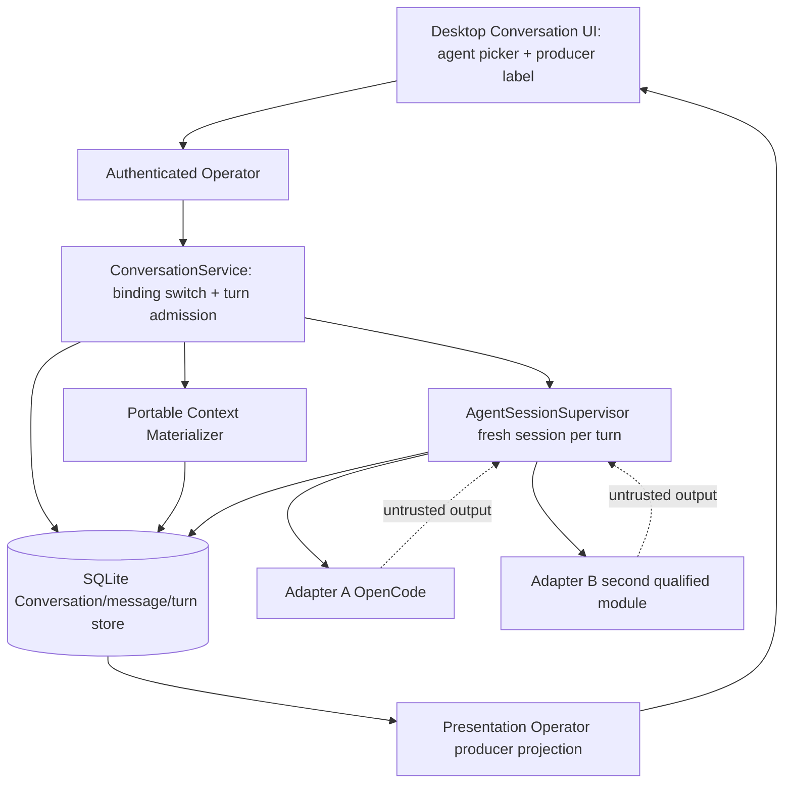

# 004 - Agent Relay on One Conversation

**ID:** 004
**Status:** ACCEPTED/LOCKED
**Owners:** Conversation, Agent Runtime, Product
**Updated:** 2026-11-09
**Revision:** 1.0 (revision 1.0 adds V1 gap coverage per owner acceptance 2026-11-09: Claude Code CLI dispatch arm in AgentSessionSupervisor (B-16), producer identity preserved through the desktop message types, and picker gating on dispatchability and descriptor freshness; new AC-013 to AC-015)
**Owner acceptance:** accepted 2026-11-09 by the repository owner (sarv-projects) via [docs/OWNER-ACCEPTANCE-REVIEW-PACKET.md](../../docs/OWNER-ACCEPTANCE-REVIEW-PACKET.md) (PR #1), including each "ACCEPT (scoped)" caveat as a binding condition.
**Change control:** this contract is locked. Any change to a locked decision, interface or acceptance criterion requires a new revision and renewed owner approval (docs/SPECIFICATION-STANDARD.md §7).
**Target release:** V1 local desktop
**Dependencies:** root ARCHITECTURE.md, docs/V1-PRODUCT-RELEASE-CONTRACT.md, docs/IMPLEMENTATION-MASTER-PLAN.md, and the owner documents named in RESEARCH.md. Feature 001 remains the Conversation send authority.

## 1. Problem

A second native agent is useless if switching agents either shares hidden harness state or drops committed LiteCowork history. Relay is not Task delegation and not a universal router.

Observable outcome: On one Conversation the owner runs a committed turn on agent A, a later turn on agent B that sees only portable context, then returns to A without copying private transcripts or credentials.

## 2. Goals

- Qualify a second AgentModule using feature 002 rules.
- Execute A then B then A as separate turns on one Conversation.
- Build each turn's native input from committed messages, selected Resources and durable references only.
- Show the exact producer agent on every turn.

## 3. Non-goals

- Transfer private native transcripts, hidden reasoning or credentials between harnesses.
- Create a Task or child Attempt merely because the agent changed.
- Silently substitute a model when the selected binding is stale.

## 4. Current evidence

The active checkout has partial Conversation binding-switching and text-only portable-context infrastructure, but no qualified A→B→A relay. The following is a source/route/UI crosswalk, not owner acceptance or release qualification.

| Capability | Current source evidence | Limitation / release meaning |
|---|---|---|
| Per-Conversation agent selection | CODE/SERVED: `PATCH /v1/conversations/{conversationId}/agent-binding`; desktop persists the selected binding for future turns and reports that an already-running session keeps its current agent | This changes the binding used for later turns; it does not prove the selected provider can execute. |
| Per-turn producer pinning | `conversation.turn.created.v2` pins `agent_binding_id`; the backend message projection carries `agent_binding_id` and `agent_session_id` | The desktop `ConversationMessageView` type omits both fields and `parseConversationSnapshot` reconstructs each message without them; the transcript therefore cannot resolve or render the producing agent. AC-005 is not implemented in the UI. |
| Portable context package | CODE: `ConversationContextPackage` is derived from committed messages through the exact USER-message event revision; SYSTEM_NOTICE is excluded; prior AGENT messages carry `source_agent_binding_id`; no native session ID/handle is serialized into the prompt | Internal code schema exists; B-15 is owner-accepted (2026-11-09) but the portable-context schema is not yet promoted into SCHEMAS.md/OpenAPI. Bounds are 1,024 messages / 4 MiB package and 256 KiB native text prompt. |
| Native session isolation | CODE: `AgentSessionSupervisor` reserves and activates a fresh Conversation AgentSession per admitted turn; the OpenCode path creates a new native session | Fresh-session behavior is implemented for the one wired provider; no cross-provider relay is qualified. |
| Provider dispatch | Active supervisor dispatch match supports `provider_key = opencode` only. `CodexAppServer` has a context-aware turn-start method and tests, but its module is used by the Codex profile probe and is not wired into `AgentSessionSupervisor` | No second native adapter. OpenCode's profile probe marks its offer incompatible, so the UI cannot create a new OpenCode binding. Codex can produce a compatible/startable binding but the supervisor returns unsupported for Codex. A→B→A is not possible through the current user flow. |
| Agent picker and descriptor gate | `ConversationsPage` uses `buildConversationAgentChoices`, which filters by Workspace, `enabled` and `leadEligible`. `conversation-agent-surface.ts` implements descriptor/auth checks but has no production import/call site. | The picker does not gate choices by actual supervisor adapter support or fresh descriptor/auth readiness. A Codex binding can appear selectable despite lacking a Conversation dispatch adapter; the descriptor route itself currently returns 503 (see Feature 002). |
| Selected Resources | Domain context package carries `resource_refs`, but `encode_conversation_context_prompt` rejects nonempty refs and RESOURCE blocks with `ResourceMaterializationRequired` | No resource materializer is wired into relay. The composer’s “Add context or file” button is inert. Only text-only committed history can reach the native prompt path. |
| Task separation | Binding selection uses Conversation state/events only; no Task/Attempt/DelegationProfile/Environment/lease is created by changing the Conversation binding | This invariant is reflected in the current route boundary; it does not establish relay availability. |

Code or a passing helper test alone does not qualify the A→B→A user journey. B-15 and B-16 are owner-accepted and this package is ACCEPTED/LOCKED; implementation and qualification status are unchanged by acceptance and are tracked in this §4 and in [docs/IMPLEMENTATION-STATUS.md](../../docs/IMPLEMENTATION-STATUS.md).

Additional source detail checked 2026-11-09: the OpenCode profile is stored with `provider_key` `OPENCODE` while `execute_agent_turn` matches the literal `opencode`, so the one existing arm is not reachable from a probe-created profile either (Feature 002 SPEC §4a; fixed by Feature 002's first task). The Tauri bridge passes the Conversation message JSON through as `serde_json::Value`, so producer fields reach the WebView; they are dropped in TypeScript by `parseConversationSnapshot` (`apps/litecowork-ui/src/conversations/conversation-view.ts`). The OpenAPI `ConversationMessage` schema already declares `agent_binding_id` and `agent_session_id` as nullable strings.

## 5. LOCKED and FLEXIBLE decisions

### LOCKED

- Conversation and Task stay separate.
- Native handles never enter public projections.
- HOST_DELEGATED work belongs to Task Runtime (DELEGATION.md), not to ordinary relay.
- Each turn uses the binding selected for that turn.

### FLEXIBLE

- Module file layout and private helper names, provided the transactions and secret boundaries stay intact.
- Presentation copy, provided state distinctions remain visible.

### ACCEPTED DECISIONS AND ARCHITECTURAL CONTRACTS (owner-accepted 2026-11-09)

These resolutions were accepted as written by the repository owner on 2026-11-09 through [docs/OWNER-ACCEPTANCE-REVIEW-PACKET.md](../../docs/OWNER-ACCEPTANCE-REVIEW-PACKET.md); "ACCEPT (scoped)" caveats are binding conditions. The register of record is [docs/CONTRADICTION-AND-ALIGNMENT-REGISTER.md](../../docs/CONTRADICTION-AND-ALIGNMENT-REGISTER.md) (maintained by the orchestrator).

| ID | Topic | Accepted resolution and architectural contract | Canonical authority and consequence |
|---|---|---|---|
| B-15 | Portable context size and reduction rules for relay | **ACCEPTED (2026-11-09).** Resolution: **Reuse the Feature 001 `ConversationContextPackage` bounds as the portable-context contract, with an explicit portability filter.** The relay export is a pure function of committed Conversation messages ordered by aggregate event revision: pinned Workspace preamble, selected `ResourceRef` digests, then the most recent contiguous messages up to the smaller of 1,024 messages / 4 MiB package and the selected adapter's native text budget (currently 256 KiB encoder bound). CHANNEL content is included as committed semantic history; `SYSTEM_NOTICE`, drafts, native handles, provider credentials and harness-private transcripts are excluded. Over-budget relay refuses with an audited truncation receipt rather than silent drop. Allowed reference kinds are `ResourceRef` and durable `ArtifactRef` only. Retention follows the owning Conversation; relay creates no second store. | [CONTEXT.md](../../docs/CONTEXT.md), [SCHEMAS.md](../../docs/SCHEMAS.md). Prevents leakage of provider-private state across harnesses; the 1,024/4 MiB/256 KiB values are accepted as the V1 bounds and are promoted into SCHEMAS.md and the OpenAPI document together by 004-T01; per the Feature 001 B-07 caveat, the selected adapter's real context budget is confirmed during context-dispatch work and the smaller bound wins. |
| B-16 | Second qualified native route and exact relay semantics | **ACCEPTED (2026-11-09), scoped: agent A is OpenCode v2.0.32 (first route) and agent B is Claude Code CLI (second module, Feature 002 B-11); Codex is a later module.** Original resolution: **The second AgentModule is the first Feature 002 GA route's complement from the same B-02 pair (Claude Code CLI as agent B when OpenCode is agent A), qualified under Feature 002 before any relay claim.** Relay semantics: switching the Conversation binding (`setConversationAgentBinding`) affects future turns only; each admitted turn allocates a fresh Conversation-scoped `AgentSession` through the Feature 001 supervisor; returning to agent A opens a new session and never replays A's prior native handle. No `DelegationProfile`, Attempt, lease or Task lead-handoff event is created. The second adapter must present a dispatch arm in `AgentSessionSupervisor`, not only a profile probe. | [DELEGATION.md](../../docs/DELEGATION.md), [AGENT-CONTROL.md](../../docs/AGENT-CONTROL.md), [STATE-MACHINES.md](../../docs/STATE-MACHINES.md). A profile probe is not a dispatch adapter; no current A→B→A provider pair is wired. The Claude Code dispatch arm is 004-T05; the relay claim waits for Feature 002 to qualify the second module. |

Both rows are owner-accepted and the package is ACCEPTED/LOCKED. Acceptance authorizes implementation only; the second adapter and the cross-provider path are not implemented, served or qualified by acceptance.

## 6. High-level design

UI selects a different enabled binding between turns. Operator admits the next turn only through the feature 001 supervisor with a new session for the newly selected binding. Context materializer exports a portable package and never a native handle.

### Feature-specific component diagram



The portable context materializer and the producer-label projection are the two feature-specific additions; everything else reuses the Feature 001 supervisor and ConversationService owners without redefining them.

### Trust boundaries

The desktop UI is untrusted; the authenticated Operator is the only command path. Agent A's native session handle, private transcript and credentials never cross into agent B's input: the materializer reads only committed semantic messages and durable references and strips every private field. Provider output from either adapter is an untrusted observation, not authority. Native handles and credentials stay in the Runtime-local host binding; SQLite transactions perform no network or process calls.

### Actor sequence (target, not current wiring)

1. Owner runs turn 1; ConversationService pins agent A in `conversation.turn.created.v2` and the Feature 001 supervisor settles it with a fresh session.
2. Owner selects agent B; `setConversationAgentBinding` commits `conversation.agent_binding.changed.v1` (future turns only).
3. Owner submits turn 2; the materializer exports a portable package (committed messages + selected refs, no A handle) and the supervisor allocates a fresh session for B.
4. B settles; its committed AGENT message records `source_agent_binding_id = B`.
5. Owner returns to agent A; turn 3 opens a brand-new A session and sees B's committed messages as ordinary portable history.
6. History reload resolves each turn's producer binding id for display.

### Ownership

| Owner | Responsibility | Excluded responsibility |
|---|---|---|
| Desktop UI | Binding picker, per-turn producer label, draft preservation on stale B | Provider execution, native handles |
| Operator | Auth, Workspace scope, binding-switch and turn-admission validation | Portable-context contents |
| ConversationService | Binding switch commit, turn admission, producer pinning | Parsing raw provider output |
| Portable Context Materializer | Export committed messages + selected refs, strip private state | Native session lifecycle |
| AgentSessionSupervisor (Feature 001) | Fresh session per admitted turn for the selected binding | Cross-session transcript transfer |
| Storage | Atomic binding-switch and message/turn commits, receipts | External process/network calls |

Trust boundary: the desktop UI is untrusted; the authenticated Operator is the only command path; native credentials and OS handles stay outside public events; SQLite transactions do not perform network or process calls.

## 7. Low-level design and interfaces

Turn N+1 input is a pure function of committed Conversation messages, explicit resource refs and artifact refs. Each admitted Conversation turn uses a fresh Conversation-scoped AgentSession. Returning to A does not replay A's prior AgentSession or native handle. Host reuse is a host-supervisor choice and is not reuse of the prior AgentSession. No DelegationProfile is created.

### 7.1 Existing signatures (CODE)

Observed in the active source; existence is CODE evidence, not qualification.

- `setConversationAgentBinding` Operator route `PATCH /v1/conversations/{conversationId}/agent-binding` with `If-Match` + `Idempotency-Key`, committing `conversation.agent_binding.changed.v1` (future turns only).
- `conversation.turn.created.v2` pins `agent_binding_id` for the admitted turn.
- `ConversationContextPackage` builder in `crates/storage-core/src/conversation.rs`: orders by aggregate event revision through the committed USER message, excludes `SYSTEM_NOTICE`, carries `source_agent_binding_id` on prior AGENT messages, bounded at 1,024 messages / 4 MiB.
- `encode_conversation_context_prompt` native encoder in `apps/litecoworkd/src/agents/conversation_prompt.rs`: 256 KiB text bound; rejects nonempty `resource_refs`/RESOURCE blocks with `ResourceMaterializationRequired`.
- `AgentSessionSupervisor::execute_agent_turn` dispatch arm for `provider_key == "opencode"` only.

### 7.2 Accepted target signatures (not yet in source)

Every signature below is an accepted target interface (not yet in source). It is promoted only when its canonical owner document and the OpenAPI/schema change together.

```rust
// Accepted target: portable relay export, pure over committed state.
pub struct PortableRelayExport {
    pub conversation_id: String,
    pub target_binding_id: String,          // agent B
    pub messages: Vec<PortableMessage>,     // committed, revision-ordered
    pub resource_refs: Vec<ResourceRef>,    // reauthorized at dispatch
    pub artifact_refs: Vec<ArtifactRef>,    // durable only
    pub truncation_receipt: Option<TruncationReceipt>,
}

// Accepted target: strips native handles, private transcripts and credentials.
pub trait PortableContextMaterializer: Send + Sync {
    fn export_for_relay(
        &self, principal_id: &str, workspace_id: &str, conversation_id: &str,
        target_binding_id: &str, up_to_turn_version: u64,
    ) -> Result<PortableRelayExport, RelayExportError>;
}

// Accepted target: producer attribution carried into the desktop projection.
pub struct ConversationMessageProducer {
    pub message_id: String,
    pub source_agent_binding_id: Option<String>,
    pub agent_session_id: Option<String>,   // LiteCowork AgentSession id only, never the native handle
}

// Accepted target (004-T05): second dispatch arm in agents/supervisor.rs::execute_agent_turn,
// selected through Feature 002's closed NativeProviderKey instead of a string literal.
match NativeProviderKey::from_profile_key(provider_key) {
    Some(NativeProviderKey::OpenCode) => run_opencode_turn(/* existing arm */),
    Some(NativeProviderKey::ClaudeCode) => run_claude_code_turn(/* fresh native session per turn */),
    _ => Err(unsupported_provider),          // fail closed, never fall back to another binding
}
```

```typescript
// Accepted target (004-T02): apps/litecowork-ui/src/conversations/conversation-view.ts
export type ConversationMessageView = {
  /* existing fields */
  agent_binding_id: string | null;   // producer, from ConversationMessage.agent_binding_id
  agent_session_id: string | null;   // LiteCowork AgentSession id, display/diagnostic only
};
```

Typed errors (accepted target, not yet in source): `RelayExportError::{PrivateFieldPresent, OverBudget, StaleTargetBinding, CrossWorkspaceRef}`.

Ordering: authorize, compare expected version, commit the durable receipt, then perform any external call, then reconcile. Accepted target payload fields stay target-only until the canonical owner document and machine schema change together.

## 8. Data

See [DATA-MODEL.md](DATA-MODEL.md). This feature does not create a second source of truth beside the domain owner.

## 9. Wiring

See [WIRING.yaml](WIRING.yaml). Requests enter through the Operator. External calls sit outside transactions.

## 10. Security

Export filter strips secret refs, native handles and harness-private transcripts. Each binding is revalidated. Cross-workspace refs are rejected.

## 11. Errors and recovery

If B is unavailable, turn admission fails and A's history remains. Partial stream on B settles or fails through 001 rules before another relay. Restart reloads committed turns only.

Races use compare-and-swap or a single-writer occurrence identity. Timeout after an external effect reconciles. Duplicate retries return the original receipt when the idempotency key matches and fail when the payload conflicts.

## 12. Crash and restart

Reload the last committed owner records. Do not infer success from an intent. Reconcile in-flight external work before a new side effect. Cancellation fences late results.

## 13. Configuration and compatibility

Requires two qualified modules from 002. Relay flag is per turn selection, not a workspace mode that forces delegation.

OS qualification is per native desktop. WSL2 does not qualify Windows or Linux GUI behavior.

## 14. Observability

Log ids, versions, statuses and denial reasons. Do not log secret bytes, native handles, private locators or raw credentials. Audit commits include actor, workspace and receipt id.

## 15. EARS acceptance

Positive:
- **AC-001:** WHEN the owner switches from agent A to agent B on the same Conversation, THE SYSTEM SHALL admit B only with a fresh binding revalidation. Verify: binding-switch admission integration test.
- **AC-002:** WHEN B's turn is dispatched, THE SYSTEM SHALL supply portable context from committed messages and selected refs and SHALL NOT supply A's native handle or private transcript. Verify: materializer export unit test asserting excluded fields.
- **AC-003:** WHEN the owner returns to A, THE SYSTEM SHALL preserve B's committed messages in semantic history. Verify: A→B→A transcript continuity test.

Negative:
- **AC-004:** IF B's binding is stale, THEN THE SYSTEM SHALL fail admission and keep the draft without calling A as a fallback. Verify: stale-binding negative test asserting no fallback dispatch.
- **AC-006:** IF the user did not create a Task, THEN THE SYSTEM SHALL NOT create an Attempt, lease or grant because the agent changed. Verify: storage assertion that no Task/Attempt/lease/grant rows are written.

UI and accessibility:
- **AC-005:** WHEN history reloads, THE SYSTEM SHALL show the producer binding id for each committed turn. Verify: desktop projection + render test resolving `source_agent_binding_id`.

Boundary:
- **AC-007:** IF the portable export would exceed the smaller of 1,024 messages / 4 MiB or the selected adapter text budget, THEN THE SYSTEM SHALL refuse or emit an audited truncation receipt and SHALL NOT silently drop committed content. Verify: over-budget boundary test asserting a truncation receipt.

Security:
- **AC-008:** WHEN the portable export is built, THE SYSTEM SHALL reject any cross-Workspace reference and strip credentials, native handles and harness-private transcript before the prompt is encoded. Verify: redaction and cross-workspace rejection tests.

Concurrency:
- **AC-009:** WHILE an agent-A turn is still non-terminal, THE SYSTEM SHALL reject a concurrent agent-B submit on the same Conversation with `CONVERSATION_TURN_IN_PROGRESS` and preserve the draft. Verify: single-flight concurrency test.

Recovery:
- **AC-010:** WHEN the daemon restarts mid-relay, THE SYSTEM SHALL reload only committed turns and SHALL NOT replay A's prior session or re-emit B's uncommitted output. Verify: restart recovery test.

Performance:
- **AC-011:** WHEN a relay turn is admitted, THE SYSTEM SHALL build the portable export within a finite bounded budget and SHALL NOT scan unbounded history. Verify: bounded-build timing/assertion test over a capped prefix.

Producer provenance:
- **AC-012:** WHEN B settles, THE SYSTEM SHALL record `source_agent_binding_id = B` on the committed AGENT message with original provenance preserved for earlier turns. Verify: provenance persistence test.

V1 gap coverage (revision 1.0):
- **AC-013:** WHEN a turn is admitted for a binding whose profile is Claude Code CLI at the Feature 002 pinned version, THE SYSTEM SHALL dispatch it through a Claude Code arm in `AgentSessionSupervisor` that opens a fresh native session, sends only the portable prompt and commits through the Feature 001 final-response path; IF the provider key is not a dispatchable module, THEN THE SYSTEM SHALL fail the turn closed and SHALL NOT dispatch to any other binding. Verify: supervisor dispatch test with a real Claude Code CLI on each release-matrix OS plus an unsupported-key negative test.
- **AC-014:** WHEN Conversation history is loaded into the desktop, THE SYSTEM SHALL carry each message's `agent_binding_id` and `agent_session_id` from the Operator response through the Tauri bridge and `parseConversationSnapshot` into `ConversationMessageView`, and SHALL reject a response whose producer field is malformed rather than drop it silently. Verify: bridge and parser unit tests.
- **AC-015:** WHEN the composer agent picker lists bindings, THE SYSTEM SHALL mark selectable only bindings whose provider has a supervisor dispatch arm and whose descriptor is fresh, and SHALL show every other binding disabled with its exact reason. Verify: picker render test using the daemon projection.

## 16. Executable acceptance command

```bash
python3 .specify/scripts/validate_feature_package.py specs/004-agent-relay
```

Implementation gates are the cargo and pnpm commands named per task in TASKS.md. They are evidence only when run at an identified revision and recorded per TASKS.md "Completion evidence".

## 17. Out-of-bounds

- Do not implement HOST_DELEGATED Task workers here.
- Do not merge native sessions across harnesses.

## 18. Assumptions and open questions

- Depends on 001 turn settlement and 002 second module. Agent A is OpenCode v2.0.32 and agent B is Claude Code CLI (accepted 2026-11-09).
- Default resume policy is new session until an owner qualifies harness resume.

Each blocker was resolved by owner acceptance on 2026-11-09. Implementation is ordered in TASKS.md, from contract promotion in 004-T01 to 004-T12 (package VERIFIED).

## 7a. Owner facts and implementation crosswalk checked 2026-11-06

Read from DELEGATION, STATE-MACHINES, and CONTEXT.

- Ordinary relay is not NATIVE_INTERNAL, HOST_DELEGATED, or CAPABILITY_EXECUTOR. It creates no child Attempt, DelegationProfile, Environment, lease, grant, ResultEnvelope, or capability invocation.
- Relay does not rewrite native instruction files, hooks, skills, plugins, MCP settings, permissions, subagents, or memory.
- enabled=false denies a new Conversation session. lead_eligible=false cannot be the Conversation lead. A disabled binding leaves an already admitted session to ordinary settlement.
- A stale session option returns AGENT_SESSION_OVERRIDE_UNSUPPORTED or AGENT_NATIVE_CONFIG_CHANGED. Quota exhaustion returns AGENT_QUOTA_EXHAUSTED. Every other unavailable binding returns AGENT_UNAVAILABLE with no substitute.
- Switching the Conversation binding does not emit task.lead_agent.changed.v1 and does not build a LeadHandoffPacket.
- `setConversationAgentBinding` is served; it uses `If-Match` and `Idempotency-Key`, commits `conversation.agent_binding.changed.v1`, and affects future turns only. `submitConversationTurn` and `retryConversationTurn` remain Feature 001 operations; this feature adds no relay-only route.
- `conversation.turn.created.v2` pins the binding selected for that turn. Conversation message projections include `agent_binding_id` and `agent_session_id`, but the desktop transcript does not currently display a producer label.
- The active supervisor dispatches only `opencode`. Codex App Server profile-probe code is not a Conversation adapter. Feature 002 marks OpenCode's profile offer incompatible for new binding creation, so there is no current selectable A→B pair.
- The UI picker filters Workspace, enabled and lead eligibility but not adapter dispatchability or fresh descriptor/auth readiness. The descriptor-aware composer helper is not used in production UI.
- The context package builder is internal code, not an owner-approved portable-context contract. It carries message source binding identity, excludes SYSTEM_NOTICE and is bounded at 1,024 messages / 4 MiB; native text encoding is bounded at 256 KiB and rejects RESOURCE/nonempty resource refs until materialized.
- `Add context or file` is a currently inert control. No Resource/Artifact materialization or Context Used receipt is connected to Conversation send.
- No Task/Attempt/DelegationProfile/Environment/lease/grant or Task lead-handoff event is created by ordinary Conversation agent switching.

## 19. Requirement traceability

| Requirement | Canonical contract | Task | Acceptance | Verification method |
|---|---|---|---|---|
| Fresh binding revalidation on switch | AGENT-CONTROL, STATE-MACHINES | 004-T04 | AC-001 | Admission integration test |
| Portable context, no private A state | CONTEXT, SCHEMAS, TRUST | 004-T03 | AC-002 | Materializer export unit test |
| B history preserved on return to A | STATE-MACHINES, API | 004-T04 | AC-003 | Transcript continuity test |
| Stale B fails, no A fallback | AGENT-CONTROL, PRODUCT | 004-T04 | AC-004 | Stale-binding negative test |
| Producer binding id shown | PRESENTATION-RUNTIME, API | 004-T07 | AC-005 | Projection + render test |
| No Task/Attempt on binding change | DELEGATION, STATE-MACHINES | 004-T04 | AC-006 | Storage no-write assertion |
| Over-budget export refuses/receipts | CONTEXT, SCHEMAS | 004-T03 | AC-007 | Boundary over-budget test |
| Cross-workspace/credential stripping | TRUST, STORAGE | 004-T03 | AC-008 | Redaction + rejection tests |
| Single-flight relay admission | STATE-MACHINES, API | 004-T04 | AC-009 | Concurrency test |
| Restart reloads committed only | STORAGE, FAILURE-RECOVERY | 004-T08 | AC-010 | Restart recovery test |
| Bounded export build | CONTEXT, SCHEMAS | 004-T03 | AC-011 | Bounded-build timing test |
| Producer provenance persisted | EVENTS, STORAGE | 004-T02 | AC-012 | Provenance persistence test |
| Claude Code dispatch arm, fail closed otherwise (B-16) | AGENT-CONTROL, Feature 001 supervisor | 004-T05 | AC-013 | Supervisor dispatch test per OS |
| Producer identity preserved in desktop types | API (ConversationMessage), PRESENTATION-RUNTIME | 004-T02 | AC-014 | Bridge + parser tests |
| Picker gated on dispatchability and fresh descriptor | AGENT-CONTROL, NATIVE-COMPOSER-LLD | 004-T06 | AC-015 | Picker render test |
