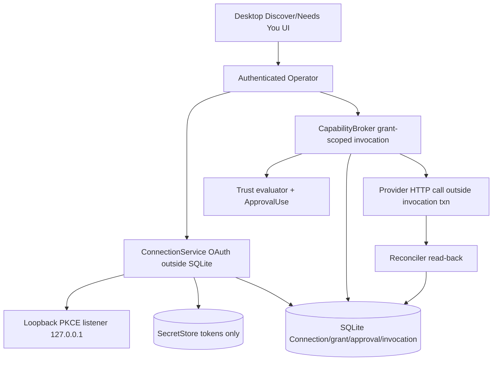

# 006 - Golden Connection and One Capability Write

**ID:** 006
**Status:** ACCEPTED/LOCKED
**Owners:** Connectors, Capability Fabric, Security, LiteSPM boundary, Desktop UI
**Updated:** 2026-11-09
**Revision:** 1.0
**Owner acceptance:** accepted 2026-11-09 by the repository owner (sarv-projects) via [docs/OWNER-ACCEPTANCE-REVIEW-PACKET.md](../../docs/OWNER-ACCEPTANCE-REVIEW-PACKET.md) (PR #1); B-19 and B-20 accepted as written, including B-19's own stop clause.
**Revision note:** revision 1.0 adds V1 gap coverage per owner acceptance 2026-11-09: OS-keystore secret custody with a broker-only resolve path (AC-013), the GitHub host allowlist (AC-014), local revoke with explicit remote-revoke state (AC-015) and the LiteSPM package-lifecycle boundary (AC-016).
**Change control:** this is a locked contract. Any later change to a LOCKED decision, accepted target interface or AC requires a new revision and renewed owner approval (SPECIFICATION-STANDARD §7). Acceptance authorizes implementation only; it is not a claim of implementation, SERVED, INTEGRATED or QUALIFIED status.
**Package boundary:** 006 does NOT own the LiteSPM package lifecycle (observe, adopt, install, update, repair, unmanage, remove, inventory, Discover Managed/Installed tabs, E2E-06). That belongs to new package 013 (litespm-package-lifecycle-bridge). `POST /v1/capabilities/{capability_id}/connect-or-install` stays a fail-closed 503 owned by 013 for its install half; 006 owns only the account Connection, the scoped read/write, approval, reconciliation and revoke.
**Target release:** V1 local desktop. Release matrix rows: Windows 11/10 `x86_64-pc-windows-msvc` first, Linux x86_64 second. OS keystore qualification is per row (Windows Credential Manager, Linux Secret Service).
**Dependencies:** root ARCHITECTURE.md, docs/V1-PRODUCT-RELEASE-CONTRACT.md, docs/IMPLEMENTATION-MASTER-PLAN.md, and the owner documents named in RESEARCH.md. Feature 001 remains the Conversation send authority.

## 1. Problem

Capabilities are not installed merely by appearing in a catalog. Token bytes must not reach the agent. A write with an unknown provider result must not be retried blindly.

Observable outcome: The owner completes one real account Connection, performs one authorized read, then one consequential write with approval, idempotency and reconciliation, and revoke fences later use.

## 2. Goals

- Finish one first-party Connection with SecretStore custody.
- Execute one scoped read and one scoped write through the capability broker.
- Require explicit approval on the write and reconcile UNKNOWN before retry.
- Revoke so later invocations fail closed.

## 3. Non-goals

- Embedding Activepieces, Nango or n8n runtimes.
- Generating operations from OpenAPI without review.
- Multiple providers in this slice.
- Coworker assignment as a substitute for a grant.
- LiteSPM package discovery, install, adopt, update, repair, unmanage or remove (package 013). Installation is not Connection authentication, grant or invocation authority.

## 4. Current evidence

The active checkout contains a Discovery catalog/read projection, a truthful fail-closed package connect/test surface, durable Approval decisions, a narrow Task-planning Resource-read grant, and read-only CapabilityInvocation history. It does not contain a served account Connection lifecycle or a live provider capability-invocation/Effect dispatch path. The following source/route/UI crosswalk is not owner acceptance or release qualification.

| Capability | Current source/route evidence | Limitation / release meaning |
|---|---|---|
| Discover catalog | CODE/SERVED: `GET /v1/discover/search` and `GET /v1/discover/items/{item_id}`; Workspace-scoped, paginated, `no-store` projections with install/auth/compatibility/availability fields and `authoritative=false` | LiteSPM package service is not qualified; public package discovery and installation are not currently available. A catalog row never grants authority. |
| Connect/install action | CODE/SERVED: `POST /v1/capabilities/{capability_id}/connect-or-install` requires local owner Workspace, runtime check and idempotency key | Handler always returns `503 DEPENDENCY_UNAVAILABLE` / `LITESPM_PACKAGE_SERVICE_NOT_QUALIFIED`, creates no receipt and grants no requested scope. This is not OAuth or Connection creation. |
| Capability health test | CODE/SERVED: `POST /v1/capabilities/{capability_id}/test` validates owner/runtime and returns `health=UNKNOWN` with a reason | It deliberately contacts no provider because package/service contract is unqualified. Never display this as connected/healthy. |
| Account Connections | OpenAPI target-only: `GET /connections`, `GET /connections/{connectionId}`, `POST /connections/{connectionId}/disconnect` | No composed daemon handlers were found. No served create/start OAuth, callback, refresh, list/get or disconnect Connection workflow exists. |
| SecretStore | CODE: `OsSecretStore` and write-only `SecretStore` trait exist. A credential-slot route for AgentProfiles is mounted as a different Feature 002 surface | The credential route verifies a current AgentControlDescriptor then deliberately returns 503 before SecretStore write because exact durable replay protection is not ready. This is not the Feature 006 account-Connection OAuth/token lifecycle. |
| Capability grants | CODE/SERVED: `POST /v1/capability-grants` and revoke commit a narrow bounded, expiring Task-planning `workspace.resource.read` grant over explicit Resource refs | No connection-backed provider operation or generic user-approved write grant is served. The route is not the AC-003 golden connector read/write grant lifecycle. |
| Capability invocations | CODE/SERVED read-only `GET /v1/tasks/{task_id}/invocations` and `GET /v1/capability-invocations/{invocation_id}`; SQLite contains transition/reconciliation primitives | The Operator module explicitly says it does not create, transition or dispatch Invocations. Storage rejects transition to DISPATCHED with `INVOCATION_DISPATCH_ADMISSION_UNAVAILABLE`. No CapabilityBroker dispatch/Effect/ApprovalUse transaction is connected. |
| Approval | CODE/SERVED: list/get and `POST /v1/approvals/{approval_id}/resolve`; CAS version, idempotency key, owner/local assurance and exact action-digest confirmation on APPROVE | This is a real exact-Approval state change, not the provider action itself. UI copy explicitly says the decision records the action decision only and does not create a reusable grant or run the action. |
| Trust evaluator and Effect | CODE: pure Trust decision primitive and durable approval/invocation/effect schemas/tests exist | `apps/litecoworkd/src/main.rs` compiles Trust evaluator as `allow(dead_code)` and states the daemon does not wire it; `trust.rs` says CapabilityBroker admission is fail-closed until combined Trust/Effect/audit transaction exists. No actual external write or reconciliation is connected. |
| Desktop Discover/Needs You UI | Discover shows Explore, Installed/native Runtime observations, Managed, and Connections tabs. `connectActionOutcome` disables every row action; Managed says not available; Connections says account connections cannot be read. Needs You ApprovalDetail performs a real exact-digest approval decision | No OAuth form/callback, connected account list, connection details, golden read/write operation chooser, grant-binding UI or connected→granted→invoked lifecycle is present. Approval UI does not execute the approved provider operation. |

Feature 006 is ACCEPTED/LOCKED as a design (owner acceptance 2026-11-09); the current-state matrix above is unchanged by that acceptance. There is no served golden account Connection, no provider-backed read/write, and no capability invocation dispatch. Existing catalog, grant, approval and invocation-record pieces must not be presented as the full connection/capability lifecycle.

Additional current-state facts checked 2026-11-09 for task grounding:

- `SecretStore` (`crates/storage-core/src/trust.rs`) is write-only by design: one `write(workspace_id, secret_kind, secret_bytes) -> SecretRef` method, no read and no delete. `OsSecretStore` (`crates/storage-sqlite/src/trust.rs`) writes through the `keyring` crate (Windows native, Linux Secret Service, macOS keychain features in `crates/storage-sqlite/Cargo.toml`); its private `SecretCredentialBackend` has `set_secret` and `remove_secret`. `SecretKind` is `ApiKey | Token | Password | Other`. `SecretLeaseRecord` and `SecretLeaseStore::issue_secret_lease` are Task/Attempt-scoped.
- `SqliteCapabilityDispatchStore::admit_capability_dispatch` (`crates/storage-sqlite/src/capability_dispatch.rs`) implements the combined Trust + ApprovalUse + Invocation + Effect admission transaction, but its module comment states it fails closed on the current schema because `sqlite-v15.sql` still guards Invocation creation and the first `DISPATCHED` transition. No daemon code constructs it.
- `apps/litecoworkd/src/capability_invocations_operator.rs` mounts only `get_invocation` and `list_task_invocations` and states it does not create, transition or dispatch an Invocation. `crates/storage-sqlite/src/invocations.rs` returns `INVOCATION_DISPATCH_ADMISSION_UNAVAILABLE` on a `DISPATCHED` transition. `domain_invocations::CapabilityInvocationRecord::reconcile_ambiguous_terminal` exists.
- `apps/litecoworkd/Cargo.toml` already depends on `reqwest` 0.12 with `rustls-tls` (no default features), so the brokered HTTP client does not need a new TLS stack.
- The OpenAPI Connection status enum (`docs/schemas/operator-api.openapi.yaml`, `listConnections` filter and the Connection schema) is `CONNECTING, CONNECTED, DEGRADED, REAUTH_REQUIRED, DISCONNECTED`; `REVOKED` is missing.

## 5. LOCKED and FLEXIBLE decisions

### LOCKED

- LiteCowork remains the control plane (CONNECTORS-WORKFLOWS §1).
- Installed, connected, assigned, granted, activated and invoked are distinct.
- Tokens stay in SecretStore; the model never sees them.
- TLS verification stays on; SSRF, redirects, timeouts and byte limits apply (AGENTS.md).
- Package approval is bound to an exact plan digest; agents cannot self-approve.

### FLEXIBLE

- Module file layout and private helper names, provided the transactions and secret boundaries stay intact.
- Presentation copy, provided state distinctions remain visible.

### OWNER-ACCEPTED DECISIONS AND ARCHITECTURAL CONTRACTS

B-19 and B-20 were accepted by the repository owner on 2026-11-09 via [docs/OWNER-ACCEPTANCE-REVIEW-PACKET.md](../../docs/OWNER-ACCEPTANCE-REVIEW-PACKET.md). The register of record is [docs/CONTRADICTION-AND-ALIGNMENT-REGISTER.md](../../docs/CONTRADICTION-AND-ALIGNMENT-REGISTER.md).

| ID | Topic | Status, resolution and architectural contract | Canonical authority and consequence |
|---|---|---|---|
| B-19 | First Connection/provider | **ACCEPTED (2026-11-09): GitHub as the first golden Connection, using a public OAuth client with PKCE and a loopback redirect.** Recipe: authorization-code + PKCE (S256), single-use `state`, loopback listener bound to `127.0.0.1` on an OS-chosen port, callback body carries no token, tokens stored in SecretStore before `status` becomes `CONNECTED`, host allowlist `api.github.com` only, refresh/revoke follow CONNECTORS-WORKFLOWS (`invalid_grant` -> `REAUTH_REQUIRED`, other refresh errors -> `DEGRADED`), minimum read scope `repo:status`/`read:user` for the read and the single write scope needed for B-20. GitHub supports a public desktop client with loopback PKCE, so no confidential client secret ships in the binary. If the chosen provider ever requires a confidential secret or hosted broker, the slice stays blocked. | [CONNECTORS-WORKFLOWS.md](../../docs/CONNECTORS-WORKFLOWS.md), [NETWORK-SECURITY.md](../../docs/NETWORK-SECURITY.md). `REVOKED` must be promoted into the OpenAPI Connection status enum and the schema owner together before implementation. |
| B-20 | First capability write operation | **ACCEPTED (2026-11-09): the one golden write is "create an issue comment" (`POST /repos/{owner}/{repo}/issues/{number}/comments`, GitHub REST v3).** `ConnectorActionDescriptor.operation_class = WRITE`; grant scope is the single comment-write scope distinct from the read grant; approval binds to the immutable plan/action digest (comment target + body hash), not a display name. Provider idempotency is `UNKNOWN` for this endpoint, so the operation blocks and reconciles by listing the issue's comments for a matching client-tagged body before any second call; `UNKNOWN` is never permission to retry. Success evidence is the reconciled comment id. | [CAPABILITY-FABRIC.md](../../docs/CAPABILITY-FABRIC.md), [CAPABILITY-INVOCATIONS.md](../../docs/CAPABILITY-INVOCATIONS.md), [TRUST.md](../../docs/TRUST.md). No generic write permission or model-selected endpoint is acceptable; the golden write operationId must be promoted into the OpenAPI and schema owner together. |

B-19 and B-20 are owner-accepted and the package is ACCEPTED/LOCKED. Implementation and qualification status are unchanged by acceptance and are tracked in §4 and [docs/IMPLEMENTATION-STATUS.md](../../docs/IMPLEMENTATION-STATUS.md).

**Provider source check 2026-11-09 (finding against B-19, owner action needed).** GitHub's current [OAuth app authorization documentation](https://docs.github.com/en/apps/oauth-apps/building-oauth-apps/authorizing-oauth-apps) supports PKCE (`code_challenge_method=S256` only) and loopback redirects on any port (`http://127.0.0.1:{port}/path`), which matches B-19. The same page lists `client_secret` as required for the web-flow code exchange and for refresh of non-device-flow tokens; only the device flow omits it. GitHub's [token revocation endpoint](https://docs.github.com/en/rest/apps/oauth-applications) (`DELETE /applications/{client_id}/token`) needs Basic auth with the client secret. Token exchange and refresh go to `github.com/login/oauth/access_token`, not `api.github.com`. Under B-19's own clause ("If the chosen provider ever requires a confidential secret or hosted broker, the slice stays blocked") the web-flow recipe is blocked as currently documented. Options for the owner (a new revision, renewed approval): (a) the GitHub device flow (RFC 8628) with a public client id, no client secret and no loopback listener; (b) treat a desktop-embedded client secret as non-confidential, with the risk recorded; (c) a different first provider. Task 006-T02 holds this decision; nothing in this revision selects an option. Revocation in every option is local first (keystore delete and fence); remote revocation without a client secret is an owner action at `https://github.com/settings/connections/applications/{client_id}` and is shown as such (AC-015).

## 6. High-level design

UI starts connect. ConnectionService holds the OAuth dance outside SQLite. SecretStore writes tokens. CapabilityBroker loads only a grant-scoped invocation. The provider HTTP call is outside the invocation transaction. Effect settlement records the reconciled receipt.

### Feature-specific component diagram



The ConnectionService OAuth/loopback path, the CapabilityBroker dispatch transaction and the reconciler read-back are the feature-specific components; Connection records, operation classes and Trust decisions remain owned by CONNECTORS-WORKFLOWS/CAPABILITY-FABRIC/TRUST and are not redefined.

### Trust boundaries

The desktop UI is untrusted; the authenticated Operator is the only command path. Provider token bytes live only in SecretStore and never enter Conversation, events, logs or the agent-visible context; only an opaque Connection id is visible. TLS verification stays on; SSRF, redirect, timeout and byte limits apply; worker egress rejects loopback, private, link-local, multicast and cloud-metadata destinations even if a grant names them. External dispatch waits until one transaction rechecks owner, lease, grant, activation, Trust decision and exact ApprovalUse. SQLite transactions make no network or process call.

### Actor sequence (target)

1. Owner starts connect; ConnectionService runs PKCE OAuth over the loopback listener outside SQLite.
2. Tokens are written to SecretStore; only then does `status` become `CONNECTED`; a failed commit purges the new secrets.
3. Owner performs one scoped read requiring an explicit grant distinct from the Connection record.
4. Owner requests the golden write; a fresh approval binds to the exact plan/action digest.
5. The broker commits the invocation admission transaction, then makes the provider HTTP call outside the transaction.
6. On `UNKNOWN`, the reconciler reads back before any retry; on revoke, later reads/writes fail closed.

### Ownership

| Owner | Responsibility | Excluded responsibility |
|---|---|---|
| Desktop UI | Connect flow, read/write chooser, approval decision | Executing the provider operation |
| Operator | Auth, Workspace scope, route validation | Holding token bytes |
| ConnectionService | OAuth/PKCE, loopback, SecretStore custody, refresh/revoke | Capability invocation authority |
| SecretStore | Token custody write-only | Echoing secret bytes |
| CapabilityBroker | Grant-scoped invocation admission, dispatch, reconcile | Self-approval |
| Trust evaluator | ApprovalUse and operation-class decision | UI boolean shortcuts |
| Storage | Atomic Connection/grant/approval/invocation commits | External process/network calls |

Trust boundary: the desktop UI is untrusted; the authenticated Operator is the only command path; native credentials and OS handles stay outside public events; SQLite transactions do not perform network or process calls.

## 7. Low-level design and interfaces

Follow CONNECTORS-WORKFLOWS Connection record and ConnectionService. One read operation and one write operation are named only after B-20. Approval is a Trust decision, not a UI boolean. LiteSPM may supply the package; it does not grant use.

### 7.1 Existing signatures (CODE)

- Served: `GET /v1/discover/search`, `GET /v1/discover/items/{item_id}`, `POST /v1/capabilities/{capability_id}/connect-or-install` (returns 503 `LITESPM_PACKAGE_SERVICE_NOT_QUALIFIED`), `POST /v1/capabilities/{capability_id}/test` (returns `health=UNKNOWN`), Approval list/get/`POST /v1/approvals/{approval_id}/resolve`, `POST /v1/capability-grants` + revoke (`workspace.resource.read` only), `GET /v1/tasks/{task_id}/invocations`, `GET /v1/capability-invocations/{invocation_id}`.
- `OsSecretStore` + write-only `SecretStore` trait. Trust evaluator compiled `allow(dead_code)`; SQLite invocation store rejects transition to `DISPATCHED` with `INVOCATION_DISPATCH_ADMISSION_UNAVAILABLE`.
- Event: `connection.state.changed.v1`. Connection list/get/disconnect are target-only.

### 7.2 Accepted target signatures (not yet in source)

Every signature below is an accepted target interface (not yet in source). It becomes source only when its canonical owner document and the OpenAPI/schema change are promoted together (task 006-T01). If 006-T02 changes the OAuth recipe, `BeginConnection` and `LoopbackCallback` change with it in a new revision.

```rust
// Accepted target (not yet in source): PKCE loopback OAuth; tokens to SecretStore before CONNECTED.
pub struct BeginConnection {
    pub principal_id: String,
    pub workspace_id: String,
    pub provider_id: String,                 // e.g. "github"
    pub pkce_challenge: PkceChallenge,        // S256
    pub state: SingleUseState,
    pub minimum_scopes: Vec<String>,
}

pub trait ConnectionService: Send + Sync {
    fn begin_connection(&self, begin: BeginConnection) -> Result<ConnectionPending, ConnectError>;
    fn finish_connection(&self, callback: LoopbackCallback) -> Result<CommittedConnection, ConnectError>;
    fn disconnect(&self, principal_id: &str, connection_id: &str) -> Result<(), ConnectError>;
}

// Accepted target (not yet in source): one golden write, approval bound to the action digest.
pub struct GoldenWriteInvocation {
    pub connection_id: String,               // opaque
    pub operation_class: OperationClass,      // WRITE
    pub action_digest: ActionDigest,          // target + body hash
    pub idempotency: ProviderIdempotency,     // UNKNOWN for this endpoint
    pub approval_use: ApprovalUse,
}
```

Typed errors (accepted target, not yet in source): `ConnectError::{Cancelled, StateReplay, SecretCommitFailed, HostNotAllowlisted}`; `InvocationError::{SelfApprovalDenied, UnknownResultBlocked, GrantMissing, ConnectionRevoked}`.

Ordering: authorize, compare expected version, commit the durable receipt, then perform any external call, then reconcile. Payload fields stay accepted target interfaces until the canonical owner document and machine schema change together.

Secret custody (accepted target interface, not yet in source): the public `SecretStore` stays write-only. A daemon-internal `ConnectionSecretBroker` in `apps/litecoworkd` resolves token bytes only inside the brokered HTTP call for an admitted Invocation, using a new non-public `SecretResolver` port implemented beside `OsSecretStore`, and zeroizes after the request. A `SecretStore` delete operation (`remove(secret_ref)`) is added for revoke. Neither the resolver nor the bytes are reachable from an Operator route, a Tauri command, an event or an agent tool.

## 8. Data

See [DATA-MODEL.md](DATA-MODEL.md). This feature does not create a second source of truth beside the domain owner.

## 9. Wiring

See [WIRING.yaml](WIRING.yaml). Requests enter through the Operator. External calls sit outside transactions.

## 10. Security

Opaque Connection id only in agent-visible context. No token bytes in events, logs or prompts. Redirect and host allowlists. Revocation fences refresh and invoke.

## 11. Errors and recovery

Cancelled OAuth leaves no Connection. Refresh serialization avoids stampeding the provider. UNKNOWN write blocks retry until reconciliation. Restart reloads Connection status without printing tokens.

Races use compare-and-swap or a single-writer occurrence identity. Timeout after an external effect reconciles. Duplicate retries return the original receipt when the idempotency key matches and fail when the payload conflicts.

## 12. Crash and restart

Reload the last committed owner records. Do not infer success from an intent. Reconcile in-flight external work before a new side effect. Cancellation fences late results.

## 13. Configuration and compatibility

One provider. Public desktop OAuth with loopback and PKCE where the provider allows it; otherwise the slice stays blocked rather than embedding a confidential cloud gateway (see the 2026-11-09 provider source check in §5).

Host allowlist: provider API calls go only to `https://api.github.com`. The OAuth token exchange and refresh endpoint `https://github.com/login/oauth/access_token` is a separate allowlisted auth endpoint used only by ConnectionService, never by an Invocation. The authorize URL opens in the system browser. No other host, scheme, port or redirect target is reachable.

Release rows: the Connection and write qualify per row, Windows x64 first (Windows Credential Manager through `keyring` `windows-native`), Linux x64 second (Secret Service through `linux-native-sync-persistent`). A row whose keystore is unavailable shows Connect as UNAVAILABLE; there is no plaintext fallback. Open question: if the golden write must run as a Task Attempt that needs an admitted Environment, E2E-05 inherits the 005 Windows-row UNAVAILABLE posture (B-17 rider) until B-35; see §18.

OS qualification is per native desktop. WSL2 does not qualify Windows or Linux GUI behavior.

## 14. Observability

Log ids, versions, statuses and denial reasons. Do not log secret bytes, native handles, private locators or raw credentials. Audit commits include actor, workspace and receipt id.

## 15. EARS acceptance

Positive:
- **AC-003:** WHEN a read runs, THE SYSTEM SHALL require an explicit grant distinct from the Connection record. Verify: grant-required read test.
- **AC-004:** WHEN a write is requested, THE SYSTEM SHALL require a fresh approval bound to the exact plan digest before invocation. Verify: approval-digest binding test.

Security:
- **AC-001:** WHEN the owner starts connect, THE SYSTEM SHALL keep provider token bytes out of Conversation, events and logs. Verify: token-redaction assertion across events/logs/prompt.
- **AC-007:** IF an agent requests install or approval of its own write, THEN THE SYSTEM SHALL deny self-approval. Verify: self-approval denial test.
- **AC-008:** WHEN a worker egress target is loopback, private, link-local, multicast or cloud-metadata, THE SYSTEM SHALL reject it and SHALL NOT let a grant exempt those classes; TLS downgrade is refused and every redirect is revalidated. Verify: SSRF/redirect/TLS egress matrix.

Negative:
- **AC-002:** IF the owner cancels auth, THEN THE SYSTEM SHALL persist no usable Connection. Verify: cancelled-OAuth negative test (AuthAttempt CANCELLED, no Connection).
- **AC-006:** WHEN the owner revokes the Connection, THE SYSTEM SHALL fail later reads and writes for that Connection id. Verify: revoke-fencing test.

Recovery:
- **AC-005:** IF the provider result is UNKNOWN, THEN THE SYSTEM SHALL reconcile before retry and SHALL NOT emit a second consequential call meanwhile. Verify: UNKNOWN reconcile-before-retry test.

Concurrency:
- **AC-009:** WHILE a token refresh is in flight, THE SYSTEM SHALL hold a per-connection lock so concurrent refreshes do not stampede the provider, mapping `invalid_grant` to `REAUTH_REQUIRED` and other failures to `DEGRADED`. Verify: concurrent-refresh lock test.

Boundary:
- **AC-010:** WHEN the golden write body or target exceeds the declared bound, THE SYSTEM SHALL reject the invocation before any provider call. Verify: payload-bound test.

UI and accessibility:
- **AC-011:** WHEN connection and capability states are shown, THE SYSTEM SHALL present connected, granted, approved and invoked as distinct states and SHALL NOT present a catalog row or `health=UNKNOWN` as connected or healthy. Verify: Discover/Needs You render test.

Performance:
- **AC-012:** WHEN the OAuth callback arrives, THE SYSTEM SHALL honor a finite listener deadline and single-use state so a late or replayed callback is refused. Verify: callback deadline/replay test.

V1 gap coverage (revision 1.0):
- **AC-013:** WHEN a Connection completes, THE SYSTEM SHALL write access and refresh tokens only to the OS keystore through `OsSecretStore` before status becomes CONNECTED, SHALL refuse to connect when the keystore is unavailable, and SHALL resolve token bytes only inside the daemon broker for an admitted Invocation. Verify: keystore-unavailable negative test, no-plaintext-fallback test and resolver reachability test.
- **AC-014:** WHEN the broker or ConnectionService makes an HTTP request, THE SYSTEM SHALL allow only `https://api.github.com` for Invocations and only the GitHub OAuth token endpoint for ConnectionService, and SHALL refuse any other host, scheme, port or redirect target. Verify: allowlist and redirect matrix test.
- **AC-015:** WHEN the owner revokes a Connection, THE SYSTEM SHALL commit REVOKED, delete the keystore entries, fence in-flight and later Invocations, and SHALL show remote revocation as either confirmed or "owner action required" with the GitHub settings link, never as done when unconfirmed. Verify: revoke test with remote-revoke unavailable and keystore-delete failure cases.
- **AC-016:** WHEN the owner connects GitHub, THE SYSTEM SHALL NOT install, adopt or mutate any LiteSPM package, and `connect-or-install` SHALL keep returning its fail-closed 503 until package 013 qualifies. Verify: route regression test and no-LiteSPM-call assertion.

## 16. Executable acceptance command

```bash
python3 .specify/scripts/validate_feature_package.py specs/006-golden-connection-capability-write
```

Further gates after ACCEPTED/LOCKED are the cargo filters named in TASKS.md. They are not evidence until run on a recovered source tree.

## 17. Out-of-bounds

- Do not enable arbitrary URLs from the model.
- Do not ship a workflow-builder canvas in this slice.

## 18. Assumptions and open questions

- Provider choice is decided (B-19 accepted: GitHub). The OAuth recipe conflicts with current GitHub documentation on the client secret (§5 source check); the owner must pick an option in 006-T02 before connection code starts.
- GitHub OAuth app scopes are coarse: commenting on an issue needs `public_repo` (public repositories) or `repo` (private). The LiteCowork CapabilityGrant, not the provider scope, is the narrow control; the UI states the provider scope plainly.
- Open: does the golden write run inside a Task Attempt? CONVERSATION and TASK_PLANNING Invocations are read-only (§7a), so the write needs a Task. If Task Attempt admission requires an admitted Environment even for a broker-only STRUCTURED_API Step, E2E-05 on the Windows row is UNAVAILABLE until 005's B-35 qualifies. Owners: Trust and Environments. Recorded in 005 SPEC §18 as well.
- Historical connector code in the archive is not served evidence.

Accepted decisions are recorded in §5. Implementation tasks: 006-T01 through 006-T17 in [TASKS.md](TASKS.md).

## 7a. Owner facts and implementation crosswalk checked 2026-11-06

Read from CONNECTORS-WORKFLOWS, CAPABILITY-INVOCATIONS, CAPABILITY-FABRIC, and NETWORK-SECURITY.

- Connection.status in CONNECTORS-WORKFLOWS is CONNECTING, CONNECTED, DEGRADED, REAUTH_REQUIRED, REVOKED, or DISCONNECTED. The OpenAPI Connection status enum omits REVOKED. Promote that value into the schema and API owner together before implementation. account_display_hint is not authenticated identity.
- The loopback listener binds only 127.0.0.1 on an OS-chosen port. state is single-use. The callback body contains no token. Secrets are stored before status becomes CONNECTED. A failed Connection commit purges the new secrets. Plaintext fallback is forbidden.
- Cancelled OAuth records AuthAttempt CANCELLED and persists no Connection. The first terminal callback wins.
- Refresh holds a per-connection lock. invalid_grant or provider revocation becomes REAUTH_REQUIRED. Other refresh failures become DEGRADED. Refresh does not delete historical Effects and does not start a consequential retry.
- ConnectorActionDescriptor.operation_class is READ, WRITE, SEND, DELETE, PURCHASE_LIKE, or ADMIN. A package READ label cannot override Trust classification. Idempotency is PROVIDER_KEY, CLIENT_KEY, READ_ONLY, or UNKNOWN.
- CapabilityInvocation.execution_method is STRUCTURED_API, STRUCTURED_BROWSER, ACCESSIBILITY_BROWSER, SCREEN_COMPUTER_USE, DETERMINISTIC_LOCAL, NATIVE_AGENT_TOOL, or UNKNOWN. Status includes AMBIGUOUS, which is non-terminal. A timeout is not completion. CONVERSATION and TASK_PLANNING invocations are read-only.
- Credential-like elicitation fails with SENSITIVE_INPUT_UNSUPPORTED. Unknown MCP methods, including sampling, fail with PROVIDER_INPUT_UNSUPPORTED and do not become a UserRequest.
- Worker egress rejects loopback, private, link-local, multicast, and cloud-metadata destinations. A Task grant cannot exempt those classes. Every redirect is revalidated. TLS downgrade is forbidden.
- External dispatch waits until one transaction rechecks owner, lease, grant, activation, Trust decision, and exact ApprovalUse. A PROPOSED Effect is not a dispatch permit.
- Cite listConnections, getConnection, disconnectConnection, createCapabilityGrant, revokeCapabilityGrant, resolveApproval. Event: connection.state.changed.v1. No golden-provider write operationId exists until B-20.


## 7b. Current source and UI boundary checked 2026-11-06

- The composed router serves Discover search/detail, capability connect-or-install, capability test, Approval list/get/resolve, capability-grant create/revoke, Task invocation list and individual invocation get. The served route inventory does not mount the Connection list/get/disconnect operations; those remain target-only.
- `connect_or_install_capability` returns `503 DEPENDENCY_UNAVAILABLE` with `LITESPM_PACKAGE_SERVICE_NOT_QUALIFIED`, does not create a durable receipt and explicitly returns `requested_scope_granted=false`. `test_capability_connection` returns `health=UNKNOWN` and does not contact a provider.
- `DiscoverPage` presents Explore, Installed/native, Managed and Connections. Explore labels Workspace-local skills and states public package discovery unavailable. Installed/native shows only Runtime-reported capability hosts, not a complete native installation scan. Managed and Connections both render explicit not-available panels. Every row action is disabled by `connectActionOutcome`; it never enables Connect/Use/Open.
- `CapabilityInvocation` API source declares this module does not create, transition or dispatch Invocations. It serves GET only. The SQLite invocation store rejects transition to DISPATCHED with `INVOCATION_DISPATCH_ADMISSION_UNAVAILABLE`; it can record/reconcile local observations, but not admit provider dispatch.
- `apps/litecoworkd/src/trust.rs` explicitly says the policy evaluator does not dispatch providers, issue grants/SecretLeases or create an independently reusable permit; CapabilityBroker admission remains fail-closed until the combined authorization/Effect/audit transaction is implemented. `main.rs` compiles `trust` behind `allow(dead_code)` and says it is not wired.
- A local OS `OsSecretStore` implementation and write-only SecretStore trait exist. The mounted AgentProfile credential-slot route is Feature 002, not an account Connection flow; after checking the current descriptor it returns 503 before writing because exact replay protection is incomplete. No OAuth callback/Connection refresh/Connection SecretStore path is served.
- Approval list/get/resolve are real. Approval resolution requires current version, idempotency key, local owner assurance and exact `confirmation_digest` for APPROVE, then commits `approval.resolved.v1`. Needs You ApprovalDetail uses this route and preserves the original decision request ID for replay. The UI says an Approval decision records the exact-action decision only; it neither grants reusable capability authority nor runs the provider operation.
- The only served CapabilityGrant creation route is the Task-planning Resource-read grant path (`workspace.resource.read`) over explicitly enumerated Resource refs. It does not issue the Feature 006 connector read/write scope or a general invocation grant.
- No provider-backed connector read or write was executed in this audit. No Connection was created, no OAuth was started, no token was stored through a Connection flow, no CapabilityInvocation was dispatched, and no external Effect was reconciled.
## 19. Requirement traceability

| Requirement | Canonical contract | Task | Acceptance | Verification method |
|---|---|---|---|---|
| Tokens out of chat/events/logs | NETWORK-SECURITY, CONNECTORS-WORKFLOWS | 006-T05 | AC-001 | Token-redaction assertion |
| Cancelled auth persists no Connection | CONNECTORS-WORKFLOWS | 006-T05 | AC-002 | Cancelled-OAuth test |
| Read requires explicit grant | CAPABILITY-FABRIC, TRUST | 006-T08 | AC-003 | Grant-required read test |
| Write requires fresh digest approval | TRUST, CAPABILITY-INVOCATIONS | 006-T09 | AC-004 | Approval-digest test |
| UNKNOWN reconcile before retry | CAPABILITY-INVOCATIONS, TRUST | 006-T10 | AC-005 | Reconcile-before-retry test |
| Revoke fences later use | CONNECTORS-WORKFLOWS | 006-T11 | AC-006 | Revoke-fencing test |
| Deny self-approval | TRUST | 006-T09 | AC-007 | Self-approval denial test |
| SSRF/redirect/TLS egress guard | NETWORK-SECURITY | 006-T04 | AC-008 | Egress matrix |
| Per-connection refresh lock | CONNECTORS-WORKFLOWS | 006-T06 | AC-009 | Concurrent-refresh test |
| Golden write payload bound | CAPABILITY-FABRIC | 006-T09 | AC-010 | Payload-bound test |
| Distinct connection/capability states | PRESENTATION-RUNTIME, contracts/ui-behavior.md | 006-T13 | AC-011 | Render test |
| Callback deadline + single-use state | CONNECTORS-WORKFLOWS, NETWORK-SECURITY | 006-T05 | AC-012 | Callback deadline/replay test |
| OS-keystore custody, broker-only resolve | TRUST, NETWORK-SECURITY | 006-T03 | AC-013 | Keystore-unavailable + resolver reachability tests |
| GitHub host allowlist | NETWORK-SECURITY, CONNECTORS-WORKFLOWS | 006-T04 | AC-014 | Allowlist and redirect matrix |
| Local revoke with explicit remote-revoke state | CONNECTORS-WORKFLOWS | 006-T11 | AC-015 | Revoke failure-case tests |
| No LiteSPM lifecycle in 006 | LITESPM-LITECOWORK-INTEROP-LLD, AGENTS.md §6 | 006-T12 | AC-016 | Route regression + no-LiteSPM-call assertion |
