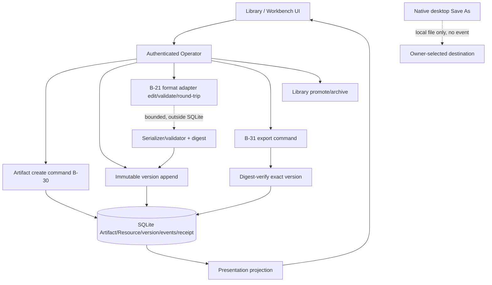

# 007 - Professional Artifacts One Format

**ID:** 007
**Status:** ACCEPTED/LOCKED
**Owners:** Artifacts, Presentation, Storage, Desktop UI
**Updated:** 2026-11-09
**Revision:** 1.0 (revision 1.0 adds V1 gap coverage per owner acceptance 2026-11-09: declared format capability matrix with DOCX/XLSX/PPTX/PDF read-only or unsupported, and Conversation association of Artifacts; AC-016 to AC-019)
**Owner acceptance:** accepted 2026-11-09 by the repository owner (sarv-projects) via [docs/OWNER-ACCEPTANCE-REVIEW-PACKET.md](../../docs/OWNER-ACCEPTANCE-REVIEW-PACKET.md) (PR #1), including each scoped caveat as a binding condition. Acceptance authorizes implementation; it is not a claim of implementation, SERVED, INTEGRATED or QUALIFIED status.
**Change control:** a change to a locked contract in this package from now on requires a new revision and renewed owner approval (SPECIFICATION-STANDARD §7).
**Target release:** V1 local desktop
**Dependencies:** root ARCHITECTURE.md, docs/V1-PRODUCT-RELEASE-CONTRACT.md, docs/IMPLEMENTATION-MASTER-PLAN.md, docs/ARTIFACTS-EVIDENCE.md, docs/PRESENTATION-RUNTIME.md, Feature 003 Resource admission, Feature 005 Task execution for Task-generated outputs, and the owner documents named in RESEARCH.md. Feature 001 remains the Conversation send authority.

## 1. Problem

Library cannot claim editing it does not have. Semantic answer text must survive if rich rendering fails. Interactive apps are a separate runtime.

Observable outcome: The owner creates, revises, exports and reopens one professional deliverable and can see provenance and version differences.

## 2. Goals

- Persist Artifact identity, immutable versions and provenance.
- Qualify one format for real edit, save, export and reopen across restart.
- Show version differences and source provenance.
- Keep semantic Conversation content when presentation fails.
- Declare one format capability matrix (view, edit, export, compare per media type) that drives every Artifact control; DOCX, XLSX, PPTX and PDF render read-only or unsupported in V1 (release contract §4) (V1 gap coverage, revision 1.0).
- Associate Artifacts created from a Conversation with that Conversation and source message, visible in both directions (V1 gap coverage, revision 1.0).

## 3. Non-goals

- Every office format in one slice.
- Interactive artifact execution (separate runtime; inert until qualified).
- Using preview of one format as proof of editing another.

## 4. Current evidence

The active checkout has a real Artifact read/Library/version model and a narrow immutable text-version append path. It does not implement general Artifact creation/publication, a format-specific professional editor, or a durable export-receipt flow. The matrix below is a source/route/UI crosswalk, not owner acceptance or release qualification.

| Capability | Current source/route evidence | Limitation / release meaning |
|---|---|---|
| Artifact identity and immutable versions | CODE: `ArtifactRecord`, `ArtifactVersionRecord`, Resource/ResourceRevision correspondence, immutable content/provenance fields, dependency edges and read/write storage traits exist | Production daemon/store has no Artifact create method or route. Existing Artifact rows in tests are seeded directly; a fresh install may have no Artifact records. |
| Artifact create and generation | Canonical `docs/ARTIFACTS-EVIDENCE.md` defines `ArtifactStore.create()` and atomic creation of Artifact + ARTIFACT Resource + revision 1 + version 1 + events | TARGET only in this checkout. No `POST /v1/artifacts`, Artifact creation operator, or production `artifact.created.v1` event producer was found. `artifact.created.v1` exists in the schema/events registry but is not emitted by the active producer path. |
| Artifact version append | CODE/SERVED: `POST /v1/artifacts/{artifact_id}/text-version`; storage stages and verifies UTF-8 text, then atomically appends ResourceRevision + ArtifactVersion + events + idempotency receipt | This is a user-authored `text/plain` append to an already existing managed Artifact, capped at 1 MiB. It is not a general generated-output/format adapter, and it rejects external-resource content. |
| Library lifecycle | CODE/SERVED: list all, list SAVED Library, promote TRANSIENT→SAVED, archive SAVED→ARCHIVED; expected aggregate version and idempotency receipt | No create button or conversion from uploaded Resource to Artifact exists in the Library UI. Promotion/archive change metadata only; they do not create or export content. |
| Exact-version read and provenance | CODE/SERVED: artifact list/detail, exact version metadata/content, Task output list, input refs, provider/provenance, Attempt and verification references | Evidence refs are shown as references; this UI does not evaluate assurance. A missing verification ref is not verified output. |
| Preview support | UI previews bounded (≤1 MiB) managed text formats: plain text, Markdown, CSV/TSV, JSON, XML and YAML variants; restricted CSV/Markdown rendering is used | Preview is not edit support. PDF/Office/image content does not become editable because the Library accepts/imports it as a Resource. External linked content remains unavailable until provider resolution. |
| Editing and restore | CODE/UI: edit only managed `text/plain` Artifacts ≤1 MiB, optimistic head checks, draft preservation/rebase on conflict, idempotent publish; historical text can be restored as a new immutable version | No DOCX/XLSX/PPTX/PDF/HTML editor or structured document round-trip exists. Markdown/CSV/JSON can be previewed but are not enabled in the text edit route. `restored_from` provenance is not persisted. |
| Native Save As | CODE/UI: save exact selected MANAGED_BLOB version ≤10 MiB, revalidate Artifact/version/ResourceRevision/digest/media/size, native picker, authenticated content read, atomic same-directory write | This is a local native Save As/download, not the target export API. It creates no new Artifact/Resource version, domain event or durable ExportReceipt. Cancelled picker fetches no bytes/touches no destination. Linked external content is not saved through this path. |
| Export receipt | Canonical target asks for an export receipt distinct from version commit | No export receipt record, event, Operator route or UI history was found. The UI reports local Save As as SAVED/CANCELLED only. |
| Task-produced outputs | `GET /v1/tasks/{task_id}/artifacts` and `TaskArtifactOutputs` render committed output records read-only | Feature 005 currently cannot dispatch a Task/Attempt/Environment or create the general Artifact output. This UI is a consumer, not an Artifact generator. |
| Office/format engine | `environment_office_qualification.rs` has format-specific capability/OS observations for DOCX/XLSX/PPTX/PDF | These are readiness probes, not parsers/editors/exporters. No active DOCX/XLSX/PPTX/PDF editing engine or verified round-trip was found. ZIP intake is source-build/Linux-only, not Office extraction/publication. |
| Library and Workbench UI | `ArtifactLibrary` lists SAVED/TRANSIENT/ARCHIVED records; `ArtifactWorkbench` versions/compares/previews/edits text/promotes/archives/Saves As. Work Task outputs opens the same Workbench read-only | The current UI is a viewer/version manager with narrow user text editing. It cannot originate an Artifact or author a professional Office/PDF deliverable. |

Feature 007 is ACCEPTED/LOCKED (owner-accepted 2026-11-09); acceptance does not change the evidence above, which is also tracked in [docs/IMPLEMENTATION-STATUS.md](../../docs/IMPLEMENTATION-STATUS.md). The stated journey (create, revise, export, reopen one professional deliverable) is not implemented end to end: Artifact creation, one accepted format engine, and a durable export receipt are missing. Existing immutable version, metadata, narrow text-edit, Library and native Save As features are real but narrower. `ArtifactRecord` (`crates/storage-core/src/artifact.rs`) carries `task_id` but no Conversation or message link, so no Conversation association exists.

## 5. LOCKED and FLEXIBLE decisions

### LOCKED

- ArtifactStore is the owner of bytes and versions (ARTIFACTS-EVIDENCE).
- Presentation does not own persistence (PRESENTATION-RUNTIME).
- Format support must be declared viewable, editable, exportable or unsupported (release contract).
- Provenance links Conversation or Task and source revisions.

### FLEXIBLE

- Module file layout and private helper names, provided the transactions and secret boundaries stay intact.
- Presentation copy, provided state distinctions remain visible.

### Decision history

B-21 (first format), B-30 (create authority) and B-31 (export receipt) were open blockers in revision 0.3. The owner accepted the resolutions below on 2026-11-09. They remain independent: the format choice does not create a create route or an export receipt by itself, and each has its own tasks.

### ACCEPTED DECISIONS AND ARCHITECTURAL CONTRACTS

These resolutions were accepted as written by the repository owner on 2026-11-09 via [docs/OWNER-ACCEPTANCE-REVIEW-PACKET.md](../../docs/OWNER-ACCEPTANCE-REVIEW-PACKET.md). The register rows in [docs/CONTRADICTION-AND-ALIGNMENT-REGISTER.md](../../docs/CONTRADICTION-AND-ALIGNMENT-REGISTER.md) are closed by the orchestrator, not by this package. They are independent: a format choice does not by itself create an Artifact create route or an export receipt.

| ID | Topic | Accepted resolution and architectural contract | Canonical authority and consequence |
|---|---|---|---|
| B-21 | First professional Artifact deliverable format | **ACCEPTED (2026-11-09): Markdown document (`text/markdown`, CommonMark + GFM tables) as the first qualified professional format, with a deterministic in-process serializer/validator and no external Office engine in the first slice.** The format has an exact ID (`text/markdown`), a declared parser/serializer (CommonMark-compliant, GFM table extension), supported operations (view/edit/export/reopen/compare), a deterministic round-trip check (parse -> AST -> re-serialize -> byte-stable canonical form), a 1 MiB input bound and a 10 MiB export bound, and an explicit `UNSUPPORTED_FORMAT` result for any other media. Preview availability of CSV/JSON/YAML/XML does NOT make them editable; they stay read-only until separately qualified. DOCX/XLSX/PPTX/PDF remain read-only/unsupported in this slice; an Office-readiness probe is not an engine. | [ARTIFACTS-EVIDENCE.md](../../docs/ARTIFACTS-EVIDENCE.md), [V1-PRODUCT-RELEASE-CONTRACT.md](../../docs/V1-PRODUCT-RELEASE-CONTRACT.md) area 9. The exact engine/version and round-trip fidelity criteria are fixed in the owner contract by the contract-promotion task (TASKS T01) before any Markdown editor ships. Accepted cost: DOCX/XLSX/PPTX parity is deferred. |
| B-30 | Initial Artifact creation authority and atomic transaction | **ACCEPTED (2026-11-09): One authenticated `POST /v1/artifacts` create command owned by ArtifactStore that atomically commits the Artifact, its ARTIFACT Resource, first ResourceRevision, immutable version 1, provenance/dependency edges, `artifact.created.v1`, the aggregate snapshot and an owner-scoped idempotency receipt in a single SQLite IMMEDIATE transaction.** The create contract declares three authorized source classes kept distinct: user-authored (owner supplies first-version bytes), imported (an admitted Resource is copied into a new ARTIFACT Resource, never relabelled in place) and Task-generated (pins `source_task_id`/`source_attempt_id`, available only once Feature 005 produces a Task output). A Resource upload is never implicitly an Artifact. Identical replay returns the receipt; a changed payload under the same key conflicts. | [ARTIFACTS-EVIDENCE.md](../../docs/ARTIFACTS-EVIDENCE.md), [STORAGE.md](../../docs/STORAGE.md), [EVENTS.md](../../docs/EVENTS.md). `artifact.created.v1` exists in the event registry but has no production producer; the OpenAPI create route and the producer are promoted together with the owner contract in TASKS T01. |
| B-31 | Durable Artifact export receipt distinct from native Save As | **ACCEPTED (2026-11-09): A durable `ArtifactExportReceipt` record and `artifact.exported.v1` event, committed by an authenticated export command, that is explicitly separate from the existing native desktop Save As.** The receipt pins exact `artifact_id` + `artifact_version`, the export format and transformer/engine version, a destination class (never a raw local path in a shared event), the exported content digest, the actor, the timestamp and a replay identity. Native Save As stays a local file write that creates no Artifact/Resource version, no domain event and no receipt, and is labelled SAVED/CANCELLED only. V1 may require the persisted export receipt only for the server/provider export path; a native local export remains visibly distinct unless Product accepts a narrower local-export-receipt contract with durable, safe destination metadata. | [ARTIFACTS-EVIDENCE.md](../../docs/ARTIFACTS-EVIDENCE.md), [STORAGE.md](../../docs/STORAGE.md), [SECURITY.md](../../docs/SECURITY.md). No export receipt record/event/route exists today; the schema and owner prose change together in TASKS T01. Binding caveat: because the only V1 export destination is a local owner-selected file, Product must confirm the narrower local-export-receipt destination class during T01 before the export command ships. |

All three decisions are owner-accepted and the package is ACCEPTED/LOCKED. Implementation and qualification status are unchanged by acceptance and are tracked in §4 and docs/IMPLEMENTATION-STATUS.md. The engine/version pin and the promoted create/export contracts are implementation tasks, not open decisions.

### Declared V1 format capability matrix (accepted target, not yet in source)

Release contract §4 requires the Artifact UI to declare which formats are truly viewable, editable, exportable, comparable or unsupported. One daemon-owned matrix drives every Artifact and Library control; the UI never infers capability from a file extension or a successful preview.

| Media type | View | Edit | Export (receipt) | Compare | Notes |
|---|---|---|---|---|---|
| `text/markdown` | SUPPORTED (safe Markdown preview) | SUPPORTED (B-21 adapter) | SUPPORTED (`text/markdown` canonical form) | SUPPORTED (stored versions) | The one professional format in V1 |
| `text/plain` | SUPPORTED | SUPPORTED (existing text-version append) | UNSUPPORTED (native Save As only) | SUPPORTED | Narrow fallback, not the professional format |
| CSV/TSV, JSON, XML, YAML | READ_ONLY (bounded preview) | UNSUPPORTED | UNSUPPORTED (native Save As only) | SUPPORTED (text diff) | Preview is not edit |
| DOCX, XLSX, PPTX | UNSUPPORTED (metadata card only) | UNSUPPORTED | UNSUPPORTED (native Save As of the original only) | UNSUPPORTED | No Office engine in V1; Office probes are not an engine |
| PDF | UNSUPPORTED (metadata card only) unless a sandboxed read-only renderer is qualified under TASKS, then READ_ONLY | UNSUPPORTED | UNSUPPORTED (native Save As of the original only) | UNSUPPORTED | A PDF preview is never labelled as DOCX editing |
| Any other type | UNSUPPORTED | UNSUPPORTED | UNSUPPORTED | UNSUPPORTED | Typed `UNSUPPORTED_MEDIA_TYPE` |


## 6. High-level design

Target: UI Library commands call ArtifactStore through the authenticated Operator. A distinct create operation publishes the initial Artifact/ARTIFACT Resource/revision/version and provenance atomically. Subsequent versions are immutable. A format adapter performs bounded edit/round-trip and deterministic export outside SQLite; the exact output is digest-verified before the export receipt is committed. Native desktop Save As is a separate local file operation and is not substituted for a provider/durable export receipt. Presentation renders committed projections only. None of the create or durable export receipt path is served in the current checkout.

### Feature-specific component diagram



Create, version append, format edit/round-trip and export are separate axes. The format adapter and native Save As both run outside the SQLite transaction; only digest-verified results are committed. Save As is deliberately drawn with no edge into the event/receipt store.

### Trust boundaries

The desktop UI is untrusted; the authenticated Operator is the only command path. Artifacts are Workspace-scoped and no presentation payload can invoke a host action. The format adapter treats document bytes as untrusted input and never executes embedded HTML, scriptable SVG or model-provided JavaScript during edit, validation or export. Export destinations stay inside authorized roots and a raw local path is never written into a shared event. SQLite transactions make no network or process call; the adapter and Save As run outside the transaction and then persist a digest-verified result.

### Actor sequence (target)

1. Owner issues an authenticated create command for the chosen source class (user-authored, imported or Task-generated); the create transaction commits Artifact + ARTIFACT Resource + revision 1 + version 1 + provenance + `artifact.created.v1` + snapshot + receipt atomically.
2. Owner opens the Markdown Artifact in the Workbench; the adapter parses it and renders an editable surface.
3. Owner edits and saves; the adapter validates and round-trips the content, the digest is verified, and a new immutable version is appended (or the prior version stays current).
4. Owner compares two versions; differences are computed from committed versions, not from the unsaved editor buffer alone.
5. Owner exports; the export command digest-verifies the exact pinned version and commits an `ArtifactExportReceipt` distinct from the version commit.
6. A native Save As for a managed blob remains a local file write labelled SAVED/CANCELLED only; it creates no version, event or receipt.

### Ownership

| Owner | Responsibility | Excluded responsibility |
|---|---|---|
| Desktop UI | Edit surface, version history/compare, honest unsupported/read-only states | Owning bytes, versions or export authority |
| Operator | Auth, Workspace scope, version/idempotency validation | Running the format engine itself |
| ArtifactStore | Atomic create/append, immutable versions, provenance, receipts | External process/network calls |
| Format adapter (B-21) | Parse, edit, validate, deterministic round-trip and export transform outside SQLite | Durable state or authority |
| Export command (B-31) | Digest-verify exact version, commit export receipt + event | Native local Save As behavior |
| Presentation | Render committed projections, semantic fallback when rich render fails | Converting rendered output into durable state |

Trust boundary: the desktop UI is untrusted; the authenticated Operator is the only command path; native credentials and OS handles stay outside public events; SQLite transactions do not perform network or process calls.

## 7. Low-level design

Follow ARTIFACTS-EVIDENCE ArtifactStore and Library commands. First commit an initial Artifact under the B-30 create contract. The B-21 format adapter must implement the exact declared read, edit, validation, save, export and reopen path; publish new immutable versions only after the content blob and digest are verified. The B-31 export boundary creates a receipt distinct from the Artifact version. Unsupported media/operations return a typed unsupported error rather than a silent no-op. Existing managed text/plain append is a separate narrow fallback, not the selected format editor.

Ordering: authorize, compare expected version, commit the durable receipt, then perform any external call, then reconcile. Accepted target payload fields are not served until the canonical owner document and machine schema change together.

### 7.1 Existing signatures (CODE)

Observed in the active source; existence/invocation is CODE evidence, not SYSTEM/USER qualification.

- Served: `GET /v1/artifacts`, `GET /v1/artifacts/{id}`, exact version metadata/content, `POST /v1/artifacts/{artifact_id}/text-version` (managed `text/plain`, <=1 MiB, `If-Match` + content/Resource aggregate version + exact parent ResourceRevision), Library list/saved/promote/archive, `GET /v1/tasks/{task_id}/artifacts` (read-only).
- Native bridge: desktop Save As for one MANAGED_BLOB version <=10 MiB with digest/size/media revalidation and atomic same-directory write; returns SAVED/CANCELLED only (`artifact_save_as` in `apps/litecowork-ui/src-tauri/src/artifact_bridge.rs`). A sibling `resource_save_as` in `apps/litecowork-ui/src-tauri/src/resource_save_bridge.rs` saves the exact current managed file Resource (<=10 MiB, revision/digest/size/media revalidated); it is the only V1 path for DOCX/XLSX/PPTX/PDF originals and is not an export receipt.
- Not present: no `create_artifact` storage method, no `POST /v1/artifacts`, no `artifact.created.v1` producer, no export receipt record/route/event. Office-readiness probes in `environment_office_qualification.rs` are observations, not an engine.

### 7.2 Accepted target signatures (not yet in source)

Every signature below is an accepted target interface (not yet in source). It is promoted into ARTIFACTS-EVIDENCE and the OpenAPI/schema in the same change that implements it.

```rust
// Accepted target interface (not yet in source): atomic Artifact creation (B-30), one SQLite IMMEDIATE transaction.
pub struct CreateArtifact {
    pub principal_id: String,
    pub workspace_id: String,
    pub source: ArtifactSource,          // UserAuthored | Imported{resource_id} | TaskGenerated{task_id, attempt_id}
    pub conversation_origin: Option<ConversationOrigin>, // {conversation_id, message_id} when created from a Conversation
    pub media_type: String,              // first slice: "text/markdown"
    pub first_version_bytes: StagedBlob, // digest/size/UTF-8 verified before commit
    pub idempotency_key: String,         // 1..=200 printable ASCII
}

// Accepted target interface (not yet in source): deterministic round-trip + validation for the B-21 format (outside SQLite).
pub trait ArtifactFormatAdapter: Send + Sync {
    fn validate(&self, media_type: &str, bytes: &[u8]) -> Result<ValidationReport, FormatError>;
    fn round_trip(&self, bytes: &[u8]) -> Result<CanonicalBlob, FormatError>; // byte-stable canonical form
    fn export(&self, bytes: &[u8], target: ExportFormat) -> Result<ExportedBlob, FormatError>;
}

// Accepted target interface (not yet in source): durable export receipt (B-31), distinct from version commit.
pub struct CommitArtifactExport {
    pub principal_id: String,
    pub workspace_id: String,
    pub artifact_id: String,
    pub artifact_version: u64,           // exact pinned version
    pub export_format: String,
    pub transformer_version: String,
    pub destination_class: DestinationClass,   // never a raw local path in a shared event
    pub exported_digest: ContentDigest,
    pub idempotency_key: String,
}

// Accepted target interface (not yet in source): the declared capability matrix row.
pub struct FormatCapability {
    pub media_type: String,
    pub view: CapabilityLevel,     // SUPPORTED | READ_ONLY | UNSUPPORTED
    pub edit: CapabilityLevel,
    pub export: CapabilityLevel,
    pub compare: CapabilityLevel,
    pub engine_id: Option<String>,  // e.g. the pinned Markdown adapter id and version
}

// Accepted target interface (not yet in source): Conversation association, stored on the Artifact.
pub struct ConversationOrigin {
    pub conversation_id: String,
    pub message_id: String,          // committed message the Artifact was saved from
}
```

Typed errors (accepted target interface, not yet in source): `FormatError::{Unsupported, ValidationFailed, RoundTripMismatch, TooLarge}`; `ArtifactError::{Archived, StaleVersion, ReplayConflict, SourceNotAdmitted}`.

## 8. Data

See [DATA-MODEL.md](DATA-MODEL.md). This feature does not create a second source of truth beside the domain owner.

## 9. Wiring

See [WIRING.yaml](WIRING.yaml). Requests enter through the Operator. External calls sit outside transactions.

## 10. Security

Artifacts are Workspace-scoped. Untrusted presentation cannot invoke host actions. Export paths stay inside authorized roots.

## 11. Errors and recovery

Crash during save rolls back the uncommitted version. Reopen loads the last committed version. Failed export does not change the current version pointer.

Races use compare-and-swap or a single-writer occurrence identity. Timeout after an external effect reconciles. Duplicate retries return the original receipt when the idempotency key matches and fail when the payload conflicts.

## 12. Crash and restart

Reload the last committed owner records. Do not infer success from an intent. Reconcile in-flight external work before a new side effect. Cancellation fences late results.

## 13. Configuration and compatibility

One editable format (`text/markdown`). Every other format follows the declared capability matrix in §5: read-only or unsupported, never a generic enabled button. Interactive run stays disabled.

OS qualification is per native desktop. WSL2 does not qualify Windows or Linux GUI behavior.

## 14. Observability

Log ids, versions, statuses and denial reasons. Do not log secret bytes, native handles, private locators or raw credentials. Audit commits include actor, workspace and receipt id.

## 15. EARS acceptance

Positive:
- **AC-001:** WHEN the owner saves, THE SYSTEM SHALL commit a new immutable Artifact version or leave the prior version current. Verify: version-append transaction test.
- **AC-002:** WHEN the owner reopens after restart, THE SYSTEM SHALL load the last committed version bytes and provenance. Verify: restart reopen test.
- **AC-003:** WHEN two versions are compared, THE SYSTEM SHALL show differences from stored versions, not from an unsaved editor buffer alone. Verify: version-compare test.
- **AC-010:** WHEN the owner creates the first Artifact under the B-30 create command, THE SYSTEM SHALL atomically commit the Artifact, ARTIFACT Resource, ResourceRevision, version 1, provenance, `artifact.created.v1`, snapshot and receipt. Verify: atomic-create transaction test.

Recovery:
- **AC-004:** IF presentation rendering fails, THEN THE SYSTEM SHALL still show the semantic artifact text or source. Verify: presentation-fallback test.
- **AC-008:** IF a crash occurs during save or export, THEN THE SYSTEM SHALL leave the current version pointer unchanged and SHALL NOT commit a partial version or receipt. Verify: crash/rollback test.

Negative:
- **AC-005:** IF the format does not support editing, THEN THE SYSTEM SHALL label it unsupported or read-only and SHALL NOT claim save. Verify: unsupported-format labeling test.
- **AC-009:** IF an uploaded Resource is presented as an Artifact without the create command, THEN THE SYSTEM SHALL reject it and SHALL NOT relabel the Resource as an Artifact. Verify: resource-not-artifact negative test.

Boundary:
- **AC-007:** WHEN document bytes exceed the declared input bound (accepted 1 MiB) or the export bound (accepted 10 MiB), THE SYSTEM SHALL reject the operation with a typed `TooLarge` error. Verify: size-boundary test.

Security:
- **AC-011:** WHEN a document contains embedded HTML, scriptable SVG or model-provided JavaScript, THE SYSTEM SHALL neither execute it during edit/validate/export nor write a raw local path into a shared export event. Verify: untrusted-content and export-destination redaction tests.

Export / concurrency:
- **AC-006:** WHEN export succeeds, THE SYSTEM SHALL record an export receipt distinct from the version commit. Verify: export-receipt test.
- **AC-012:** WHEN an export or create idempotency key replays with an unchanged payload, THE SYSTEM SHALL return the original receipt, and a changed payload with the same key SHALL conflict. Verify: replay/conflict test.

Concurrency:
- **AC-013:** WHEN two owner saves publish against the same Artifact head concurrently, THE SYSTEM SHALL commit exactly one new immutable version and SHALL reject the losing writer with a typed `STALE_VERSION` conflict without committing a partial version, receipt or event. Verify: concurrent-publish conflict test.

Performance:
- **AC-014:** WHILE a committed document within the declared input bound (accepted 1 MiB) is reopened, THE SYSTEM SHALL load the last committed version bytes and provenance within an accepted-target 500 ms local-store budget, and SHALL surface a progress or deferred-load state rather than block the workbench if the budget is exceeded. Verify: reopen latency performance test.

UI-accessibility:
- **AC-015:** WHEN the Artifact workbench renders version history, compare and save/export controls, THE SYSTEM SHALL expose every control with a stable keyboard focus order and an accessible name and role, and SHALL convey version-difference and unsupported/read-only state through text or shape rather than color alone. Verify: workbench accessibility audit test.

V1 gap coverage (revision 1.0):
- **AC-016:** WHEN the Library or Artifact workbench renders an Artifact or Resource, THE SYSTEM SHALL enable view, edit, export and compare controls only as declared by the daemon capability matrix, SHALL render DOCX, XLSX, PPTX and PDF as read-only or unsupported with a stated reason, and SHALL NOT label a PDF or other preview as DOCX editing. Verify: capability-matrix render test per media type.
- **AC-017:** WHEN the owner saves a committed Conversation message as an Artifact, THE SYSTEM SHALL record the Conversation and message as provenance in the create transaction, list the Artifact under that Conversation and show the source Conversation on the Artifact, and SHALL refuse a Conversation from another Workspace. Verify: Conversation association create and projection test.
- **AC-018:** WHEN the owner chooses New Markdown document in Library or Save as Artifact on a message, THE SYSTEM SHALL call the served create command and show the created version 1 only after its receipt returns, and SHALL show the entry points unavailable while the command is not served. Verify: create entry-point render and receipt test.
- **AC-019:** WHEN a Markdown version is saved or exported, THE SYSTEM SHALL validate it with the pinned adapter and require a byte-stable parse and re-serialize round trip, and IF validation fails, THEN THE SYSTEM SHALL return `ValidationFailed` and leave the current version unchanged. Verify: Markdown round-trip property test.

## 16. Executable acceptance command

```bash
python3 .specify/scripts/validate_feature_package.py specs/007-professional-artifacts
```

Implementation gates are the cargo and pnpm commands named in TASKS.md. They are not evidence until run at an identified revision on the declared release-matrix row.

## 17. Out-of-bounds

- Do not enable interactive artifact run.
- Do not treat PDF preview as DOCX editing.

## 18. Assumptions and open questions

- B-21, B-30 and B-31 are independent blockers. A format decision does not create an Artifact create route or export receipt by itself.
- Evidence verifier beyond deterministic content/hash and format-structure checks is out of the first one-format slice unless the selected format requires it; no artifact is described as VERIFIED merely because the bytes hash correctly.
- Feature 005 Task execution is a dependency for Task-generated Artifact output. The V1 Library must still have an explicitly supported user-authored/imported creation path if Task output remains unavailable.
- Native Save As is not required to create a durable ExportReceipt and must remain visibly distinct unless Product explicitly decides that the initial V1 export contract is satisfied by a native local export receipt with durable, safe metadata.

All section 5 decisions are owner-accepted. Open implementation question: whether the V1 PDF view is UNSUPPORTED or READ_ONLY depends on qualifying a sandboxed renderer that runs no document script in the chat WebView; until then it is UNSUPPORTED. Implementation tasks run from 007-T01 through 007-T17 in TASKS.md.

## 7a. Owner facts and implementation crosswalk checked 2026-11-06

Read from ARTIFACTS-EVIDENCE, PRESENTATION-RUNTIME, and INTERACTIVE-ARTIFACT-RUNTIME.

- An Artifact moves only TRANSIENT to SAVED by explicit promotion and SAVED to ARCHIVED by archive. Publishing to an ARCHIVED Artifact fails with ARTIFACT_ARCHIVED. Concurrent publication fails with STALE_VERSION. listLibrary returns only SAVED artifacts.
- The same Idempotency-Key and payload returns the recorded result. The same key with a changed payload returns 409 CONFLICT.
- The local text-append route accepts only managed text/plain up to 1 MiB and pins If-Match, content version, Resource aggregate version, and exact parent ResourceRevision. It rejects archived Workspaces, archived Artifacts, external-resource content, and HTML.
- Desktop Save As operates on one MANAGED_BLOB version up to the 10 MiB IPC bound. Success creates no Artifact or Resource revision and no domain event. Destination bytes do not return through WebView IPC.
- Evidence level is REPORTED, OBSERVED, or VERIFIED. REPORTED cannot satisfy an OBSERVED or VERIFIED criterion. The Runtime append path admits only REPORTED Evidence.
- An interactive run is volatile: PREVIEW_ONLY, STARTING, RUNNING, STOPPING, STOPPED, FAILED, REVOKED, or INTERRUPTED. It does not increment Artifact.version, does not start automatically, and does not run an ARCHIVED Artifact. Unproved quiescence is INTERRUPTED, not STOPPED.
- RichPresentationAvailability other than AVAILABLE still renders the committed semantic message. Presentation payloads forbid raw HTML, scriptable SVG, inline handlers, CSS, and arbitrary JavaScript. PresentationStatus COMPLETE does not mark a Task complete.
- Current source routes include list/get/version/content, edit-head, bounded text-version append, promote/archive, Task Artifact read and Library read. There is no createArtifact or export receipt operation in the composed router. Do not claim the OpenAPI owner target is served until the daemon route inventory contains its handler.


## 7b. Current source and visible Library boundary — 2026-11-06

- Production Artifact storage exposes list/get, exact immutable version metadata/content, bounded edit-head/text append, promote and archive. There is no production `create_artifact` storage method or served `POST /v1/artifacts` route. The canonical `artifact.created.v1` event and atomic-create contract are target documents, not an active producer.
- The active Library UI has Saved, Task outputs (TRANSIENT) and Archived views. It lists committed records and opens `ArtifactWorkbench`; there is no create/generate/import-convert action. Task outputs are read-only projections of already committed outputs; Feature 005 does not yet produce them through a running Task.
- `ArtifactWorkbench` supports exact-version preview/history/compare, a recent-ten-version panel, bounded text/plain draft editing and append (maximum 1 MiB), restore-to-draft for managed text/plain, metadata-only promote/archive and native Save As. The current editor path is not a Markdown/CSV/JSON/YAML/XML editor merely because those formats can be previewed.
- Preview supports bounded safe display of selected text formats; it does not execute HTML or model-provided JavaScript. Office qualification helpers observe potential host readiness; they are not DOCX/XLSX/PPTX/PDF parsers, editors, exporters or round-trip engines.
- Native Save As is a verified local-file write for one exact managed blob version within the 10 MiB bridge bound. It creates no Artifact/Resource revision, domain event or durable `ExportReceipt`. External linked content remains `PROVIDER_UNAVAILABLE`. Do not label this as server/provider export or a committed export receipt.
- Resource uploads can retain DOCX/XLSX/PPTX/PDF originals as Resources, but do not convert them into Artifact records. ZIP intake does not create Artifact members.
- No user-authored/imported Artifact creation path, professional format engine, generated Task Artifact producer or rendered end-to-end create/edit/export/reopen journey was qualified. B-21 (format engine), B-30 (initial creation transaction/path) and B-31 (export receipt semantics) remain independent blockers.

## 19. Requirement traceability

| Requirement | Canonical contract | Task | Acceptance | Verification method |
|---|---|---|---|---|
| Save commits immutable version | ARTIFACTS-EVIDENCE, STORAGE | 007-T04 | AC-001 | Version-append transaction test |
| Reopen after restart | ARTIFACTS-EVIDENCE | 007-T13 | AC-002 | Restart reopen test |
| Version compare from stored versions | ARTIFACTS-EVIDENCE, PRESENTATION-RUNTIME | 007-T11 | AC-003 | Version-compare test |
| Semantic fallback on render failure | PRESENTATION-RUNTIME | 007-T09 | AC-004 | Presentation-fallback test |
| Unsupported format labeled honestly | V1-PRODUCT-RELEASE-CONTRACT | 007-T10 | AC-005 | Unsupported-format labeling test |
| Export receipt distinct from version (B-31) | ARTIFACTS-EVIDENCE, STORAGE | 007-T06 | AC-006 | Export-receipt test |
| Size boundary rejection (B-21) | ARTIFACTS-EVIDENCE | 007-T03 | AC-007 | Size-boundary test |
| Crash leaves pointer unchanged | STORAGE, FAILURE-RECOVERY | 007-T13 | AC-008 | Crash/rollback test |
| Resource is not an Artifact (B-30) | ARTIFACTS-EVIDENCE | 007-T12 | AC-009 | Resource-not-artifact negative test |
| Atomic initial create (B-30) | ARTIFACTS-EVIDENCE, EVENTS, STORAGE | 007-T02 | AC-010 | Atomic-create transaction test |
| Untrusted content and redacted export | SECURITY, PRESENTATION-RUNTIME | 007-T03 | AC-011 | Untrusted-content / export-redaction tests |
| Create/export replay idempotency | STORAGE, ARTIFACTS-EVIDENCE | 007-T02 | AC-012 | Replay/conflict test |
| Concurrent publish conflict | STORAGE, ARTIFACTS-EVIDENCE | 007-T04 | AC-013 | Concurrent-publish conflict test |
| Reopen latency budget | STORAGE, PRESENTATION-RUNTIME | 007-T13 | AC-014 | Reopen latency performance test |
| Workbench accessibility | ui-behavior, PRESENTATION-RUNTIME | 007-T09 | AC-015 | Workbench accessibility audit test |
| Declared format capability matrix | V1-PRODUCT-RELEASE-CONTRACT §4, ARTIFACTS-EVIDENCE | 007-T05 | AC-016 | Capability-matrix render test |
| Conversation association | ARTIFACTS-EVIDENCE, Feature 001 | 007-T08 | AC-017 | Association create and projection test |
| Create entry points honest | contracts/ui-behavior.md, V1-UI-ACTION-STATE-LEDGER | 007-T09 | AC-018 | Entry-point render and receipt test |
| Markdown byte-stable round trip | ARTIFACTS-EVIDENCE (B-21) | 007-T03 | AC-019 | Round-trip property test |
