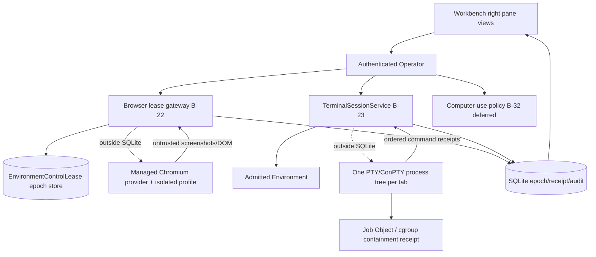

# 008 - Workbench Browser Terminal and Computer

**ID:** 008
**Status:** ACCEPTED/LOCKED
**Owners:** Desktop shell, Environments, Browser provider, Trust, Desktop UI
**Updated:** 2026-11-11 (source evidence refreshed; accepted target unchanged)
**Revision:** 1.0 (revision 1.0 adds V1 gap coverage per owner acceptance 2026-11-09: Workbench Activity view, exact-revision/VCS Diffs, Linux-row-first terminal with Windows UNAVAILABLE until Feature 005 B-35, explicit Computer UNAVAILABLE; AC-013 to AC-017)
**Owner acceptance:** accepted 2026-11-09 by the repository owner (sarv-projects) via [docs/OWNER-ACCEPTANCE-REVIEW-PACKET.md](../../docs/OWNER-ACCEPTANCE-REVIEW-PACKET.md) (PR #1), including each scoped caveat as a binding condition. Acceptance authorizes implementation; it is not a claim of implementation, SERVED, INTEGRATED or QUALIFIED status.
**Change control:** this is a locked contract. Any change to a locked decision, interface or acceptance criterion requires a new revision and renewed owner approval (docs/SPECIFICATION-STANDARD.md §7).
**Target release:** V1 local desktop
**Dependencies:** root ARCHITECTURE.md, docs/V1-PRODUCT-RELEASE-CONTRACT.md, docs/IMPLEMENTATION-MASTER-PLAN.md, and the owner documents named in RESEARCH.md. Feature 001 remains the Conversation send authority.

## 1. Problem

A WebView is not Chrome. A terminal tab is not an Environment. Computer use without consent and epoch revocation is unsafe. The Workbench must show real objects only.

Observable outcome: The owner uses the right Workbench to finish real browser and terminal work, takes over and returns control, and a stale handle cannot act.

## 2. Goals

- Ship one context-aware Workbench bound to Conversation or Task.
- Qualify browser session epochs with takeover and return.
- Bind terminal PTY lifetime to an admitted Environment process tree.
- Revoke stale browser and terminal handles on epoch change or Runtime restart rules.
- Show a truthful Workbench Activity view sourced only from committed records (revision 1.0 gap coverage).
- Show Diffs computed only from exact immutable ResourceRevision pairs or exact VCS revisions, with true counts (revision 1.0 gap coverage).
- Keep Computer use explicitly UNAVAILABLE in V1 (B-32) and the Terminal visibly UNAVAILABLE on any release-matrix row without a qualified Environment provider.

## 3. Non-goals

- Claiming Tauri WebView is Google Chrome.
- Headless browser pretending to be the same visible session.
- Terminal that executes shell startup scripts during discovery.
- Computer use without an explicit consent epoch.

## 4. Current evidence

The active checkout has a substantial Workbench presentation component and compiled browser-control/computer-policy primitives, but the user-facing Browser, Terminal and Diffs panes are not integrated with the intended provider/runtime owners. The current UI is materially more simulated than the normative owner LLDs. The following matrix is a source/route/UI crosswalk, not owner acceptance or release qualification.

| Capability | Current source/route evidence | Limitation / release meaning |
|---|---|---|
| Workbench shell and Files | CODE/UI: `WorkbenchPanel` is mounted as a resizable/collapsible right pane. Files view reads the current Workspace Resource catalog and exact preview selected by the Library/resource path | This is a Resource list/preview, not a native filesystem tree or Environment mount. Resource membership/content is governed by Feature 003; the Workbench does not own local filesystem authority. |
| Browser preview | CODE/UI: `WorkbenchPanel` holds a URL and renders it in an HTML `<iframe sandbox=...>` with an external-browser fallback affordance | This is an embedded WebView/iframe preview, not Chrome/Chromium provider, persistent browser session, Playwright/CDP controller or agent-controlled browser. The URL/default local health endpoint and iframe state live only in React component state. Switching tabs unmounts the iframe; closing the pane or changing Workspace remounts the component. |
| Browser consent and control policy | CODE: `browser_consent.rs` has managed-profile marker/consent/version guardrails; `browser_control_service.rs` has pure actor/lease/epoch/stale-input admission and takeover decisions with unit tests | `main.rs` explicitly compiles both modules with `allow(dead_code)` and says no Operator route, provider or Chrome process is connected. No composed browser session/command/takeover/return route or durable owner store exists. The policy helper does not dispatch or acknowledge a provider action. |
| Existing Chrome safety | CODE: default Chrome profile is refused; Connect Existing Chrome is consent/high-trust/version gated; policy candidates require a LiteCowork-managed profile and Chrome 144+ | These are policy decisions/helpers, not an attach provider or user flow. No Chrome attach/managed-launch process or visible consent/revoke UI is connected. |
| Terminal UI | CODE/UI: `TerminalPane` shows a status-only unavailable notice and no shell input/output | No PTY/ConPTY or Tauri terminal command is served; the notice names the missing qualified Windows Environment provider on Windows or missing admitted Environment on Linux. |
| PTY/ConPTY lifecycle | No daemon TerminalSessionService, PTY broker, ConPTY spawn bridge, terminal Tauri command, session routes or terminal process registry was found in the active source | `windows-local-security` contains Job Object process containment primitives, but there is no Workbench terminal process using them. `WorkbenchPanel`'s local scrollback survives switching tabs only while the React component remains mounted; closing the pane unmounts it and Workspace key changes remount it. No process persists, detaches, reattaches, or survives UI unmount/restart. |
| Shell profiles and Environment binding | Owner target `V1-INTEGRATED-TERMINAL-LLD` defines shell discovery/profile selection and exact Environment binding | The current Workbench hardcodes a Windows pwsh/ConPTY label, does not discover executable profiles, does not select a shell, does not require Environment admission, and has no per-tab Environment/process identity. No startup-script-safety discovery implementation is wired. |
| Diffs/Review | CODE/UI: `ReviewPane` renders “Nothing to review yet” and says changes are never inferred from document text | No real VCS or immutable-revision diff producer is connected; no fabricated diff/count is shown. |
| Activity | CODE/UI: a dedicated Activity launcher/tab and status-only empty state are rendered | No Activity source/route is served; the empty state explicitly says no recorded Activity source is served. It does not fall through to Review or fabricate timeline rows. |
| Computer use | CODE/UI: `environment_computer_use.rs` contains policy-only consent/scope/sensitive-region checks; Workbench shows a status-only unavailable message | The probe never reports READY; no capture/input backend or route exists, and no action control is rendered (accepted B-32). |
| Environment control/takeover APIs | OpenAPI types define `takeEnvironmentControl` and `returnEnvironmentControl`; the composed route inventory classifies both as target-only | No server handler or Workbench call site. Browser policy takeover functions are pure helpers and are not connected to an EnvironmentControlLease store, provider or UI. |

Feature 008 design is ACCEPTED/LOCKED (owner acceptance 2026-11-09); its target is unchanged. Current implementation is partially truthful about unavailable capabilities: Activity has an explicit empty state, Terminal and Computer are status-only, Review has no synthetic diff, and Browser remains an embedded preview. No Browser, PTY/ConPTY, Activity data or Computer provider is qualified.

**Source re-check 2026-11-11 (register A-51 remediation and T02 implementation).** The Terminal UI, Diffs/Review and Browser rows above describe the pre-A-51 component. The current `apps/litecowork-ui/src/workbench/WorkbenchPanel.tsx` exports `TerminalPane` ("Terminal execution is unavailable" notice, no input, no output, no ConPTY/Job Object labels) and `ReviewPane` ("Nothing to review yet", no synthetic diff or counts); the Browser `browserUrl` starts empty and the pane is labelled "Embedded page preview" with no containment claim. `apps/litecowork-ui/tests/workbench-truthfulness.test.mjs` asserts the absence of fabricated process, diff and containment strings. The Activity tab now has its own status-only empty state, and Computer use is shown only as unavailable status text. Terminal and Review no longer render sample process output or synthetic diffs. No browser, terminal, activity-data or diff producer route exists. These UI changes improve truthful availability; they do not add provider capability or qualification.

## 5. LOCKED and FLEXIBLE decisions

### LOCKED

- Browser provider and presentation adapter are separate (CHROME-BROWSER-LLD).
- UNAVAILABLE is not a browser mode.
- Terminal UI does not own a privileged shell (V1-INTEGRATED-TERMINAL-LLD).
- Workbench is views over authorized objects (release contract).
- Stale handles cannot act (master plan P7).

### FLEXIBLE

- Module file layout and private helper names, provided the transactions and secret boundaries stay intact.
- Presentation copy, provided state distinctions remain visible.

### Decisions recorded (formerly open)

The three questions below were the open decisions; each is now ACCEPTED (2026-11-09) with the resolution in the table that follows.

- B-22: Which exact browser provider/distribution and visible-surface mode is first on the GA OS/build? Choose managed Chromium or consented connect-existing Chrome (not both by assumption); pin engine/channel/version, launch/profile policy, storage/retention, downloads, network restrictions, session lifecycle and the provider-to-view/presentation adapter.
- B-23: Which exact terminal provider, OS/build, shell executable/profile and Environment binding is first? Define PTY/ConPTY implementation, exact spawn argv/environment allowlist, working-directory root, Job Object/cgroup process-tree limits, resize/encoding, output/backpressure, process identity, detach/reattach, stop/quiescence and Runtime-restart semantics.
- B-32: Is Computer use in V1 or explicitly deferred? If included, select the exact native provider/platform permission flow and supported actions/capture scopes; if deferred, expose no disabled/fake Computer surface and keep the module unavailable.

### Blockers (ACCEPTED 2026-11-09; implementation obligations remain)

- B-22: Desktop shell, Browser provider, Environments and Security must accept one browser provider/mode for the declared GA OS/build, including an executable versioned provider, isolated profile strategy, actual visible surface, consent/revoke, lease persistence, action dispatch, observation, takeover/return and exact stale-epoch rejection. Current browser policy code is not a provider.
- B-23: Desktop shell, Environments and Security must accept one real PTY/ConPTY implementation and shell profile, tied to a qualified Environment. Acceptance requires a real process, exact executable/argv/cwd/allowlisted env, per-session process-tree containment, bounded streaming, resize, explicit stop, detach/reattach and quiescence/lost-session proof on UI close, Runtime restart and crash.
- B-32: Product and Desktop shell must decide Computer-use scope. If same V1 milestone, Environments/Trust must supply an exact OS provider with explicit capture/input permission, scope, excluded sensitive regions, revocation and per-action authority; current code explicitly has no capture or injection backend. Otherwise defer the surface and state it as unavailable.

### ACCEPTED DECISIONS AND ARCHITECTURAL CONTRACTS (owner-accepted 2026-11-09)

The repository owner accepted these resolutions on 2026-11-09 via [docs/OWNER-ACCEPTANCE-REVIEW-PACKET.md](../../docs/OWNER-ACCEPTANCE-REVIEW-PACKET.md), including the riders recorded in each row. The register [docs/CONTRADICTION-AND-ALIGNMENT-REGISTER.md](../../docs/CONTRADICTION-AND-ALIGNMENT-REGISTER.md) is updated by the orchestrator. Browser, terminal and computer-use remain three independent qualification axes.

| ID | Topic | ACCEPTED resolution and architectural contract | Canonical authority and consequence |
|---|---|---|---|
| B-22 | First real browser mode on the GA OS/build | **ACCEPTED (2026-11-09): `MANAGED_CHROMIUM` with a LiteCowork-managed isolated profile as the first qualified browser mode, not `CONNECT_EXISTING_CHROME`.** The provider launches a version-pinned Chromium under a dedicated managed profile directory; it never copies the user's default profile, cookies, history or login state, and ambient CDP discovery against the default user directory is DISABLED. The visible-surface adapter (`LIVE_INTERACTIVE` or `OBSERVATION_FRAMES`) is separate from the provider session identity. Consent is recorded before any agent action, Take control is an atomic epoch transfer that fences queued agent input, and Return requires explicit confirmation plus a fresh observation. `CONNECT_EXISTING_CHROME` stays a later, separately consented mode. **Owner-requested refinement (2026-11-11):** Workbench observation shows only the managed browser tab viewport as ephemeral bounded frames; the persistent browser Take over control transfers browser input authority after epoch fencing and is distinct from Feature 012 Conversation Take control. Whole-desktop capture/input remains deferred under B-32. Adapter rule (docs/REFERENCE-IMPLEMENTATIONS.md, REF-BROWSER-HARNESS): browser-harness `get_ws_url()` ambient-CDP discovery, generic `handle()` CDP passthrough, default-profile discovery, cookie sync and task-text telemetry are DISABLED or replaced by provider-owned sessions and allowlisted typed methods. The managed browser does not need an admitted Task Environment, so it may qualify on the Windows x64 row first. | [CHROME-BROWSER-LLD.md](../../docs/CHROME-BROWSER-LLD.md), [TRUST.md](../../docs/TRUST.md). The exact Chromium channel/version, profile policy and provider transport are promoted into the owner contract by the first implementation task; until then no browser route is served. |
| B-23 | First real terminal provider, shell profile and Environment binding | **ACCEPTED (2026-11-09): One daemon-owned PTY/ConPTY provider bound to an admitted Environment, with a discovered default shell profile and no startup-script execution during discovery.** The provider spawns exactly one process tree per terminal tab under the admitted Environment, with exact shell executable/argv/cwd and an allowlisted environment, a process-tree containment receipt (Job Object on Windows, cgroup on Linux), bounded scrollback/backpressure, resize and stdin bridged to Tauri. Tab switch/detach/reattach never respawns or kills the process; explicit Stop terminates the owned tree; UI close, Runtime stop and crash yield exact QUIESCENT or LOST/UNKNOWN evidence. Discovery performs bounded executable/version probing only and never sources rc files or scrapes secrets. The command-receipt shape and timeout-as-receipt doctrine are informed by OpenHands (RESEARCH.md). **B-17 rider (binding):** Linux bubblewrap is the first Environment provider, so the terminal qualifies on the Linux x64 row first (PTY via `openpty`, cgroup/process-scope lifetime). On the Windows x64 row the Terminal stays visibly UNAVAILABLE, naming the missing Windows Environment provider, until Feature 005 blocker B-35 (AppContainer + restricted token + Job Object + WFP egress, all four dimensions ENFORCED and attested) qualifies; a Job Object alone is process lifetime only and never an isolation claim. | [V1-INTEGRATED-TERMINAL-LLD.md](../../docs/V1-INTEGRATED-TERMINAL-LLD.md), [ENVIRONMENTS.md](../../docs/ENVIRONMENTS.md). The exact OS/shell/PTY implementation is promoted into the owner contract by the first implementation task; the Terminal pane stays unavailable until a real admitted session exists. |
| B-32 | Computer-use milestone and takeover boundary | **ACCEPTED (2026-11-09): Defer Computer use from the first V1 milestone and keep the surface explicitly UNAVAILABLE.** No disabled-but-ready computer button, synthetic cursor or capture control is rendered; `probe_computer_provider()` continues to report UNSUPPORTED/UNAVAILABLE on the supported targets. If Product later includes it, Environments/Trust must supply an exact OS capture/input provider with explicit permission flow, scope, excluded sensitive regions (password/payment/CAPTCHA/MFA remain human-only), revocation and per-action authority sharing the same consent epoch as the browser. | [ENVIRONMENTS.md](../../docs/ENVIRONMENTS.md), [TRUST.md](../../docs/TRUST.md). Keeping the surface explicitly UNAVAILABLE is the accepted V1 position; any later inclusion requires a new revision, a promoted provider contract and renewed owner approval. |

These decisions are owner-accepted and the package is ACCEPTED/LOCKED. Implementation and qualification status are unchanged and tracked in §4 and docs/IMPLEMENTATION-STATUS.md; no provider, route or OS process exists yet.

## 6. High-level design

Right Workbench hosts views. Browser control goes through a lease gateway outside SQLite. Terminal opens a PTY only after Environment admission. Computer actions use the same epoch and consent record. UI disablement follows provider availability.

### Feature-specific component diagram



Browser, terminal and computer-use are three separate providers. The managed Chromium process and the PTY process both live outside SQLite; only epoch transitions, receipts and audit rows commit inside the transaction.

### Trust boundaries

The desktop UI is untrusted; the authenticated Operator is the only command path. Screenshots, page text and terminal output are untrusted observations, never authorization. The managed browser profile is isolated: no default-profile copy, no ambient CDP discovery, no cookie/history/login import; password/payment/CAPTCHA/MFA stay human-only. The raw CDP handle and the PTY handle never enter events, snapshots or logs; the model receives a capability grant, not the handle. SQLite transactions make no network or process call.

### Actor sequence (target)

1. Owner opens the Workbench bound to a Conversation or Task; unqualified surfaces render UNAVAILABLE rather than a fake Chrome/terminal.
2. Owner starts a managed browser epoch; consent and session epoch are recorded before any agent browser action.
3. Agent acts under epoch n; every action rechecks session/tab generation, principal, control epoch and lease.
4. Owner takes over; the epoch advances to n+1 atomically and queued agent input is fenced/discarded.
5. Owner returns control with explicit confirmation; the epoch increments again and the agent replans from a fresh observation.
6. Owner opens a terminal; one real PTY/ConPTY process spawns in the admitted Environment with a containment receipt; tab switch/detach/reattach does not respawn or kill it; Stop terminates the owned tree.
7. Provider loss marks the epoch LOST/RECOVERING/AMBIGUOUS and reconciles in-flight actions before any retry.

### Ownership

| Owner | Responsibility | Excluded responsibility |
|---|---|---|
| Desktop UI | Honest availability states, consent/takeover affordances, never label a WebView as Chrome | Owning the provider process or lease authority |
| Operator | Auth, Workspace scope, epoch/lease validation | Native process custody |
| Browser lease gateway (B-22) | Consent, epoch transfer, stale-epoch rejection, action dispatch outside SQLite | Copying the user's Chrome profile |
| TerminalSessionService (B-23) | PTY/ConPTY spawn, one process tree per tab, containment receipt, streaming, stop | Executing shell startup scripts during discovery |
| Computer-use policy (B-32) | Consent/scope policy; stays UNAVAILABLE until a provider is qualified | Capture/input without an OS provider |
| Storage | Atomic epoch/receipt/audit commits | External process/network calls |

Trust boundary: the desktop UI is untrusted; the authenticated Operator is the only command path; native credentials and OS handles stay outside public events; SQLite transactions do not perform network or process calls.

## 7. Low-level design

Takeover keeps the EnvironmentControlLease ACTIVE, moves control from AGENT epoch n to HUMAN epoch n+1, and rejects the old epoch. The browser process may stay up. Return requires explicit confirmation and another epoch increment. Handle presentation to the model is a capability grant, not the raw CDP or PTY handle in events.

Ordering: authorize, compare expected version, commit the durable receipt, then perform any external call, then reconcile. Payload fields below are accepted target interfaces (not yet in source) until the canonical owner document and machine schema are promoted together.

### 7.1 Existing signatures (CODE)

Observed in the active source; existence is CODE evidence, not SYSTEM/USER qualification.

- `browser_consent.rs` and `browser_control_service.rs`: pure policy/admission helpers (managed-profile marker, consent, high-trust, exact major-version match, Chrome 144+ for connect-existing; actor/lease/epoch/stale-input admission and takeover/return decisions). Compiled with `allow(dead_code)`; the only call sites are unit tests. They do not dispatch a provider action.
- `environment_computer_use.rs`: policy boundary with `probe_computer_provider()`; every capture/input request is refused; capability flags are false.
- `WorkbenchPanel.tsx`: iframe browser preview, Resource Files preview, honest unavailable Terminal/Review panes (per register A-51).
- Not served: no BrowserSession create/list/get/navigate/capture/action/control-lease route, no TerminalSession/profile/PTY route, no Computer-use route. `takeEnvironmentControl`/`returnEnvironmentControl` are target-only Environment operations, not BrowserControlLease handlers.

### 7.2 Accepted target signatures (not yet in source)

Every signature below is an accepted target interface (not yet in source). It is promoted only when CHROME-BROWSER-LLD / V1-INTEGRATED-TERMINAL-LLD and the OpenAPI/schema change together.

```rust
// Accepted target (not yet in source): atomic browser control epoch transfer (B-22, AC-003/AC-004).
pub struct TakeBrowserControl {
    pub principal_id: String,
    pub workspace_id: String,
    pub session_id: String,
    pub expected_epoch: u64,          // stale epoch => rejected
    pub expected_session_version: u64,
}

// Accepted target (not yet in source): daemon-owned terminal session bound to an admitted Environment (B-23).
pub trait TerminalSessionService: Send + Sync {
    fn open(&self, env_id: &str, profile: ShellProfile) -> Result<TerminalSession, TerminalError>;
    fn write_stdin(&self, session_id: &str, bytes: &[u8]) -> Result<(), TerminalError>;
    fn resize(&self, session_id: &str, cols: u16, rows: u16) -> Result<(), TerminalError>;
    fn stop(&self, session_id: &str) -> Result<QuiescenceReceipt, TerminalError>; // QUIESCENT | LOST | UNKNOWN
}

// Accepted target (not yet in source): ordered terminal command receipt (B-23), informed by OpenHands RESEARCH.
pub struct CommandReceipt {
    pub session_id: String,
    pub order: u64,                    // monotonic; persisted before publication
    pub exit_code: Option<i32>,        // None => still running; -1 => timed out
    pub timed_out: bool,
}
```

Typed errors (accepted target, not yet in source): `BrowserControlError::{StaleEpoch, LeaseLost, ConsentMissing, ProviderUnavailable}`; `TerminalError::{EnvironmentNotAdmitted, SpawnFailed, ContainmentUnavailable, Lost}`. The existing source enum `browser_control_service::BrowserControlError` already carries reason codes; promotion maps onto it rather than creating a parallel enum.

Gap-coverage targets (revision 1.0), also accepted target interfaces (not yet in source):

- `WorkbenchActivityItem { workspace_id, source_event_id, actor_kind, assurance, occurred_at }`: a read projection over committed domain events and receipts. `source_event_id` always names a committed record; `assurance` is COMMITTED, OBSERVED, REPORTED or UNKNOWN (AC-013).
- `RevisionDiffRequest { workspace_id, base: DiffSource, head: DiffSource, max_lines }` where `DiffSource` is `ResourceRevision { resource_id, revision_id, sha256 }` or `VcsRevision { repo_ref, commit }`. Over-bound input returns a typed TOO_LARGE result, never a partial count (AC-014).

## 8. Data

See [DATA-MODEL.md](DATA-MODEL.md). This feature does not create a second source of truth beside the domain owner.

## 9. Wiring

See [WIRING.yaml](WIRING.yaml). Requests enter through the Operator. External calls sit outside transactions.

## 10. Security

Consent is explicit per epoch. Network and filesystem remain Environment policy. Screenshots and page text are untrusted input. Handles are redacted from logs.

## 11. Errors and recovery

Provider crash marks the epoch lost. Restart does not replay a half-applied browser action without reconciliation. Closing the window does not by itself kill the Runtime, but sleep and shutdown follow RUNTIME-LIFECYCLE.

Races use compare-and-swap or a single-writer occurrence identity. Timeout after an external effect reconciles. Duplicate retries return the original receipt when the idempotency key matches and fail when the payload conflicts.

## 12. Crash and restart

Reload the last committed owner records. Do not infer success from an intent. Reconcile in-flight external work before a new side effect. Cancellation fences late results.

## 13. Configuration and compatibility

Modes that are not qualified stay hidden with a repair path. Computer use stays explicitly UNAVAILABLE because accepted B-32 defers it.

OS qualification is per native desktop. WSL2 does not qualify Windows or Linux GUI behavior.

Release-matrix rows (accepted 2026-11-09): row 1 is Windows x64 (`x86_64-pc-windows-msvc`) with OpenCode v2.0.32; row 2 is Linux x64. Browser (`MANAGED_CHROMIUM`) may qualify on row 1. Terminal qualifies on row 2 first under a bubblewrap Environment and is UNAVAILABLE on row 1 until Feature 005 B-35. Computer is UNAVAILABLE on every row.

## 14. Observability

Log ids, versions, statuses and denial reasons. Do not log secret bytes, native handles, private locators or raw credentials. Audit commits include actor, workspace and receipt id.

## 15. EARS acceptance

Positive:
- **AC-002:** WHEN the owner starts a managed browser epoch, THE SYSTEM SHALL record consent and a session epoch before any agent browser action. Verify: consent/epoch-ordering test.
- **AC-005:** WHEN a terminal opens, THE SYSTEM SHALL spawn one real PTY/ConPTY process in the admitted Environment, persist its exact session/process identity, and SHALL NOT merge tabs or process trees across Environments. Verify: PTY spawn/containment test.

Negative:
- **AC-001:** WHEN no qualified browser provider exists, THE SYSTEM SHALL show UNAVAILABLE and SHALL NOT label a WebView as Chrome. Verify: unavailable-state labeling test.
- **AC-004:** IF a stale epoch handle is presented, THEN THE SYSTEM SHALL reject it. Verify: stale-epoch rejection test.

Concurrency:
- **AC-003:** WHEN the owner takes over, THE SYSTEM SHALL atomically advance the control epoch and fence/discard queued agent input; the agent SHALL perform no further browser action until a separate confirmed return to a fresh observation or the session is closed. Verify: atomic takeover/fence test.

Boundary:
- **AC-006:** WHEN shell profiles are discovered, THE SYSTEM SHALL perform bounded executable/version discovery without executing profile startup scripts, sourcing shell rc files, or scraping environment secrets. Verify: discovery-safety test.
- **AC-009:** WHEN a terminal command finishes or times out, THE SYSTEM SHALL emit an ordered command receipt with the exact exit status (timeout recorded as `exit_code = -1`) and SHALL NOT fabricate a successful exit code. Verify: command-receipt and no-fabrication test.

Recovery:
- **AC-007:** WHEN the Runtime loses the provider, THE SYSTEM SHALL mark the epoch lost and reconcile in-flight actions before retry. Verify: provider-loss reconciliation test.
- **AC-010:** WHEN the terminal UI closes, the Runtime stops or the process crashes, THE SYSTEM SHALL record exact QUIESCENT or LOST/UNKNOWN evidence and SHALL NOT claim continuation without a surviving process. Verify: close/stop/crash evidence matrix.

Security:
- **AC-008:** WHEN a managed browser launches, THE SYSTEM SHALL use an isolated LiteCowork-managed profile, SHALL NOT copy the default profile/cookies/history/login state, SHALL NOT perform ambient CDP discovery against the default user directory, and SHALL keep password/payment/CAPTCHA/MFA human-only. Verify: profile-isolation and human-only-field tests.

UI and accessibility:
- **AC-011:** WHEN the Workbench renders, THE SYSTEM SHALL present browser/terminal/computer availability as keyboard- and screen-reader-accessible states and SHALL NOT render a disabled-but-ready Computer control while B-32 is deferred. Verify: Workbench render + a11y test.

Gap coverage (revision 1.0):
- **AC-013:** WHEN the Workbench Activity view renders, THE SYSTEM SHALL list only committed domain events, receipts and provider observations for the bound Conversation or Task with actor, timestamp and assurance level, SHALL show an explicit empty state when none exist, and SHALL NOT render synthetic progress, token or process traces. Verify: Activity projection and render test.
- **AC-014:** WHEN Diffs renders a change, THE SYSTEM SHALL compute it from two exact immutable ResourceRevision identities (with digests) or two exact VCS revisions, SHALL display the true added/removed counts and source identities, and IF a source is missing, binary, uncommitted or over the bound THEN SHALL show a typed unavailable state instead of an inferred diff. Verify: exact-revision diff and over-bound test.
- **AC-015:** WHILE the current release-matrix row has no qualified Environment provider (the Windows x64 row until Feature 005 B-35), THE SYSTEM SHALL render the Terminal as UNAVAILABLE naming that prerequisite and SHALL NOT spawn a shell outside an admitted Environment. Verify: per-row terminal availability test.
- **AC-016:** WHEN the Workbench renders on any V1 release-matrix row, THE SYSTEM SHALL present Computer use as explicitly UNAVAILABLE with its reason, SHALL mount no capture or input route, and `probe_computer_provider()` SHALL NOT report READY. Verify: Computer unavailable render and route-inventory test.
- **AC-017:** WHEN the Runtime restarts, THE SYSTEM SHALL mark browser and terminal sessions of the previous incarnation LOST or RECOVERING and SHALL reject every handle, epoch or cursor issued by that incarnation. Verify: incarnation-fencing restart test.

Performance:
- **AC-012:** WHEN terminal output is high-volume, THE SYSTEM SHALL apply bounded scrollback/backpressure and SHALL NOT block the Operator or other tabs. Verify: backpressure/throughput test.

Owner-approved additions (2026-11-09):
- **AC-018:** WHEN the Browser preview iframe renders (task P-06), THE SYSTEM SHALL NOT combine `allow-scripts` with `allow-same-origin` in its sandbox attribute, and a guard test SHALL fail if any iframe in the source carries that attribute pair. Verify: iframe sandbox guard test.
- **AC-019:** WHEN the Workbench shows a Git worktree and diff or runs a GitHub pull-request operation (task P-13), THE SYSTEM SHALL compute the diff from the real VCS with true added/removed counts and SHALL run PR operations only through a Feature 006 brokered Connection on explicit user action, never auto-opened or self-approved by an agent and never exposing tokens or arbitrary URLs. Verify: worktree/VCS diff and user-invoked PR-op test.

## 16. Executable acceptance command

```bash
python3 .specify/scripts/validate_feature_package.py specs/008-workbench-browser-terminal-computer
```

Further gates after ACCEPTED/LOCKED are the cargo filters named in TASKS.md. They are not evidence until run on a recovered source tree.

## 17. Out-of-bounds

- Do not automate the user's everyday Chrome profile by default.
- Do not treat WSL as proof of native Windows terminal qualification.

## 18. Assumptions and open questions

- Browser provider, terminal provider and Computer-use provider are separate qualification decisions. A mode/policy enum or UI control does not prove an OS process/provider exists.
- Computer use is deferred by accepted B-32; the current helper must remain visibly UNAVAILABLE/UNSUPPORTED rather than appear as a disabled-but-ready computer tool.
- The current Review pane is an honest empty state, not a VCS/evidence diff. Activity is now a rendered status-only Workbench tab (2026-11-11 CODE); its placement follows the accepted V1 screen contract, and no fabricated timeline is shown.
- Archive UI is not served evidence.

Each blocker has the owners named above. The owner decisions are recorded (ACCEPTED 2026-11-09). Implementation tasks: 008-T01 through 008-T21 in TASKS.md.

## 7a. Owner facts and implementation crosswalk checked 2026-11-06

Read from CHROME-BROWSER-LLD, V1-INTEGRATED-TERMINAL-LLD, and STATE-MACHINES.

- AvailabilityStatus is READY, NEEDS_SETUP, UNAVAILABLE, OFFLINE, or UNKNOWN. BrowserMode is MANAGED_CHROMIUM, CONNECT_EXISTING_CHROME, MANUAL_ONLY, or HEADLESS_TASK. HEADLESS_TASK handoff to a visible browser is a new surface.
- BrowserControlOwner is AGENT, USER, NONE, or TRANSFER_PENDING. Session health is STARTING, READY, DEGRADED, DISCONNECTED, RECOVERING, or CLOSED. viewMode is LIVE_INTERACTIVE, OBSERVATION_FRAMES, EXTERNAL_WINDOW, or UNAVAILABLE. BrowserActionReceipt.state is REJECTED, ADMITTED, IN_PROGRESS, APPLIED, AMBIGUOUS, or BLOCKED. The command actor field is caller intent. Authority comes from the authenticated principal plus the control lease.
- Take control is an atomic epoch transfer. Return requires explicit confirmation, increments the epoch, and the agent replans from a fresh observation. Closing the side pane does not close the browser or cancel the Task. A matching URL after restart is not proof that a pre-crash write succeeded.
- Password fields, payments, CAPTCHA, permission prompts, and MFA require a human. Copying encrypted cookies or importing history, passwords, or login state is forbidden. Chrome remote debugging against the default user directory and Playwright automation of the default Chrome profile are forbidden.
- reconcileBrowserAction leaves UNKNOWN ambiguous and does not submit the same form twice. detachBrowserSession does not kill a user-owned Chrome profile.
- shellProcessState is STARTING, ACTIVE, EXITED, RECONNECTING, LOST, DETACHED, or STOPPING. ownerKind is USER_MANUAL, TASK_ATTEMPT, or PROVIDER_PRIVATE. An unauthorized root is rejected. Silent fallback to home is forbidden. Closing the terminal view is not Stop Task. A manual terminal history does not become Task Evidence automatically.
- OpenAPI `takeEnvironmentControl` and `returnEnvironmentControl` exist as TARGET_ONLY Task/Attempt Environment operations; they are not served and are not BrowserControlLease handlers. No browser-session or terminal-PTY operationId/route is currently served. `environment.control.lease.changed.v1` remains a target event contract; do not report it as emitted by the current Workbench.


## 7b. Current source and visible Workbench boundary — 2026-11-06

- The composed Operator has no BrowserSession create/list/get/navigate/capture/action/control-lease route, no TerminalSession/profile/PTY route and no Computer-use capture/input route. `takeEnvironmentControl` and `returnEnvironmentControl` are target-only Environment operations, not served BrowserControlLease handlers.
- `browser_consent` and `browser_control_service` compile policy helpers but are not wired to a route, browser provider or Chrome process; their call sites are tests. Consent rules refuse default Chrome profiles and require a managed-profile marker, explicit consent/high-trust acknowledgement, exact major-version match and minimum Chrome 144 for the connect-existing candidate. They do not create a session or deliver browser actions.
- `environment_computer_use` is a policy boundary only. No capture/input provider is wired; requests are refused. On Linux with a display the provider probe still reports unsupported because desktop-portal/remote-desktop paths are unqualified; non-Linux is unsupported and headless Linux is unavailable. Capture/input capability flags remain false.
- The visible Files pane lists Workspace Resource projections and exact ResourceRevision previews; it is not a native filesystem or Environment browser. The Browser pane is a sandboxed iframe with local React URL state that starts empty and is labelled Embedded page preview. It is not a Chrome provider; tab switch unmounts it and pane/Workspace changes reset state.
- Historical A-51 finding: the earlier Terminal pane fabricated command output and process/containment labels. Remediated in the current UI (2026-11-11 CODE): Terminal now displays only an unavailable notice and runs no command; PTY/ConPTY service, Tauri route, session records, streams, process identity and Stop remain unimplemented.
- Historical A-51 finding: Diffs fabricated a sample patch and Activity fell through to Diffs. Remediated in the current UI (2026-11-11 CODE): Review is an honest empty state, Activity has a separate status-only empty state, and Computer use shows only an unavailable status message. No VCS/ResourceRevision diff, Activity data route or Computer provider is connected.
- `windows-local-security` Job Object helpers are not a PTY/ConPTY provider and do not prove a terminal process was admitted to an Environment. No terminal session store, shell-profile registry, process spawn, resize/stdin/stdout bridge or explicit Stop operation was found.
- The current Workbench right pane is keyed by Workspace and unmounts on close. Its view-local browser and terminal state is therefore lost on pane close or Workspace change. This is distinct from the target contract where detach/reattach must not own or restart a provider process.
- The UI contract and RESEARCH.md contain the exact current source crosswalk. B-22 (browser provider/mode), B-23 (PTY/ConPTY and shell profile) and B-32 (Computer-use deferred, UNAVAILABLE) were ACCEPTED on 2026-11-09. Synthetic command execution and ungrounded success/containment claims were removed under register A-51 (verified in source 2026-11-09); no real process is wired yet.

## 19. Requirement traceability

| Requirement | Canonical contract | Task | Acceptance | Verification method |
|---|---|---|---|---|
| WebView is not Chrome | CHROME-BROWSER-LLD | 008-T02, 008-T06 | AC-001 | Unavailable-state labeling test |
| Consent before agent action | CHROME-BROWSER-LLD, TRUST | 008-T03, 008-T05 | AC-002 | Consent/epoch-ordering test |
| Atomic takeover fences input | CHROME-BROWSER-LLD | 008-T05, 008-T07 | AC-003 | Atomic takeover/fence test |
| Stale epoch rejected | CHROME-BROWSER-LLD | 008-T03, 008-T05 | AC-004 | Stale-epoch rejection test |
| One PTY per Environment | V1-INTEGRATED-TERMINAL-LLD, ENVIRONMENTS | 008-T09, 008-T12 | AC-005 | PTY spawn/containment test |
| Safe profile discovery | V1-INTEGRATED-TERMINAL-LLD | 008-T09 | AC-006 | Discovery-safety test |
| Provider loss reconciliation | CHROME-BROWSER-LLD, FAILURE-RECOVERY | 008-T07 | AC-007 | Provider-loss reconciliation test |
| Isolated managed profile (B-22) | CHROME-BROWSER-LLD, TRUST | 008-T04 | AC-008 | Profile-isolation / human-only tests |
| Ordered command receipt (B-23) | V1-INTEGRATED-TERMINAL-LLD | 008-T08, 008-T10 | AC-009 | Command-receipt / no-fabrication test |
| Close/stop/crash evidence | V1-INTEGRATED-TERMINAL-LLD, RUNTIME-LIFECYCLE | 008-T13 | AC-010 | Close/stop/crash evidence matrix |
| Accessible availability states (B-32) | DESKTOP-SHELL-LLD; contracts/ui-behavior.md | 008-T02, 008-T06, 008-T11 | AC-011 | Workbench render + a11y test |
| Bounded terminal backpressure | V1-INTEGRATED-TERMINAL-LLD | 008-T10 | AC-012 | Backpressure/throughput test |
| Truthful Activity view (gap) | V1-UI-SCREEN-CONTRACT, EVENTS | 008-T14 | AC-013 | Activity projection and render test |
| Exact-revision / VCS Diffs (gap) | V1-UI-SCREEN-CONTRACT, Feature 003 ResourceRevision | 008-T15 | AC-014 | Exact-revision diff and over-bound test |
| Terminal per-row availability (B-17/B-35 rider) | ENVIRONMENTS, V1-INTEGRATED-TERMINAL-LLD | 008-T11, 008-T12 | AC-015 | Per-row terminal availability test |
| Computer explicitly UNAVAILABLE (B-32) | ENVIRONMENTS, TRUST | 008-T02 | AC-016 | Computer unavailable render and route-inventory test |
| Prior-incarnation handles fenced | RUNTIME-LIFECYCLE, CHROME-BROWSER-LLD | 008-T07, 008-T13 | AC-017 | Incarnation-fencing restart test |
| Browser iframe sandbox guard (P-06, owner approval 2026-11-09) | CHROME-BROWSER-LLD, register A-51 | 008-T19 | AC-018 | Iframe sandbox guard test |
| Git worktree, VCS diff and user-invoked GitHub PR ops (P-13, owner approval 2026-11-09) | ENVIRONMENTS, Feature 006 Connection broker | 008-T20 | AC-019 | Worktree/VCS diff and PR-op test |
