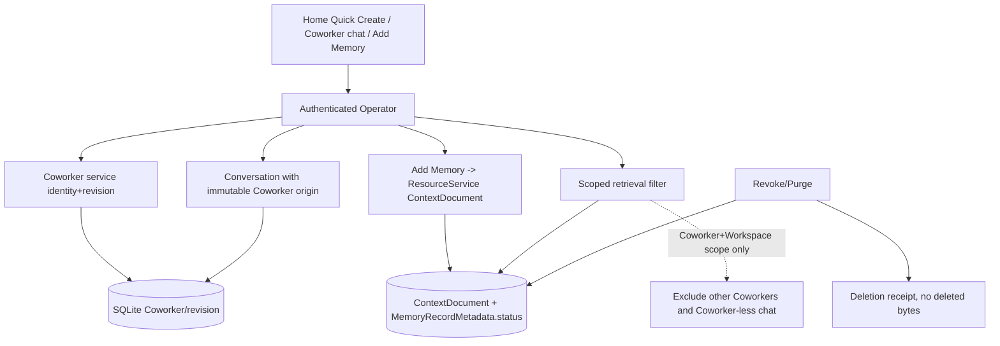

# 009 - Coworkers and Scoped Memory

**ID:** 009
**Status:** DRAFT
**Owners:** Coworkers, Conversation, Memory, Trust, Desktop UI
**Updated:** 2026-11-06
**Revision:** 0.2
**Target release:** V1 local desktop
**Dependencies:** root ARCHITECTURE.md, docs/V1-PRODUCT-RELEASE-CONTRACT.md, docs/IMPLEMENTATION-MASTER-PLAN.md, and the owner documents named in RESEARCH.md. Feature 001 remains the Conversation send authority.

## 1. Problem

Coworkers are optional and must not be required for ordinary chat. Memory must not silently grant permissions, Connections, packages or schedules. Automatic learning waits on consent and deletion contracts.

Observable outcome: The owner optionally creates a Coworker, chats, attaches and revokes scoped context, restarts, and proves another Coworker or Workspace scope cannot read it.

## 2. Goals

- Quick Create to a first usable Coworker chat.
- Scope Conversation ownership and ContextDocuments to that Coworker.
- Support inspect, correct, revoke and purge of owner-authored memory.
- Prove restart and cross-scope denial.

## 3. Non-goals

- Mandatory Coworker on first run.
- Automatic learning in this slice.
- Coworker-to-Coworker authority sharing.
- Channels and remote control.

## 4. Current evidence

The active source tree is present in `apps/` and `crates/`. The behavior below remains the normative feature target; the matrix distinguishes that target from the currently served implementation. The full source crosswalk is in [IMPLEMENTATION-STATUS.md](../../docs/IMPLEMENTATION-STATUS.md) and [CONTEXT.md](../../docs/CONTEXT.md). A matching route, persisted field or UI control alone does not qualify the feature.

| Area | Current source evidence (2026-11-06) | Current capability boundary |
|---|---|---|
| Coworker identity and revisions | `apps/litecoworkd/src/coworker_operator.rs`; `crates/storage-sqlite/src/coworkers.rs`; domain Responsibility service | Workspace-scoped list/create/get/revision/status and primary-Coworker commands are served. Coworker/CoworkerRevision and Workspace primary selection are durable. |
| Home Quick Create | `apps/litecowork-ui/src/coworkers/HomeCoworkerOnboarding.tsx` | Creates a general Assistant and can set Workspace primary. It does not open a Coworker chat. Primary selection only prefills future Task settings. |
| Conversation ownership | `crates/storage-core/src/conversation.rs`; `apps/litecoworkd/src/conversation_operator.rs` | Conversation create/record has Workspace/title/agent-session fields, not immutable Coworker ID/revision. No Coworker conversation list/open/new-chat path is served. |
| Task Coworker provenance | Task domain and SQLite Task record; Task composer in `apps/litecowork-ui/src/App.tsx` | A Task may pin Coworker ID/revision. This is Task origin provenance, not Conversation ownership or a Coworker-scoped chat. |
| Coworker context policy | `crates/domain-responsibility/src/models.rs`, `service.rs`; Coworker Settings | `CoworkerContextPolicy` is persisted in Coworker revisions. Current validation checks shape/ranges and requires `require_user_confirmation_for_memory=true`; no retrieval path enforces allowed kinds, item count or Task-summary retention. It is not `CoworkerLearningPolicy`. |
| Coworker policy editor and consumers | `apps/litecowork-ui/src/coworkers/CoworkerSettings.tsx`; `coworker_operator.rs`; Task create and domain/storage services | UI edits default lead, delegation strategy, worker-profile allowlist, interaction defaults, lead-failover preferences, context policy and notification preferences. Default lead is consumed by Task creation; lead-failover policy is copied into TaskSpec but has no production fallback dispatcher; interaction policy has no Trust consumer; notification policy has no Coworker delivery consumer; delegation strategy has no worker selector; context policy has no retrieval consumer. Delegation budget is preserved but not editable. The current mutation schema does not expose delegation_policy_source. |
| DelegationProfile assignment | Coworker Settings plus Agent Settings; `crates/storage-sqlite/src/execution.rs` | Coworker profile IDs are validated against same-Workspace enabled DelegationProfiles and read by the SQLite child-Attempt admission guard; the budget policy is also read by that storage primitive. No production daemon/Operator caller invokes child-Attempt admission, so the UI allowlist/profile editor does not establish runnable child workers. |
| Coworker status and proactive admission | Coworker status Operator, Responsibility domain service, Automation enable transition, TriggerHost and Task creation | Automation enable checks Coworker active at enable time. A PAUSED transition can still commit while enabled Automations exist; no production origin-status helper/trigger-host recheck fences their later occurrences. Task creation storage rejects ARCHIVED, not PAUSED. The Task composer separately rejects PAUSED Coworkers even for owner-submitted Tasks, contrary to the target contract. The UI copy that pause stops new proactive/scheduled work is therefore not fully enforced. |
| ContextDocument creation | `crates/domain-workspace/src/lib.rs::valid_context_document_metadata`; Resource upload route/schema | Current domain validation accepts only USER-owned `PERSONAL_PROFILE` and WORKSPACE-owned `WORKSPACE_NOTES`. The generic schema/UI also names `COWORKER_NOTES` and `GOAL_NOTES`, but the validator rejects those owners. |
| Retrieval and memory UI | `apps/litecoworkd/src/rag_retrieval_operator.rs`; Resource/RAG storage; Coworker Settings | Retrieval is Workspace/explicit-Resource scoped lexical search with no Coworker ID/revision or CoworkerContextPolicy. There is no Coworker-private memory list/editor/review/revoke UI or Context Used flow. |
| Learning pipeline | `crates/storage-core/src/coworker_learning.rs`; `crates/storage-core/src/skill.rs` | Typed candidate/policy records and deterministic gates exist. `redact_sensitive_content` is reused by SkillProposal intake; the candidate evaluator/policy/conflict path has no production caller. No LearningService, candidate/MemoryRecord SQLite store or migration, learning Operator routes/events, or Learning Inbox exists. |
| Presence | `apps/litecoworkd/src/coworker_operator.rs::presence_unavailable` | Route is mounted but returns 503 `DEPENDENCY_UNAVAILABLE` after verifying the Coworker, because Task/UserRequest/Attempt/Runtime projections are not available. |

This package remains DRAFT until its named owners accept the decisions and supporting contracts. The rows above are evidence, not authorization to change the target UX.

## 5. LOCKED and FLEXIBLE decisions

### LOCKED

- Ordinary Conversation does not require a Coworker (ARCHITECTURE, release contract).
- A memory change cannot grant permissions, Connections, packages or schedules (release contract §6.4).
- Goals and Suggestions do not grant authority (COWORKERS-TARGET).
- ADR-0024 remains the decision record for optional chat-first Coworkers.
- Paused versus archived Coworker rules in TASK-RUNTIME apply when a Task names a Coworker.

### FLEXIBLE

- Module file layout and private helper names, provided the transactions and secret boundaries stay intact.
- Presentation copy, provided state distinctions remain visible.

### Open decisions

- Which memory record is in the minimal slice: owner-authored ContextDocument only, with embeddings deferred. Current create path supports Personal Profile and Workspace Notes, not Coworker-owned notes; B-24 remains an owner decision.

### Blockers

- B-24: minimal memory record and purge semantics.
- B-25: whether Quick Create pins a default lead binding or starts unbound until 002.

### DECLARED DECISIONS AND ARCHITECTURAL CONTRACTS (OWNER ACCEPTANCE NOT YET EVIDENCED)

These PROPOSED resolutions mirror the specs/001 §5 style and are authored for owner review under SPECIFICATION-STANDARD §7; no author may self-approve. B-24 and B-25 remain open and pending owner decision in [docs/CONTRADICTION-AND-ALIGNMENT-REGISTER.md](../../docs/CONTRADICTION-AND-ALIGNMENT-REGISTER.md). B-24 is gated on the A-34/A-20 learning-vocabulary PROPOSED decision authored at the owner [LEARNING.md](../../docs/LEARNING.md); this package uses that vocabulary and does not reintroduce `MemoryCandidate`.

| ID | Topic | PROPOSED resolution and architectural contract | Canonical authority and consequence |
|---|---|---|---|
| B-24 | Minimal Coworker memory record, retention and purge | **RECOMMENDED: The V1 minimal memory record is an owner-authored Coworker-scoped ContextDocument only, with embeddings and the automatic-learning pipeline deferred.** It uses the single learning vocabulary chosen in FEAT-001: a committed memory record carries `MemoryRecordMetadata.status` (ACTIVE / SUPERSEDED / REVOKED / PURGE_PENDING) per [LEARNING.md](../../docs/LEARNING.md) §7, and the automatic candidate lifecycle (`LearningCandidate`: NEW / CLASSIFIED / NEEDS_REVIEW / AUTO_COMMIT_ELIGIBLE / COMMITTED / DISMISSED / REJECTED / SUPERSEDED) stays deferred and is NOT exercised in V1. Add Memory writes a user-authored ContextDocument/Resource revision with owner/scope/source provenance through ResourceService; it never forges a `LearningCandidate` or `source_candidate_id`. Revoke moves the record to REVOKED and purge moves it to PURGE_PENDING, fencing future context assembly and retaining a deletion receipt without the deleted bytes. A memory change never grants a permission, Connection, package or schedule. To support Coworker-owned memory, the domain `valid_context_document_metadata` validator must additionally accept the COWORKER-owned `COWORKER_NOTES` owner kind (currently rejected), promoted in the owner doc and schema together. | [LEARNING.md](../../docs/LEARNING.md), [CONTEXT.md](../../docs/CONTEXT.md), [DATA-MODEL.md](../../docs/DATA-MODEL.md). The `MemoryCandidate` set is superseded-by-proposal in FEAT-001; do not reintroduce it. The validator/schema change must be promoted before this leaves PROPOSED. |
| B-25 | Quick Create Coworker binding | **PROPOSED: Quick Create starts the Coworker UNBOUND (no default lead AgentBinding) until Feature 002 qualifies a binding, and the Coworker identity commit and the first Conversation commit are two separate idempotent commits.** A failed first chat leaves the Coworker created for safe retry (distinct idempotency identities). The Coworker is immediately usable for ordinary chat under Feature 001 once a Send route exists; it does not fabricate a lead binding or imply agent qualification. If Product later wants an initial lead, it is a separate explicit binding step owned by Feature 002, never an implicit side effect of Quick Create. | [COWORKERS-TARGET.md](../../docs/COWORKERS-TARGET.md), [ADR-0024](../../docs/adr/0024-optional-chat-first-coworkers.md), Feature 002. The exact first-binding policy stays owner-pinned; Quick Create must not pretend a qualified lead exists before this leaves PROPOSED. |

Both rows are declared design positions only. This package stays DRAFT; owner acceptance, the promoted validator/schema change and the exact Quick Create binding policy are not complete. Do not infer owner sign-off from the presence of a decision row.

## 6. High-level design

Target design: Coworker service commits identity and revision. Chat uses the Conversation model with an explicit immutable Coworker origin. Retrieval filters by Coworker and Workspace scope. Purge fences future context assembly and retains a deletion receipt without deleted bytes.

Current checkout limitation: the Coworker aggregate and primary selection are served, but Conversation has no Coworker-origin fields and retrieval has no Coworker scope. The Coworker-bound chat and scoped retrieval described above are not current capabilities.

### Feature-specific component diagram



Coworker identity, Coworker-origin Conversation, owner-authored memory and scoped retrieval are separate axes. Memory records carry `MemoryRecordMetadata.status`; the automatic `LearningCandidate` pipeline is deferred and absent from this diagram.

### Trust boundaries

The desktop UI is untrusted; the authenticated Operator is the only command path. Every memory read enforces Coworker + Workspace scope; a cross-Coworker id fails. Memory text is data, never a Trust policy document, and cannot grant a permission, Connection, package or schedule. Purge is owner-authorized and retains a receipt without the bytes. SQLite transactions make no network or process call.

### Actor sequence (target)

1. Owner uses ordinary New Chat with no Coworker; an ordinary Conversation is created (Coworkers stay optional).
2. Owner Quick Creates a Coworker; the Coworker identity commit and the first Conversation commit are separate idempotent commits; the Coworker starts UNBOUND (B-25).
3. Owner adds memory; Add Memory writes an owner-authored Coworker-scoped ContextDocument with `MemoryRecordMetadata.status = ACTIVE`, never a forged `LearningCandidate`.
4. Retrieval for that Coworker filters by Coworker + Workspace scope and excludes other Coworkers and Coworker-less retrieval.
5. Owner revokes/purges; the record moves to REVOKED/PURGE_PENDING and future prompts are fenced; no capability is granted.
6. After restart the Coworker chat is restored with no cross-scope leakage.

### Ownership

| Owner | Responsibility | Excluded responsibility |
|---|---|---|
| Desktop UI | Optional New Chat, Quick Create, memory review/revoke affordances | Granting authority or forging learned memory |
| Operator | Auth, Workspace/Coworker scope, version/idempotency | Parsing memory text as policy |
| Coworker service | Identity, immutable revisions, status | Starting an agent session |
| ResourceService (memory) | Owner-authored ContextDocument + `MemoryRecordMetadata.status` | Creating a `LearningCandidate` for a manual edit |
| Retrieval | Coworker + Workspace scoped read, exclusion fence | Widening scope or granting capability |
| Storage | Atomic commits, deletion receipts without bytes | External process/network calls |

Trust boundary: the desktop UI is untrusted; the authenticated Operator is the only command path; native credentials and OS handles stay outside public events; SQLite transactions do not perform network or process calls.

## 7. Low-level design

Records proposed in COWORKERS-TARGET stay PROPOSED until promoted. This package's target uses owner-authored context documents and immutable Coworker revision pins already described in TASK-RUNTIME and CONTEXT.md. No new grant path.

Current context ownership is narrower: Resource ContextDocument creation accepts only authenticated USER-owned PERSONAL_PROFILE and WORKSPACE-owned WORKSPACE_NOTES. COWORKER_NOTES and GOAL_NOTES are rejected by the current domain-workspace validator, even though the generic OpenAPI enum and Coworker Settings UI expose those names. The persisted CoworkerContextPolicy is not enforced by retrieval.

Ordering: authorize, compare expected version, commit the durable receipt, then perform any external call, then reconcile. Proposed payload fields are PROPOSED until the canonical owner document and machine schema change together.

### 7.1 Existing signatures (CODE)

Observed in the active source; existence is CODE evidence, not SYSTEM/USER qualification.

- Served: Coworker list/create/get/revision/status, `setPrimaryCoworker`; `POST /v1/resources/retrieval` (Workspace/explicit-Resource scope, lexical, no Coworker scope); ContextDocument create accepting only USER `PERSONAL_PROFILE` and WORKSPACE `WORKSPACE_NOTES`; `setContextDocumentStatus`, `requestContextDocumentDeletion`.
- Fail-closed: `GET /v1/coworkers/{id}/presence` returns 503 `DEPENDENCY_UNAVAILABLE`.
- Deterministic-only: `crates/storage-core/src/coworker_learning.rs` defines `LearningCandidate`, `CoworkerLearningPolicy` and gates with no production caller; no `LearningCandidate`/`MemoryRecord` SQLite store, migration, Operator route or Learning Inbox exists.
- Not present: Conversation has no Coworker origin fields; no Coworker-scoped retrieval or Coworker-owned Add Memory path.

### 7.2 PROPOSED signatures (not yet served)

Every signature below is PROPOSED and is not promotable until LEARNING.md / CONTEXT.md and the OpenAPI/schema change together.

```rust
// PROPOSED: owner-authored Coworker-scoped memory (B-24); never a forged LearningCandidate.
pub struct AddCoworkerMemory {
    pub principal_id: String,
    pub workspace_id: String,
    pub coworker_id: String,
    pub owner_kind: ContextDocumentOwner, // must accept COWORKER_NOTES (validator change)
    pub body: StagedBlob,                 // bounded ContextDocument/Resource revision
    pub idempotency_key: String,
}

// PROPOSED: committed-record lifecycle uses MemoryRecordMetadata.status, not a candidate vocabulary.
pub enum MemoryRecordStatus { Active, Superseded, Revoked, PurgePending }

// PROPOSED: separate idempotent commits for Quick Create (B-25).
pub struct QuickCreateCoworker {
    pub principal_id: String,
    pub workspace_id: String,
    pub coworker_idempotency_key: String,       // distinct from the first-chat key
    pub first_conversation_idempotency_key: String,
    pub initial_binding: Option<AgentBindingRef>, // PROPOSED default None (unbound until Feature 002)
}
```

Typed errors (PROPOSED): `MemoryError::{CrossScopeDenied, OwnerKindRejected, StaleCoworkerVersion}`; a revoke/purge never deletes bytes without a retained receipt.

## 8. Data

See [DATA-MODEL.md](DATA-MODEL.md). This feature does not create a second source of truth beside the domain owner.

## 9. Wiring

See [WIRING.yaml](WIRING.yaml). Requests enter through the Operator. External calls sit outside transactions.

## 10. Security

Scope checks on every read. Cross-coworker ids fail. Purge is authorized by the owner. Memory text is not a Trust policy document.

## 11. Errors and recovery

Restart reloads Coworker head and does not restore purged bytes. Stale expected_coworker_version conflicts. PAUSED blocks proactive and scheduled admission, and an explicit owner Task may still name that Coworker. ARCHIVED cannot be a new Task origin at all.

Races use compare-and-swap or a single-writer occurrence identity. Timeout after an external effect reconciles. Duplicate retries return the original receipt when the idempotency key matches and fail when the payload conflicts.

## 12. Crash and restart

Reload the last committed owner records. Do not infer success from an intent. Reconcile in-flight external work before a new side effect. Cancellation fences late results.

## 13. Configuration and compatibility

One Coworker, owner-authored memory, no learning pipeline, no multi-coworker handoff.

OS qualification is per native desktop. WSL2 does not qualify Windows or Linux GUI behavior.

## 14. Observability

Log ids, versions, statuses and denial reasons. Do not log secret bytes, native handles, private locators or raw credentials. Audit commits include actor, workspace and receipt id.

## 15. EARS acceptance

Positive:
- **AC-001:** WHEN the owner uses New Chat without a Coworker, THE SYSTEM SHALL create an ordinary Conversation. Verify: optional-chat test.
- **AC-002:** WHEN the owner Quick Creates a Coworker, THE SYSTEM SHALL open a chat scoped to that Coworker id. Verify: Quick Create chat-open test.
- **AC-008:** WHEN the owner adds memory, THE SYSTEM SHALL write an owner-authored Coworker-scoped ContextDocument with `MemoryRecordMetadata.status = ACTIVE` and SHALL NOT forge a `LearningCandidate` or `source_candidate_id`. Verify: Add-Memory provenance test.

Scope / security:
- **AC-003:** WHEN context is attached to a Coworker, THE SYSTEM SHALL exclude it from other Coworkers and from Coworker-less retrieval. Verify: scoped-retrieval exclusion test.
- **AC-009:** WHEN a memory change is committed, THE SYSTEM SHALL NOT grant any permission, Connection, package or schedule. Verify: no-grant security test.

Negative:
- **AC-005:** IF a Task names a stale Coworker version, THEN THE SYSTEM SHALL conflict and SHALL NOT switch Coworker implicitly. Verify: stale-version conflict test.
- **AC-010:** IF Add Memory targets a Coworker owner kind the validator has not promoted, THEN THE SYSTEM SHALL reject it rather than silently widen the owner boundary. Verify: owner-kind rejection test.

Recovery:
- **AC-004:** WHEN the owner revokes or purges memory, THE SYSTEM SHALL fence future prompts and SHALL NOT grant any capability. Verify: revoke/purge fence test.
- **AC-006:** WHEN the app restarts, THE SYSTEM SHALL restore the Coworker chat without cross-scope leakage. Verify: restart isolation test.

Boundary / concurrency:
- **AC-011:** WHEN purge is requested, THE SYSTEM SHALL move the record to PURGE_PENDING and retain a deletion receipt without the deleted bytes. Verify: purge-receipt test.
- **AC-012:** WHEN Quick Create's first-chat commit fails, THE SYSTEM SHALL leave the Coworker created for safe retry under distinct idempotency identities. Verify: Quick Create partial-failure test.

UI and accessibility:
- **AC-007:** WHEN the Coworker surface renders, THE SYSTEM SHALL keep ordinary New Chat available without a Coworker and SHALL present memory review/revoke as keyboard- and screen-reader-accessible states. Verify: Coworker UI render + a11y test.

Boundary:
- **AC-013:** WHEN an Add Memory write exceeds the declared per-document or per-Coworker memory bound (PROPOSED), THE SYSTEM SHALL reject it with a typed `TooLarge`/`QuotaExceeded` error and SHALL NOT commit a truncated or partial ContextDocument. Verify: memory size/quota boundary test.

Security:
- **AC-014:** WHEN owner-authored memory text contains model-directed instructions, embedded links or secret-looking content, THE SYSTEM SHALL store it as inert scoped data, SHALL NOT let it grant a permission, Connection, package or schedule, and SHALL NOT write a raw local path into a shared event. Verify: memory injection containment and event-redaction test.

Concurrency:
- **AC-015:** WHEN an Add Memory write and a revoke/purge of the same Coworker scope commit concurrently, THE SYSTEM SHALL serialize them so the purge/revoke fence remains authoritative and SHALL NOT resurrect purged bytes or leave a writer observing a half-applied scope. Verify: concurrent memory-mutation ordering test.

Performance:
- **AC-016:** WHILE scoped retrieval assembles context for a Coworker chat, THE SYSTEM SHALL bound the memory scan to that Coworker's scope within a PROPOSED retrieval budget and SHALL NOT perform a full-corpus or cross-Coworker scan to satisfy one chat. Verify: scoped-retrieval performance test.

## 16. Executable acceptance command

```bash
python3 .specify/scripts/validate_feature_package.py specs/009-coworkers-scoped-memory
```

Further gates after ACCEPTED/LOCKED are the cargo filters named in TASKS.md. They are not evidence until run on a recovered source tree.

## 17. Out-of-bounds

- Do not enable schedules from memory text.
- Do not auto-learn from chat in this slice.

## 18. Assumptions and open questions

- Promotion of proposed Coworker tables needs owner schema review before implementation.
- Depends on Conversation send from 001 for a usable chat.

Each blocker has the owners named above. Resolution gate: owner decision recorded in this SPEC before status leaves DRAFT. Implementation tasks: 009-T01, 009-T02, 009-T03, 009-T04.

## 7a. Owner/target facts incorporated 2026-11-01

Read from RESPONSIBILITIES, COWORKERS-TARGET, and LEARNING boundaries those docs already lock. These are owner/target invariants; they do not imply that the matching routes, records or UI paths are all implemented. See the source-backed matrix in §4 and the current implementation owner document.

- Coworker.status is ACTIVE, PAUSED, or ARCHIVED. Archive is allowed only when no Coworker-owned Automation is active and every Task is terminal. Archive does not delete Tasks, Artifacts, ContextDocuments, or external data.
- A Coworker-origin Task stores immutable origin_coworker_id and origin_coworker_revision. Later Coworker edits do not mutate that Task.
- Presence projection keeps proactive_status, activity_status, and runtime_status separate on GET /v1/coworkers/{id}/presence. That projection is not an admission input and is not synthetic typing.
- CoworkerInteractionPolicy is STANDARD_TRUST_POLICY, REQUIRE_OWNER_APPROVAL, or HANDOFF_TO_OWNER. No setting weakens Workspace or provider requirements or creates a Grant.
- Goal.status is ACTIVE, PAUSED, COMPLETED, or ARCHIVED. Only an owner command sets COMPLETED, and that does not change linked Tasks or disable linked Routines. Mutating an archived Goal returns GOAL_ARCHIVED. GoalProgressProjection COMPLETE means readers were readable, not that criteria passed.
- Suggestion.status is PROPOSED, ACCEPTED, DISMISSED, or EXPIRED. Accepting a TASK suggestion commits one READY Task and does not create a Plan or start an AgentSession. A suggestion does not install, schedule, authorize, or send.
- Target invariant: owner_coworker_id is immutable. Target Quick Create uses distinct idempotency identities for Coworker creation and first Conversation creation; a failed first chat leaves the Coworker created for safe retry. Current Home Quick Create only creates the Coworker and does not yet create/open the chat.
- Target invariant: Add Memory writes an owner-authored ContextDocument and does not forge a LearningCandidate. Current Resource create supports Personal Profile and Workspace Notes only; Coworker-owned Add Memory is not served.
- Cite createCoworker, reviseCoworker, changeCoworkerStatus, getCoworkerRevision, setPrimaryCoworker, setContextDocumentStatus, requestContextDocumentDeletion.


## 19. Requirement traceability

| Requirement | Canonical contract | Task | Acceptance | Verification method |
|---|---|---|---|---|
| Ordinary chat without a Coworker | ARCHITECTURE, ADR-0024 | 009-T04 | AC-001 | Optional-chat test |
| Quick Create opens scoped chat (B-25) | COWORKERS-TARGET, ADR-0024 | 009-T04 | AC-002 | Quick Create chat-open test |
| Scoped retrieval exclusion | CONTEXT | 009-T03 | AC-003 | Scoped-retrieval exclusion test |
| Revoke/purge fence | CONTEXT, LEARNING | 009-T02 | AC-004 | Revoke/purge fence test |
| Stale Coworker version conflict | RESPONSIBILITIES, STATE-MACHINES | 009-T02 | AC-005 | Stale-version conflict test |
| Restart isolation | CONTEXT | 009-T03 | AC-006 | Restart isolation test |
| Optional/accessible Coworker UI | COWORKERS-TARGET; contracts/ui-behavior.md | 009-T04 | AC-007 | Coworker UI render + a11y test |
| Owner-authored memory provenance (B-24) | LEARNING, CONTEXT | 009-T02 | AC-008 | Add-Memory provenance test |
| Memory grants no capability | COWORKERS-TARGET, TRUST | 009-T02 | AC-009 | No-grant security test |
| Owner-kind boundary (B-24) | CONTEXT, DATA-MODEL | 009-T02 | AC-010 | Owner-kind rejection test |
| Purge receipt without bytes | CONTEXT, LEARNING | 009-T02 | AC-011 | Purge-receipt test |
| Quick Create partial-failure safety (B-25) | COWORKERS-TARGET | 009-T01 | AC-012 | Quick Create partial-failure test |
| Memory size/quota boundary | CONTEXT, DATA-MODEL | 009-T02 | AC-013 | Memory size/quota boundary test |
| Memory text is inert, grants nothing | SECURITY, TRUST, LEARNING | 009-T02 | AC-014 | Memory injection containment and event-redaction test |
| Concurrent memory mutation ordering | CONTEXT, STATE-MACHINES | 009-T02 | AC-015 | Concurrent memory-mutation ordering test |
| Scoped retrieval stays bounded | CONTEXT | 009-T03 | AC-016 | Scoped-retrieval performance test |
