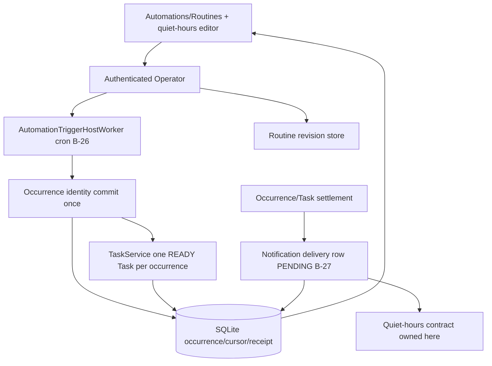

# 010 - Automations and Recurring Host

**ID:** 010
**Status:** ACCEPTED/LOCKED
**Owners:** Automation, Task Runtime, Runtime lifecycle, Desktop UI
**Updated:** 2026-11-09
**Revision:** 1.0
**Owner acceptance:** accepted 2026-11-09 by the repository owner (sarv-projects) via [docs/OWNER-ACCEPTANCE-REVIEW-PACKET.md](../../docs/OWNER-ACCEPTANCE-REVIEW-PACKET.md) (PR #1), including every "ACCEPT (scoped)" caveat as a binding condition and the A-35 quiet-hours ownership. Acceptance approves the design and authorizes implementation; it is not evidence that anything is implemented, SERVED, INTEGRATED or QUALIFIED.
**Revision note:** revision 1.0 adds V1 gap coverage per owner acceptance 2026-11-09 (AC-013 to AC-019: pinned cron grammar, an event-trigger kind after cron for E2E-10, LOCAL_POLL delivery transitions, the quiet-hours control surface, Task execution only through Feature 005, Coworker PAUSED recheck at occurrence time, truthful pause copy and history pagination).
**Change control:** this is a locked contract. Any change to it from now on requires a new revision and renewed owner approval (SPECIFICATION-STANDARD section 7).
**Target release:** V1 local desktop
**Dependencies:** root ARCHITECTURE.md, docs/V1-PRODUCT-RELEASE-CONTRACT.md, docs/IMPLEMENTATION-MASTER-PLAN.md, and the owner documents named in RESEARCH.md. Feature 001 remains the Conversation send authority.

## 1. Problem

Timers in the UI are not occurrences. Closing the window is not the same as the machine sleeping. Duplicate fires must not duplicate consequential Tasks.

Observable outcome: A saved schedule or event creates exactly one Task per occurrence, including across sleep and restart, with truthful history and notification status.

## 2. Goals

- Persist Automation revisions and occurrence identity.
- Let TriggerHost observe and Task admission execute.
- Cover timezone, DST, misfire, overlap, dedupe and offline.
- Record notification status separately from Task success.

V1 gap coverage (revision 1.0, owner acceptance 2026-11-09):

- Qualify cron in a named timezone first, then one event-trigger kind, because E2E-10 requires a scheduled and an event Automation.
- Deliver LOCAL_POLL notifications: a PENDING row moves through claim and settlement to a final status, and that status stays separate from the Task outcome.
- Own the quiet-hours control surface (A-35) with an editable, version-fenced control.
- Hand occurrence Tasks to execution only through Feature 005 admission once 005 qualifies.
- Recheck Coworker PAUSED when a scheduled slot is settled, so a paused Coworker produces a recorded skip rather than a retry loop.

## 3. Non-goals

- Inbound public webhooks as the default reachability story.
- Unattended Coworker autonomy beyond an explicit Routine.
- Cloud Runtime execution.
- An in-Core visual workflow graph, graph database, graph execution engine or generic code-node runtime.
- Importing external workflow node/step state as LiteCowork Task Step state.

## 4. Current evidence

The active source tree is present in apps/ and crates/. The behavior below is the normative feature target; source, served-route and UI evidence for this checkout is recorded in docs/IMPLEMENTATION-STATUS.md. Code or a route alone does not qualify the feature. A recursive 2026-11-06 scan of active apps/ and crates/ found no WorkflowBackendAdapter, WorkflowAuthoringAdapter, WorkflowGraph, edit_workflow, list_workflows or invokeWorkflow symbols. The WorkflowBackendAdapter described in CONNECTORS-WORKFLOWS.md is therefore a target contract, not an implemented production integration in this checkout. The decisions in §5 are owner-accepted (2026-11-09) and this package is ACCEPTED/LOCKED. Implementation and qualification status are unchanged by acceptance and tracked in §19a and [IMPLEMENTATION-STATUS.md](../../docs/IMPLEMENTATION-STATUS.md).

## 5. LOCKED and FLEXIBLE decisions

### LOCKED

- TriggerHost observes; ordinary Task admission selects the execution Runtime (master plan P9, AUTOMATION.md).
- At-least-once input becomes exactly-once occurrence.
- Polling is the default local reachability, not a fallback excuse for open webhooks.
- Logical occurrence and idempotency are durable.
- Window close may leave Runtime up; sleep and shutdown are blockers (release contract §6.7).

### FLEXIBLE

- Module file layout and private helper names, provided the transactions and secret boundaries stay intact.
- Presentation copy, provided state distinctions remain visible.

### Open decisions

- Resolved by B-26 (ACCEPTED 2026-11-09): cron in a named timezone is the first trigger type. Revision 1.0 adds one event-trigger kind after it (TASKS.md T09), as required by E2E-10; a local file poll stays a later, separately qualified type.

### Blockers

- B-26: first trigger type and misfire policy for GA. ACCEPTED (2026-11-09).
- B-27: notification channel (local only in this slice). ACCEPTED (2026-11-09).

### ACCEPTED DECISIONS AND ARCHITECTURAL CONTRACTS (OWNER-ACCEPTED 2026-11-09)

The repository owner accepted these resolutions on 2026-11-09 via [docs/OWNER-ACCEPTANCE-REVIEW-PACKET.md](../../docs/OWNER-ACCEPTANCE-REVIEW-PACKET.md). The register rows in [docs/CONTRADICTION-AND-ALIGNMENT-REGISTER.md](../../docs/CONTRADICTION-AND-ALIGNMENT-REGISTER.md) are closed by the orchestrator.

| ID | Topic | Accepted resolution and architectural contract | Canonical authority and consequence |
|---|---|---|---|
| B-26 | First Automation trigger type and misfire policy for GA | **ACCEPTED (2026-11-09): Cron-in-a-named-timezone as the first qualified trigger type, with `MisfirePolicy = RUN_ONCE_WHEN_AVAILABLE` as the GA default, over the already-running local `AutomationTriggerHostWorker` (30s cursor poll).** The next fire is computed from the stored timezone (not a baked UTC offset); `ambiguous_local_time`/`nonexistent_local_time` follow the AUTOMATION.md DST rules (EARLIER/LATER, SKIP/NEXT_VALID). A missed fire during sleep records a single misfire-recovered occurrence, never a silent success or an unbounded catch-up storm. Local file-poll triggers stay a later, separately qualified type. One occurrence identity maps to exactly one Task. | [AUTOMATION.md](../../docs/AUTOMATION.md), [ROUTINES.md](../../docs/ROUTINES.md). The exact cron grammar and catch-up bound land in the owner contract in TASKS.md T01 before T03 qualifies the trigger. The event-trigger kind that E2E-10 needs follows cron (TASKS.md T09). |
| B-27 | Local notification channel and delivery guarantees | **ACCEPTED (2026-11-09): A single LOCAL_POLL notification channel in this slice, where occurrence/Task settlement inserts a `PENDING` delivery row transactionally and notification status is tracked distinctly from Task outcome; no public webhook listener and no delivery guarantee beyond best-effort local presentation.** A `PENDING` row is not a delivered notification; when delivery is unknown the status stays distinct from Task settlement (a Task can COMPLETE while notification delivery is UNKNOWN). Free-text channel names do not route delivery; the producer uses Workspace event-class policy and the quiet-hours contract this feature owns (see Notifications-surface ownership below). The quiet-hours control surface and its normative semantics are owned here. | [AUTOMATION.md](../../docs/AUTOMATION.md), [CHANNELS.md](../../docs/CHANNELS.md). The `SENDING/SENT/FAILED/AMBIGUOUS/SUPPRESSED` transitions and the LOCAL_POLL presenter are TASKS.md T06 and T07; until they land, a `PENDING` row means only "recorded, not delivered". |

Both decisions are owner-accepted and the package is ACCEPTED/LOCKED. Implementation and qualification status are unchanged and tracked in §19a and [IMPLEMENTATION-STATUS.md](../../docs/IMPLEMENTATION-STATUS.md): the cron grammar pin, the delivery transitions and the quiet-hours editor are not in source yet.

### Notifications surface ownership (A-35, ACCEPTED 2026-11-09)

Per the A-35 resolution, accepted by the owner on 2026-11-09, in [docs/CONTRADICTION-AND-ALIGNMENT-REGISTER.md](../../docs/CONTRADICTION-AND-ALIGNMENT-REGISTER.md), the normative **notification quiet-hours control surface** (quiet-hours start/end, timezone, selected notification classes and their semantics) is owned by **Feature 010** (delivery). Feature 011 owns only the Settings shell entry point and LINKS to this feature's quiet-hours contract rather than republishing the control semantics. The quiet-hours normative table below is the owner definition; other packages link to it.

#### Quiet-hours normative control table (owned here)

| Control | Scope | Saved state class | Semantics |
|---|---|---|---|
| Quiet-hours enabled | Workspace | OPERATOR_CAS | When enabled, selected notification classes are suppressed during the window; Task settlement is unaffected. |
| Quiet-hours start/end | Workspace | OPERATOR_CAS | Stored with an explicit timezone; DST handling follows AUTOMATION.md local-time rules. |
| Quiet-hours timezone | Workspace | OPERATOR_CAS | Named timezone; never a baked UTC offset. |
| Suppressed notification classes | Workspace | OPERATOR_CAS | Only the selected classes are suppressed; others still present. A suppressed delivery row is SUPPRESSED, not a silent drop. |

## 6. High-level design

UI saves a Routine revision. TriggerHost commits an occurrence once. TaskService materializes one Task linked to that occurrence. A second observation with the same identity returns the original Task id. Notifications update a separate status row.

### Feature-specific component diagram



Trigger hosting, occurrence identity, Task materialization and notification status are separate axes; quiet-hours is owned by this feature and consulted by the notification producer.

### Trust boundaries

The desktop UI is untrusted; the authenticated Operator is the only command path. Triggers cannot widen grants; event payloads are untrusted; secrets are never stored in the automation revision. The TriggerHost observes and commits occurrence identity but never runs the Task body. No public inbound port is opened. SQLite transactions make no network or process call; notification delivery rows commit transactionally with settlement but transport runs outside the transaction.

### Actor sequence (target)

1. Owner saves an Automation; it is created PAUSED and admits no Task.
2. Owner resumes; the cron trigger becomes locally reconcilable and the TriggerHost begins observing (no fire at enable time).
3. A scheduled occurrence is observed once; the TriggerHost commits exactly one occurrence identity.
4. TaskService materializes exactly one READY Task linked to that occurrence; a second observation returns the original Task id.
5. On settlement a `PENDING` notification delivery row is inserted, consulting the quiet-hours contract owned here; status is distinct from Task outcome.
6. After sleep/restart the cursor replays and records a single misfire-recovered occurrence per the locked policy, never a silent success.

### Ownership

| Owner | Responsibility | Excluded responsibility |
|---|---|---|
| Desktop UI | Automation/Routine editor, quiet-hours controls, honest history | Executing the Task body or routing delivery by free text |
| Operator | Auth, Workspace scope, version/idempotency | Running the Task inside TriggerHost |
| AutomationTriggerHostWorker | Cursor poll, occurrence identity, misfire/overlap | Task execution or machine wake |
| TaskService | One READY Task per occurrence, dedupe by occurrence id | Starting planning/agent execution |
| Notification producer | `PENDING` delivery row, quiet-hours suppression, status distinct from Task | Claiming transport delivery |
| Storage | Atomic occurrence/cursor/receipt/notification commits | External process/network calls |

Trust boundary: the desktop UI is untrusted; the authenticated Operator is the only command path; native credentials and OS handles stay outside public events; SQLite transactions do not perform network or process calls.

## 7. Low-level design

Follow AUTOMATION.md occurrence lifecycle, cursor durability and concurrency rules. Manual run and scheduled run share idempotency rules. Execution still uses feature 005 admission once that package exists; until then this spec's acceptance is the occurrence-to-Task identity contract.

Ordering: authorize, compare expected version, commit the durable receipt, then perform any external call, then reconcile. Accepted target payload fields are not served until the canonical owner document and machine schema change together (TASKS.md T01).

### 7.1 Existing signatures (CODE)

Observed in the active source; existence is CODE evidence, not SYSTEM/USER qualification.

- Served: `createAutomation`, `updateAutomation`, `pauseAutomation`, `resumeAutomation`, `runAutomationNow`, `settleAutomationTriggers`, `runRoutine`; `listOccurrences` (returns `next_cursor`). Events: `automation.occurrence.created.v1`, `automation.occurrence.claimed.v1`, `automation.occurrence.settled.v1`, `automation.cursor.changed.v1`, `notification.delivery.changed.v1`.
- Running: `AutomationTriggerHostWorker` started by `OperatorServer::start`, polls local trigger cursors every 30s. Occurrence/Task settlement inserts `PENDING` delivery rows.
- Not present: no production delivery worker/consumer or `SENDING/SENT/FAILED/AMBIGUOUS/SUPPRESSED` status writer; no quiet-hours editor controls (currently read/preserve-only); `retry_policy`/`wake_policy` have no production consumer; `preferred_channels` is not read by the producer; no WorkflowBackendAdapter.

### 7.2 Accepted target signatures (not yet in source)

Every signature below is an accepted target interface (not yet in source). TASKS.md T01 promotes it into AUTOMATION.md / CHANNELS.md and the OpenAPI/schema together. `TriggerDefinition::Schedule` with `RecurrenceFormat::Cron5` already exists in `crates/domain-responsibility/src/models.rs`; the struct below records the accepted shape, not a second type.

```rust
// Accepted target: first qualified trigger type (B-26) - cron in a named timezone.
pub struct CronTrigger {
    pub cron_expr: String,            // exact grammar owner-pinned
    pub timezone: String,             // IANA name, never a baked UTC offset
    pub misfire_policy: MisfirePolicy, // accepted default RUN_ONCE_WHEN_AVAILABLE
    pub catch_up_bound: u16,          // bounded; no unbounded storm
}

// Accepted target: local notification delivery row (B-27), status distinct from Task outcome.
pub struct NotificationDelivery {
    pub occurrence_id: String,
    pub channel: NotificationChannel, // LOCAL_POLL in this slice
    pub status: NotificationStatus,   // PENDING | SENDING | SENT | FAILED | AMBIGUOUS | SUPPRESSED
    pub suppressed_by_quiet_hours: bool,
}

// Accepted target: quiet-hours contract owned by this feature (A-35).
pub struct QuietHours {
    pub enabled: bool,
    pub start_local: LocalTime,
    pub end_local: LocalTime,
    pub timezone: String,             // IANA name
    pub suppressed_classes: Vec<NotificationClass>,
}

// Accepted target (revision 1.0 gap): the event-trigger kind after cron. CONNECTOR_EVENT is
// already a TriggerDefinition variant; it is hosted by LOCAL_POLL through the Feature 006
// Connection broker, never by an inbound port.
pub struct ConnectorEventObservation {
    pub trigger_id: String,
    pub connection_id: String,            // opaque Connection ID
    pub provider_event_id: String,        // occurrence identity input
    pub payload_digest: String,           // conflict detection; payload is untrusted data
}

// Accepted target (revision 1.0 gap): a paused Coworker is a recorded skip, not a retry loop.
// SlotOutcomeReason in crates/domain-responsibility/src/trigger_host.rs gains one variant.
pub enum SlotOutcomeReason { /* Missed, OverlapSkipped, OverlapQueued, OverlapCancelOld, */ CoworkerPaused }
```

Typed errors (accepted target): `OccurrenceError::{Conflict, LeaseExpired}` (a stable delivery id reused with a different payload digest is `OCCURRENCE_CONFLICT`); `NotificationError::{ChannelUnavailable, QuietHoursSuppressed}`.

## 8. Data

See [DATA-MODEL.md](DATA-MODEL.md). This feature does not create a second source of truth beside the domain owner.

## 9. Wiring

See [WIRING.yaml](WIRING.yaml). Requests enter through the Operator. External calls sit outside transactions.

## 10. Security

Triggers cannot widen grants. Event payloads are untrusted. Secrets are not stored in the automation revision.

The future external-workflow adapter is a provider boundary, not a trust shortcut. Provider workflow metadata, node descriptions, prompts, code, comments, schemas, sample data, test outputs and run errors are untrusted input. Provider MCP access is not one boolean: discover/read, draft/mutate, validate/test, publish/activate, production run and delete/disable/revoke are separate permissions. Provider credentials remain in provider custody and are never copied into Routine text, Task packets, public events or model context.

n8n instance-level MCP requires owner/admin enablement, per-workflow exposure and client scopes; Activepieces separates read-only discovery from per-project tool categories. The exact provider instance/version and permission configuration must be probed before integration. Provider Code nodes execute under the provider's own host, credentials, filesystem/network and runner isolation; they are not LiteCowork Environment processes, and Core Trust cannot claim to mediate their internal effects. See [SECURITY.md](../../docs/SECURITY.md) and [CONNECTORS-WORKFLOWS.md](../../docs/CONNECTORS-WORKFLOWS.md) §10.2. No production workflow adapter exists in the active source tree, so these are future qualification requirements only.

## 11. Errors and recovery

Restart replays the cursor and does not double-create. Overlap policy is explicit. Missed fire during sleep is recorded as misfire or skipped according to B-26, never as silent success.

Races use compare-and-swap or a single-writer occurrence identity. Timeout after an external effect reconciles. Duplicate retries return the original receipt when the idempotency key matches and fail when the payload conflicts.

## 12. Crash and restart

Reload the last committed owner records. Do not infer success from an intent. Reconcile in-flight external work before a new side effect. Cancellation fences late results.

## 13. Configuration and compatibility

Local notifications only. No public webhook listener in this slice.

OS qualification is per native desktop. WSL2 does not qualify Windows or Linux GUI behavior.

## 14. Observability

Log ids, versions, statuses and denial reasons. Do not log secret bytes, native handles, private locators or raw credentials. Audit commits include actor, workspace and receipt id.

## 15. EARS acceptance

Positive:
- **AC-001:** WHEN a scheduled occurrence is observed once, THE SYSTEM SHALL create exactly one Task linked to that occurrence id. Verify: occurrence-to-Task identity test.
- **AC-004:** WHEN DST or timezone changes, THE SYSTEM SHALL compute the next fire from the stored timezone, not from a fixed UTC offset baked into the revision. Verify: DST/timezone next-fire test.

Concurrency / idempotency:
- **AC-002:** WHEN the same occurrence is observed again, THE SYSTEM SHALL return the original Task and SHALL NOT create another. Verify: duplicate-observation dedupe test.
- **AC-009:** WHEN a stable delivery id is reused with a different payload digest, THE SYSTEM SHALL return `OCCURRENCE_CONFLICT` and SHALL NOT create a second occurrence. Verify: occurrence-conflict test.

Recovery:
- **AC-003:** IF the machine was asleep across a fire time, THEN THE SYSTEM SHALL record misfire or skip according to the locked policy and SHALL NOT claim the run succeeded. Verify: sleep-misfire recovery test.
- **AC-005:** WHEN the desktop window closes and the Runtime remains up, THE SYSTEM SHALL still observe; WHEN the Runtime stops, THE SYSTEM SHALL not claim runs that did not start. Verify: window-close vs Runtime-stop matrix.

Boundary:
- **AC-010:** WHEN an Automation is saved, THE SYSTEM SHALL create it PAUSED and admit no Task, and resume SHALL NOT fire a trigger at enable time. Verify: saved-paused / resume-no-fire test.

Security:
- **AC-011:** WHEN a trigger or routine text is saved, THE SYSTEM SHALL NOT grant a capability, weaken an approval or open an inbound public port. Verify: no-grant / no-inbound-port test.

Notifications:
- **AC-006:** WHEN notification delivery is unknown, THE SYSTEM SHALL keep Task settlement and notification status distinct. Verify: status-separation test.
- **AC-007:** WHEN quiet hours are active for a selected class, THE SYSTEM SHALL mark the delivery SUPPRESSED using the quiet-hours contract owned here and SHALL NOT silently drop it. Verify: quiet-hours suppression test.

UI and accessibility:
- **AC-008:** WHEN the Automation history renders, THE SYSTEM SHALL show occurrence, Task and notification status separately as keyboard- and screen-reader-accessible states and SHALL NOT present a `PENDING` row as a delivered notification. Verify: history render + a11y test.

Performance:
- **AC-012:** WHEN many occurrences are due, THE SYSTEM SHALL bound catch-up per the locked misfire policy and SHALL NOT create an unbounded occurrence storm. Verify: catch-up bound test.

V1 gap coverage (revision 1.0):
- **AC-013:** WHEN an Automation is saved with a schedule trigger, THE SYSTEM SHALL accept only the pinned CRON_5 grammar with an IANA timezone name and SHALL reject an unknown timezone, a fixed UTC offset or an expression outside the grammar with a typed validation error before any cursor exists. Verify: cron grammar and timezone validation test.
- **AC-014:** WHEN an enabled event trigger observes a provider event through LOCAL_POLL, THE SYSTEM SHALL commit exactly one occurrence keyed by the trigger and provider event identity, SHALL return the original occurrence for a duplicate, and SHALL NOT open an inbound port. Verify: event-trigger occurrence identity test.
- **AC-015:** WHEN a `PENDING` delivery row exists, THE SYSTEM SHALL let the local presenter claim it under a lease, SHALL settle it SENT, FAILED or AMBIGUOUS with a `notification.delivery.changed.v1` event, SHALL mark a claim interrupted by restart AMBIGUOUS rather than SENT, and SHALL NOT change the Task outcome. Verify: LOCAL_POLL delivery transition test.
- **AC-016:** WHEN the owner edits quiet hours, THE SYSTEM SHALL require the current preference version, SHALL reject an invalid timezone, window or class set, and SHALL apply the saved window to later deliveries only. Verify: quiet-hours control CAS test.
- **AC-017:** WHILE Feature 005 Task execution is not qualified, THE SYSTEM SHALL leave occurrence Tasks READY and show them as not executed; WHEN 005 qualifies, THE SYSTEM SHALL hand them to 005 admission and SHALL NOT run a Task body inside the TriggerHost. Verify: execution-handoff boundary test.
- **AC-018:** WHEN a due slot belongs to an Automation whose pinned Coworker is PAUSED, THE SYSTEM SHALL record one skipped occurrence with reason COWORKER_PAUSED, SHALL advance the cursor per the misfire policy, and SHALL NOT create a Task or retry the slot on every pass. Verify: Coworker-paused settlement test.
- **AC-019:** WHEN the owner pauses or resumes an Automation or opens its history, THE SYSTEM SHALL describe the actual hosting effect and SHALL page occurrence history through `next_cursor`. Verify: truthful copy and history pagination test.

## 16. Executable acceptance command

```bash
python3 .specify/scripts/validate_feature_package.py specs/010-automations-recurring-host
```

Further gates after ACCEPTED/LOCKED are the cargo filters named in TASKS.md. They are not evidence until run on a recovered source tree.

## 17. Out-of-bounds

- Do not expose an unauthenticated inbound port.
- Do not run the Task body inside TriggerHost.

## 18. Assumptions and open questions

- Depends on Task execution from 005 for end-to-end execution (TASKS.md T08); occurrence identity can be tested first.
- Event-trigger kind: revision 1.0 names CONNECTOR_EVENT because AUTOMATION.md already lists connector-event among the V1 providers and it needs no inbound port. It depends on a qualified Feature 006 Connection. The owner confirmed this choice (CONNECTOR_EVENT over LOCAL_POLL) on 2026-11-10; if 006 is not qualified in time, T09 stays BLOCKED rather than substituting an unreviewed kind.
- Source conflict for T07: `record_automation_outcome_delivery` in `crates/storage-sqlite/src/notification.rs` documents that "a suppressed outcome never becomes a delivery row", while AC-007 requires a SUPPRESSED row. The accepted contract (AC-007) wins; T07 changes the producer.
- Legacy docs/superpowers plans are not this package.

B-26 and B-27 are owner-accepted (2026-11-09). Implementation tasks: 010-T01 to 010-T17 in [TASKS.md](TASKS.md) form the V1 plan. 010-T18 (external WorkflowBackend Routine mapping, previously numbered T05) is blocked on qualified Task/CapabilityInvocation/WorkflowBackendAdapter ownership and is not a V1 release gate; 010-T19 (direct provider-graph authoring evaluation, previously numbered T06) is deferred and is not implementation authorization.

## 7a. Owner facts incorporated 2026-11-01

Read from AUTOMATION and ROUTINES.

- Only a terminal Task settles an occurrence. COMPLETED maps to COMPLETED, terminal FAILED maps to FAILED, and CANCELLED maps to SKIPPED with an explicit reason. INCOMPLETE, PAUSED, WAITING_USER, BLOCKED, NEEDS_USER, VERIFYING, READY, RUNNING, PAUSE_REQUESTED, and CANCEL_REQUESTED leave the occurrence STARTED and still occupying its concurrency slot.
- MisfirePolicy is SKIP, RUN_ONCE_WHEN_AVAILABLE, or CATCH_UP_BOUNDED. ambiguous_local_time is EARLIER or LATER. nonexistent_local_time is SKIP or NEXT_VALID. A timezone-rule update does not rewrite a claimed occurrence.
- Occurrence states move PENDING to CLAIMED to STARTED to COMPLETED or FAILED, with WAITING_DEPENDENCY and SKIPPED. CLAIMED returns to PENDING only when its lease expires before Task materialization. A stable delivery id reused with a different payload digest is OCCURRENCE_CONFLICT.
- Saving an Automation creates it PAUSED and admits no Task. POST /v1/automations/{id}/run is allowed while PAUSED and does not enable recurring hosting. DISABLED is terminal. Resume enables only a PAUSED Automation whose triggers are locally reconcilable Manual or Schedule triggers and does not fire them at enable time.
- POST /v1/routines/{id}/run requires Idempotency-Key and the exact routine_revision, rejects a non-null conversation_id until Conversation and Task can commit atomically, and accepts at most 64 top-level TEXT or RESOURCE_REF bindings. Success creates one READY Task and TaskSpecRevision 1 and no Plan, Step, session, Attempt, lease, Environment, Effect, or grant. Routine text cannot grant capabilities or weaken approvals.
- A SIGNATURE webhook is verified with constant-time HMAC over the raw bytes before parsing. Local default hosting is LOCAL_POLL. This slice still does not add a public webhook listener.
- Cite createAutomation, updateAutomation, pauseAutomation, resumeAutomation, runAutomationNow, settleAutomationTriggers, runRoutine. Events: automation.occurrence.created.v1, automation.occurrence.claimed.v1, automation.occurrence.settled.v1, automation.cursor.changed.v1, notification.delivery.changed.v1.


## 19. External WorkflowBackend integration and authoring boundary — 2026-11-06

This feature owns Automation revision, trigger hosting, occurrence identity, cursor, misfire/overlap, Task materialization and notification status. It does not own a general-purpose visual workflow graph or workflow execution runtime.

The canonical boundary is defined by [CONNECTORS-WORKFLOWS.md](../../docs/CONNECTORS-WORKFLOWS.md), [AUTOMATION.md](../../docs/AUTOMATION.md), [ROUTINES.md](../../docs/ROUTINES.md), [TASK-RUNTIME.md](../../docs/TASK-RUNTIME.md) and [V1-WORKFLOW-EVENT-LLD.md](../../docs/V1-WORKFLOW-EVENT-LLD.md):
- A Routine is a pinned reusable Task instruction/input contract.
- An Automation determines when/why a Routine is invoked and produces a canonical Occurrence/Task.
- The target external-workflow integration invokes a provider-owned deterministic workflow through a future qualified WorkflowBackendAdapter as one bounded CapabilityInvocation inside a Task; no production adapter is present in this checkout.
- The external engine owns its graph schema, internal nodes, graph revisions, execution engine and internal run/step state.
- LiteCowork owns Task/Attempt/CapabilityInvocation/Effect/Evidence, Trust, Workspace scope, user approvals and user-visible reconciliation.
- Provider node status is an observation. It does not create a LiteCowork Task Step or settle a Task by itself.

### V1 authoring modes

**Manual authoring:** the user creates or edits an existing flow in the connected workflow provider's own editor (for example, a user-owned n8n or Activepieces instance). The target LiteCowork experience is to discover the workflow, inspect its supported input/output metadata, validate user-provided input, pin the selected external workflow reference in a Routine, invoke it through the adapter and display provider run observations. This is not implemented in the current checkout: the adapter contract is target-only and no production WorkflowBackendAdapter was found in apps/ or crates/. LiteCowork does not embed or clone the provider canvas.

**Provider-native AI authoring:** n8n documents an Assistant that builds a normal n8n graph on the provider's canvas from a natural-language brief, then lets the owner inspect and edit the same graph manually; its MCP server also documents provider-side create/edit/validate/test operations. Activepieces documents a Build-by-Asking path and MCP tools such as `ap_build_flow`, `ap_add_step`, `ap_update_step`, validation and publish. These are authoring capabilities of the user's external provider, not capabilities of LiteCowork Core. The user may use them in the connected provider's own UI/MCP environment, subject to that provider's permissions and security boundary. LiteCowork currently has no production provider connection/WorkflowBackendAdapter path in the active source tree, so this is external-provider capability research rather than an available LiteCowork integration.

**LiteCowork agent assistance:** in V1, a LiteCowork Coworker/agent may help the user formulate a Routine, map values to a selected workflow's input schema, explain validation errors and summarize run receipts. It may not claim to create or modify an external graph. The WorkflowBackendAdapter described in CONNECTORS-WORKFLOWS.md is a target read/validate/invoke/observe/cancel contract; no corresponding production adapter symbols/routes were found in the active source tree. It has no qualified create/update/publish operation. An agent tool that only lists/reads/invokes is not an authoring API.

These paths are complementary: manual and provider-native AI graph authoring stay in the external provider; LiteCowork V1 owns the Routine/input mapping and will invoke only once a qualified adapter and Task/CapabilityInvocation/Trust path exist. Direct LiteCowork agent graph writes are future, provider-specific and separately gated—not V1.

### Future direct LiteCowork-Coworker provider-graph authoring extension

A future direct LiteCowork-agent capability may be evaluated through an optional provider-specific WorkflowAuthoringAdapter or tightly scoped mediated MCP Connection capability, with provider-owned create/draft/update/validate/publish/read-version operations. This is distinct from users using n8n Assistant or Activepieces Build by Asking/MCP directly inside those provider products, which does not require LiteCowork to author the graph. Direct LiteCowork-agent authoring must be an explicit provider capability, not an assumption shared by all WorkflowBackendAdapter implementations. Before enabling it, the owner must define:
- provider identity, API version, workflow reference and exact graph/version digest;
- draft-versus-published lifecycle, expected revision and stale-update conflict behavior;
- validation response and supported node/edge catalog;
- external effects, required scopes, execution identity and visibility;
- idempotency, timeout, ambiguous publish reconciliation and rollback/restore behavior;
- owner review/confirmation before a draft is published or a consequential run is started;
- audit receipts, retention, secret boundaries and per-provider compatibility tests.

A graph proposed by a LiteCowork Coworker must be created as a provider-side draft, schema-validated by that provider, shown to the owner as a provider-backed diff/preview, and explicitly confirmed before publish. LiteCowork must not create a second local graph database or execute the graph itself. This is a future direct-agent adapter proposal, not V1 acceptance and not an implementation authorization.

### Code-based nodes and execution

The inspected OpenBot graph schema has trigger, text, prompt, asset, LLM, agent, image, condition, approval, output, note and shape node kinds; it has no dedicated code-node kind. Its agent tool omits asset and image nodes from the kinds it may add. The reference therefore does not establish a JavaScript/Python workflow code-node feature.

n8n documents a Code node with JavaScript and Python support: https://docs.n8n.io/code/code-node/. Activepieces documents CODE steps accepting JavaScript/TypeScript source and package dependencies through its provider MCP tools: https://www.activepieces.com/docs/mcp/tools. Node-RED documents a JavaScript Function node over flow messages: https://nodered.org/docs/user-guide/writing-functions. These are external provider capabilities, not LiteCowork code-node types. They do not inherit LiteCowork's Environment/Trust guarantees. Code runs under the external engine's host configuration, credentials, filesystem/network policy and isolation. LiteCowork must disclose the provider execution boundary and required scopes; if effects cannot be declared/reconciled, the workflow remains unavailable for consequential production use. n8n also disclosed the condition-specific Python Task Runner advisory GHSA-9pq8-m8gp-4p53; where Python Task Runner is enabled, verify affected/patched version and configuration before allowing provider-side graph editing or execution.

### UI boundary

The V1 Automation screen remains a list/editor for Routine + trigger + owner + schedule/policy + history. It does not gain a permanent Workflow canvas section or an in-Core node palette.

Where a qualified external WorkflowBackend exists, a Routine may select an existing workflow and show:
- provider/Connection identity and exact workflow reference/version;
- supported input schema and validation errors;
- mapped Routine values and pinned source references;
- expected effect classes and Trust/approval requirements;
- test versus production invocation mode where the adapter supports both;
- external run identifier/progress observation and normalized result;
- a link to open the provider's own editor, when safe and supported.

A backend without a qualified listing/validation/invocation adapter is not selectable. A provider's internal graph, nodes and statuses are never represented as LiteCowork-owned Steps.

### OpenBot comparison

The source comparison and limitations are recorded in [OPENBOT-REFERENCE-IMPLEMENTATION-STUDY.md](../../docs/OPENBOT-REFERENCE-IMPLEMENTATION-STUDY.md). OpenBot demonstrates visual graph editing plus constrained agent tools that can save graph changes and animate the result. That is useful design evidence, but its graph runtime and direct agent editing are not promoted into LiteCowork Core. The reference README describes a development preview with danger-full-access/approvalPolicy-never behavior, and the repository declares PolyForm Noncommercial 1.0.0; this is not a security or code-reuse template.

## 19a. Current source and UI boundary — 2026-11-06

The following distinctions are source-verified and must remain explicit in downstream UI/feature ledgers:

- `AutomationTriggerHostWorker` is started by `OperatorServer::start` and polls local trigger cursors every 30 seconds. The `automation_operator.rs` module header is stale where it says recurring hosting and `/resume` remain unavailable. The Automation page's Pause success message is also stale where it says trigger execution is unavailable in this build.
- Definition pagination has a UI Load more action; occurrence history does not. `listOccurrences` returns a page with `next_cursor`, but the current page reads only the first page and discards the cursor.
- `retry_policy` and `wake_policy` are persisted editor fields with no production daemon consumer. The local TriggerHost does not run Task retry attempts or wake the machine. `max_concurrent_occurrences`, `overlap_policy` and schedule misfire decisions are consumed by the host. Placement/budget are materialized into Task inputs but do not imply a Task executor or cloud placement.
- Notification preferences store `preferred_channels`, but the outcome producer never reads that field. It reads Workspace event-class policy and quiet hours, then treats the first active ChannelBinding or any active Runtime Workspace binding as a local channel. Free-text channel names do not select a delivery route.
- `ON_CONDITION` means only a `Blocked` / `DEPENDENCY_BLOCKED` outcome in the domain evaluator; it is not a user-authored named condition. The Notifications page has no condition editor. It displays quiet hours but has no controls to create/change them; saves preserve the existing value or null.
- Occurrence/Task settlement inserts `PENDING` notification delivery rows. No production sender/consumer or status-transition writer was found for `SENDING`, `SENT`, `FAILED`, `AMBIGUOUS` or `SUPPRESSED`. The current Notifications Operator exposes reads and preference writes only; delivery history is not proof of transport delivery.
- Manual Run and Create test Task are separate: the former commits an occurrence and READY Task; the latter creates a READY Task without an occurrence/cursor. Neither starts planning or agent execution. The Routine and Automation pending-request recovery registries are process-local and are lost on app exit.
- External WorkflowBackendAdapter remains target-only; there is no provider selector/invocation UI or Core graph runtime.

## 20. Requirement traceability

| Requirement | Canonical contract | Task | Acceptance | Verification method |
|---|---|---|---|---|
| One Task per occurrence | AUTOMATION | 010-T04, 010-T08 | AC-001 | Occurrence-to-Task identity test |
| Duplicate observation dedupe | AUTOMATION, STORAGE | 010-T04, 010-T12 | AC-002 | Duplicate-observation dedupe test |
| Sleep misfire recovery (B-26) | AUTOMATION, RUNTIME-LIFECYCLE | 010-T03, 010-T10 | AC-003 | Sleep-misfire recovery test |
| DST/timezone next fire (B-26) | AUTOMATION | 010-T03 | AC-004 | DST/timezone next-fire test |
| Window-close vs Runtime-stop | RUNTIME-LIFECYCLE, AUTOMATION | 010-T10 | AC-005 | Window-close vs Runtime-stop matrix |
| Notification status separation (B-27) | AUTOMATION, CHANNELS | 010-T06 | AC-006 | Status-separation test |
| Quiet-hours suppression (A-35, B-27) | AUTOMATION, CHANNELS | 010-T07 | AC-007 | Quiet-hours suppression test |
| Accessible separate history | ui-behavior; AUTOMATION | 010-T11 | AC-008 | History render + a11y test |
| Occurrence conflict | AUTOMATION, STORAGE | 010-T04, 010-T09 | AC-009 | Occurrence-conflict test |
| Saved-paused / resume-no-fire | AUTOMATION | 010-T03, 010-T11 | AC-010 | Saved-paused / resume-no-fire test |
| No grant / no inbound port | TRUST, AUTOMATION | 010-T13 | AC-011 | No-grant / no-inbound-port test |
| Bounded catch-up | AUTOMATION | 010-T03 | AC-012 | Catch-up bound test |
| Pinned cron grammar and IANA timezone (B-26, gap) | AUTOMATION | 010-T03 | AC-013 | Cron grammar and timezone validation test |
| Event-trigger kind after cron (E2E-10, gap) | AUTOMATION, CONNECTORS-WORKFLOWS | 010-T09 | AC-014 | Event-trigger occurrence identity test |
| LOCAL_POLL delivery transitions (B-27, gap) | AUTOMATION, CHANNELS, EVENTS | 010-T06 | AC-015 | LOCAL_POLL delivery transition test |
| Quiet-hours control surface (A-35, gap) | AUTOMATION, CHANNELS, V1-SETTINGS-CONTRACT-LEDGER | 010-T07 | AC-016 | Quiet-hours control CAS test |
| Task execution only through 005 (gap) | TASK-RUNTIME, AUTOMATION | 010-T08 | AC-017 | Execution-handoff boundary test |
| Coworker PAUSED recheck at settlement (gap, with 009) | RESPONSIBILITIES, AUTOMATION | 010-T05 | AC-018 | Coworker-paused settlement test |
| Truthful pause copy and history pagination (A-29, gap) | AUTOMATION, ui-behavior | 010-T02, 010-T11 | AC-019 | Truthful copy and history pagination test |
