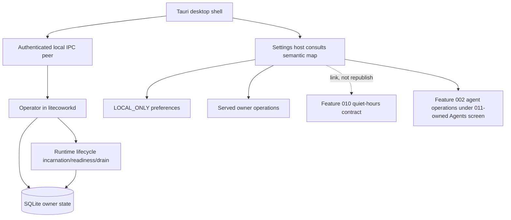

# 011 - Desktop Shell IPC Settings and Runtime Health

**ID:** 011
**Status:** ACCEPTED/LOCKED
**Owners:** Runtime, Operator IPC, Desktop UI, Product
**Updated:** 2026-11-09
**Revision:** 1.0 (revision 1.0 adds V1 gap coverage per owner acceptance 2026-11-09: authenticated Operator stop and update/quiescence gate, keep-awake, Workspace rename/archive in Settings, app-wide keyboard/focus baseline, Settings->Agents screen ownership (A-35), inert-control removal (B-29/B-33), Notifications link to Feature 010; AC-014 to AC-020)
**Owner acceptance:** accepted 2026-11-09 by the repository owner (sarv-projects) via [docs/OWNER-ACCEPTANCE-REVIEW-PACKET.md](../../docs/OWNER-ACCEPTANCE-REVIEW-PACKET.md) (PR #1), including each scoped caveat and the B-02/B-28 rider as binding conditions. Acceptance authorizes implementation; it is not a claim of implementation, SERVED, INTEGRATED or QUALIFIED status.
**Change control:** this is a locked contract. Any change to a locked decision, interface or acceptance criterion requires a new revision and renewed owner approval (docs/SPECIFICATION-STANDARD.md §7).
**Target release:** V1 local desktop
**Dependencies:** root ARCHITECTURE.md, docs/V1-PRODUCT-RELEASE-CONTRACT.md, docs/IMPLEMENTATION-MASTER-PLAN.md, and the owner documents named in RESEARCH.md. Feature 001 remains the Conversation send authority.

## 1. Problem

The shell is not the security boundary. A settings toggle without a handler must not look armed. Window close, sleep and daemon stop are different. WSL is not native Windows or Linux qualification.

Observable outcome: The owner launches the desktop, reaches a real local Runtime over authenticated IPC, changes a setting only when its handler exists, and sees truthful runtime health across restart.

## 2. Goals

- Authenticate Tauri-to-daemon IPC without a loopback bearer.
- Map each settings control to LOCAL_ONLY, NATIVE, TARGET or a served command.
- Expose Runtime incarnation, readiness and drain state honestly.
- Keep semantic chat usable when rich presentation is disabled.
- Gate Runtime stop and desktop update on proven quiescence through an authenticated Operator stop (revision 1.0 gap coverage).
- Provide keep-awake, Workspace rename/archive in Settings and an app-wide keyboard/focus baseline (revision 1.0 gap coverage).
- Own the Settings -> Agents screen (A-35) and render only served-owner Settings controls; remove inert controls (B-29/B-33).

## 3. Non-goals

- Replacing the daemon with a window-owned Electron host.
- Cloud Runtime enrollment.
- Claiming all 187 settings are served.
- Mobile clients.

## 4. Current evidence

The active source tree is present in apps/ and crates/. The behavior below is the normative feature target; source, served-route and UI evidence for this checkout is recorded in docs/IMPLEMENTATION-STATUS.md and docs/SETTINGS-AND-SHELL-SURFACE-AUDIT.md. Code or a route alone does not qualify the feature. The design is ACCEPTED/LOCKED (owner acceptance 2026-11-09); implementation and qualification status are unchanged and tracked here and in docs/IMPLEMENTATION-STATUS.md.

### Current source crosswalk — 2026-11-06

The active App.tsx Settings route mounts `SettingsView.tsx`, with four visible categories only: General, Workspaces, Agents and Runtime. The 16-category IA later in this SPEC is the V1 target, not current navigation. The mounted view currently exposes Workspace selection/refresh/create, immutable Workspace instruction revision editing, archive, bounded Agent catalogue/profile probes and binding operations, and Runtime start/refresh/lifecycle observation. It does not expose WorkspaceRoot management, Workspace rename/policy mutation, Runtime enrollment, Runtime stop/drain or startup-policy mutation. General appearance controls are ephemeral component state and do not apply/persist preferences; the source comment claiming localStorage persistence is inaccurate. Shortcut labels are not wired to key handlers. There is no Settings search or responsive category drawer in the active component. The Workspaces & Roots heading overstates the visible operations; the panel shows replication policy read-only and does not expose roots or policy changes. The Agents heading mentions OpenCode, Codex, Claude Code and Gemini, but active probes are only Codex and OpenCode; the 15 curated candidates/ACP distributions are catalogue metadata, not detected/installed/turn-capable agents. The alternate exported `SettingsPage` in App.tsx is unmounted. Earlier nine-category and Browser/cache/TLS/Shell Engine/approval/Credential Store claims are stale; Browser/Terminal are Workbench surfaces owned by Feature 008. The current UI's “Connected (Localhost)” copy is inaccurate for OS-local socket/named-pipe IPC. The mounted component also fails to render Runtime error/loading props, Workspace-create pending-journal retry state and Workspace-instruction conflict recovery controls that are passed into it. App bootstrap separately attempts auto-start when no daemon process is running and the daemon executable is available. See the source audit for exact controls and limitations.

## 5. LOCKED and FLEXIBLE decisions

### LOCKED

- Operator IPC does not change API authorization (LOCAL-OPERATOR-IPC).
- Principal comes from the authenticated transport, never a client-supplied id (settings ledger).
- Display preferences must not restore grants.
- Three independent lifecycles: Runtime, AgentHost, Environment (RUNTIME-LIFECYCLE).
- V1 is local-first desktop (ARCHITECTURE).
- Untrusted presentation cannot forge host actions (master plan P10, owned here as a shell rule).

### FLEXIBLE

- Module file layout and private helper names, provided the transactions and secret boundaries stay intact.
- Presentation copy, provided state distinctions remain visible.

### Decisions recorded (formerly open)

- GA OS order: ACCEPTED (2026-11-09) as B-28 below.
- First served Settings groups: ACCEPTED (2026-11-09) as B-29 and B-33 below.

### Blockers (ACCEPTED 2026-11-09; implementation obligations remain)

- B-28: GA OS and IPC qualification bar.
- B-29: first settings groups allowed to be enabled in the shell.
- B-33: V1 Settings acceptance surface (mounted four categories vs the 16-category/187-control target IA).

### ACCEPTED DECISIONS AND ARCHITECTURAL CONTRACTS (owner-accepted 2026-11-09)

The repository owner accepted these resolutions on 2026-11-09 via [docs/OWNER-ACCEPTANCE-REVIEW-PACKET.md](../../docs/OWNER-ACCEPTANCE-REVIEW-PACKET.md), including the riders recorded in each row. The register [docs/CONTRADICTION-AND-ALIGNMENT-REGISTER.md](../../docs/CONTRADICTION-AND-ALIGNMENT-REGISTER.md) is updated by the orchestrator.

| ID | Topic | ACCEPTED resolution and architectural contract | Canonical authority and consequence |
|---|---|---|---|
| B-28 | First GA operating system and exact security profile | **ACCEPTED (2026-11-09): Windows 11 / Windows 10 (`x86_64-pc-windows-msvc`) as the first GA desktop, matching the Feature 001 B-02 first route, with the LOCAL-OPERATOR-IPC named-pipe security profile as the IPC bar.** The Windows named pipe DACL grants only the current logon SID and SYSTEM; remote clients are rejected; if the DACL cannot be created, startup does not open an unauthenticated pipe and does not fall back to loopback bearer. Linux (owner-only 0600 socket in an owner-only 0700 directory, peer-UID match, symlink rejection) is the second qualified OS. WSL2 never counts as native Windows or native Linux qualification. Each OS is qualified independently; shared Rust code does not imply cross-OS qualification. | [LOCAL-OPERATOR-IPC.md](../../docs/LOCAL-OPERATOR-IPC.md), [RUNTIME-LIFECYCLE.md](../../docs/RUNTIME-LIFECYCLE.md). The register notes A-45/A-49 container test failures belong on the host qualification checklist for this bar. **B-02/B-28 rider (binding):** the first route to qualify on the Windows row is OpenCode v2.0.32 (the only harness the supervisor dispatches today); Claude Code CLI is the second module and Codex later. Linux x64 with the 0600/0700 socket is the second release-matrix row. The exact packaged-peer test matrix is an implementation task, not a precondition of acceptance. |
| B-29 | Which Settings groups are enabled in V1 | **ACCEPTED (2026-11-09): Only the groups whose owner operation is already served are interactive in V1; every other category renders visibly unavailable with a concrete missing prerequisite.** Concretely: Workspaces (selection/create/instruction revision/archive) and Runtime (health/readiness/start/refresh reads) are the interactive-served groups; Agents surfaces Feature 002's served catalogue/probe/binding operations; General appearance controls are LOCAL_ONLY preferences only once persistence is actually wired (today they are inert component state and must not look armed). No target-only control is presented active. | [V1-SETTINGS-CONTRACT-LEDGER.md](../../docs/V1-SETTINGS-CONTRACT-LEDGER.md), [SEMANTIC-SERVED-UI-MAP.md](../../docs/SEMANTIC-SERVED-UI-MAP.md). Every enabled control must map to a durable owner operation and recovery behavior before it ships enabled. Inert controls found in source (General theme/density/text-scale/reduced-motion component state, display-only Ctrl + N / Ctrl + W / Ctrl + K labels, the "Connected (Localhost)" transport copy) are removed or wired by the implementation tasks. |
| B-33 | V1 Settings acceptance surface | **ACCEPTED (2026-11-09): The V1 acceptance surface is the honestly-mapped set of served controls within the mounted four categories (General, Workspaces, Agents, Runtime), NOT a claim that all 16 categories or 187 controls are served.** The 16-category IA in the screen map below is the authored target; it is explicitly not current navigation and does not assert all underlying controls are served. Acceptance is control-by-control: a control is in the V1 acceptance surface only if its owner operation is served and its empty/stale/offline/denied/error states exist. The target IA guides future growth; it does not expand the V1 acceptance surface by assertion. | [V1-PRODUCT-RELEASE-CONTRACT.md](../../docs/V1-PRODUCT-RELEASE-CONTRACT.md), [V1-UI-SCREEN-CONTRACT.md](../../docs/V1-UI-SCREEN-CONTRACT.md) §11/§14. This changes the acceptance surface by two orders of magnitude; the exact four-category control set plus the revision 1.0 gap controls (Workspace rename, keep-awake, safe stop) is pinned by the first implementation task in the Settings ledger. |

These decisions are owner-accepted and the package is ACCEPTED/LOCKED. Implementation and qualification status are unchanged and tracked in §4 and docs/IMPLEMENTATION-STATUS.md; the packaged-peer OS matrix and the pinned control set are implementation tasks.

### Settings surface ownership (A-35, ACCEPTED 2026-11-09)

Per the A-35 resolution, accepted as written on 2026-11-09, in [docs/CONTRADICTION-AND-ALIGNMENT-REGISTER.md](../../docs/CONTRADICTION-AND-ALIGNMENT-REGISTER.md): Feature 011 OWNS the normative **Settings -> Agents screen surface** (control table, layout, categories and shell wiring); Feature 002 owns only the agent install/auth/binding operations the screen invokes and links to this package. Conversely, the notification **quiet-hours control surface** is owned by **Feature 010** (delivery); this package exposes only the Settings shell entry point for Notifications and LINKS to Feature 010's quiet-hours contract rather than republishing the control semantics.

## 6. High-level design

Tauri shell renders. IPC carries Operator commands to litecoworkd. Runtime lifecycle owns incarnation and drain. Settings UI consults the semantic map: LOCAL_ONLY may change immediately; TARGET stays disabled with the ledger's failure text; served commands wait until a later package marks them SERVED.

### Feature-specific component diagram



The shell is not the security boundary: IPC peer authentication is. Settings never mounts a control whose owner operation is not served. Quiet-hours is drawn as a link to Feature 010, not a republished table.

### Trust boundaries

The desktop UI is untrusted and never supplies the principal; the principal comes from the authenticated transport (peer UID on Unix, logon-SID DACL on Windows). Remote pipe clients are rejected. There is no loopback bearer fallback. IPC frames are redacted in logs; native credentials and OS handles stay outside public events. Display preferences cannot restore grants. SQLite transactions make no network or process call.

### Actor sequence (target)

1. The shell connects over the OS-local IPC transport; the Operator accepts a command only from an authenticated local peer.
2. A missing peer marker is rejected; no bearer fallback is attempted.
3. The Settings host consults the semantic map and renders each control as LOCAL_ONLY, served or unavailable; a TARGET control is disabled with the ledger's failure text.
4. A LOCAL_ONLY change persists a presentation preference without changing grants or bindings.
5. Runtime health reads report incarnation/readiness/drain honestly; a STOPPED/STARTING/RECOVERING incarnation never shows execution as ready.
6. Window close with the Runtime still running never reports the Runtime as stopped; drain stops admission before claiming stopped.

### Ownership

| Owner | Responsibility | Excluded responsibility |
|---|---|---|
| Desktop shell/UI | Render, category navigation, honest unavailable states, 011-owned Agents screen | Being the security boundary |
| Operator IPC | Authenticate local peer, reject remote/missing marker, redact frames | Changing API authorization |
| Runtime lifecycle | Incarnation, readiness, drain, recovery reporting | Cancelling Tasks on window close |
| Settings host | Semantic-map-driven control rendering, LOCAL_ONLY persistence | Mounting unserved controls as active |
| Feature 010 (linked) | Quiet-hours normative control table | Being republished here |
| Feature 002 (under 011 screen) | Agent install/auth/binding operations | Owning the Agents screen surface |

Trust boundary: the desktop UI is untrusted; the authenticated Operator is the only command path; native credentials and OS handles stay outside public events; SQLite transactions do not perform network or process calls.

## 7. Low-level design

No new operationIds beyond the revision 1.0 gap targets listed in §7.2 (renameWorkspace and the keep-awake/preference contracts; the stop operations already exist as target-only). Health reads use existing Runtime readiness contracts. Settings mutations use idempotency and If-Match only when the ledger class is OPERATOR_CAS and the operation is actually mounted. This package's implementation task is the shell gate plus IPC auth tests, not silently mounting all settings.

Ordering: authorize, compare expected version, commit the durable receipt, then perform any external call, then reconcile. Payload fields below are accepted target interfaces (not yet in source) until the canonical owner document and machine schema are promoted together.

### 7.1 Existing signatures (CODE)

Observed in the active source; existence is CODE evidence, not SYSTEM/USER qualification.

- Served reads: `getLocalOperatorReadiness`, `getLocalRuntimeLifecycle`; Workspace selection/create/instruction-revision/archive; Feature 002 catalogue/probe/binding operations. Event: `runtime.availability.changed.v1`.
- Target-only: `enrollLocalRuntimeInWorkspace`, `previewLocalRuntimeStop`, `requestLocalRuntimeStop`; Runtime stop route stays absent until Task/Effect/lease/local-service settlement exists.
- UI reality: the mounted `SettingsView.tsx` exposes four categories (General, Workspaces, Agents, Runtime). General appearance controls are inert component state; shortcut labels are display-only; the exported `SettingsPage` is unmounted.

### 7.2 Accepted target signatures (not yet in source)

Every signature below is an accepted target interface (not yet in source). It is promoted only when LOCAL-OPERATOR-IPC / RUNTIME-LIFECYCLE / the ledger and the OpenAPI/schema change together. Existing source already authenticates peers in `crates/operator-ipc/src/unix.rs` (`UnixIpcListener` with an `authorize_peer` callback over `PeerCredentials`) and `crates/operator-ipc/src/windows.rs` (`WindowsEndpoint::bind` using `windows_local_security::create_operator_pipe`); promotion names that code rather than adding a parallel authenticator.

```rust
// Accepted target (not yet in source): authenticated local IPC peer check (B-28, AC-001/AC-002).
pub trait LocalPeerAuthenticator: Send + Sync {
    // Unix: peer UID must match the installation binding; Windows: pipe DACL = logon SID + SYSTEM.
    fn authenticate(&self, peer: PeerCredential) -> Result<AuthenticatedPrincipal, IpcAuthError>;
}

// Accepted target (not yet in source): semantic-map class that gates whether a Settings control is rendered active (B-29/B-33).
pub enum SettingsControlClass { LocalOnly, Native, Target, OperatorServed }

// Accepted target (not yet in source): honest runtime health projection consumed by Settings/Advanced.
pub struct RuntimeHealthView {
    pub recovery_state: RecoveryState, // STARTING|RECOVERING|READY|DEGRADED|DRAINING|STOPPING|STOPPED
    pub operator_readiness: OperatorReadiness, // SERVING or not; not execution readiness
}
```

Typed errors (accepted target, not yet in source): `IpcAuthError::{MissingPeerMarker, RemotePeerRejected, DaclUnavailable}` (no bearer fallback); a LOCAL_ONLY control write never returns a grant/binding change.

Gap-coverage targets (revision 1.0), accepted target interfaces (not yet in source):

- `previewLocalRuntimeStop` / `requestLocalRuntimeStop` (operationIds already in `docs/schemas/operator-api.openapi.yaml` as target-only): preview returns `StopPreview { admitted_turns, admitted_attempts, unresolved_effects, execution_leases, environment_control_leases, provider_references, pending_cleanup, verdict: QUIESCENT | BLOCKED | UNKNOWN }`; request is authenticated, idempotent and If-Match on the incarnation version, and proceeds to DRAINING only after admission is fenced. `apps/litecoworkd/src/runtime.rs` keeps the shutdown receiver reachable only from the process-supervisor signal until this settlement is proven.
- `UpdateQuiescenceGate::check(incarnation) -> PositiveQuiescence | NotQuiescent(reasons)`: the desktop updater (Feature 019) calls it and refuses to install without `PositiveQuiescence`.
- `PowerAssertion { mode: OFF | WHILE_WORK_RUNS | WHILE_WORK_RUNS_ON_POWER, os_state: HELD | RELEASED | UNSUPPORTED | UNKNOWN, observed_at }`: held by the daemon process, observed from the OS, released on drain.
- `renameWorkspace(workspace_id, name, If-Match, Idempotency-Key)`: a versioned Workspace owner mutation over the existing `workspaces.name` column (`docs/schemas/sqlite-v1.sql`) and `Workspace.version`, so no migration is needed; the existing `updateWorkspacePolicy` request schema accepts only `replication_policy` and `replication_scope_root_ids`, so rename is a separate operation.
- `LocalPreferenceStore { theme, density, text_scale, reduced_motion }`: a desktop-local store with no domain authority.

## 8. Data

See [DATA-MODEL.md](DATA-MODEL.md). This feature does not create a second source of truth beside the domain owner.

## 9. Wiring

See [WIRING.yaml](WIRING.yaml). Requests enter through the Operator. External calls sit outside transactions.

## 10. Security

Peer credentials or named-pipe DACL as already specified. Reject remote pipe clients. Redact IPC frames in logs. Do not trust WebView-supplied principals.

## 11. Errors and recovery

Daemon crash shows disconnected, not an empty successful workspace. Restart creates a new incarnation and reconciles hosts per RUNTIME-LIFECYCLE. Drain stops admission before claiming stopped.

Races use compare-and-swap or a single-writer occurrence identity. Timeout after an external effect reconciles. Duplicate retries return the original receipt when the idempotency key matches and fail when the payload conflicts.

## 12. Crash and restart

Reload the last committed owner records. Do not infer success from an intent. Reconcile in-flight external work before a new side effect. Cancellation fences late results.

## 13. Configuration and compatibility

Per-OS qualification is separate. Accessibility: keyboard path for New Chat, Settings and disabled-control explanations.

OS qualification is per native desktop. WSL2 does not qualify Windows or Linux GUI behavior.

## 14. Observability

Log ids, versions, statuses and denial reasons. Do not log secret bytes, native handles, private locators or raw credentials. Audit commits include actor, workspace and receipt id.

## 15. EARS acceptance

Positive / security:
- **AC-001:** WHEN the shell sends a command, THE SYSTEM SHALL accept it only from an authenticated local IPC peer. Verify: peer-auth accept test.
- **AC-002:** IF the peer marker is missing, THEN THE SYSTEM SHALL reject the command. Verify: missing-marker reject test.
- **AC-009:** IF the Windows pipe DACL cannot be created, THEN THE SYSTEM SHALL NOT open an unauthenticated pipe and SHALL NOT fall back to loopback bearer authentication. Verify: DACL-failure no-fallback test.
- **AC-010:** WHEN a remote pipe/socket client connects, THE SYSTEM SHALL reject it and SHALL NOT trust a WebView-supplied principal. Verify: remote-peer rejection test.

Negative / boundary:
- **AC-003:** WHEN a settings control is TARGET or unserved, THE SYSTEM SHALL render it unavailable and SHALL NOT send a mutation. Verify: unserved-control gate test.
- **AC-004:** WHEN a control is LOCAL_ONLY, THE SYSTEM SHALL persist presentation preference without changing grants or bindings. Verify: local-only persistence test.
- **AC-008:** WHEN tests run only under WSL2, THE SYSTEM SHALL NOT record them as native Windows or native Linux desktop qualification. Verify: WSL2 qualification-guard check.

Recovery:
- **AC-005:** WHEN the Runtime incarnation is STOPPED, STARTING, or RECOVERING, THE SYSTEM SHALL show that health state and SHALL NOT present execution as ready. WHILE the incarnation is DEGRADED and GET /v1/operator/readiness is SERVING, THE SYSTEM SHALL still allow ordinary Operator commands and SHALL keep execution readiness and Task recovery closed. Verify: incarnation health-state matrix.
- **AC-006:** WHEN the window closes and the Runtime is still running, THE SYSTEM SHALL NOT report the Runtime as stopped. Verify: window-close vs Runtime-state test.

UI and accessibility:
- **AC-007:** IF rich presentation fails, THEN THE SYSTEM SHALL still show semantic Conversation text. Verify: presentation-fallback test.
- **AC-011:** WHEN the Settings shell renders, THE SYSTEM SHALL present categories and disabled-control explanations as keyboard- and screen-reader-accessible states and SHALL NOT render a target-only control as armed. Verify: Settings render + a11y test.

Performance:
- **AC-012:** WHEN drain is requested, THE SYSTEM SHALL stop admission before persisting DRAINING, allow admitted handlers their bounded deadline, and SHALL NOT claim STOPPED before those handlers finish. Verify: graceful-drain timing test.

Concurrency:
- **AC-013:** WHILE the IPC admission bounds are reached (LOCAL-OPERATOR-IPC: 8 concurrently accepted requests and 128 MiB combined in-flight request bodies; `DEFAULT_MAX_IN_FLIGHT_BODY_BYTES` in `crates/operator-ipc/src/lib.rs`), THE SYSTEM SHALL reject or hold the excess with a typed backpressure error, SHALL NOT exceed either bound, and SHALL keep each accepted request's framing isolated so concurrent peers cannot interleave or corrupt one another's response. Verify: IPC concurrency-limit and frame-isolation test.

Gap coverage (revision 1.0):
- **AC-014:** WHEN the owner requests Runtime stop, THE SYSTEM SHALL accept it only through the authenticated Operator, SHALL fence new admission first, SHALL show a stop preview naming admitted turns/Attempts, unresolved Effects, leases, provider references and pending cleanup, and SHALL NOT report STOPPED while any of them is unsettled or UNKNOWN. WHILE settlement cannot be proven, THE SYSTEM SHALL NOT mount the stop route. Verify: stop/quiescence gate journey (ACCEPTANCE-AND-E2E-PLAN "Desktop stop/update qualification gate").
- **AC-015:** IF a desktop update or install is requested without positive quiescence evidence for the current incarnation, THEN THE SYSTEM SHALL refuse it, explain what is still running or unknown, and offer a safe retry. Verify: simultaneous stop/update and admission-racing-drain test.
- **AC-016:** WHEN keep-awake is selected, THE SYSTEM SHALL show HELD only after the OS confirms the power assertion, SHALL show UNSUPPORTED on an OS or power mode without a provider, and SHALL release the assertion on drain, stop or when no admitted work runs. Verify: native power-assertion test per row.
- **AC-017:** WHEN the owner renames or archives a Workspace in Settings, THE SYSTEM SHALL commit a versioned owner mutation with If-Match and Idempotency-Key, SHALL show a conflict with the latest value on version mismatch, and SHALL show an archived Workspace as read-only. Verify: Workspace rename/archive CAS and UI test.
- **AC-018:** WHEN the desktop renders any primary surface (navigation, New Chat, Conversation, Workbench, Settings), THE SYSTEM SHALL make every control reachable by keyboard with a visible focus indicator, SHALL return focus predictably after dialogs and drawers close, and SHALL show a shortcut label only when its key handler is registered. Verify: app-wide keyboard/focus test.
- **AC-019:** WHEN Settings -> Agents renders, THE SYSTEM SHALL invoke only Feature 002 operations that are served and SHALL render each unserved operation (for example the AgentControlDescriptor and credential routes that return 503) as unavailable with its reason. Verify: Agents screen served-operation map test.
- **AC-020:** WHEN a Settings control has no served owner operation or applied local effect, THE SYSTEM SHALL not render it as an interactive control; the Notifications entry SHALL link to Feature 010's quiet-hours contract and SHALL NOT render its own quiet-hours controls. Verify: inert-control audit test.

Owner-approved additions (2026-11-09):
- **AC-021:** WHEN the shell renders (task P-05), THE SYSTEM SHALL give every mounted page a navigation path or remove it from V1 with a recorded owner decision, SHALL make Back/Forward either work against real history or be absent, SHALL render a null API as unavailable rather than empty, SHALL give Recent Chats distinct loading and error states, and SHALL show a real Needs You count; a test SHALL fail if a mounted page has no navigation path or a null API renders as empty. Verify: shell reachability guard test.
- **AC-022:** WHEN App.tsx and the Rust god files are decomposed (tasks P-07 and P-19), THE SYSTEM SHALL preserve behavior exactly - one shared Operator-unavailable panel, one module per page, and owned modules behind the existing boundaries - with no new authority, route or record, and existing UI and cargo tests SHALL pass unchanged. Verify: unchanged-behavior test suite.
- **AC-023:** WHEN Settings renders (task P-08), THE SYSTEM SHALL present one Settings authority with the former SettingsPage features merged in, SHALL delete SettingsPage and the unused navigation array, and SHALL show a precedence note on each setting that has a Coworker or Automation override (register A-35). Verify: merged-settings and precedence-note test.
- **AC-024:** WHEN the Workspace Dashboard renders (task P-16), THE SYSTEM SHALL show pinnable Task-status, automation-status, Coworker-activity and recent-artifacts widgets from served owner projections, SHALL render an unavailable source as unavailable with its reason rather than a fabricated value, and SHALL persist pin state across restart per Workspace. Verify: dashboard render and persistence test.

## 16. Executable acceptance command

```bash
python3 .specify/scripts/validate_feature_package.py specs/011-desktop-shell-ipc-settings-runtime
```

Further gates after ACCEPTED/LOCKED are the cargo filters named in TASKS.md. They are not evidence until run on a recovered source tree.

## 17. Out-of-bounds

- Do not mount every OpenAPI route in this package.
- Do not implement cloud continuation.

## 18. Assumptions and open questions

- Historical IPC CODE in the archive is not current served evidence for this checkout.
- Semantic map rows start as TARGET or LOCAL_ONLY until source returns.

Each blocker has the owners named above. The owner decisions are recorded (ACCEPTED 2026-11-09). Implementation tasks: 011-T01 through 011-T23 in TASKS.md.

## 7a. Owner facts incorporated 2026-11-01

Read from LOCAL-OPERATOR-IPC and RUNTIME-LIFECYCLE.

- IPC limits: 16 KiB header, 100 MiB request body, 10 MiB response body, 8 concurrent accepted requests, 128 MiB combined in-flight bodies, 3-second connect and header deadline, 30-second body-read deadline, handler deadline at most 60 seconds.
- Logical request headers are only X-Workspace-ID, Idempotency-Key, If-Match, Content-Type, Content-Range, and X-Chunk-SHA256. Authorization, Host, Origin, cookies, and hop-by-hop headers are forbidden. The frame request_id is correlation only and is not an Idempotency-Key.
- Unix sockets are owner-only 0600 in an owner-only 0700 directory. Symlinks are rejected. The peer UID must match the installation binding. Windows uses a local named pipe whose DACL grants only the current logon SID and SYSTEM. Remote clients are rejected. If that DACL cannot be created, startup does not open an unauthenticated pipe and does not fall back to loopback bearer authentication.
- Local incarnation recovery_state moves through STARTING, RECOVERING, READY, DEGRADED, DRAINING, STOPPING, and STOPPED. That is not the payload of runtime.availability.changed.v1, whose schema enum is only PAIRING, ONLINE, DEGRADED, DRAINING, OFFLINE, and REVOKED. The lifecycle view availability enum also includes STARTING and RECOVERING, so those three lists stay distinct. GET /v1/operator/readiness confirms Operator API serving for the reported incarnation and is not execution readiness. GET /v1/runtime-lifecycle does not probe providers or change lifecycle state.
- Graceful drain stops admission before persisting DRAINING, allows admitted handlers at most 60 seconds, and reaches STOPPING and STOPPED only after those handlers finish. A handler deadline is unsettled because work may continue after HTTP 504. The authenticated Operator stop route stays absent until Task, Effect, lease, and local-service settlement exist.
- RuntimeStartupPolicy is MANUAL, LOGIN_BACKGROUND, or ALWAYS_ON_SERVICE. LOGIN_BACKGROUND is the recommended personal-desktop mode. Sleep suspends the local Runtime. Stopping the Runtime is distinct from cancelling Tasks.
- After restart, a failed identity check makes an ACTIVE root UNAVAILABLE, leaves a PAUSED root PAUSED, and does not reactivate a revoked root.
- Cite getLocalOperatorReadiness, getLocalRuntimeLifecycle, enrollLocalRuntimeInWorkspace, previewLocalRuntimeStop, requestLocalRuntimeStop. Event: runtime.availability.changed.v1.


## 19. Requirement traceability

| Requirement | Canonical contract | Task | Acceptance | Verification method |
|---|---|---|---|---|
| Authenticated local peer | LOCAL-OPERATOR-IPC | 011-T02, 011-T03 | AC-001 | Peer-auth accept test |
| Missing peer marker rejected | LOCAL-OPERATOR-IPC | 011-T02, 011-T03 | AC-002 | Missing-marker reject test |
| Unserved control gated | V1-SETTINGS-CONTRACT-LEDGER, SEMANTIC-SERVED-UI-MAP | 011-T06 | AC-003 | Unserved-control gate test |
| LOCAL_ONLY preference persists | V1-SETTINGS-CONTRACT-LEDGER | 011-T07 | AC-004 | Local-only persistence test |
| Incarnation health honesty | RUNTIME-LIFECYCLE | 011-T05, 011-T15 | AC-005 | Incarnation health-state matrix |
| Window-close vs Runtime state | RUNTIME-LIFECYCLE | 011-T15 | AC-006 | Window-close vs Runtime-state test |
| Semantic fallback | PRESENTATION-RUNTIME | 011-T06 | AC-007 | Presentation-fallback test |
| WSL2 not native qualification (B-28) | TESTING, RUNTIME-LIFECYCLE | 011-T17 | AC-008 | WSL2 qualification-guard check |
| DACL failure no fallback (B-28) | LOCAL-OPERATOR-IPC | 011-T02 | AC-009 | DACL-failure no-fallback test |
| Remote peer rejected (B-28) | LOCAL-OPERATOR-IPC | 011-T02, 011-T03 | AC-010 | Remote-peer rejection test |
| Accessible Settings shell (B-33) | V1-UI-SCREEN-CONTRACT; contracts/ui-behavior.md | 011-T06, 011-T11 | AC-011 | Settings render + a11y test |
| Graceful drain timing | RUNTIME-LIFECYCLE | 011-T13, 011-T15 | AC-012 | Graceful-drain timing test |
| IPC concurrency bound and frame isolation | LOCAL-OPERATOR-IPC | 011-T04 | AC-013 | IPC concurrency-limit and frame-isolation test |
| Authenticated stop with quiescence (gap) | RUNTIME-LIFECYCLE; ACCEPTANCE-AND-E2E-PLAN stop/update gate | 011-T13, 011-T14 | AC-014 | Stop/quiescence gate journey |
| Update refused without quiescence (gap) | RUNTIME-LIFECYCLE; ACCEPTANCE-AND-E2E-PLAN stop/update gate | 011-T14, 011-T15 | AC-015 | Simultaneous stop/update and drain-race test |
| Keep-awake OS assertion (gap) | RUNTIME-LIFECYCLE; SPEC Advanced tab | 011-T12 | AC-016 | Native power-assertion test per row |
| Workspace rename/archive in Settings (gap) | WORKSPACES owner contract; V1-SETTINGS-CONTRACT-LEDGER | 011-T08 | AC-017 | Workspace rename/archive CAS and UI test |
| App-wide keyboard/focus baseline (gap) | V1-UI-SCREEN-CONTRACT; DESKTOP-SHELL-LLD | 011-T11 | AC-018 | App-wide keyboard/focus test |
| Settings -> Agents screen owner (A-35) | V1-SETTINGS-CONTRACT-LEDGER; Feature 002 operations | 011-T09 | AC-019 | Agents screen served-operation map test |
| Inert controls removed; quiet hours linked (B-29/B-33, A-35) | V1-SETTINGS-CONTRACT-LEDGER; Feature 010 | 011-T06, 011-T10 | AC-020 | Inert-control audit test |
| Shell reachability and truthfulness (P-05, owner approval 2026-11-09) | V1-UI-SCREEN-CONTRACT | 011-T19 | AC-021 | Shell reachability guard test |
| App.tsx and god-file decomposition (P-07, P-19, owner approval 2026-11-09) | ARCHITECTURE boundaries | 011-T20 | AC-022 | Unchanged-behavior test suite |
| SettingsPage merged into SettingsView with precedence notes (P-08, owner approval 2026-11-09, A-35) | V1-SETTINGS-CONTRACT-LEDGER | 011-T21 | AC-023 | Merged-settings and precedence-note test |
| Persistent Workspace Dashboard (P-16, owner approval 2026-11-09) | V1-UI-SCREEN-CONTRACT | 011-T22 | AC-024 | Dashboard render and persistence test |


## V1 Settings screen map and control behavior — 2026-11-06

Feature 011 owns the shell/navigation and Settings host. Each category continues to defer to its existing domain owner and [V1 Settings Per-Control Authority Ledger](../../docs/V1-SETTINGS-CONTRACT-LEDGER.md). This section selects the V1 information architecture and makes explicit that the target categories do not mean all underlying controls are served.

### Shell layout
Persistent category navigation on the left, focused content panel on the right. Compact Settings heading and local search at top. Categories are grouped, not rendered as dozens of top-level tabs. Category selection preserves Workspace/Runtime scope and search query. Narrow windows use a focus-managed category drawer and detail back navigation. Local category layout/search preferences do not persist grants, credentials, auth or active process handles.

### V1 categories in order
1. General — appearance, language, density, text scale, reduced motion, keyboard shortcuts.
2. Notifications — sound, OS notification delivery, quiet hours, local preview.
3. Workspaces — selection, create, rename, roots, instructions, archive, default lead.
4. Agents — Catalog, Installed, Profiles, Workspace bindings/defaults, Usage shortcut.
5. Connections & Tools — Discover/LiteSPM package lifecycle and Connections only where their owner operations are qualified.
6. Local Models — Runtime-specific local-server observation and exact AgentModule compatibility; no global model router.
7. Coworkers & Subagents — Coworker defaults/delegation, worker profiles, concurrency and budget settings under their owners.
8. Runtime — daemon health, readiness, startup policy, recovery, active environments.
9. Terminal — shell profiles, terminal preferences, retention and health; no interactive service controls unless daemon-owned PTY is qualified.
10. Browser & Computer — managed profiles/permissions/session and OS control only when a real qualified provider exists.
11. Memory & Knowledge — scoped sources, memory policies and revocation only when memory/context owner operations exist.
12. Security & Privacy — grants, secret presence, egress, retention, revocation.
13. Storage & Backup — usage report, safe cleanup preview, backup/export/import/restore.
14. Usage & Monitoring — usage summaries/drilldown, quota observations, latency/failure and source coverage.
15. Advanced — OS keep-awake assertions, restart/recovery policy and advanced diagnostics.
16. About & Diagnostics — version/build, redacted logs, provider diagnostics, support docs/bundle.

Search searches settings labels/help and only the currently available configuration surface. It must not expose secrets or let a text match enable an unavailable control. Every setting row shows its scope (Global, Workspace, Coworker, AgentBinding, Runtime or local OS) and whether saved state is local, native-observed, Operator-committed, read-only or unavailable.

### Notifications tab
This package exposes only the Settings shell entry point for Notifications. Per A-35 the normative **quiet-hours control surface** (quiet-hours start/end, timezone, selected notification classes and their suppression semantics) is owned by **Feature 010** (delivery); see the quiet-hours normative control table in [specs/010-automations-recurring-host/SPEC.md](../010-automations-recurring-host/SPEC.md) §5. This section LINKS to that owner and does not republish the control semantics.

The shell-local presentation choices that remain owned here are the four mutually exclusive sound/notification delivery combinations (Sound + notification; Sound only; Notification only; Neither) and the "Try it" local preview. "Try it" plays a local sound preview and may request an OS notification only if the OS notification provider is implemented; its result reports each channel separately and never creates a domain event or external delivery receipt. Notification delivery queue is not Needs You: Needs You reflects unresolved actionable UserRequests/approvals, not all unseen notifications. No "Off" summary may hide which channel is disabled.

Buttons: select each delivery combination; Try it; Reset to defaults. The quiet-hours start/end, timezone and class controls follow Feature 010's contract rather than a table restated here. Each shell-local control is LOCAL_PREF unless an OS notification delivery operation is explicitly owned and served.

### Advanced tab
Keep-awake choices: Off; While agents/work run (including battery); While agents/work run on power only. These require native OS power assertions and must expose unsupported/unavailable state per OS; do not infer behavior from a selected radio option. "Resume agents after restart" is not generic process resurrection: it applies only to LiteCowork-owned jobs with durable admission and a qualified recovery contract. It does not restore arbitrary third-party native CLI TTY/session state. Runtime startup policy (MANUAL, LOGIN_BACKGROUND, ALWAYS_ON_SERVICE) is independent from resume policy. Any control affecting active work must show the effective boundary, pending/restart-required status and what it cannot resume.

Buttons: keep-awake option, resume admitted jobs toggle, Inspect recovery, Start runtime/refresh status where served, Preview stop/drain, Stop safely only when lifecycle owner admits. No hardcoded checkmarks or locally flipped "On" state for OS/Runtime actions.

### Agents tab
See Feature 002's full Agent catalog/profile contract. Settings shows a searchable catalogue and independent lifecycle chips; installed agents and available distributions are separate lists; selected item opens a profile with Overview, Installation, Authentication, Capabilities, Workspace bindings and Diagnostics. No global "Provider" page or generic model dropdown. Native account/login/model configuration is harness-owned; LiteCowork records redacted observations and scoped binding/default choices.

### Usage & Monitoring tab
Use the canonical telemetry LLD. The top-level quick ranges are Today, Last 7 days, Last 1 month, Last 3 months, Last 1 year and All time; YTD and Custom are expanded options. Primary filters include agent/harness, model, provider, AgentBinding, Coworker, Conversation/session, Task, Attempt, lead/subagent, Runtime, source/confidence and outcome. Grouping supports day/session/Coworker/Task/agent/model/provider. Scope defaults to selected Workspace; all-workspace totals require explicit scope.

Display requests and input/output/cached tokens with coverage; estimated list-price equivalent separate from provider-billed amount; currency partitions; quota snapshots and reset windows only where reported; latency/failure and source coverage. Detail table opens to leaf inference records and provenance, never prompt/response text. Refresh is a read operation. Export is a user-initiated bounded, redacted local file. No billing account management, price editing, budget enforcement or quota reset is implied.

The canonical telemetry LLD owns the data model and explicitly states that current dashboard projections are target-only. Therefore V1 Settings must show an honest unavailable/empty-with-coverage message until the complete Operator + SQLite + schema + UI projection exists. Missing usage is UNKNOWN, never zero. Provider-reported/billed, native/gateway reported, tokenizer estimate and unknown remain distinguished. Flat-plan included use is not $0 API spend.

### Other Settings controls
Every row/action remains subject to the per-control ledger. Appearance and layout controls may be local preferences. Workspace operations are versioned Operator mutations. Profile/binding actions use Feature 002. Connection install/use uses LiteSPM and Trust. Runtime actions use Runtime lifecycle. Keep-awake uses OS integration. Terminal actions require TerminalSessionService. Browser/Computer settings require qualified native providers. Storage cleanup and restore require preview + exact impact + version/receipt. Diagnostics are scoped reads or explicit redacted exports.

Do not surface all target controls in V1 as active UI. A control with no served operation is absent or visibly unavailable with a concrete missing prerequisite; no fake toggle, inert ellipsis menu, success toast before receipt, or state derived from a click.
