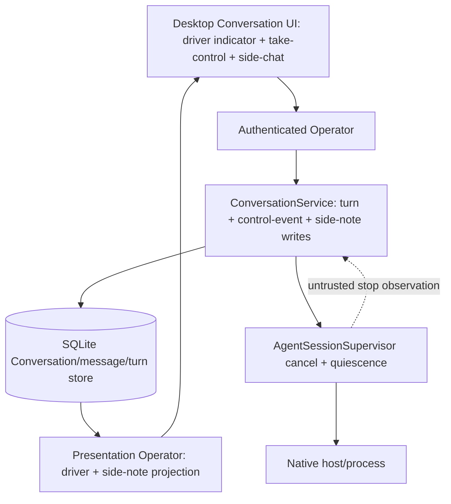

# 012 - Conversation co-edit and take-control

**ID:** 012
**Status:** DRAFT
**Owners:** Conversation, Agent Runtime, Product
**Updated:** 2026-11-08
**Revision:** 0.1
**Target release:** V1 local desktop
**Dependencies:** root ARCHITECTURE.md, docs/V1-PRODUCT-RELEASE-CONTRACT.md, docs/IMPLEMENTATION-MASTER-PLAN.md, and the owner documents named in RESEARCH.md. Feature 001 remains the Conversation send/turn authority; Feature 004 owns agent relay. Research gate RV-14 is owned by docs/VIABILITY-VS-COMPETITORS.md.

## 1. Problem

Rivals ship a synchronous human+agent co-edit / take-control surface (Claude Duet; Claude Code Desktop side-chat is a partial analogue). LiteCowork has no owner concept for it and no honest way for an owner to intervene on a running turn: the one wired OpenCode turn cannot be effectively stopped from the UI (register A-25), and nothing lets the owner continue by hand or ask a bounded clarifying question against the live turn. The temptation is to model co-edit as a new durable work type, which would collide with the Conversation/Task separation.

Observable outcome: while an agent turn runs on one Conversation, the owner takes control (requests an observed stop and the Conversation returns to an ordinary owner-authored exchange) or sends a bounded side-chat message correlated to the running turn, and the system records this as ordinary Conversation state, never as a Task, Attempt, Coworker or a new durable-Task type.

## 2. Goals

- Map synchronous co-edit / take-control onto an ordinary Conversation UX (take-control and side-chat), reusing the Feature 001 turn and cancellation authority.
- Let the owner take control of a non-terminal turn: request an observed stop, then continue the Conversation by hand with the prior content preserved.
- Let the owner post a bounded side-chat message that is correlated to the running turn for display but does not mutate or reroute that turn.
- Show, truthfully, who is driving the Conversation (agent turn running, owner in control, side-chat visible) without implying shared native memory or a second worker.

## 3. Non-goals

- Create a Task, Attempt, PlanRevision, Coworker, lease, grant or any new durable-Task type because the owner intervened.
- Feed side-chat text into the running native turn's prompt, or let it steer or reroute that turn.
- Transfer, display or persist the native session handle, private harness transcript or provider credentials.
- Assert Claude Duet as a shipped capability, reuse vendor co-edit code, or build a real-time operational-transform document editor (co-edit here is a Conversation UX, not a CRDT text editor).
- Introduce a concurrent second active turn on one Conversation (the Feature 001 single-flight lane is preserved).

## 4. Current evidence

The active checkout has a Conversation turn lifecycle and a cancel route, but no take-control continuation, no side-chat and no effective Stop for the wired provider. The following is a source/route/UI crosswalk, not owner acceptance or release qualification.

| Capability | Current source evidence | Limitation / release meaning |
|---|---|---|
| Conversation turn lifecycle | CODE/SERVED: `POST /v1/conversations/{conversationId}/turns` admits one turn; `conversation.turn.created.v2` pins the binding; the OpenCode supervisor settles it | Only `provider_key = opencode` dispatches; the turn is not a qualified USER journey (Feature 001). |
| Stop / cancel | PARTIAL / ineffective: a cancel Operator route commits `CANCEL_REQUESTED` then `CANCELLED` | It does not observe native interrupt/quiescence and the UI Stop handler searches transient turns the OpenCode path never emits (register A-25). Take-control cannot rely on today's Stop being effective. |
| Owner continuation after stop | NOT PRESENT | After a settled turn the owner can send a new ordinary message, but there is no take-control affordance that preserves the stopped turn's content as owner-editable context and no distinct "owner in control" state. |
| Side-chat correlated to a running turn | NOT PRESENT | Conversation messages exist, but no message kind or projection correlates a bounded clarifying exchange to a non-terminal turn without entering that turn's prompt. |
| Co-edit / take-control as an owner concept | NOT DOCUMENTED | Tracked only as research RV-14; the Duet first-party URL is unresolved (2026-11-08). No owner doc asserts the capability; this is the one gap-matrix row with "Doc claims it? = no". |
| Driver / presence projection | NOT PRESENT | The transcript does not distinguish "agent turn running" from "owner in control"; there is no truthful driver indicator. |

Code or a passing helper test alone does not qualify a co-edit / take-control journey. This package remains DRAFT until B-34 is owner-accepted, RV-14 has a dated first-party reference or an explicit no-vendor-claim resolution, and the Feature 001 Stop/quiescence defects (A-25) are closed.

## 5. LOCKED and FLEXIBLE decisions

### LOCKED (inherited invariants; canonical owners, not feature approval)

- Plain Conversation is not a Task and creates no Task/Attempt/PlanRevision/Coworker (PRODUCT, DATA-MODEL).
- A Conversation enforces a single-flight active turn; co-edit never opens a second concurrent active turn (STATE-MACHINES, Feature 001 B-01).
- Cancellation settles only after observed stop/quiescence; a winning completion/failure remains authoritative (STATE-MACHINES, Feature 001 L-11).
- Native session handles, private transcripts and credentials never enter public projections, replicated events or ordinary logs (AGENT-CONTROL, STORAGE, Feature 001 L-06/L-08).
- Native/provider output is an untrusted observation, not authority (ARCHITECTURE, TRUST).

### FLEXIBLE

- Side-chat presentation copy and placement, provided state distinctions (agent running / owner in control / side-chat) remain visible.
- Internal module/helper names, provided the transactions and secret boundaries stay intact.

### DECLARED DECISIONS AND ARCHITECTURAL CONTRACTS (OWNER ACCEPTANCE NOT YET EVIDENCED)

This PROPOSED resolution mirrors the specs/001 §5 style. It is a RECOMMENDED position authored for owner review under SPECIFICATION-STANDARD §7; no author may self-approve. The blocker is open and pending owner in [docs/CONTRADICTION-AND-ALIGNMENT-REGISTER.md](../../docs/CONTRADICTION-AND-ALIGNMENT-REGISTER.md); the research gate is owned by [docs/VIABILITY-VS-COMPETITORS.md](../../docs/VIABILITY-VS-COMPETITORS.md) (RV-14).

| ID | Topic | PROPOSED resolution and architectural contract | Canonical authority and consequence |
|---|---|---|---|
| B-34 | Co-edit / take-control owner model on a Conversation | **PROPOSED: Model synchronous co-edit as two bounded Conversation UX affordances over the Feature 001 turn authority, with no new durable work type.** (1) **Take-control** is an authenticated owner command on a non-terminal turn: it issues the Feature 001 cancel path, waits for observed native stop/quiescence, settles that turn `CANCELLED` (a racing completion/failure wins and remains authoritative), records an immutable `ConversationControlEvent{kind: OWNER_TOOK_CONTROL}` and moves the Conversation to an ordinary owner-authored state in which the stopped turn's committed content is preserved as editable context. No Task/Attempt/Coworker/lease is created. (2) **Side-chat** is a bounded owner message, kind `OWNER_SIDE_NOTE`, correlated to the running turn id for display only; it is excluded from the running turn's `ConversationContextPackage` and never reroutes or steers that turn. Both affordances are available only while a turn is non-terminal; both preserve single-flight (no second active turn). The driver indicator is derived from committed turn status plus the latest control event. | [STATE-MACHINES.md](../../docs/STATE-MACHINES.md), [EXPERIENCE.md](../../docs/EXPERIENCE.md), [API.md](../../docs/API.md), [EVENTS.md](../../docs/EVENTS.md). Any new message kind / event / control-event type is promotable only when its canonical owner document and `docs/schemas/` change together. RV-14 is cited as RESEARCH; do not assert Claude Duet as a shipped fact. |

This row is a declared design position only. This package stays DRAFT; owner acceptance, the dated RV-14 reference and the Feature 001 Stop/quiescence fixes are not complete. Do not infer owner sign-off from the presence of a decision row.

## 6. High-level design

Co-edit reuses the Feature 001 Conversation turn authority. The only feature-specific additions are the take-control command (built on the Feature 001 cancel/quiescence path) and the side-chat message correlated to a running turn for display. No native prompt, session or handle is affected by either affordance.

### Feature-specific component diagram



The take-control command and the correlated side-note projection are the two feature-specific additions; everything else reuses the Feature 001 supervisor and ConversationService owners without redefining them.

### Trust boundaries

The desktop UI is untrusted; the authenticated Operator is the only command path. Take-control issues the Feature 001 cancel path and waits for observed quiescence before settlement; it never kills an externally owned process. Side-chat text is untrusted owner input: it is committed as ordinary Conversation history but is excluded from the running turn's native prompt, so it cannot steer or reroute the agent. Native handles and credentials stay in the Runtime-local host binding; SQLite transactions perform no network or process calls.

### Actor sequence (target, not current wiring)

1. An agent turn is RUNNING on the Conversation (Feature 001).
2. The owner invokes take-control; the Operator validates owner/Workspace scope and the exact turn version and issues the Feature 001 cancel path.
3. The supervisor observes native stop/quiescence; storage settles the turn `CANCELLED` and commits an immutable `OWNER_TOOK_CONTROL` control event in the same transaction. A completion/failure that wins the race remains authoritative and take-control reports that outcome instead.
4. The Conversation enters owner-in-control: the stopped turn's committed content is preserved and the owner continues by hand; a later owner message admits a new ordinary turn through Feature 001.
5. Alternatively, while the turn is still RUNNING, the owner posts a side-chat note (`OWNER_SIDE_NOTE`) correlated to the running turn id; it is committed and displayed but excluded from that turn's context package.
6. History reload resolves the driver indicator from committed turn status plus the latest control event; side-notes render with their correlated turn id.

### Ownership

| Owner | Responsibility | Excluded responsibility |
|---|---|---|
| Desktop UI | Driver indicator, take-control affordance, side-chat composer, draft preservation | Native process, handles, durable authority |
| Operator | Auth, Workspace scope, take-control/side-note validation and projection access | Native process lifecycle |
| ConversationService | Control-event and side-note commits, turn settlement reuse | Parsing raw provider output |
| AgentSessionSupervisor (Feature 001) | Cancel request, observed quiescence, settlement | Side-note semantics or UI state |
| Storage | Atomic turn settle + control-event + side-note commits, receipts | External process/network calls |
| Presentation Operator | Driver and correlated side-note projections | Converting provider text to durable state |

## 7. Low-level design and interfaces

Take-control is a pure composition over the Feature 001 cancel/quiescence authority plus one immutable control-event append. Side-chat is one bounded message append with a non-terminal-turn correlation field. Neither touches the native prompt, session or handle.

### 7.1 Existing signatures (CODE)

Observed in the active source; existence is CODE evidence, not qualification.

- `POST /v1/conversations/{conversation_id}/turns` (`submitConversationTurn`) and the cancel route are owned by Feature 001; cancel commits `CANCEL_REQUESTED` then `CANCELLED` but does not yet observe native interrupt/quiescence (register A-25).
- `transition_conversation_turn(...)` enforces turn state transitions; generic OPEN->RUNNING remains forbidden outside readiness activation.
- `ConversationContextPackage` builder in `crates/storage-core/src/conversation.rs` orders committed messages by aggregate revision and excludes `SYSTEM_NOTICE`.

### 7.2 PROPOSED signatures (not yet in source)

Every signature below is PROPOSED and is not promotable until its canonical owner document and the OpenAPI/schema change together.

```rust
// PROPOSED: owner take-control over a non-terminal turn.
pub struct TakeControlCommand {
    pub principal_id: String,
    pub workspace_id: String,
    pub conversation_id: String,
    pub turn_id: String,
    pub expected_turn_version: u64,
    pub idempotency_key: String,
}

// PROPOSED: immutable control-event appended atomically with turn settlement.
pub enum ConversationControlEventKind { OwnerTookControl, OwnerReleasedControl }

pub struct ConversationControlEvent {
    pub conversation_id: String,
    pub turn_id: String,              // the turn that was taken over
    pub kind: ConversationControlEventKind,
    pub occurred_at: String,
}

// PROPOSED: bounded side-chat note correlated to a running turn, excluded from its prompt.
pub struct OwnerSideNote {
    pub conversation_id: String,
    pub correlated_turn_id: String,   // must be a non-terminal turn at commit time
    pub body: String,                 // bounded; never entered into the native prompt
}
```

Typed errors (PROPOSED): `TakeControlError::{TurnAlreadyTerminal, StaleTurnVersion, QuiescenceTimeout, RacedCompletionWins}`; `SideNoteError::{TurnTerminal, OverBudget, CrossWorkspace}`.

Ordering: authenticate, compare the expected turn version, issue the Feature 001 cancel path, observe quiescence outside any SQLite transaction, then commit settlement + control-event atomically. Side-note commit verifies the correlated turn is non-terminal at commit time.

## 8. Security, trust and privacy

- Authenticate every write and scope it to the owner and Workspace.
- Take-control issues the Feature 001 cancel path and waits for observed stop/quiescence; never kill an externally owned process and never settle `CANCELLED` before quiescence.
- Side-chat text is untrusted input: it is committed as ordinary history but excluded from the running turn's native prompt and can never grant authority, approve requests or steer the agent.
- Native handle stays only in the exact Runtime-local host binding; never serialised, logged, emitted, snapshotted or displayed by any co-edit affordance.
- Provider output remains an untrusted observation; the driver indicator derives from committed turn status and the latest control event, not from provider text.
- Diagnostics contain safe correlation IDs only, never prompt text, side-note bodies as secrets, hidden reasoning or handle values.

## 9. Errors, edge cases and recovery

See [contracts/errors-recovery.md](contracts/errors-recovery.md). Global rules: observed quiescence is required before settlement; a racing completion/failure wins and remains authoritative; a side-note against an already-terminal turn is rejected; duplicate take-control with a matching idempotency key returns the original receipt and conflicts when the payload differs.

## 10. Configuration and compatibility

- No new durable-Task type, no second concurrent active turn, no automatic fallback.
- Take-control and side-chat depend on the Feature 001 Stop/quiescence fixes (A-25); until those land, take-control is not a qualified journey and must fail closed rather than claim an effective stop.
- Quiescence, side-note size and idempotency deadlines must be finite; exact initial values are a blocking owner decision (B-34).
- Any new message kind / control-event / projection field changes only through the canonical owner document and `docs/schemas/` together.

## 11. Observability

Record safe correlation IDs for request, Workspace, Conversation, turn and control event; quiescence result; take-control terminal classification; side-note commit outcome. Exclude provider text, side-note bodies treated as sensitive, handles, auth and secret bytes.

## 12. EARS acceptance criteria

Positive:
- **AC-001:** WHEN the owner invokes take-control on a non-terminal turn, THE SYSTEM SHALL issue the Feature 001 cancel path and settle that turn `CANCELLED` only after observed native stop/quiescence. Verify: take-control quiescence integration test.
- **AC-002:** WHEN take-control settles, THE SYSTEM SHALL commit an immutable `OWNER_TOOK_CONTROL` control event atomically with the turn settlement and move the Conversation to an owner-in-control state that preserves the stopped turn's committed content. Verify: storage atomicity test asserting both records commit together.
- **AC-003:** WHEN the owner posts a side-chat note while a turn is RUNNING, THE SYSTEM SHALL commit it as an `OWNER_SIDE_NOTE` correlated to that turn id and display it without mutating the turn. Verify: side-note commit and projection test.

Negative:
- **AC-004:** IF take-control is invoked on an already-terminal turn, THEN THE SYSTEM SHALL reject it with `TurnAlreadyTerminal` and SHALL NOT create any control event or new turn. Verify: terminal-turn negative test.
- **AC-005:** IF a side-chat note targets a terminal turn, THEN THE SYSTEM SHALL reject it with `TurnTerminal` and preserve the owner's draft. Verify: side-note terminal-turn negative test.

Boundary:
- **AC-006:** IF a side-chat note exceeds the bounded size, THEN THE SYSTEM SHALL refuse it with `OverBudget` and SHALL NOT truncate silently. Verify: side-note over-budget boundary test.

Security:
- **AC-007:** WHEN a running turn's `ConversationContextPackage` is built, THE SYSTEM SHALL exclude every `OWNER_SIDE_NOTE` so side-chat text never enters the native prompt. Verify: context-package exclusion test asserting no side-note content in the prompt.
- **AC-008:** WHEN any co-edit record is serialized to events, snapshots, API responses or logs, THE SYSTEM SHALL exclude the native session handle and private harness transcript. Verify: redaction test over take-control and side-note projections.

Concurrency:
- **AC-009:** WHILE a turn is non-terminal, THE SYSTEM SHALL NOT admit a second concurrent active turn because of a side-chat note or take-control, preserving the single-flight lane. Verify: single-flight concurrency test.

Recovery:
- **AC-010:** WHEN a completion or failure wins the race against take-control, THE SYSTEM SHALL keep that terminal outcome authoritative and report it instead of a fabricated `CANCELLED`. Verify: race recovery test.
- **AC-011:** WHEN the daemon restarts after an `OWNER_TOOK_CONTROL` event, THE SYSTEM SHALL reload the owner-in-control state and the preserved stopped-turn content from committed records only. Verify: restart recovery test.

UI and accessibility:
- **AC-012:** WHEN the transcript reloads, THE SYSTEM SHALL render a truthful driver indicator (agent turn running, owner in control, or side-chat visible) derived from committed turn status and the latest control event, with accessible state labels, and SHALL NOT infer the driver from the selected agent. Verify: desktop projection + accessibility render test.

Performance:
- **AC-013:** WHEN take-control is invoked, THE SYSTEM SHALL bound the quiescence wait with a finite deadline and SHALL NOT block the Conversation indefinitely. Verify: bounded quiescence timing test asserting `QuiescenceTimeout` on deadline.

## 13. Executable acceptance command

```bash
python3 .specify/scripts/validate_feature_package.py specs/012-conversation-coedit-take-control
```

Further gates after ACCEPTED/LOCKED are the cargo filters named in TASKS.md. They are not evidence until run on a recovered source tree and the Feature 001 Stop/quiescence fixes (A-25) are in place.

## 14. Out-of-bounds

- Do not implement a CRDT/operational-transform document co-editor; co-edit here is a Conversation UX only.
- Do not feed side-chat text into the running native turn's prompt or let it reroute the turn.
- Do not create a Task, Attempt, Coworker, lease or a new durable-Task type for either affordance.

## 15. Assumptions and open questions

| ID | Question | Evidence/limitation | Owner | Gate |
|---|---|---|---|---|
| O-01 | Exact take-control quiescence contract and deadline. | Feature 001 cancel does not yet observe native interrupt/quiescence (A-25); take-control cannot be qualified until that lands. | Agent Runtime / Conversation | B-34 / A-25 |
| O-02 | Side-note message kind and correlation schema. | `OWNER_SIDE_NOTE` and the control-event type are PROPOSED; promotable only with the owner doc and `docs/schemas/` together. | Conversation / Storage | B-34 |
| O-03 | Whether RV-14 Claude Duet is ever cited as fact. | The Duet first-party URL is unresolved (2026-11-08); the matrix maps co-edit onto Conversation UX without asserting Duet. | Product | RV-14 |
| O-04 | Driver-indicator presentation and accessibility copy. | No current driver projection exists; this is a UI-contract target. | Desktop UI | B-34 |

## 16. Requirement traceability

| Requirement | Canonical owner | Task | Acceptance | Verification method |
|---|---|---|---|---|
| Take-control settles only after quiescence | STATE-MACHINES, AGENT-CONTROL | 012-T02 | AC-001 | Quiescence integration test |
| Atomic control-event + owner-in-control state | STATE-MACHINES, STORAGE, EVENTS | 012-T02 | AC-002 / AC-011 | Storage atomicity + restart test |
| Side-chat correlated, non-steering | EXPERIENCE, API | 012-T03 | AC-003 | Side-note commit/projection test |
| Take-control rejects terminal turn | STATE-MACHINES | 012-T02 | AC-004 | Terminal-turn negative test |
| Side-note rejects terminal turn / over-budget | API, STORAGE | 012-T03 | AC-005 / AC-006 | Negative + boundary tests |
| Side-chat excluded from native prompt | CONTEXT, TRUST | 012-T03 | AC-007 | Context-package exclusion test |
| Native handle / transcript privacy | AGENT-CONTROL, STORAGE | 012-T02 | AC-008 | Redaction test |
| Single-flight preserved | STATE-MACHINES, API | 012-T03 | AC-009 | Concurrency test |
| Racing completion wins | STATE-MACHINES | 012-T02 | AC-010 | Race recovery test |
| Truthful driver indicator | PRESENTATION-RUNTIME, API | 012-T04 | AC-012 | Projection + a11y render test |
| Bounded quiescence deadline | RUNTIME-LIFECYCLE, FAILURE-RECOVERY | 012-T02 | AC-013 | Bounded quiescence timing test |

Implementation tasks: 012-T01, 012-T02, 012-T03, 012-T04.
