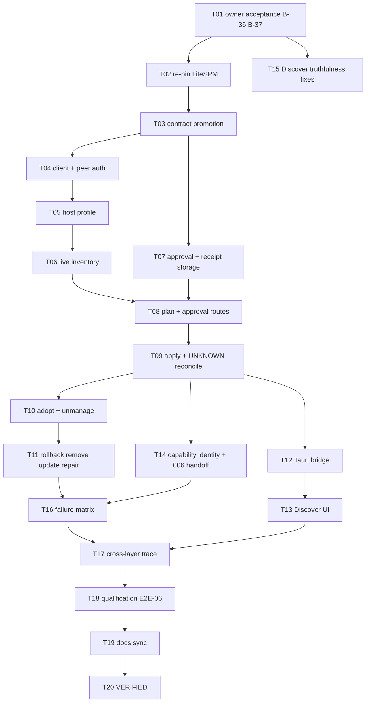

# Implementation Plan - LiteSPM Package Lifecycle Bridge

**Feature:** 013 | **Spec:** SPEC.md revision 0.1
**Status:** IN_REVIEW - not owner-accepted; does not authorize implementation; not a claim of implementation or qualification.
**Updated:** 2026-11-09
**Rule:** the authoritative ordered work list is [TASKS.md](TASKS.md) (013-T01 to 013-T20). This plan is the summary view.

## 1. Delivery strategy

Follow the master plan LiteSPM lane (section 3) in order: pin and read the published contract, freeze protocol and peer identity, build the client against that contract, add one host profile and inventory observation, add consent-controlled plan/apply/reconcile for one kind and host, preserve LiteSPM-owned state, then add repair/update/unmanage/remove only after receipt and rollback are proven. Observe-only inventory ships first and is useful on its own; every mutating verb stays disabled with a reason until its rung is qualified on a release row. LiteCowork never writes host config or LiteSPM storage.

## 2. Dependency graph

## 3. Phases and exit gates

| Phase | Tasks | Outcome | Exit gate |
|---|---|---|---|
| A - decision and pin | T01, T02 | B-36/B-37 accepted; one LiteSPM pin; operations marked ADVERTISED or ABSENT | Owner acceptance recorded; RESEARCH pin table |
| B - contract promotion | T03 | Routes, errors, events, tables in owner docs and schemas | Schema and validator pass |
| C - observe | T04-T06, T13 (read-only), T15 | Client, peer auth, host profile, live inventory in Discover | Inventory unavailable is an error; no inventory persisted |
| D - plan/apply | T07-T09, T12 | Plan, owner approval, apply, receipt, UNKNOWN reconcile, startup sweep | Fault-injection matrix for apply passes |
| E - lifecycle breadth | T10, T11, T14 | Adopt/unmanage, rollback/remove, update/repair, capability identity | Byte-identical adopt; owned-only remove |
| F - proof | T16, T17, T18 | Canonical test target, trace, release-row qualification | E2E-06 USER sign-off per row |
| G - close | T19, T20 | Docs sync, VERIFIED | Evidence bundle and owner sign-off |

## 4. Scope and file ownership (candidate paths after acceptance)

| Area | Candidate paths | Owner | Guardrail |
|---|---|---|---|
| LiteSPM client | `apps/litecoworkd/src/litespm/` (new) | Capability Fabric | Async, bounded, pinned protocol, no process spawn |
| Service and routes | `apps/litecoworkd/src/package_lifecycle_service.rs`, `package_lifecycle_operator.rs` (new), `discover_operator.rs` | Operator | No external call inside a transaction |
| Storage | `crates/storage-core/src/package_operation.rs`, `crates/storage-sqlite/src/package_operations.rs` (new), `crates/storage-sqlite/src/discover.rs` | Storage | Refs and receipts only |
| Capability identity | `crates/domain-invocations/src/capability_bridge.rs` (tests) | Capability Fabric | Identity from receipts only |
| Tauri | `apps/litecowork-ui/src-tauri/src/package_lifecycle_bridge.rs` (new) | Desktop bridge | Bounded inputs; one key per intent |
| UI | `apps/litecowork-ui/src/discover/` | Desktop UI | Plain-text package content; distinct verbs |
| Contracts | API, EVENTS, STORAGE, SCHEMAS, CAPABILITY-FABRIC, LiteSPM owner docs | Domain owners | Promote together |

Host compatibility profile rows (filled by T05 and T18):

| Host | Version | OS/build | Scope | Kind | Operations | Evidence |
|---|---|---|---|---|---|---|
| OpenCode | v2.0.32 | Windows 11/10 x86_64-pc-windows-msvc | user | skill | inventory, plan, install, adopt, remove, unmanage, update, repair | none yet |
| OpenCode | v2.0.32 | Linux x86_64 | user | skill | same | none yet |

## 5. Persistence, migration, rollout

- One forward-only migration (allocated v39 in docs/LITECOWORK-BUILD-TASKS.md; the chain ends at `sqlite-v32.sql`; DEFERRED with the whole package, see TASKS.md) adds the three tables in DATA-MODEL; no earlier migration changes.
- Rollout is per release row and per verb. A verb is enabled only when its profile row has CODE, SYSTEM and USER evidence.
- No feature flag may enable a verb whose server-side route is missing or not advertised by the pinned LiteSPM.

## 6. Operational risks

| Risk | Mitigation / gate |
|---|---|
| Upstream never publishes approval recording or operation query | Observe-only scope; mutations stay unavailable (B-36) |
| Pin drift (37 commits in one day recorded in interop LLD Appendix B) | Re-read at T02; compiled `ProtocolPin`; incompatible versions fail closed |
| Windows peer auth weaker than Linux | Record `TRANSPORT_ACL_ONLY`; never label verified |
| Duplicate mutation after timeout | UNKNOWN state, operation query, partial unique index per target |
| Clobbered user edits | LiteSPM keep-local default; adopt byte-identical tests |
| Install read as permission | Four separate facts in UI; no grant created |

## 7. Validation command matrix

| Gate | Command | Expected |
|---|---|---|
| Docs | `python3 .specify/scripts/validate_feature_package.py` | PASS |
| Client | `cargo test -p litecoworkd --locked litespm_client` | Pass (filter added by T04) |
| Storage | `cargo test -p storage-sqlite --locked package_operation` | Pass (filter added by T07) |
| Feature | `cargo test -p litecoworkd --test litespm_package_lifecycle --locked -- --nocapture` | Pass (target added by T16) |
| UI | `pnpm --dir apps/litecowork-ui test` | Pass |
| Routes | `python3 scripts/audit_served_routes.py` | New routes listed |

## 8. Stop and rollback criteria

Stop on any LiteCowork write to host config or LiteSPM storage, any inferred wire name, any success shown without receipt and read-back, any second apply for one approval, any approval created from agent input, or any verified label on a transport-ACL-only result. Roll back code by disabling the verb; never roll back package state outside a LiteSPM plan.

## 9. Handoff

Implementation starts only after 013-T01 records owner acceptance. The first implementation task must name the accepted revision and SHA, the LiteSPM pin from 013-T02, the clean worktree and the exact command.

## DeepSeek Harness proposals (PROPOSED, owner review required)

PROPOSED only; see the matching section in [TASKS.md](TASKS.md). Nothing here changes the accepted design of this package. Owner review is required first.

- **P-43 Lifecycle-script allowlist and classified patch policy for dependencies** (touches this package; row owned by package 019). Class **ADAPT**. Design impact if accepted: Package 013 (DEFERRED); T13 of package 019. Deferral: DEFERRED with LiteSPM (package 013). Upstream: [scripts/runtime-patch-policy.ts](https://github.com/deepseek-ai/deepseek-harness/blob/fcc0ad462172522aaf5c93a7b2e01f6b9f0b0159/apps/desktop/scripts/runtime-patch-policy.ts), [src/project-manager.ts](https://github.com/deepseek-ai/deepseek-harness/blob/fcc0ad462172522aaf5c93a7b2e01f6b9f0b0159/apps/desktop/src/project-manager.ts). Study: [desktop study](../../docs/DEEPSEEK-HARNESS-DESKTOP-DEEP-DIVE-2026-11.md) Sections 11 and 14 (row P-43).
- **P-27 durable run record plus process-group liveness fence** (ADAPT): see TASKS.md PROP-P27 / plugin lessons. Study: [plugin study](../../docs/DEEPSEEK-HARNESS-PLUGIN-ARCHITECTURE-DEEP-DIVE-2026-11.md) Sections 2, 3 and 8. Upstream: [operations.ts](https://github.com/deepseek-ai/deepseek-harness/blob/fcc0ad462172522aaf5c93a7b2e01f6b9f0b0159/packages/boot/plugin-manager/src/operations.ts), [run-tree.ts](https://github.com/deepseek-ai/deepseek-harness/blob/fcc0ad462172522aaf5c93a7b2e01f6b9f0b0159/packages/boot/plugin-manager/src/run-tree.ts).

