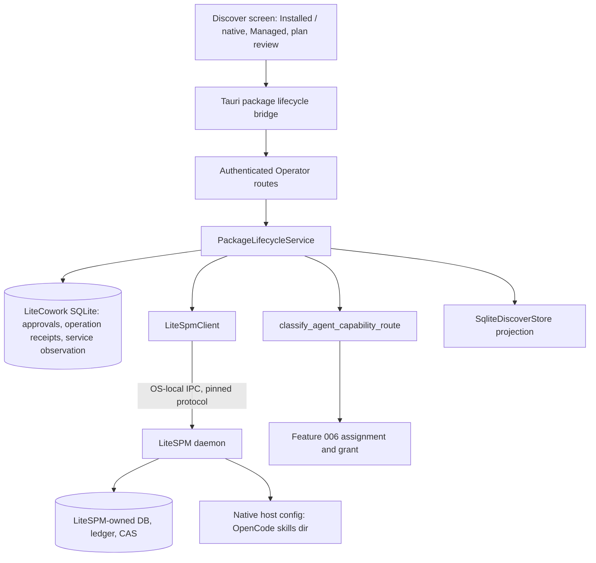

# Feature Specification - LiteSPM Package Lifecycle Bridge

- **Feature ID:** 013 | **Status:** IN_REVIEW | **Revision:** 0.1
- **Owner review:** authored 2026-11-09 after the owner accepted the review packet ([docs/OWNER-ACCEPTANCE-REVIEW-PACKET.md](../../docs/OWNER-ACCEPTANCE-REVIEW-PACKET.md)). This package did not exist when the packet was accepted, so it is not owner-accepted. Its open decisions are new global blockers B-36 and B-37 (PROPOSED, pending owner). IN_REVIEW does not authorize implementation, and nothing here claims anything is implemented, SERVED, INTEGRATED or QUALIFIED.
- **Change control:** once accepted, any change to this contract requires a new revision and renewed owner approval (SPECIFICATION-STANDARD section 7).
- **Target:** LiteCowork V1 Area 5 items 5.1 to 5.4, master plan P5 package exit, LiteSPM lane section 3 steps 1 to 7, gate C, E2E-06.
- **Owners:** LiteSPM boundary (Capability Fabric), Operator/API, Storage, Trust/Approval, Desktop UI, Security, Product. Upstream LiteSPM owns package catalog, inventory, host registration, mutation and lifecycle.
- **Dependencies:** pinned LiteSPM daemon service contract (B-36); one qualified host compatibility profile (B-37); Feature 011 local IPC and Runtime readiness; Feature 002 host/agent identity; Feature 006 Core assignment, grant and invocation; Feature 005 Trust/approval primitives.

## 1. Problem and user outcome

LiteCowork V1 Area 5 requires "LiteSPM discovery, live installed/external inventory, source and compatibility, plan-before-write install/adopt/copy/update/repair/unmanage/remove" plus separate Connection, assignment and grant. Today no package owns this lifecycle. The Discover screen shows Workspace-local skills and Runtime capability-host observations only, every row is `authoritative: false`, and `POST /v1/capabilities/{capability_id}/connect-or-install` always returns `503 DEPENDENCY_UNAVAILABLE` with reason `LITESPM_PACKAGE_SERVICE_NOT_QUALIFIED` (`apps/litecoworkd/src/discover_operator.rs`). There is no LiteSPM client anywhere in `apps/` or `crates/`.

LiteSPM, not LiteCowork, is the package manager. LiteCowork must never become a second package database, resolver or host-config writer (AGENTS.md section 6). The missing piece is a narrow, version-pinned bridge: LiteCowork reads LiteSPM's live inventory, asks LiteSPM for an immutable plan, records the owner's approval bound to the plan digest, asks LiteSPM to apply it, keeps LiteSPM's receipt, reconciles UNKNOWN outcomes and projects truthful state in Discover. Installation stays separate from Connection, Coworker assignment, Task/Conversation grant and invocation.

**Outcome:** on the first release row, the owner opens Discover, sees what LiteSPM reports as already on the computer and what it manages, reviews an exact plan to adopt or install one supported package for one supported agent and scope, approves that exact plan, and sees LiteSPM's receipt and refreshed inventory. A lost response or crash never produces a second mutation or a false success. The owner can later update, repair, stop managing or remove it through the same plan, approval and receipt path.

## 2. Goals

- G-01 Connect to one pinned LiteSPM daemon service version over OS-local IPC, negotiate the protocol, and record the exact per-OS peer-authentication result without upgrading it.
- G-02 Use only operations the pinned service descriptor advertises; every other verb is visibly unavailable with a reason.
- G-03 Project LiteSPM's live inventory (observed, managed, adopted, drifted, broken) per host and scope in Discover without persisting a LiteCowork copy of it.
- G-04 Evaluate one host compatibility profile (host x version x OS x scope x kind x operation) before offering any mutation.
- G-05 Plan before write: LiteSPM produces the immutable plan; LiteCowork shows the exact diff and binds a single-use owner approval to its digest, host, scope and expiry. An agent can request but never approve.
- G-06 Apply with a stable idempotency key, keep LiteSPM's durable operation receipt and read-back fingerprint, and reconcile UNKNOWN by original operation identity before any further mutation.
- G-07 Roll back a failed or unwanted apply only through a LiteSPM-owned plan (remove of owned nodes), never by LiteCowork file writes.
- G-08 Add adopt and unmanage (preserving originally present native entries), then update, repair and remove, only after receipt and rollback semantics are proven.
- G-09 Feed `classify_agent_capability_route` with LiteSPM-verified identity (managed + digest verified) from a receipt, and hand off to Feature 006 for assignment and grant. Installed is not granted.
- G-10 Keep every verb fail-closed until B-36 and B-37 are accepted and the exact release-row route is qualified.

## 3. Non-goals

No LiteCowork package database, resolver, catalog cache, CAS or host-config writer. No direct reads or writes of LiteSPM's SQLite, lockfile, ledger or files. No parsing of `litespm` CLI output and no RPC names inferred from CLI output, marketplace pages or the 13-tool MCP stdio bridge (that bridge remains the agent-facing ABI and is not this client's transport). No HTTP endpoint for package management. No Connection/OAuth/SecretStore work (Feature 006). No Coworker assignment or Task/Conversation grant semantics (Features 006 and 009). No invocation of package tools (Feature 006). No LiteSPM service install, signed update or uninstall by LiteCowork (ServiceSupervisor and ACSR agent-bridge registration from LITESPM-INTEGRATION-PLAN sections 2 and 3 are deferred; see O-04). No catalog publication or skill authoring (LEARNING section 15b). No universal `/marketplace` slash-command promise. No `connector` package kind (deferred upstream).

## 4. Current implementation and evidence boundary

| Capability | Current evidence | Limitation |
|---|---|---|
| Discover catalog read | CODE/SERVED: `GET /v1/discover/search` and `GET /v1/discover/items/{item_id}` in `apps/litecoworkd/src/discover_operator.rs`; `SqliteDiscoverStore::search_catalog` / `describe_entry` in `crates/storage-sqlite/src/discover.rs` | Projects Workspace-local `SkillRecord` rows plus up to 50 Runtime capability hosts (`DISCOVER_MAX_RUNTIME_CAPABILITIES`); never contacts LiteSPM |
| Provider truthfulness flag | CODE: `DiscoverProviderStatus { package_service_qualified: false, reason_code: PACKAGE_SERVICE_NOT_QUALIFIED }` (`crates/storage-sqlite/src/discover.rs`) | Hard-coded default; no observation behind it |
| connect-or-install | SERVED, fail-closed: `connect_or_install_capability` requires owner Workspace, Runtime match and `Idempotency-Key`, then returns 503 `LITESPM_PACKAGE_SERVICE_NOT_QUALIFIED` with `requested_scope_granted: false` and writes no receipt | Route name conflates Connection and installation; no plan, approval or receipt |
| Capability test | SERVED: `test_capability_connection` returns `health: "UNKNOWN"` and contacts no provider | `checked_at` is filled with `new_id("cor")`, a correlation ID, not a timestamp; `search_discover` likewise passes a correlation ID as `now` |
| Route classification | CODE: `classify_agent_capability_route` in `crates/domain-invocations/src/capability_bridge.rs` returns `UNSUPPORTED / PACKAGE_IDENTITY_UNQUALIFIED` unless `lite_spm_managed`, `package_digest_verified` and a valid `sha256:` digest are all true; unit tests in the same file | No production caller; nothing produces LiteSPM-verified identity |
| Discover entry model | CODE: `DiscoverCatalogEntry`, `DiscoverInstallState`, `DiscoverEntrySource::LiteSpmPackage`, `derive_discover_availability` in `crates/storage-core/src/discover.rs`; `validate()` rejects `authoritative = true` | No LiteSPM-sourced rows exist |
| Desktop Discover | CODE: `apps/litecowork-ui/src/discover/DiscoverPage.tsx` tabs Explore, "Installed / native", Managed, Connections; `connectActionOutcome()` in `discover-state.ts` disables every row action; Managed and Connections render "Not available"; `discover_request` in `apps/litecowork-ui/src-tauri/src/discover_bridge.rs` supports only `search` and `item`; test `apps/litecowork-ui/tests/discover-catalog-state.test.ts` | Truthful unavailable states; no lifecycle UI |
| LiteSPM client, transport, peer auth | ABSENT: no `LiteSpm*` type in `apps/` or `crates/` | Whole bridge is target |
| Package approval and receipt records | ABSENT: no table after `docs/schemas/sqlite-v28.sql` | Target |
| Reusable primitives | CODE: `crates/operator-ipc` (`BudgetedBody`, `InFlightBodyBudget`, framed read/write), `crates/windows-local-security` (`current_logon_sid`, `connect_operator_pipe`) | Built for LiteCowork's own Operator pipe; reuse for a LiteSPM client is unproven |
| Upstream LiteSPM | Pins disagree: REF-LITESPM `9f42b25d` ([REFERENCE-IMPLEMENTATIONS.md](../../docs/REFERENCE-IMPLEMENTATIONS.md)); interop LLD header `111fd9b8`; LLD Appendix A/B study `f77a3a3`. Appendix A records that upstream publishes no approval-recording method (A1), no package `operation.get` (A2), no reconcile/unmanage (A3), no service descriptor (A4) and no agreed health meaning (A5) | Bridge contract not pinned; see B-36 |

The served-route and Discover facts above are also recorded in [docs/IMPLEMENTATION-STATUS.md](../../docs/IMPLEMENTATION-STATUS.md) ("Discover and LiteSPM").

## 5. Decision register

### Inherited LOCKED invariants (canonical owners; not feature approval)

| ID | Invariant | Authority |
|---|---|---|
| L-01 | LiteSPM owns catalog, inventory, host registration, package mutation and lifecycle; LiteCowork owns scoped authorization for use. | AGENTS.md sections 2 and 6, ARCHITECTURE |
| L-02 | Do not duplicate LiteSPM's database, resolver or configuration writer. | AGENTS.md section 6, LITESPM-INTEGRATION-PLAN section 1 |
| L-03 | Package mutations need explicit consent and an exact approved plan; approval binds to the plan digest; an agent can request but not self-approve. | AGENTS.md section 6, interop LLD section 6 |
| L-04 | Installation is not Connection authentication, Coworker assignment, Task grant or invocation authority. | AGENTS.md section 6, CAPABILITY-FABRIC |
| L-05 | LiteSPM wire names, version and authentication come from its published pinned bridge contract; never from CLI output or listings. | AGENTS.md section 6 |
| L-06 | LiteSPM observes before writing; an adopted installation may be un-managed without uninstalling; user edits win by default. | V1 release contract section 6 invariant 5 |
| L-07 | A failed inventory read is an explicit unavailable error, never an empty successful list. | interop LLD section 3, LITESPM-INTEGRATION-PLAN section 4 |
| L-08 | An owner-only Windows named-pipe DACL is a transport boundary, not verified application identity. | interop LLD "upstream bridge evidence", LITESPM-INTEGRATION-PLAN section 4 |
| L-09 | Filesystem mutation and SQLite bookkeeping are not one atomic medium; a request timeout is never success. | interop LLD section 6, LITESPM-INTEGRATION-PLAN section 6 |
| L-10 | A Discover catalog entry is never authoritative. | `DiscoverCatalogEntry::validate` in `crates/storage-core/src/discover.rs` |

### FLEXIBLE

| ID | Choice | Allowed options | Constraint |
|---|---|---|---|
| F-01 | Client placement | Module `apps/litecoworkd/src/litespm/` or a new crate | No dependency from storage crates on the client; codec testable without a daemon |
| F-02 | Inventory paging | Pass-through LiteSPM cursor, or bounded in-memory page cache per request | No durable inventory rows; cache keyed by observed fingerprint and discarded on refresh |
| F-03 | Plan diff rendering | Structured diff from LiteSPM, or LiteSPM text diff rendered as plain text | Never render package-supplied HTML/Markdown as markup |
| F-04 | Progress delivery | Polling `GET` operation, or the existing projection stream | UNKNOWN is a state, not a timeout message |

### PROPOSED DECISIONS (pending owner)

| ID | Topic | Proposed resolution | Consequence |
|---|---|---|---|
| B-36 | Pinned LiteSPM bridge version, transport and peer authentication | **PROPOSED (pending owner).** (1) **Version:** pin one LiteSPM release tag or commit, re-read at implementation time and recorded in RESEARCH.md; REF-LITESPM `9f42b25d` is only the research baseline, and the conflicting LLD pins (`111fd9b8`, `f77a3a3`) are reconciled in the same change. The bridge contract counts as pinned only when that revision publishes a versioned daemon service descriptor and machine schemas for the operations LiteCowork uses (upstream parity requests A1, A2 and A4 in the interop LLD Appendix A). (2) **Transport:** the per-user LiteSPM daemon's own local IPC (Windows owner-only named pipe; Linux Unix-domain socket 0600 in a 0700 directory), attach-only to an existing daemon, with the descriptor's framing and LiteCowork-side byte caps, deadlines and bounded pagination. Never HTTP, never the 13-tool MCP stdio bridge, never CLI output, never a shell command built from package, user or model input. (3) **Peer authentication:** LiteCowork verifies that the server endpoint is owned by the current OS user (Windows: pipe server process SID equals `current_logon_sid`; Linux: socket owner uid and `SO_PEERCRED` uid equal the daemon user) and records LiteSPM's handshake `peerAuth` result verbatim. A Windows `peerAuth.verified=false` is stored as `TRANSPORT_ACL_ONLY` and is never labelled verified. (4) **Negotiation:** an unpinned protocol version, a missing descriptor or an unadvertised operation fails closed with `LITESPM_PROTOCOL_INCOMPATIBLE`; only advertised operations are offered. (5) **Approval:** LiteCowork never spawns `litespm approve` or any interactive CLI; until the pinned revision advertises an approval-recording operation bound to the plan digest, apply stays UNAVAILABLE and connect-or-install keeps returning `LITESPM_PACKAGE_SERVICE_NOT_QUALIFIED`. | Unblocks 013-T02 to 013-T05. If upstream does not publish A1/A2/A4, the package ships observe-only inventory and every mutation stays visibly unavailable. |
| B-37 | First package kind and host for plan/apply | **PROPOSED (pending owner).** First mutating pair: **kind `skill`** (a `SKILL.md` directory, installed by LiteSPM by copy with its provenance ledger and path confinement; only `runtime_verified` listings) for host **OpenCode v2.0.32, user scope**, on **Windows 11/10 x86_64-pc-windows-msvc** (release row 1), then the same pair on **Linux x86_64** (row 2). Order: inventory observe (all kinds the host profile reports, read-only) -> install -> adopt of an already present skill -> remove/rollback -> unmanage -> update/repair. `mcp` install follows only after LiteSPM publishes the agreed health/qualification meaning (Appendix A5), because an MCP install launches a provider process. Project scope and copy-to-another-agent wait for a second host profile (Claude Code after Features 002/004). If the pinned LiteSPM host adapter does not advertise skill lifecycle for OpenCode v2.0.32 on a row, plan/apply stays UNAVAILABLE on that row and the owner chooses between `mcp` on OpenCode and `skill` on the second qualified agent. | Fixes the compatibility profile for 013-T05 and the qualification rows for 013-T18. Keeps the first mutation free of provider processes and secrets. |

These proposals are not owner decisions. This package remains IN_REVIEW until the owner accepts or amends B-36 and B-37 through 013-T01.

## 6. High-level design



### Trust boundaries

- Desktop WebView to Operator: authenticated local IPC (Feature 011). The UI sends typed commands only; it never talks to LiteSPM.
- Operator to LiteSPM daemon: a second OS-local IPC boundary. LiteSPM responses are untrusted input until size-checked, schema-validated and correlated to the request, host, scope and plan digest.
- LiteSPM to native host files: LiteSPM's authority only. LiteCowork never writes host config.
- Approval: only an authenticated owner action from the desktop creates an approval; agent, model, Conversation or Task input can create a plan request at most.
- Package contents (skill text, manifests, diffs) are untrusted data and are never executed or rendered as markup.

### Actor sequence (install, target)

1. Owner opens Discover "Installed / native"; UI calls `package_inventory`; daemon calls LiteSPM inventory for the profiled host and scope and returns a bounded page with `observed_fingerprint` and `observed_at`.
2. Owner selects a listing and "Install to agent"; daemon checks the host compatibility profile, then asks LiteSPM to plan. LiteSPM returns plan digest, exact diff, hazards and expiry. No mutation happens.
3. UI shows the plan review dialog. Owner approves. Daemon commits `PackageOperationApproval` (owner, plan digest, host, scope, expiry, single-use) with an idempotency receipt in one transaction.
4. Daemon commits a `PackageOperationReceipt` intent row (state `DISPATCHING`, stable apply key) and only then calls LiteSPM apply outside any transaction, passing the plan digest, the approval correlation required by the pinned protocol and the stable key.
5. LiteSPM revalidates freshness, mutates, writes its own receipt and read-back. Daemon records the LiteSPM operation ID, terminal state and read-back fingerprint (`SUCCEEDED`, `FAILED`, or `UNKNOWN` on timeout/lost response).
6. `UNKNOWN` is reconciled by querying the original LiteSPM operation identity before any other mutation for that host and scope. Startup resumes reconciliation.
7. Daemon refreshes inventory; Discover shows Managed. Assignment and grant are offered separately by Feature 006.

### Ownership

| Owner | Responsibility | Excluded responsibility |
|---|---|---|
| Discover UI | Tabs, plan review, approval control, progress, accessible states | Package logic, approval authority, LiteSPM calls |
| Tauri bridge | Typed commands, bounded responses | Retries that change intent |
| Operator | Auth, Workspace/Runtime scope, idempotency, If-Match, typed errors | LiteSPM wire details |
| PackageLifecycleService | Profile check, plan/approve/apply orchestration, reconciliation, Discover projection | Package mutation, inventory storage |
| LiteSpmClient | Handshake, version negotiation, peer check, bounded framed calls | Authorization decisions |
| Storage | Approval and receipt rows, CAS, idempotency receipts | External calls inside transactions |
| LiteSPM daemon | Inventory, plan, apply, receipts, read-back, rollback, host writes | LiteCowork grants or Effects |
| Feature 006 | Assignment, grant, invocation | Package lifecycle |

## 7. Low-level design and interfaces

### 7.1 Existing CODE signatures (verified in source)

```rust
// apps/litecoworkd/src/discover_operator.rs
pub(super) fn routes() -> Router<ApiState>; // search, items, connect-or-install, test
async fn connect_or_install_capability(State(state): State<ApiState>, headers: HeaderMap,
    Path(capability_id): Path<String>, body: Bytes) -> Result<Response, Response>; // always 503
async fn test_capability_connection(/* same shape */) -> Result<Response, Response>; // UNKNOWN

// crates/storage-sqlite/src/discover.rs
pub const PACKAGE_SERVICE_NOT_QUALIFIED: &str = "LITESPM_PACKAGE_SERVICE_NOT_QUALIFIED";
pub struct DiscoverProviderStatus { pub package_service_qualified: bool, pub reason_code: String, pub message: String }
impl SqliteDiscoverStore {
    pub fn search_catalog(&self, principal_id: &str, workspace_id: &str, runtime_id: &str,
        local_incarnation_id: &str, query: Option<&str>, kind: Option<DiscoverEntryKind>,
        now: &str, after: Option<(String, String)>, limit: usize) -> Result<DiscoverCatalogPage, StoreError>;
    pub fn describe_entry(/* principal, workspace, runtime, incarnation, item_id, now */)
        -> Result<Option<DiscoverCatalogEntryDetail>, StoreError>;
}

// crates/domain-invocations/src/capability_bridge.rs
pub fn classify_agent_capability_route(input: &AgentCapabilityBridgeInput)
    -> (AgentCapabilityRoute, CapabilityBridgeDecision);
```

### 7.2 Proposed target signatures (not yet in source)

```rust
// apps/litecoworkd/src/litespm/ (new)
pub struct LiteSpmServiceDescriptor { pub protocol_version: String, pub daemon_identity: String,
    pub operations: BTreeSet<LiteSpmOperation>, pub max_request_bytes: usize,
    pub max_response_bytes: usize, pub peer_auth: PeerAuthObservation }
pub enum PeerAuthObservation { OsCredentialVerified { uid_or_sid: String },
    TransportAclOnly { reason: String }, Refused { reason: String } }
pub enum LiteSpmOperation { Inventory, Describe, Plan, RecordApproval, Apply, OperationGet,
    Adopt, Unmanage, Remove, Update, Repair, Reconcile } // semantic names; wire names come from the pinned descriptor
pub struct LiteSpmClient { /* endpoint, descriptor, budgets, deadlines */ }
impl LiteSpmClient {
    pub async fn connect(endpoint: &LiteSpmEndpoint, pin: &ProtocolPin) -> Result<Self, LiteSpmError>;
    pub async fn inventory(&self, q: InventoryQuery) -> Result<InventoryPage, LiteSpmError>;
    pub async fn plan(&self, r: PlanRequest) -> Result<PackagePlan, LiteSpmError>;
    pub async fn apply(&self, r: ApplyRequest) -> Result<ApplyOutcome, LiteSpmError>; // Timeout => Unknown
    pub async fn operation_get(&self, op: &LiteSpmOperationRef) -> Result<ApplyOutcome, LiteSpmError>;
}

// crates/storage-core/src/package_operation.rs (new)
pub struct PackageOperationApproval { pub approval_id: String, pub workspace_id: String,
    pub principal_id: String, pub plan_digest: String, pub operation_kind: PackageOperationKind,
    pub host_profile_id: String, pub scope: PackageScope, pub expires_at: String,
    pub state: ApprovalState /* GRANTED | CONSUMED | EXPIRED | REVOKED */, pub version: u64 }
pub struct PackageOperationReceipt { pub receipt_id: String, pub approval_id: String,
    pub apply_key: String, pub litespm_operation_ref: Option<String>,
    pub state: PackageOperationState /* DISPATCHING | SUCCEEDED | FAILED | UNKNOWN | RECONCILED_* */,
    pub readback_fingerprint: Option<String>, pub version: u64 }
pub trait PackageOperationStore: Send + Sync {
    fn record_approval(&self, c: RecordPackageApproval) -> Result<CommittedApproval, StoreError>;
    fn begin_apply(&self, c: BeginPackageApply) -> Result<PackageOperationReceipt, StoreError>; // consumes approval (CAS)
    fn settle_apply(&self, c: SettlePackageApply) -> Result<PackageOperationReceipt, StoreError>;
    fn list_unsettled_package_operations(&self, workspace_id: &str, limit: usize)
        -> Result<Vec<PackageOperationReceipt>, StoreError>;
}
```

Proposed Operator routes (target, not yet in source), all requiring the selected Workspace header and owner; mutating routes require `Idempotency-Key`:

| Route | Purpose |
|---|---|
| `GET /v1/package-service/status` | Descriptor, protocol pin, peer-auth observation, advertised operations |
| `GET /v1/package-inventory?host_profile_id=&scope=&cursor=&limit=` | Live LiteSPM inventory page (read-through) |
| `POST /v1/package-operations/plans` | Ask LiteSPM for a plan (install, adopt, unmanage, remove, update, repair) |
| `POST /v1/package-operations/approvals` | Owner approval bound to `plan_digest`, host profile, scope, expiry |
| `POST /v1/package-operations/approvals/{approval_id}/apply` | Consume approval and dispatch apply |
| `GET /v1/package-operations/{receipt_id}` | Receipt state, LiteSPM operation ref, read-back |
| `POST /v1/package-operations/{receipt_id}/reconcile` | Owner-triggered reconciliation of UNKNOWN |

`connect-or-install` keeps its fail-closed 503 for the Connection half (Feature 006 owns Connection). Whether it is retired in favour of the plan route is open question O-03.

Proposed error codes: `LITESPM_PROTOCOL_INCOMPATIBLE`, `LITESPM_OPERATION_NOT_ADVERTISED`, `PACKAGE_HOST_PROFILE_UNSUPPORTED`, `PACKAGE_PLAN_EXPIRED`, `PACKAGE_APPROVAL_CONSUMED`, `PACKAGE_OPERATION_UNKNOWN_PENDING`, `PACKAGE_INVENTORY_UNAVAILABLE`. Proposed events: `package.operation.approved.v1`, `package.operation.dispatched.v1`, `package.operation.settled.v1`, `package.operation.reconciled.v1`. They are promoted by 013-T03 before any code uses them.

## 8. Data model and lifecycle

See [DATA-MODEL.md](DATA-MODEL.md). LiteCowork stores only the service observation, owner approvals and operation receipts (stable external refs, per interop LLD section 1). Approval lifecycle: `GRANTED -> CONSUMED | EXPIRED | REVOKED`. Receipt lifecycle: `DISPATCHING -> SUCCEEDED | FAILED | UNKNOWN`, `UNKNOWN -> RECONCILED_SUCCEEDED | RECONCILED_FAILED`. Inventory is never persisted.

## 9. Wiring

See [WIRING.yaml](WIRING.yaml): UI -> Tauri bridge -> Operator -> PackageLifecycleService -> Storage (approval, receipt intent, settlement) and LiteSpmClient -> LiteSPM daemon; no external call inside a transaction.

## 10. Security, trust and privacy

- Authenticate and owner-scope every route; reject a foreign Runtime (`RUNTIME_MISMATCH`, existing behaviour) and foreign Workspace.
- Approval is created only by an authenticated owner command from the desktop; approval IDs and any LiteSPM approval token are single-use, never logged, never returned to an agent and never placed in model-visible context.
- The client refuses an endpoint whose owner is not the current OS user and records Windows transport-ACL-only results as such.
- Byte caps before JSON parse; deadlines on connect, call and stream; bounded pagination. Malformed or oversized LiteSPM responses are errors, not partial success.
- No shell interpolation; no environment secrets passed to LiteSPM; raw skill contents never logged.
- Display-name matches never set `lite_spm_managed` or `package_digest_verified`.
- A package fingerprint or permission change invalidates dependent Feature 006 grants (notification only; 006 owns the grant change).

## 11. Errors, edge cases and recovery

See [contracts/errors-recovery.md](contracts/errors-recovery.md). Rules: unavailable inventory is an error; a timeout after apply dispatch is UNKNOWN; UNKNOWN blocks further mutation on the same host and scope until reconciled; restart resumes reconciliation from `list_unsettled_package_operations`; stale observation or changed fingerprint invalidates the plan; drift defaults to keep-local.

## 12. Configuration and compatibility

- One `ProtocolPin` (LiteSPM revision, protocol version) compiled in; a mismatch fails closed.
- Endpoint discovery follows the pinned descriptor's documented location only; no guessing.
- Host compatibility profile is data: host, host version, OS/build, scope, kind, operation, evidence ref. Only rows qualified in 013-T18 are enabled.
- Deadlines and caps are finite; proposed initial values (connect 5 s, call 30 s, response 4 MiB, inventory page 200) are confirmed against the descriptor in 013-T04.
- Migration: one forward-only `sqlite-vNN.sql` (next free number at implementation time; the chain currently ends at `sqlite-v28.sql`).

## 13. Observability

Record correlation ID, LiteSPM operation ref, plan digest prefix, host profile, scope, state transitions, durations, peer-auth classification and LiteSPM error code. Never record approval tokens, package contents, environment values or host file contents.

## 14. EARS acceptance criteria

- AC-001 WHEN the daemon connects to LiteSPM, THE SYSTEM SHALL negotiate the pinned protocol version and offer only operations the descriptor advertises; IF the version is not pinned, the descriptor is missing or an operation is not advertised, THEN THE SYSTEM SHALL fail closed with `LITESPM_PROTOCOL_INCOMPATIBLE` or `LITESPM_OPERATION_NOT_ADVERTISED` and show the verb unavailable. Verify: client unit tests with fixture descriptors.
- AC-002 WHEN a LiteSPM handshake completes, THE SYSTEM SHALL verify the endpoint is owned by the current OS user and store the exact peer-auth result; IF the result is Windows `peerAuth.verified=false`, THEN THE SYSTEM SHALL record `TRANSPORT_ACL_ONLY` and SHALL NOT display or log it as verified; IF the owner differs, THEN THE SYSTEM SHALL refuse the connection. Verify: per-OS peer tests (Windows and Linux).
- AC-003 THE SYSTEM SHALL reach LiteSPM only through the pinned OS-local IPC endpoint and SHALL NOT call HTTP, parse CLI output or build a shell command from package, user or model input. Verify: code review checklist plus a test asserting no process spawn in the client.
- AC-004 WHEN the owner opens Installed / native or Managed, THE SYSTEM SHALL return LiteSPM's live inventory with host, scope, locator, provenance, management state, observed fingerprint and observed time; IF the LiteSPM read fails or times out, THEN THE SYSTEM SHALL return `PACKAGE_INVENTORY_UNAVAILABLE`, not an empty page; and THE SYSTEM SHALL persist no inventory rows. Verify: route tests and schema inspection.
- AC-005 WHEN two entries share a display name across hosts or scopes, THE SYSTEM SHALL keep them distinct by LiteSPM identity and SHALL NOT merge or infer identity from names. Verify: fixture test.
- AC-006 WHEN the owner requests a plan, THE SYSTEM SHALL check the host compatibility profile first and return LiteSPM's immutable plan digest, exact diff, hazards and expiry with no mutation; IF the profile row is not qualified, THEN THE SYSTEM SHALL return `PACKAGE_HOST_PROFILE_UNSUPPORTED`. Verify: service tests with fake client.
- AC-007 WHEN the authenticated owner approves a plan, THE SYSTEM SHALL atomically record one single-use approval bound to owner, plan digest, host profile, scope and expiry; IF the request originates from an agent, model, Conversation or Task path, or the plan is expired or changed, or the approval was already consumed, THEN THE SYSTEM SHALL refuse it with no mutation. Verify: storage and route negative tests.
- AC-008 WHEN apply is requested twice with the same idempotency key, or concurrently for the same approval, THE SYSTEM SHALL dispatch at most one LiteSPM apply and return the same receipt. Verify: concurrency test with a counting fake client.
- AC-009 IF the apply response is lost or times out after dispatch, THEN THE SYSTEM SHALL record UNKNOWN, query the original LiteSPM operation identity, block further mutation for that host and scope until reconciled, and resume that reconciliation after daemon restart. Verify: fault-injection and restart tests.
- AC-010 WHEN LiteSPM reports a terminal success, THE SYSTEM SHALL show success only after recording LiteSPM's operation ref and read-back fingerprint and refreshing inventory, and SHALL NOT create any assignment, grant or invocation. Verify: integration test asserting no Feature 006 records.
- AC-011 WHEN the owner adopts an observed native entry, THE SYSTEM SHALL require a LiteSPM plan that leaves host config byte-identical, and WHEN the owner un-manages it, THE SYSTEM SHALL preserve the originally present native entry; IF the host entry drifted, THEN THE SYSTEM SHALL present keep-local as the default. Verify: host fixture byte comparison (CODE) and release-row SYSTEM test.
- AC-012 IF an apply fails or the owner rolls back, THEN THE SYSTEM SHALL obtain a LiteSPM remove or rollback plan for owned nodes only and SHALL NOT write host config or LiteSPM storage itself. Verify: test asserting the daemon has no host-path write capability.
- AC-013 WHEN an update or repair is requested, THE SYSTEM SHALL require a new plan against the current fingerprint, and WHEN the package permission or tool-schema fingerprint changes, THE SYSTEM SHALL notify Feature 006 to invalidate dependent grants. Verify: service tests.
- AC-014 WHILE Discover is loading, empty, unavailable, offline, stale, awaiting approval, applying or UNKNOWN, THE SYSTEM SHALL show a distinct accessible state, keep each lifecycle verb (Use existing, Manage with LiteSPM, Install to agent, Update, Repair, Stop managing, Remove installation) a separate control with its own preview, disable unavailable verbs with an accessible reason, and show no irreversible action before the exact diff is confirmed. Verify: UI state tests and keyboard/screen-reader audit.
- AC-015 WHEN a Discover row is rendered, THE SYSTEM SHALL show package availability, Connection authentication, Coworker assignment and use permission as separate facts and SHALL keep `authoritative` false. Verify: decoder and render tests.
- AC-016 WHEN an inventory page or plan is requested on the release row, THE SYSTEM SHALL enforce the response cap, page limit and deadline, and the first inventory page for up to 500 entries SHALL render within 2 s at p95 (proposed budget, confirmed in 013-T04). Verify: bounded fake-daemon benchmark and release-row measurement.
- AC-017 WHEN any request, event, receipt, log line or projection is serialized, THE SYSTEM SHALL exclude approval tokens, environment values and raw package contents. Verify: redaction tests.
- AC-018 WHEN `classify_agent_capability_route` is called for a package, THE SYSTEM SHALL set `lite_spm_managed` and `package_digest_verified` only from a settled LiteSPM receipt matched to current inventory by LiteSPM identity and digest. Verify: producer unit tests.
- AC-019 WHILE B-36 and B-37 are not accepted or the release-row route is not qualified, THE SYSTEM SHALL keep connect-or-install returning `LITESPM_PACKAGE_SERVICE_NOT_QUALIFIED` and every new verb disabled with that reason. Verify: route and UI negative tests.
- AC-020 WHEN Discover reports `checked_at` or uses a current time, THE SYSTEM SHALL use an RFC 3339 clock value, not a correlation identifier. Verify: route test parsing `checked_at`.
- AC-021 WHEN the LiteSPM bridge is pinned (task P-17), THE SYSTEM SHALL take its wire names, version and authentication only from the published pinned bridge contract (reconciling the three SHAs 9f42b25d, 111fd9b8 and f77a3a3), SHALL mirror the LiteSPM preview, backup, transaction and byte-exact-restore safety contract so a failed mutation restores byte-for-byte, and SHALL use single-flight plus backoff for Discover read-through; while the published bridge is unreachable the pin SHALL be recorded as TARGET-pending-published-bridge and no wire name SHALL be inferred from CLI output or a listing. Verify: RESEARCH pin record and single-flight read-through test.

## 15. Executable acceptance command

**Canonical feature acceptance command (proposed target; the test target does not exist yet and is created by 013-T16):**

```bash
cargo test -p litecoworkd --test litespm_package_lifecycle --locked -- --nocapture
```

Do not mark this package VERIFIED until the target exists, covers AC-001 to AC-020 against a fake daemon and the pinned real LiteSPM build, and passes on Windows x64 + OpenCode v2.0.32 and then Linux x64 with owner USER evidence for E2E-06.

## 16. Out-of-bounds paths and side effects

While IN_REVIEW, no implementation path is in bounds. After acceptance, each task in [TASKS.md](TASKS.md) names its allowed paths. Always out of bounds: LiteSPM's repository, database, lockfile, ledger and CAS; native host config files; `repo_take/`; Feature 006 Connection and grant code except the documented notification hook; unrelated migrations. Design validation must not install, adopt, remove or update any package, start or stop a LiteSPM daemon, or read native host config.

## 17. Assumptions and open questions

| ID | Question | Evidence/limitation | Owner | Gate |
|---|---|---|---|---|
| O-01 | Will the pinned LiteSPM revision publish a service descriptor, approval recording and package `operation.get`? | Appendix A1, A2, A4 of the interop LLD say not at `f77a3a3` | LiteSPM owner | B-36 / 013-T02 |
| O-02 | Does LiteSPM's host adapter support skills for OpenCode v2.0.32 on Windows? | Upstream notes cite OpenCode v2.2.5 host UX, not v2.0.32 | LiteSPM owner, Agent Runtime | B-37 / 013-T05 |
| O-03 | Retire `connect-or-install` or keep it as the Connection-only entry? | Name conflates install and Connection (L-04) | Capability Fabric, Feature 006 | 013-T03 |
| O-04 | Who installs and updates the LiteSPM service binary in V1 (ServiceSupervisor, ACSR)? | Deferred here; LITESPM-INTEGRATION-PLAN sections 2 and 3 | Product, Feature 019 | 013-T01 |
| O-05 | Which pin is authoritative today (`9f42b25d`, `111fd9b8` or `f77a3a3`)? | Three pins in the corpus | Capability Fabric | 013-T02 |
| O-06 | Does reconcile/unmanage exist upstream (A3)? | Not at `f77a3a3` | LiteSPM owner | 013-T10 |

## 18. Requirement traceability

| Requirement | Canonical owner | Task | Acceptance |
|---|---|---|---|
| Owner acceptance of B-36 and B-37 | OWNER-ACCEPTANCE-REVIEW-PACKET | 013-T01 | AC-019 |
| Re-pin LiteSPM and reconcile pins | REFERENCE-IMPLEMENTATIONS, interop LLD | 013-T02 | AC-001 / AC-003 |
| Contract promotion | API, EVENTS, SCHEMAS, STORAGE, error registry | 013-T03 | AC-001 / AC-007 / AC-019 |
| Client, transport, handshake, peer auth | LITESPM-INTEGRATION-PLAN section 4, LOCAL-OPERATOR-IPC | 013-T04 | AC-001 / AC-002 / AC-003 / AC-016 / AC-017 |
| Host compatibility profile | interop LLD section 4 | 013-T05 | AC-006 |
| Live inventory projection | interop LLD section 3, CAPABILITY-FABRIC | 013-T06 | AC-004 / AC-005 / AC-015 / AC-016 |
| Approval and receipt storage | STORAGE, TRUST | 013-T07 | AC-007 / AC-008 |
| Plan and approval routes | API, TRUST | 013-T08 | AC-006 / AC-007 |
| Apply, receipt, UNKNOWN reconcile | FAILURE-RECOVERY, interop LLD section 6 | 013-T09 | AC-008 / AC-009 / AC-010 |
| Adopt and unmanage | interop LLD section 3, release contract section 6 | 013-T10 | AC-011 |
| Rollback, remove, update, repair | interop LLD sections 3 and 6 | 013-T11 | AC-012 / AC-013 |
| Tauri bridge | LOCAL-OPERATOR-IPC | 013-T12 | AC-014 / AC-017 |
| Discover UI | V1-UI-SCREEN-CONTRACT, DESKTOP-SHELL-LLD | 013-T13 | AC-014 / AC-015 |
| Capability bridge producer and 006 handoff | CAPABILITY-FABRIC, CAPABILITY-INVOCATIONS | 013-T14 | AC-010 / AC-013 / AC-018 |
| Discover truthfulness fixes | API | 013-T15 | AC-019 / AC-020 |
| Failure and recovery matrix | FAILURE-RECOVERY, TESTING | 013-T16 | AC-008 / AC-009 / AC-012 |
| Cross-layer trace | AGENTS.md section 4 | 013-T17 | AC-004 / AC-010 / AC-014 |
| Qualification (E2E-06, LSI rows) | ACCEPTANCE-AND-E2E-PLAN, LITESPM-INTEGRATION-PLAN section 8 | 013-T18 | AC-002 / AC-011 / AC-016 |
| LiteSPM bridge pin and safety-contract mirror (P-17) | RESEARCH, AGENTS.md section 6 | 013-T20 | AC-021 |
| Docs sync and VERIFIED transition | IMPLEMENTATION-STATUS | 013-T19 / 013-T21 | AC-001 to AC-021 (AC-001, AC-002, AC-003, AC-004, AC-005, AC-006, AC-007, AC-008, AC-009, AC-010, AC-011, AC-012, AC-013, AC-014, AC-015, AC-016, AC-017, AC-018, AC-019, AC-020, AC-021) |
