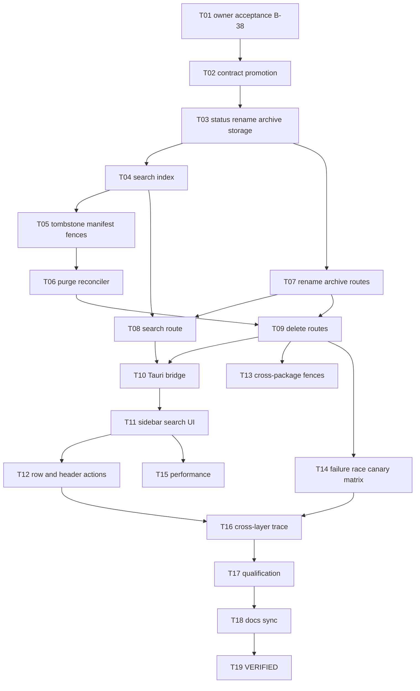

# Implementation Plan - Conversation History Management

**Feature:** 014 | **Spec:** SPEC.md revision 0.1
**Status:** IN_REVIEW - not owner-accepted; does not authorize implementation; not a claim of implementation or qualification.
**Updated:** 2026-11-09
**Rule:** the authoritative ordered work list is [TASKS.md](TASKS.md) (014-T01 to 014-T19). This plan is the summary view.

## 1. Delivery strategy

Build storage first (status and CAS, then search index, then tombstone and fences, then the purge reconciler), then routes, then the Tauri bridge and UI. Rename and archive are low risk and can ship before delete. Delete ships only when every reader is fenced and the purge reconciler passes crash and canary tests. 014 is Wave 1 (gate A) and needs only the Feature 001 Conversation aggregate and its single-flight check.

## 2. Dependency graph

## 3. Phases and exit gates

| Phase | Tasks | Outcome | Exit gate |
|---|---|---|---|
| A - decision | T01 | B-38 accepted or amended | Owner acceptance recorded |
| B - contracts | T02 | Lifecycle, routes, errors, events, migration promoted | Schema and validator pass |
| C - rename/archive | T03, T07 | Version-fenced rename and archive with status-aware writes | Storage and route tests |
| D - search | T04, T08 | Bounded scoped search with index state | Exclusion and rollback tests |
| E - delete | T05, T06, T09, T13 | Tombstone, fences, purge with receipts, cross-package fences | Canary scan and restart tests |
| F - UI | T10, T11, T12 | Sidebar search, row and header actions, accessible states | UI reducer and a11y tests |
| G - proof | T14, T15, T16, T17 | Canonical target, budget, trace, release-row qualification | USER sign-off per row |
| H - close | T18, T19 | Docs sync, VERIFIED | Evidence bundle |

## 4. Scope and file ownership (candidate paths after acceptance)

| Area | Candidate paths | Owner | Guardrail |
|---|---|---|---|
| Storage types | `crates/storage-core/src/conversation.rs` | Storage | One ConversationRecord definition |
| SQLite | `crates/storage-sqlite/src/conversations.rs`, `conversation_search.rs`, `conversation_purge.rs` (new) | Storage | Status check inside each transaction |
| Worker | `apps/litecoworkd/src/conversation_purge_worker.rs` (new), `runtime.rs` (one call) | Runtime | No external call inside a transaction |
| Routes | `apps/litecoworkd/src/conversation_operator.rs` | Operator | If-Match and Idempotency-Key on every mutation |
| Tauri | `apps/litecowork-ui/src-tauri/src/conversation_bridge.rs` | Desktop bridge | One key per intent |
| UI | `apps/litecowork-ui/src/App.tsx`, `src/conversations/` | Desktop UI | No inert controls |
| Contracts | API, STATE-MACHINES, EVENTS, STORAGE, DATA-MODEL, SCHEMAS, DESKTOP-SHELL-LLD | Domain owners | Promote together |

Feature 001 edits `conversations.rs` and `ConversationsPage.tsx` in the same wave. Sequence merges and keep each change scoped to its task.

## 5. Persistence, migration, rollout

- Migration v31 (shipped, `conversation_history_state` side table holding status, archived_at, deleted_at; `conversations` itself is NOT altered, because released migrations are immutable and the status lives in a side table keyed by conversation_id) is followed by a later forward-only migration (next free number after the allocation table in docs/LITECOWORK-BUILD-TASKS.md) for the search index table, `conversation_purge_plans` and `conversation_purge_receipts`.
- Backfill of the search index runs in bounded batches with a per-Workspace watermark; the UI shows `BUILDING` until done.
- Rollout: rename and archive first; search second; delete last, after T13 and T14 pass.

## 6. Operational risks

| Risk | Mitigation / gate |
|---|---|
| Deleted content survives in WAL, index segments or snapshot blobs | Manifest includes them; checkpoint before completion; canary scan |
| Reader not fenced | Single predicate; per-reader fence tests; delete disabled until all pass |
| Delete races a turn | Single-flight check inside the delete transaction |
| Index drift from messages | Same-transaction maintenance; rollback test |
| Concurrent Feature 001 edits | Sequenced merges; shared review of `conversations.rs` hooks |
| Restore resurrects content | Feature 017 preserves tombstone and pending manifest |

## 7. Validation command matrix

| Gate | Command | Expected |
|---|---|---|
| Docs | `python3 .specify/scripts/validate_feature_package.py` | PASS |
| Storage | `cargo test -p storage-sqlite --locked conversation_history` | Pass (filter added by T03) |
| Purge | `cargo test -p storage-sqlite --locked conversation_purge` | Pass (filter added by T05) |
| Feature | `cargo test -p litecoworkd --test conversation_history_management --locked -- --nocapture` | Pass (target added by T14) |
| UI | `pnpm --dir apps/litecowork-ui test` | Pass |
| Routes | `python3 scripts/audit_served_routes.py` | New routes listed |

## 8. Stop and rollback criteria

Stop on any content readable after the tombstone, any cascade delete of Tasks, Artifacts, Evidence or memory, any title or query in logs, any unfenced reader, or any second purge framework. Roll back by disabling the control and route; never undo a committed tombstone by restoring content.

## 9. Handoff

Implementation starts only after 014-T01 records owner acceptance. The first implementation task must name the accepted revision and SHA, the clean worktree and the exact command.
