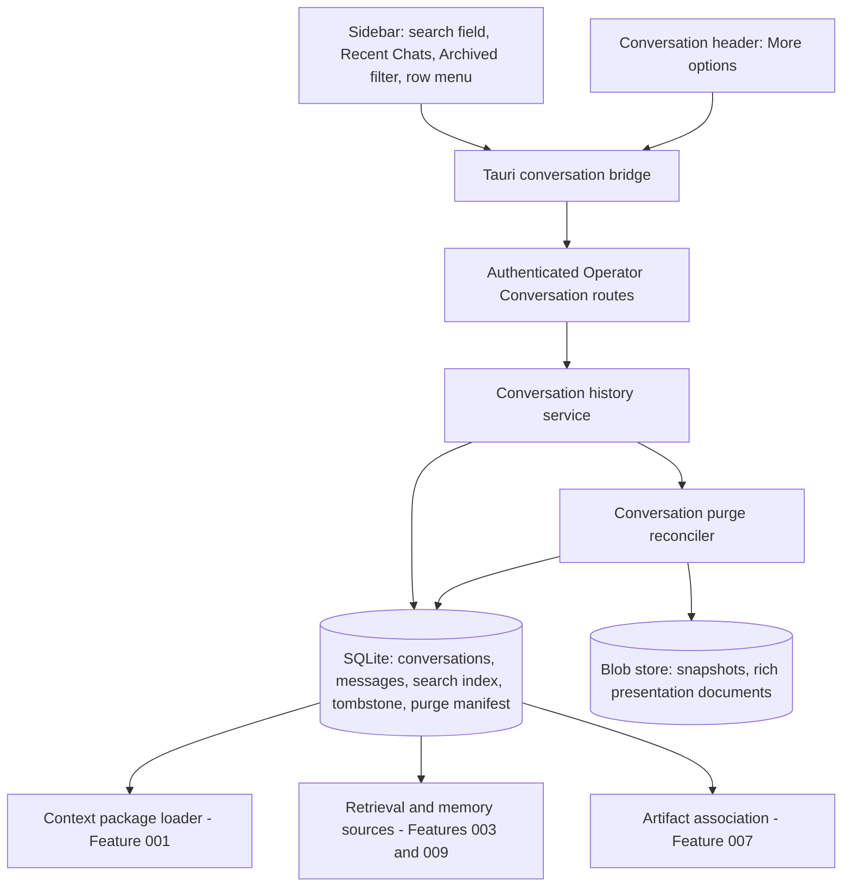

# Feature Specification - Conversation History Management

- **Feature ID:** 014 | **Status:** IN_REVIEW | **Revision:** 0.1
- **Owner review:** authored 2026-11-09 after the owner accepted the review packet ([docs/OWNER-ACCEPTANCE-REVIEW-PACKET.md](../../docs/OWNER-ACCEPTANCE-REVIEW-PACKET.md)). This package did not exist when the packet was accepted, so it is not owner-accepted. Its decision B-38 was accepted as proposed by the owner (sarv-projects) on 2026-11-10; the SPEC as a whole is not yet owner-accepted (014-T01). IN_REVIEW does not authorize implementation, and nothing here claims anything is implemented, SERVED, INTEGRATED or QUALIFIED.
- **Change control:** once accepted, any change to this contract requires a new revision and renewed owner approval (SPECIFICATION-STANDARD section 7).
- **Target:** LiteCowork V1 Area 1 items 1.6 to 1.9 (search, rename, archive, delete) and release contract section 6 invariant 6 (delete fences across retrieval, context, memory, logs and artifacts).
- **Owners:** Conversation, Storage, Operator/API, Desktop UI (sidebar and Conversation header), Security/Privacy, Product.
- **Dependencies:** Feature 001 Conversation aggregate, versioning and `CONVERSATION_TURN_IN_PROGRESS` single-flight; Feature 003 retrieval and context fences; Feature 007 Artifact association; Feature 009 Coworker memory sources; Feature 011 sidebar shell and keyboard baseline; Feature 017 backup preservation of tombstones.

## 1. Problem and user outcome

V1 Area 1 requires "semantic committed history; search, rename/archive/delete". Today the Operator serves Conversation create, list, get, turn submit/retry/cancel and agent-binding change only (`apps/litecoworkd/src/conversation_operator.rs`); there is no search, rename, archive or delete route. `ConversationRecord` (`crates/storage-core/src/conversation.rs`) has `title: Option<String>` set only at create, no status and no last-activity field. The desktop sidebar "Recent Chats" list in `apps/litecowork-ui/src/App.tsx` renders every loaded Conversation without search, and the Conversation header "More options" button in `ConversationsPage.tsx` has no handler. Release contract section 6 invariant 6 requires delete fences across retrieval, context, memory, logs and artifacts; no package owns them for Conversations.

**Outcome:** the owner can find a past Conversation by title or by the text of committed messages, rename it, archive it out of the way and bring it back, or delete it. Delete is honest: content becomes unreadable at once, is purged from every LiteCowork-owned store, does not silently delete independent Tasks, Artifacts or memory, and survives crash, restart and backup/restore without resurrecting content.

## 2. Goals

- G-01 Rename a Conversation with version and idempotency protection.
- G-02 Archive and unarchive a Conversation; archived Conversations are read-only and hidden from the default list and search.
- G-03 Search Conversation titles and committed USER/AGENT message text, owner- and Workspace-scoped, bounded, with an index state that distinguishes "index building" from "no results".
- G-04 Delete with a durable tombstone, immediate read fences and a sealed purge manifest completed by a reconciler with per-target receipts (B-38).
- G-05 Apply delete fences to search, presentation, rich presentations, context packaging, retrieval, Coworker memory sources, Artifact association and diagnostics, and keep Conversation text out of logs.
- G-06 Never cascade delete to independent Tasks, Artifacts, Evidence or memory; show the impact before confirmation.
- G-07 Accessible sidebar search and row actions with loading, empty, no-results, index-building, error, offline, stale and denied states.

## 3. Non-goals

No undo/trash window in V1 (the owner accepted B-38 as proposed on 2026-11-10). No pin/favourite, folders, tags or multi-select bulk actions. No semantic or embedding search. No export (Feature 017). No search of drafts, transient deltas, rich-presentation documents, system notices or provider-private transcripts. No deletion of Tasks, Artifacts, Evidence or Coworker memory as a side effect. No purge of copies already inside backups (Feature 017 states the backup policy). No Coworker-owned Conversation admission (Feature 009). No change to turn dispatch (Feature 001). No cross-Workspace search.

## 4. Current implementation and evidence boundary

| Capability | Current evidence | Limitation |
|---|---|---|
| Conversation routes | CODE/SERVED: `routes_with_state` in `apps/litecoworkd/src/conversation_operator.rs` mounts `GET/POST /v1/conversations`, `GET /v1/conversations/{conversation_id}`, `POST .../turns`, `.../turns/{turn_id}/retry`, `.../turns/{turn_id}/cancel`, `PATCH .../agent-binding` | No search, rename, archive, unarchive or delete route |
| List pagination | CODE/SERVED: `list_conversations` (limit 1-100, Workspace-bound opaque cursor `(created_at, conversation_id)` newest first); test `conversation_operator_cursor_paginates_more_than_fifty_and_fences_workspace_and_owner` | Orders by creation time, not activity; no status filter |
| Title | CODE: create validates 1-160 printable characters (`create_conversation`); `conversations.title` column in `docs/schemas/sqlite-v1.sql` | Set only at create; no mutation path |
| Conversation record | CODE: `ConversationRecord { conversation_id, workspace_id, title, active_agent_binding_id, version, created_at }` | No status, archived_at, deleted_at |
| Storage list | CODE: `SqliteConversationStore::list_conversations` in `crates/storage-sqlite/src/conversations.rs` | Single SQL statement; no index on `(workspace_id, created_at, conversation_id)` beyond the UNIQUE constraint |
| Message storage | CODE: `conversation_messages.content_json` plaintext; `conversation.message.added.v1` payload carries `content_digest`, not content | No search index of any kind |
| Events | CODE: `conversation.created.v1` payload has no title | No rename, archive or delete events |
| Tombstone and purge precedent | CODE: ContextDocument `DELETION_PENDING -> DELETED` with sealed purge plan and per-target receipts (`crates/storage-sqlite/src/context_document_purge.rs`; STATE-MACHINES Resource section) | Not applied to Conversations |
| Lexical index precedent | CODE: Resource index stores HMAC term tokens, never plaintext terms (`crates/storage-sqlite/src/resource_index.rs`, `MAX_QUERY_TERMS = 32`, `MAX_TERM_CHARS = 128`) | Resource-only |
| Rows referencing a Conversation | Schema: `conversation_messages`, `conversation_turns`, `agent_sessions`, `user_requests`, `user_request_responses`, `provider_input_bindings`, `capability_grants`, `capability_activations`, `capability_invocations`, `capability_invocation_provider_bindings`, `tasks`, `channel_thread_mappings`, `channel_event_receipts`, `invalidation_records` (`sqlite-v1.sql`), `rich_presentations` (`sqlite-v12.sql`); plus `aggregate_snapshots` blobs and `request_dedup.response_json` | No delete path touches any of them |
| Desktop sidebar | CODE: "Recent Chats" in `apps/litecowork-ui/src/App.tsx` renders `conversationsByWorkspace[selectedWorkspaceId]` with `conv.title || "Untitled"`; the selected row shows the text "now" | No search field, no row actions, no virtualization; "now" is not a time |
| Conversation header | CODE: `ConversationsPage.tsx` header shows `selected?.title ?? "AI Capabilities Overview"`; "More options" button has no handler | Fabricated fallback title; inert control |
| Tauri commands | CODE: `conversation_bridge.rs` `list_conversations`, `create_conversation`, `get_conversation`, `set_conversation_agent_binding`, turn commands | No history-management commands |

Status rows above are also reflected in [docs/IMPLEMENTATION-STATUS.md](../../docs/IMPLEMENTATION-STATUS.md) (Conversation section).

## 5. Decision register

### Inherited LOCKED invariants (canonical owners; not feature approval)

| ID | Invariant | Authority |
|---|---|---|
| L-01 | Plain Conversation is separate from Task; Task creation is explicit and Tasks keep independent durable state. | AGENTS.md section 2, PRODUCT |
| L-02 | Data scope, user ownership, revocation and delete fences apply to retrieval, context, memory, logs and artifacts. | V1 release contract section 6 invariant 6 |
| L-03 | Delete/Archive changes do not cascade to independent Tasks, Artifacts or Memory without explicit impact approval. | DESKTOP-SHELL-LLD left sidebar section |
| L-04 | Conversation search is permission-scoped and count-capped/virtualized; a missing search index differs from "no results". | DESKTOP-SHELL-LLD left sidebar section |
| L-05 | Conversation search indexes semantic message content, never rendered HTML, rich frames or local UI state. | RICH-RESPONSE "Search, export, and channels" |
| L-06 | Archived Workspaces reject every domain mutation (`WORKSPACE_ARCHIVED`). | STATE-MACHINES Workspace, API |
| L-07 | Domain events are immutable; message events carry digests, not content. | EVENTS, `conversation.message.added.v1` |
| L-08 | Conversation text is never written to ordinary logs or diagnostics. | Feature 001 SPEC section 8, OBSERVABILITY |
| L-09 | One active turn per Conversation (B-01, accepted in Feature 001); `CONVERSATION_TURN_IN_PROGRESS` 409. | Feature 001 SPEC section 5 |

### FLEXIBLE

| ID | Choice | Allowed options | Constraint |
|---|---|---|---|
| F-01 | Search index mechanism | (a) HMAC term-token table modelled on `resource_index.rs`; (b) SQLite FTS5 external-content table with `secure-delete` | Purge must leave no recoverable term data; FTS5 only if the bundled `libsqlite3-sys 0.38.2` build is proven to include it. Recommended: (a) |
| F-02 | Index maintenance | (a) in the same SQLite transaction as the message insert; (b) asynchronous indexer from the event journal with a watermark | Search never returns uncommitted text; UI shows index state. Recommended: (a) plus a resumable backfill for existing rows |
| F-03 | List ordering | `created_at` (today) or last committed activity | Ordering must come from persisted data, not the display clock |
| F-04 | Archive route shape | `POST .../archive` and `.../unarchive`, or `PATCH` status | Same version and idempotency rules |

### PROPOSED DECISION (pending owner)

| ID | Topic | Proposed resolution | Consequence |
|---|---|---|---|
| B-38 | Delete semantics: tombstone plus purge window vs immediate purge | **ACCEPTED as proposed (owner sarv-projects, 2026-11-10).** **Tombstone with immediate fenced purge; no restore window in V1.** (1) `DELETE /v1/conversations/{id}` (If-Match, Idempotency-Key) is accepted only when the Conversation has no nonterminal turn (`CONVERSATION_TURN_IN_PROGRESS`) and no unsettled Conversation-scoped invocation, active grant, activation or open UserRequest (`CONVERSATION_NOT_QUIESCENT`). (2) One IMMEDIATE transaction writes the tombstone (status `DELETION_PENDING`, `deleted_at`, version bump, title cleared), a sealed purge manifest of exact targets, and `conversation.deletion_requested.v1`; from that commit every read and write path returns `CONVERSATION_DELETED` (proposed, HTTP 410). (3) Manifest targets: message rows and their search-index rows; turn rows' content-bearing fields; UserRequest details and responses; `rich_presentations` rows and their document blobs; `aggregate_snapshots` blobs for the Conversation and its messages; `request_dedup.response_json` for Conversation commands; `channel_thread_mappings`; Runtime-local session host bindings already closed. (4) A purge reconciler, reusing the ContextDocument purge pattern, removes each target and records one receipt per target; failure keeps the receipt pending and retries; restart resumes. `DELETED` commits only when every receipt is acknowledged, with `conversation.deleted.v1`. (5) Retained by design: the tombstone row (ids, Workspace, timestamps, version, no title), immutable domain events (digests only), Task records with their origin link shown as "deleted conversation", Artifacts and Evidence (Feature 007/005 owners), Coworker memory (Feature 009 owner decides separately). (6) Backups (Feature 017) preserve the tombstone and pending manifest so a restore resumes purge; content already inside an older backup is outside this guarantee and the delete dialog says so. **Alternative for the owner:** a 30-day `DELETION_PENDING` restore window before purge. Not proposed because it keeps content on disk for 30 days, needs the fences to hold for that whole period, and Archive already covers reversible removal. | Fixes the lifecycle in DATA-MODEL, the manifest in 014-T05 and the reconciler in 014-T06. |

B-38 was accepted as proposed on 2026-11-10 (the 30-day restore-window alternative is not adopted). This package remains IN_REVIEW until the owner accepts the SPEC as a whole and answers O-02 and O-03 through 014-T01.

## 6. High-level design



### Trust boundaries

- Desktop WebView to Operator: authenticated local IPC (Feature 011). Search queries and titles are untrusted input, bounded and validated server-side.
- Storage: every read path (list, get, presentation, messages, context, search, rich presentation) checks Conversation status inside its own transaction; a read prepared before a tombstone cannot commit derived state after it.
- Blob store: purge acknowledges a target only after the object is physically removed.

### Actor sequence (delete, target)

1. Owner opens the row menu, chooses Delete; UI calls `get_conversation_deletion_impact`; daemon returns counts of linked Tasks, Artifacts and memory sources and whether an active turn blocks delete.
2. Owner confirms in the dialog. UI sends `delete_conversation` with the observed version and a fresh idempotency key.
3. Daemon checks quiescence and version, then commits tombstone, manifest, fence and event in one transaction and returns 202 with `DELETION_PENDING`.
4. The sidebar removes the row; any open view of the Conversation shows "This conversation was deleted".
5. The purge reconciler runs outside the request, removes targets, writes receipts and finally commits `DELETED`.
6. After restart the reconciler resumes from pending receipts.

### Ownership

| Owner | Responsibility | Excluded |
|---|---|---|
| Sidebar / header UI | Search field, list, filters, row menu, dialogs, states | Authorization, fences |
| Tauri bridge | Typed commands, bounds | Retrying with a new key |
| Operator | Auth, Workspace scope, If-Match, idempotency, typed errors | Purge execution |
| Conversation history service | Rename, archive, search, delete orchestration | Turn dispatch (Feature 001) |
| Storage | CAS transactions, index maintenance, tombstone, manifest, read fences | External calls inside transactions |
| Purge reconciler | Target removal, receipts, completion | Deleting Tasks, Artifacts, Evidence |
| Features 003, 007, 009 | Honour the fence in their readers | Conversation lifecycle |

## 7. Low-level design and interfaces

### 7.1 Existing CODE signatures (verified in source)

```rust
// crates/storage-core/src/conversation.rs
pub struct ConversationRecord { pub conversation_id: String, pub workspace_id: String,
    pub title: Option<String>, pub active_agent_binding_id: Option<String>,
    pub version: u64, pub created_at: String }
pub trait ConversationStore: Send + Sync {
    fn create_conversation(&self, commit: CreateConversationCommit) -> Result<CommittedConversation, StoreError>;
    fn set_conversation_agent_binding_idempotent(&self, commit: SetConversationAgentBinding)
        -> Result<CommittedConversation, StoreError>;
    fn get_conversation(&self, principal_id: &str, workspace_id: &str, conversation_id: &str)
        -> Result<Option<ConversationRecord>, StoreError>;
    fn list_conversations(&self, principal_id: &str, workspace_id: &str,
        after_created_at: Option<&str>, after_conversation_id: Option<&str>, limit: usize)
        -> Result<Vec<ConversationRecord>, StoreError>;
}
// crates/storage-sqlite/src/conversations.rs: impl ConversationStore for SqliteConversationStore
// apps/litecoworkd/src/conversation_operator.rs: routes_with_state, list_conversations, create_conversation
```

`SetConversationAgentBinding` is the existing version-fenced, idempotent mutation pattern (request, principal, Workspace, Conversation, `expected_version`, event); rename and archive reuse that shape.

### 7.2 Proposed target signatures (not yet in source)

```rust
// crates/storage-core/src/conversation.rs (extended)
pub enum ConversationStatus { Active, Archived, DeletionPending, Deleted }
// ConversationRecord gains: status, archived_at: Option<String>, deleted_at: Option<String>
pub struct RenameConversation { pub request: WorkspaceCreateRequest, pub principal_id: String,
    pub workspace_id: String, pub conversation_id: String, pub expected_version: u64,
    pub title: Option<String>, pub event: EventDraft } // event payload carries title_digest only
pub struct SetConversationArchived { /* same identity fields */ pub archived: bool, pub event: EventDraft }
pub struct RequestConversationDeletion { /* same identity fields */ pub event: EventDraft }
pub struct ConversationSearchQuery { pub principal_id: String, pub workspace_id: String,
    pub text: String, pub scope: ConversationSearchScope /* ACTIVE | ARCHIVED | ALL */,
    pub after: Option<ConversationSearchCursor>, pub limit: usize }
pub struct ConversationSearchHit { pub conversation_id: String, pub title: Option<String>,
    pub matched: ConversationMatchKind /* TITLE | MESSAGE */, pub message_id: Option<String>,
    pub snippet: Option<String> /* <= 240 chars from the committed message */, pub status: ConversationStatus }
pub trait ConversationHistoryStore: Send + Sync {
    fn rename_conversation(&self, c: RenameConversation) -> Result<CommittedConversation, StoreError>;
    fn set_conversation_archived(&self, c: SetConversationArchived) -> Result<CommittedConversation, StoreError>;
    fn search_conversations(&self, q: ConversationSearchQuery) -> Result<ConversationSearchPage, StoreError>;
    fn conversation_deletion_impact(&self, principal_id: &str, workspace_id: &str, conversation_id: &str)
        -> Result<ConversationDeletionImpact, StoreError>;
    fn request_conversation_deletion(&self, c: RequestConversationDeletion)
        -> Result<ConversationDeletionStatus, StoreError>;
    fn list_pending_conversation_purge_targets(&self, limit: usize) -> Result<Vec<ConversationPurgeTarget>, StoreError>;
    fn acknowledge_conversation_purge_target(&self, target_id: &str) -> Result<(), StoreError>;
    fn complete_conversation_deletion_if_all_acknowledged(&self, conversation_id: &str)
        -> Result<ConversationDeletionStatus, StoreError>;
}
```

Proposed routes (not yet in source):

| Route | Headers | Purpose |
|---|---|---|
| `GET /v1/conversations?status=&cursor=&limit=` (status `ACTIVE` or `ARCHIVED`) | Workspace | Existing list gains a status filter (default ACTIVE) |
| `GET /v1/conversations/search?q=&scope=&cursor=&limit=` | Workspace | Title and committed-message search; `index_state` in response |
| `PATCH /v1/conversations/{conversation_id}` | If-Match, Idempotency-Key | Rename (`title`, 1-160 printable characters, or null to clear) |
| `POST /v1/conversations/{conversation_id}/archive` | If-Match, Idempotency-Key | Archive |
| `POST /v1/conversations/{conversation_id}/unarchive` | If-Match, Idempotency-Key | Unarchive |
| `GET /v1/conversations/{conversation_id}/deletion-impact` | Workspace | Linked Tasks, Artifacts, memory sources, blockers |
| `DELETE /v1/conversations/{conversation_id}` | If-Match, Idempotency-Key | Tombstone and purge (202) |
| `GET /v1/conversations/{conversation_id}/deletion` | Workspace | `DELETION_PENDING` or `DELETED`, pending target count |

Proposed error codes: `CONVERSATION_ARCHIVED` (409), `CONVERSATION_DELETED` (410), `CONVERSATION_NOT_QUIESCENT` (409), `CONVERSATION_SEARCH_INDEX_BUILDING` (informational state, not an error status). Reused: `STALE_VERSION`, `IDEMPOTENCY_CONFLICT`, `INVALID_ARGUMENT`, `FORBIDDEN`, `NOT_FOUND`, `WORKSPACE_ARCHIVED`, and Feature 001's `CONVERSATION_TURN_IN_PROGRESS`. Proposed events: `conversation.renamed.v1` (title_digest), `conversation.archived.v1`, `conversation.unarchived.v1`, `conversation.deletion_requested.v1`, `conversation.deleted.v1`.

## 8. Data model and lifecycle

See [DATA-MODEL.md](DATA-MODEL.md).

```text
ACTIVE <-> ARCHIVED
ACTIVE | ARCHIVED -> DELETION_PENDING -> DELETED
```

ARCHIVED is read-only: submit, retry, cancel of a new turn, agent-binding change and rename are refused with `CONVERSATION_ARCHIVED` (rename is allowed only after unarchive). DELETION_PENDING and DELETED refuse every read and write except the deletion status route.

## 9. Wiring

See [WIRING.yaml](WIRING.yaml).

## 10. Security, trust and privacy

- Every route is owner- and Workspace-scoped; another owner's Conversation is `NOT_FOUND` with no existence leak in search.
- Search query bounded (1-256 characters, at most 32 terms, `MAX_TERM_CHARS` 128) and never logged; results bounded (limit 1-50).
- Snippets come only from committed USER/AGENT messages the caller may read; no rich document, notice or draft text.
- Title changes emit `title_digest`, not the title, so deleted titles do not survive in the immutable journal.
- Delete purge is verified by a canary test that scans the database file, WAL and blob store for a unique string after `DELETED`.
- Conversation text and titles never appear in ordinary logs or diagnostics before or after delete.

## 11. Errors, edge cases and recovery

See [contracts/errors-recovery.md](contracts/errors-recovery.md). Key rules: stale version is a conflict with no write; archive and delete are refused while a turn is active; a read that started before a tombstone fails its final status check; the purge reconciler is idempotent and resumable; restore from backup resumes purge and never resurrects content.

## 12. Configuration and compatibility

- Title bound reused from create (1-160 printable characters).
- Search bounds: query 256 characters, 32 terms, limit 50, snippet 240 characters; proposed p95 budget below.
- Migration: one forward-only `sqlite-vNN.sql` (next free number; chain ends at `sqlite-v28.sql`) adds status columns, index table, tombstone and manifest tables, and the list index `(workspace_id, status, created_at DESC, conversation_id DESC)`.
- Old binaries reading a migrated database would not understand status; the migration is one-way and covered by the upgrade check of Feature 017.

## 13. Observability

Record correlation IDs, Conversation IDs, operation, result class, durations, index backfill progress, purge target counts and receipt latency. Never record titles, query text, snippets or message content.

## 14. EARS acceptance criteria

- AC-001 WHEN the owner renames a Conversation with the current version and an idempotency key, THE SYSTEM SHALL atomically commit the new title (1-160 printable characters, or cleared), the version increment, `conversation.renamed.v1` carrying only a title digest, and the request receipt, and the sidebar and header SHALL show the new title. Verify: storage and route tests; UI test.
- AC-002 IF a rename carries a stale version, an invalid title, a foreign owner or Workspace, or targets a Conversation in an archived Workspace, THEN THE SYSTEM SHALL return `STALE_VERSION`, `INVALID_ARGUMENT`, `NOT_FOUND`/`FORBIDDEN` or `WORKSPACE_ARCHIVED` and write nothing. Verify: negative route tests.
- AC-003 WHEN a rename, archive, unarchive or delete is replayed with the same key and payload, THE SYSTEM SHALL return the stored result; IF the payload differs under the same key, THEN THE SYSTEM SHALL return `IDEMPOTENCY_CONFLICT`. Verify: replay tests.
- AC-004 WHEN the owner archives a Conversation that has no nonterminal turn, THE SYSTEM SHALL mark it ARCHIVED, hide it from the default list and default search, show it under the Archived filter, and refuse submit, retry, agent-binding change and rename with `CONVERSATION_ARCHIVED`; IF a turn is active, THEN THE SYSTEM SHALL refuse archive with `CONVERSATION_TURN_IN_PROGRESS`. Verify: storage, route and UI tests.
- AC-005 WHEN the owner unarchives a Conversation, THE SYSTEM SHALL restore ACTIVE status, leave its messages unchanged and allow future turns. Verify: route test.
- AC-006 WHEN the owner searches, THE SYSTEM SHALL return owner- and Workspace-scoped matches on title and committed USER/AGENT message text with a bounded snippet and a stable cursor, enforcing query, term and limit bounds. Verify: search tests with fixtures in two Workspaces and two owners.
- AC-007 THE SYSTEM SHALL exclude from search SYSTEM_NOTICE messages, drafts, transient deltas, rich-presentation documents, other Workspaces, DELETION_PENDING and DELETED Conversations, and ARCHIVED Conversations unless the scope requests them. Verify: exclusion fixtures.
- AC-008 WHEN a message commits, THE SYSTEM SHALL make it searchable no later than the end of its own transaction (F-02 option a) and a rolled-back message SHALL never be searchable; WHILE the backfill for pre-existing messages is running, THE SYSTEM SHALL report `index_state=BUILDING` instead of an empty result. Verify: transaction rollback test and backfill test.
- AC-009 WHEN the owner confirms delete with the current version and no active turn or unsettled Conversation-scoped invocation, grant, activation or open UserRequest, THE SYSTEM SHALL in one transaction write the tombstone, the sealed purge manifest and `conversation.deletion_requested.v1` and return 202 with `DELETION_PENDING`; otherwise THE SYSTEM SHALL return `CONVERSATION_TURN_IN_PROGRESS` or `CONVERSATION_NOT_QUIESCENT` and write nothing. Verify: storage and route tests.
- AC-010 WHILE a Conversation is DELETION_PENDING or DELETED, THE SYSTEM SHALL refuse get, messages, presentation, rich presentation, context package loading, search, turn submit and every mutation with `CONVERSATION_DELETED`, and a read or derived write prepared before the tombstone SHALL fail its final status check. Verify: fence tests across each reader, including a race test.
- AC-011 WHEN the purge reconciler runs, THE SYSTEM SHALL remove each manifest target, record one receipt per target only after physical removal, keep failed or ambiguous targets pending for retry, resume after restart, and commit DELETED with `conversation.deleted.v1` only when every receipt is acknowledged. Verify: reconciler fault-injection and restart tests.
- AC-012 WHEN a Conversation is deleted, THE SYSTEM SHALL NOT delete linked Tasks, Artifacts, Evidence or Coworker memory, SHALL show their counts in the impact preview before confirmation, and linked records SHALL show a "deleted conversation" origin. Verify: impact route test and linked-record assertions.
- AC-013 WHEN a Conversation reaches DELETED, THE SYSTEM SHALL retain only the tombstone and digest-only events, and a canary string from its title and messages SHALL NOT be found in the SQLite database file, WAL, search index or blob store. Verify: canary scan test.
- AC-014 THE SYSTEM SHALL NOT write Conversation titles, message text, search queries or snippets to ordinary logs or diagnostics, before or after delete. Verify: log capture canary test.
- AC-015 IF two mutations race on the same Conversation version (rename and rename, submit and archive, submit and delete), THEN THE SYSTEM SHALL commit exactly one and return `STALE_VERSION` or the applicable conflict for the other. Verify: concurrency tests.
- AC-016 WHILE the owner types in the sidebar search field, THE SYSTEM SHALL debounce requests, abort stale responses, and show distinct accessible states for loading, results, no results, index building, error, offline and denied, with a labelled field and results announced through a polite live region. Verify: UI reducer tests and keyboard/screen-reader audit.
- AC-017 WHEN the owner uses Rename, Archive, Unarchive or Delete from the row menu or header More options, THE SYSTEM SHALL provide keyboard-operable controls (Enter commits, Escape cancels, focus returns to the invoking control), disable them with an accessible reason while a turn is active, and require an explicit confirmation dialog for Delete that names the irreversible consequence and the backup limitation. Verify: UI component tests and accessibility audit.
- AC-018 WHEN a Workspace holds 10,000 Conversations and 200,000 committed messages on the release row, THE SYSTEM SHALL answer a search page within 300 ms at p95 and render the sidebar list virtualized or count-capped (proposed budget, confirmed in 014-T15). Verify: storage benchmark and UI render test.
- AC-019 WHEN a backup taken during DELETION_PENDING is restored, THE SYSTEM SHALL keep the tombstone and fences and resume purge, and SHALL NOT make the deleted content readable. Verify: Feature 017 restore test using this package's fixture.
- AC-020 WHILE a history-management route is not served, THE SYSTEM SHALL hide the control or render it disabled with an "unavailable" accessible name, and SHALL NOT show the fabricated header title "AI Capabilities Overview" or the "now" recency text for a row. Verify: UI truthfulness test.

## 15. Executable acceptance command

**Canonical feature acceptance command (proposed target; the test target does not exist yet and is created by 014-T14):**

```bash
cargo test -p litecoworkd --test conversation_history_management --locked -- --nocapture
```

Do not mark this package VERIFIED until the target exists, covers AC-001 to AC-020 with the UI suite, and passes on Windows x64 + OpenCode v2.0.32 and then Linux x64 with owner USER evidence.

## 16. Out-of-bounds paths and side effects

While IN_REVIEW, no implementation path is in bounds. After acceptance, each task in [TASKS.md](TASKS.md) names its allowed paths. Always out of bounds: turn dispatch and the supervisor (Feature 001), Task, Artifact, Evidence and Coworker memory deletion, backup format (Feature 017), unrelated migrations, released migrations. Design validation must not delete or rewrite any user Conversation.

## 17. Assumptions and open questions

| ID | Question | Evidence/limitation | Owner | Gate |
|---|---|---|---|---|
| O-01 | Does the bundled SQLite include FTS5? | `rusqlite 0.40.2` with `bundled`; flags not verified here | Storage | F-01 / 014-T04 |
| O-02 | Should Evidence and Capability Invocation records that quote Conversation text be redacted on delete? | Evidence retention is owned by Feature 005/007 contracts | Trust, Evidence owner | 014-T13 |
| O-03 | Sidebar ordering by last activity instead of creation time? | COWORKERS-TARGET asks for persisted-activity ordering | Product | F-03 |
| O-04 | Which E2E id covers history management? | ACCEPTANCE-AND-E2E-PLAN has no dedicated journey; E2E-01 and E2E-12 cover parts | Testing (orchestrator) | 014-T17 |
| O-05 | Coworker memory derived from a deleted Conversation | Feature 009/020 owns memory; fence makes the source ineligible | Feature 009 | 014-T13 |

## 18. Requirement traceability

| Requirement | Canonical owner | Task | Acceptance |
|---|---|---|---|
| Owner acceptance of B-38 | OWNER-ACCEPTANCE-REVIEW-PACKET | 014-T01 | AC-009 / AC-020 |
| Contract promotion | API, STATE-MACHINES, EVENTS, STORAGE, SCHEMAS | 014-T02 | AC-001 / AC-004 / AC-009 |
| Rename and archive storage | STORAGE, STATE-MACHINES | 014-T03 | AC-001 / AC-002 / AC-003 / AC-004 / AC-005 / AC-015 |
| Search index | STORAGE, RICH-RESPONSE | 014-T04 | AC-006 / AC-007 / AC-008 |
| Tombstone and fences | STORAGE, release contract section 6 | 014-T05 | AC-009 / AC-010 / AC-015 |
| Purge reconciler | STORAGE, FAILURE-RECOVERY | 014-T06 | AC-011 / AC-013 |
| Rename/archive routes | API | 014-T07 | AC-001 / AC-002 / AC-003 / AC-004 / AC-005 |
| Search route | API, DESKTOP-SHELL-LLD | 014-T08 | AC-006 / AC-007 / AC-008 |
| Delete routes and impact | API, DESKTOP-SHELL-LLD | 014-T09 | AC-009 / AC-012 |
| Tauri bridge | LOCAL-OPERATOR-IPC | 014-T10 | AC-003 / AC-014 |
| Sidebar search UI | DESKTOP-SHELL-LLD, V1-UI-SCREEN-CONTRACT | 014-T11 | AC-016 / AC-020 |
| Row actions and header UI | DESKTOP-SHELL-LLD, V1-UI-ACTION-STATE-LEDGER | 014-T12 | AC-017 / AC-020 |
| Cross-package fences | release contract section 6, Features 003/007/009 | 014-T13 | AC-010 / AC-012 / AC-014 |
| Failure, race and canary matrix | FAILURE-RECOVERY, TESTING | 014-T14 | AC-011 / AC-013 / AC-014 / AC-015 |
| Performance | TESTING | 014-T15 | AC-018 |
| Cross-layer trace | AGENTS.md section 4 | 014-T16 | AC-001 / AC-006 / AC-009 |
| Qualification and backup interplay | ACCEPTANCE-AND-E2E-PLAN | 014-T17 | AC-016 / AC-017 / AC-019 |
| Docs sync and VERIFIED transition | IMPLEMENTATION-STATUS | 014-T18 / 014-T19 | AC-001 to AC-020 (AC-001, AC-002, AC-003, AC-004, AC-005, AC-006, AC-007, AC-008, AC-009, AC-010, AC-011, AC-012, AC-013, AC-014, AC-015, AC-016, AC-017, AC-018, AC-019, AC-020) |
