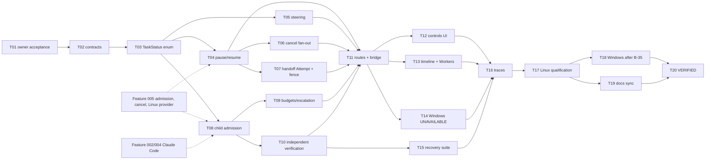

# Implementation Plan - Task Control and Heterogeneous Delegation

**Feature:** 015 | **Spec revision:** 0.1
**Status:** IN_REVIEW - authored for owner review; does not authorize implementation until owner acceptance (TASKS T01).

## 1. Delivery strategy

Build on Feature 005 rather than beside it. The order is: typed Task status first (so every control is checked against one transition table), then the state-only controls (pause, resume, steer), then fan-out cancel and handoff (which reuse Feature 005 cancel and admission), then delegation (child admission, escalation, independent verification), then routes and UI, then recovery and qualification. Wave 4 in the V1 delivery plan (gate E). Qualify on the Linux x86_64 row first; the Windows row ships the UNAVAILABLE posture until Feature 005 B-35 qualifies.

All new code is Rust (daemon services in `apps/litecoworkd`, domain logic in `crates/domain-task`, storage in `crates/storage-sqlite`) or TypeScript (Work-screen components under `apps/litecowork-ui/src/tasks/`). Most decision logic already exists in Rust; the work is mostly composition plus fences, which keeps the change small and testable.

## 2. Dependency graph

## 3. Phases and exit gates

| Phase | Tasks | Exit gate |
|---|---|---|
| 0 Acceptance | T01 | B-39 decided; status ACCEPTED/LOCKED |
| 1 Contracts | T02 | Routes, errors, events, migration promoted at owners |
| 2 Domain and storage | T03-T10 | CAS, idempotency and negative tests green; no external call inside a transaction |
| 3 Service, route, bridge | T11 | Authenticated routes with replay and 409 behaviour; route inventory regenerated |
| 4 UI | T12-T14 | All states tested; accessibility audit clean; Windows UNAVAILABLE posture |
| 5 Recovery | T15 | Crash, restart, timeout-after-dispatch, duplicate replay and cancel races pass |
| 6 Trace and qualification | T16-T18 | Linux row QUALIFIED; Windows row UNAVAILABLE or QUALIFIED after B-35 |
| 7 Docs and VERIFIED | T19-T20 | Status rows match evidence; owner sign-off |

## 4. Scope and file ownership (candidate paths, re-inspect before implementation)

| Area | Paths |
|---|---|
| Domain | `crates/domain-task/src/task_control.rs` (new), `delegation_admission.rs`, `delegation_recovery.rs`, `delegation_result_service.rs`, `lead_handoff.rs`, `lead_handoff_packet.rs`, `execution.rs`, `lib.rs` |
| Storage | `crates/storage-core/src/task_status.rs` (new), `crates/storage-sqlite/src/task_control.rs` (new), `execution.rs`, `verification_runs.rs`, `delegation_results.rs` |
| Daemon | `apps/litecoworkd/src/task_control_service.rs`, `delegation_admission_service.rs`, `lead_handoff_attempt.rs`, `independent_verification_service.rs`, `task_control_operator.rs` (all new), `task_lead_handoff_operator.rs`, `verification_runs_operator.rs`, `operator.rs` (merge only) |
| Desktop | `apps/litecowork-ui/src-tauri/src/task_control_bridge.rs` (new), `apps/litecowork-ui/src/tasks/` new components and reducers |
| Contracts | owner docs and `docs/schemas/*` listed in TASKS T02 |

## 5. Persistence, migration, rollout

One forward-only migration after `sqlite-v28.sql` (number taken at implementation time) adds `task_control_requests` and `task_resume_packets` and stores `on_exhaustion` with the escalation policy. No existing column changes type; `tasks.status` stays text and is parsed by the new enum. Rollout is behind the Task projection's `allowed_commands`: a control is invisible to the UI until its route and owner path are served.

## 6. Operational risks

| Risk | Mitigation |
|---|---|
| Quiescence never observed (stuck native process) | Bounded wait, then Feature 005 forceful stop of LiteCowork-owned processes only; Task stays PAUSE_REQUESTED or CANCEL_REQUESTED with a typed blocker |
| Worker writes leak between Attempts | `ATTEMPT_PRIVATE` only (B-39); shared scope denied |
| Late result accepted after handoff | Lease epoch and Attempt id fence in `DelegationResultService` and Effect receipts |
| Claude Code result format unstable | Pin version in Feature 002; adapter normalization fixture |
| Verifier collusion (same binding) | Storage-level check that verifier binding differs from producer binding |
| Windows users see missing features | Visible UNAVAILABLE reason, no hidden partial path |

## 7. Validation command matrix

| Layer | Command |
|---|---|
| Docs | `python3 .specify/scripts/validate_feature_package.py` |
| Domain | `cargo test -p domain-task --locked` |
| Storage | `cargo test -p storage-sqlite --locked task_control` |
| Daemon | `cargo test -p litecoworkd --locked task_control` |
| Bridge | `cargo test -p litecowork-ui --locked task_control_bridge` |
| UI | `pnpm --dir apps/litecowork-ui test` and `pnpm --dir apps/litecowork-ui run build` |
| Feature | `cargo test -p litecoworkd --test task_control_delegation --locked -- --nocapture` |
| Routes | `python3 scripts/audit_served_routes.py` |

## 8. Stop and rollback criteria

Stop if any path reports PAUSED or CANCELLED without observed quiescence, admits a child before the admission commit, accepts a late result, lets a verifier share the producer's binding, or admits an Attempt on Windows without a qualified Environment. Roll back by removing the route merge in `operator.rs`; the migration is additive and stays.

## 9. Handoff

After T20 the package moves to VERIFIED; downstream consumers are Feature 010 (Automation-created Tasks use the same controls) and Feature 020 (Needs You items from `on_exhaustion`).
