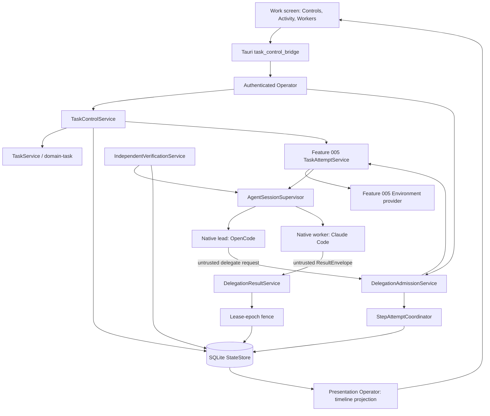

# Feature Specification - Task Control and Heterogeneous Delegation

- **Feature ID:** 015 | **Status:** IN_REVIEW | **Revision:** 0.1
- **Owner acceptance:** not yet accepted. This package was created after the 2026-11-09 owner acceptance of [docs/OWNER-ACCEPTANCE-REVIEW-PACKET.md](../../docs/OWNER-ACCEPTANCE-REVIEW-PACKET.md) and is authored complete for review. Blocker B-39 is PROPOSED and needs an owner decision. Nothing in this package authorizes implementation until the owner accepts it (TASKS 015-T01).
- **Change control:** after acceptance this becomes a locked contract; any later change needs a new revision and renewed owner approval (SPECIFICATION-STANDARD section 7).
- **Target:** LiteCowork V1 local desktop, Area 6 "Real Tasks and Multi-Agent Work" items 6.5 (eligible native or heterogeneous delegation), 6.6 (control, steering, cancellation) and 6.9 (handoff), release-contract invariant section 6 item 3, gate E (heterogeneous delegation).
- **Release rows:** Linux x86_64 desktop row first (Task execution qualifies there first per the accepted B-17 rider). On the Windows 11/10 `x86_64-pc-windows-msvc` row every execution-dependent operation in this package stays visibly UNAVAILABLE until Feature 005 blocker B-35 (Windows Environment provider) is accepted and qualified.
- **Owners:** Task Runtime, Delegation, Storage, Operator/API, Desktop UI (Work screen), Security/Trust, Product.
- **Hard dependency:** Feature 005 (safe Task path: plan acceptance, Attempt admission, Environment attestation, Effect reconciliation, single-Attempt cancel and recovery). Other dependencies: Feature 002 and Feature 004 (second qualified agent, Claude Code CLI), Feature 009 (Coworker revision and `enabled_delegation_profile_ids`), Feature 011 (IPC, Runtime incarnation), Feature 019 (release matrix rows).

## 1. Problem and user outcome

Feature 005 delivers one safe Task with one Attempt. V1 also promises that the owner can control running work (pause, resume, steer, cancel), change the lead agent safely, let the lead delegate one Step to a different eligible agent, and have the result checked by an independent agent. Today the domain logic for most of this exists in Rust but nothing calls it from a served route, and there is no Work-screen control or execution timeline.

**Outcome:** on the Linux release row, the owner opens a running Task on the Work screen, sees a truthful Activity timeline and a Workers view, can pause and later resume it, can send a steering note or a spec change, can cancel it, and can hand the lead role to another agent. The OpenCode lead can delegate an eligible READY Step to a Claude Code worker inside a private Environment; a separate verifier agent checks the result. Every control is enabled only when the owning service admits that exact transition, and a late result from a replaced Attempt can never change the Task.

## 2. Goals

- G-01 Task pause and resume follow the canonical Task state machine (`PAUSE_REQUESTED`, `PAUSED`) with a portable ResumePacket, lease release and a fresh Attempt on resume.
- G-02 Steering is typed (`CHAT_ONLY | TASK_SPEC_CHANGE | PLAN_HINT | URGENT_INTERRUPT | CANCEL`); a spec change creates an immutable `TaskSpecRevision(n+1)` and never mutates a running Attempt's pinned revision.
- G-03 Task-level cancel fans out to every active child Attempt and settles CANCELLED only after all Attempts and Effects are quiescent or reconciled.
- G-04 Lead handoff starts an authorized new Attempt; the prior lease is released, expired or revoked first; a late result from the old Attempt or lease epoch is fenced (release contract section 6 item 3).
- G-05 Child-Attempt admission has a production caller that enforces the DelegationProfile, the Coworker worker allowlist (`enabled_delegation_profile_ids`), depth, concurrency and budget, committing Attempt, Step binding, lease, budget reservation and admission event atomically.
- G-06 Escalation honours `max_worker_attempts`, `fallback_profile_ids` and `on_exhaustion` (`RETURN_TO_LEAD | NEEDS_YOU`, register A-37).
- G-07 Verification is performed by an independent agent binding in a read-only Environment and is evidence for criteria, not Task completion.
- G-08 The Work screen shows an Activity timeline and a Workers view projected only from owner records, with complete loading, empty, error, denied, offline, stale, UNAVAILABLE and recovery states, keyboard and screen-reader access.
- G-09 Native harness sub-agents stay native (`NATIVE_UNMODIFIED`) and are labelled reported, never shown as LiteCowork child Attempts.

## 3. Non-goals

No new Environment provider (Feature 005 owns Linux bubblewrap and B-35). No Conversation relay (Feature 004). No Coworker-to-Coworker handoff (that is a new Task under the recipient, TASK-RUNTIME "Coworker Task origin"). No RuntimeMesh cross-device handoff (V2). No automatic model routing or provider fallback outside an accepted `LeadFailoverPolicy`. No shared writable tree between parallel workers in V1. No grandchild delegation in V1 (depth 1, see B-39). No percent-complete, ETA or animated progress. No rewriting of native harness configuration, hooks, skills, MCP settings or native sub-agents. No Task retry command (recovery is `recover_step`, owned by Feature 005).

## 4. Current implementation/evidence boundary

Verified against the checkout on branch `docs/audit-competitor-superset`. Highest migration is `docs/schemas/sqlite-v28.sql`.

| Capability | Current evidence | Limitation |
|---|---|---|
| Task state names | TARGET in [docs/STATE-MACHINES.md](../../docs/STATE-MACHINES.md) (READY, RUNNING, VERIFYING, PAUSE_REQUESTED, PAUSED, CANCEL_REQUESTED, CANCELLED and others) | Task status is a `String` in storage (`TaskRecord`/`TaskView`); no typed `TaskStatus` enum or transition table exists in Rust. `AttemptState` is typed in `crates/storage-core/src/execution.rs`. |
| Pause, resume, steer, Task cancel | NOT FOUND in domain code, routes or Tauri bridges | IMPLEMENTATION-STATUS lists "Task pause/resume/cancel/steer" as target-only. Error codes `TASK_ALREADY_PAUSED`, `TASK_PAUSE_UNSAFE`, `TASK_TERMINAL` exist in `docs/schemas/error-codes.schema.json`. Feature 005 plans a single-Attempt `cancel_task` route and quiescence (its tasks T10, T11) but explicitly excludes pause/resume/steer. |
| Lead handoff | CODE/SERVED: `POST /v1/tasks/{task_id}/lead-agent` in `apps/litecoworkd/src/task_lead_handoff_operator.rs` (`owner_handoff`), `TaskLeadHandoffService::execute` in `crates/domain-task/src/lead_handoff.rs`, `TaskStore::commit_task_lead_handoff` | Commits only the lead-binding CAS, `task.lead_agent.changed.v1` and the idempotency receipt. It creates no Attempt, starts no session and fences no late result. No Tauri bridge or UI control. |
| Lead failover policy | CODE: `FailoverPolicy`, `decide_lead_failover` in `crates/domain-task/src/lead_failover.rs`; `LeadFailoverService::evaluate` in `lead_failover_service.rs`; `prepare_lead_handoff_packet` in `lead_handoff_packet.rs` | No production caller observes triggers or invokes the service. |
| Child-Attempt admission | CODE: `decide_child_attempt_admission`, `decide_child_attempt_admission_from_durable_snapshot`, `preview_child_attempt_admission` in `crates/domain-task/src/delegation_admission.rs` (policy `host-child-admission-v1`); `StepAttemptCoordinator::preview_delegated_admission` and `admit` in `crates/domain-task/src/execution.rs`; SQLite guard reading `enabled_delegation_profile_ids_json` and `delegation_budget_policy_json` in `crates/storage-sqlite/src/execution.rs` | No production caller in `apps/litecoworkd`. `ChildAdmissionDenial::ProfileNotEnabledForCoworker` has no wire error code. |
| Escalation | CODE: `EscalationPolicy { max_worker_attempts, fallback_profile_ids }` in `crates/domain-task/src/delegation_recovery.rs` | No `on_exhaustion` field (register A-37: schema is ahead of code by design; TARGET-not-yet-wired). |
| Delegation profiles | CODE/SERVED: `apps/litecoworkd/src/delegation_profiles_operator.rs` (`/v1/delegation-profiles` list, revisions, performance, duplicate, status); Tauri `delegation_profile_bridge.rs`, `delegation_profile_write_bridge.rs` | Profiles are stored and editable; nothing dispatches a worker. |
| Delegation results | CODE: `delegation_results` table (`sqlite-v24.sql`), `crates/domain-task/src/delegation_result_service.rs`, `crates/storage-sqlite/src/delegation_results.rs` | No production producer. |
| Verification runs | CODE/SERVED read: `GET /v1/tasks/{task_id}/verification-runs` in `apps/litecoworkd/src/verification_runs_operator.rs`; write paths `start_verification_run`, `settle_verification_run` in `crates/storage-sqlite/src/verification_runs.rs`; `VerificationRunStatus` in `crates/domain-effects/src/lib.rs` | Write paths have no route and no producer; no independence rule is enforced. |
| Lease epoch | CODE: `execution_leases.epoch` with `UNIQUE(step_id, epoch)` and an immutability trigger (`sqlite-v1.sql`) | Not yet used to fence ResultEnvelopes or receipts from a superseded Attempt. |
| Work screen | CODE/UI: `WorkPage`, `TaskListPanel`, `TaskDetailPanel` in `apps/litecowork-ui/src/App.tsx`; `TaskSpecRevisionHistory.tsx`, `task-stream.ts` in `apps/litecowork-ui/src/tasks/`; `TaskPresentationPanel.tsx` | No Activity timeline, no Workers view, no pause/resume/steer/cancel/handoff controls (V1-UI-SCREEN-CONTRACT section 3 "Current implementation boundary"). |
| Windows execution | Feature 005: B-35 PROPOSED; Windows row UNAVAILABLE | No Windows Environment provider exists, so no Attempt can be admitted on Windows. |

## 5. Decision register

### Inherited LOCKED invariants (canonical owners; not feature approval)

| ID | Invariant | Authority |
|---|---|---|
| L-01 | Pause stops new Attempt and planning-session admission, writes a portable ResumePacket and releases leases; resume is rejected unless the Task is PAUSED. | TASK-RUNTIME "Pause and resume" |
| L-02 | An interrupted Attempt normally becomes ABANDONED on resume; continuation uses a fresh Attempt with a higher lease epoch. | TASK-RUNTIME, STATE-MACHINES |
| L-03 | Cancellation is cooperative first, forceful second; it is valid from PAUSED and supersedes an in-progress PAUSE_REQUESTED. An MCP `tasks/cancel` acknowledgement records intent only. | TASK-RUNTIME "Cancellation" |
| L-04 | A spec change creates an immutable `TaskSpecRevision(n+1)`; concurrent edits become siblings, never last-writer-wins; running Attempts stay pinned to their accepted revision. | TASK-RUNTIME "Steering" |
| L-05 | A replacement execution Attempt cannot acquire the Step until the prior lease is released, expired or revoked; grants, Approvals, SecretLeases, provider handles and native transcripts never transfer. | TASK-RUNTIME "Lead-agent change", DELEGATION "LeadFailoverPolicy" |
| L-06 | Delegation is accepted only from the current RUNNING parent Attempt's active AgentSession and current lease, for a READY Step; it never creates an unplanned Step or edits a PlanRevision. | TASK-RUNTIME "Host delegation admission" |
| L-07 | Platform hard limit is depth 2 and at most 8 concurrently active child Attempts per Task; `max_concurrency` 1..8 and `max_host_delegation_depth` 0..2 are rejected out of range, never clamped. | DELEGATION "Depth and concurrency" |
| L-08 | For a Task pinned to a Coworker revision, candidate profiles must appear in that revision's `enabled_delegation_profile_ids`. | DELEGATION |
| L-09 | A passing child verifier is evidence for its criteria and does not itself complete the Task; no new VerificationRun starts during PAUSE_REQUESTED or CANCEL_REQUESTED. | DELEGATION "Verification and escalation", STATE-MACHINES "VerificationRun" |
| L-10 | Budget threshold actions resolve strictest-first: STOP_NEW_DELEGATION > REQUIRE_APPROVAL > REDUCE_CONCURRENCY > PREFER_CHEAPER > WARN. | DELEGATION "Cost, budgets, and performance projections" |
| L-11 | LiteCowork never rewrites native harness configuration or native sub-agents (`NATIVE_UNMODIFIED`); native activity is reported, not mediated. | DELEGATION "Native harness integrity", ARCHITECTURE |
| L-12 | A Job Object is process lifetime only, never an isolation claim; execution needs an attested Environment. | ENVIRONMENTS, Feature 005 B-17/B-35 |
| L-13 | Lead handoff, delegated work and worker replacement are distinct commands. | TASK-RUNTIME |

### FLEXIBLE

| ID | Choice | Allowed options | Constraint |
|---|---|---|---|
| F-01 | Control command transport | One route per command or one `POST /v1/tasks/{task_id}/control` with a typed body | Each command keeps its own idempotency key, If-Match and error mapping |
| F-02 | Timeline source | Event journal projection or dedicated projection table | Bounded pages (1..200), cursor, no invented states |
| F-03 | Quiescence wait | Async settle worker or polling reconciler | No SQLite transaction spans a native or Environment call |
| F-04 | ResumePacket storage | Dedicated table or blob plus row | Immutable, digest-bound, Workspace-scoped |

### PROPOSED DECISIONS (pending owner acceptance)

| ID | Topic | Proposed resolution | Canonical authority and consequence |
|---|---|---|---|
| B-39 | First heterogeneous delegation pair and Environment sharing rule | **PROPOSED (pending owner).** (1) **Pair:** the lead is **OpenCode v2.0.32** (the first qualified route, B-02 rider) and the first delegated worker is **Claude Code CLI** (the second AgentModule, Feature 002 B-11 and Feature 004 B-16), each through its own AgentBinding and a DelegationProfile whose `native_delegation_policy` is `INHERIT` and whose integrity mode is `NATIVE_UNMODIFIED`. The independent verifier is a third AgentBinding that differs from the producing worker's binding (the OpenCode lead binding is allowed as verifier of a Claude Code worker, never the worker itself). The pair qualifies first on the Linux x86_64 row; on Windows it is UNAVAILABLE until Feature 005 B-35 qualifies. (2) **Environment sharing:** every child Attempt runs in its own `ATTEMPT_PRIVATE` Environment (separate worktree or overlay attested by the Feature 005 provider); `TASK_SHARED`, `WORKSPACE_SHARED` and `USER_SHARED` writable sharing are refused in V1; child output reaches the Task only as a ResultEnvelope plus lead-reviewed Effects or Artifacts; the verifier gets a read-only Environment pinned to the produced revision. (3) **V1 bounds:** `max_host_delegation_depth = 1` (lead to worker, no grandchildren) and `max_concurrency <= 2` per Task, both inside the platform limits. (4) **A-37 default:** once the dispatcher is wired, producers always emit `on_exhaustion`; a stored legacy packet without it is treated as `NEEDS_YOU`. | [DELEGATION.md](../../docs/DELEGATION.md), [TASK-RUNTIME.md](../../docs/TASK-RUNTIME.md), [ENVIRONMENTS.md](../../docs/ENVIRONMENTS.md). Gives gate E one concrete, testable pair with no shared-write merge problem in V1. Owner: Delegation with Product; decision needed from the repository owner. |

Do not infer owner sign-off from this document. This package stays IN_REVIEW until the owner accepts the SPEC and B-39 (TASKS 015-T01); implementation and qualification status are tracked in section 4 and [docs/IMPLEMENTATION-STATUS.md](../../docs/IMPLEMENTATION-STATUS.md).

## 6. High-level design



### Trust boundaries

| Boundary | Inside | Outside | Rule |
|---|---|---|---|
| Desktop to daemon | Operator, services, SQLite | WebView | Authenticated IPC (Feature 011 profile), Workspace owner check, If-Match, Idempotency-Key |
| Daemon to native harness | Supervisor, adapters | OpenCode, Claude Code processes | Harness output (delegate requests, ResultEnvelopes, reports) is untrusted until normalized and correlated to Attempt, lease epoch and session |
| Daemon to Environment | Feature 005 TaskAttemptService | bubblewrap Environment | Admission only with a current-incarnation attestation, all four dimensions ENFORCED |
| Lead to worker | DelegationAdmissionService | Worker AgentSession | Worker receives only the TaskPacket and its `capability_grant_refs`; no grant, Approval, SecretLease or transcript crosses |

### Actor sequence: delegated Step with independent verification (target)

1. The OpenCode lead, in its RUNNING parent Attempt, requests delegation of READY Step S through the adapter; the request is an untrusted observation.
2. `DelegationAdmissionService` loads the durable snapshot and calls `decide_child_attempt_admission_from_durable_snapshot`; on Admit, one transaction commits child Attempt CREATED, Step binding, ExecutionLease (new epoch), budget reservation and the admission event.
3. After commit, Feature 005 `TaskAttemptService` attaches an `ATTEMPT_PRIVATE` Environment and starts the Claude Code session outside SQLite.
4. The worker returns a ResultEnvelope; `DelegationResultService` accepts it only if child Attempt id, lease epoch, `revision_at_start` and session match current state; otherwise it is recorded as a fenced observation (`STALE_FENCE`).
5. `IndependentVerificationService` admits a verifier Attempt on a different AgentBinding with a read-only Environment, records a VerificationRun PASSED, FAILED or INCONCLUSIVE.
6. On failure with attempts remaining, escalation admits a replacement worker Attempt (new Attempt id) only after the prior Attempt and its Effects settle; on exhaustion it applies `on_exhaustion`.
7. The lead consumes the verified result; completion still requires the Feature 005 completion proposal path.

### Actor sequence: owner pause and resume (target)

1. The owner presses Pause on the Work screen; the UI sends `pause_task` with the Task version and a fresh idempotency key.
2. `TaskControlService::request_pause` commits PAUSE_REQUESTED, blocks new admission and records the request.
3. Outside SQLite it asks each active Attempt to stop at a safe boundary, waits for observed quiescence, writes the ResumePacket and releases leases, then commits PAUSED.
4. Resume commits the prior nonterminal state; interrupted Attempts are ABANDONED and the next admission uses a fresh Attempt with a higher lease epoch.

### Ownership

| Owner | Responsibility | Excluded responsibility |
|---|---|---|
| Work screen UI | Render projections, enable controls from `allowed_commands`, local drafts | Task state machine, authority |
| Operator | Authentication, Workspace scope, validation, error mapping | Native or Environment calls |
| TaskControlService (new, daemon) | Pause, resume, steer, Task-level cancel fan-out, quiescence orchestration | Single-Attempt Environment lifecycle (Feature 005) |
| DelegationAdmissionService (new, daemon) | Child admission from the parent session, budget reservation, escalation | Choosing the worker model inside the harness |
| DelegationResultService (exists, domain-task) | ResultEnvelope validation and lease-epoch fencing | Task completion |
| IndependentVerificationService (new, daemon) | Verifier Attempt on a distinct binding, VerificationRun settle | Effect commit |
| Feature 005 TaskAttemptService | Attempt admission with attestation, Environment, Effects, single-Attempt cancel | Delegation policy |
| Storage | CAS, idempotency, atomic records, fences | External calls |

## 7. Low-level design and interfaces

### 7.1 Existing CODE signatures (real paths)

```rust
// crates/domain-task/src/delegation_admission.rs
pub const CHILD_ADMISSION_POLICY_VERSION: &str = "host-child-admission-v1";
pub struct ChildAdmissionRequest { workspace_id, task_id, step_id, parent_attempt_id, child_attempt_id,
    expected_task_version, expected_task_spec_revision, expected_plan_revision,
    profile_id, profile_revision, agent_binding_id }
pub enum ChildAdmissionDenial { InvalidInput, WorkspaceMismatch, StaleTask, StalePlanOrSpec, StepNotReady,
    ParentAttemptNotCurrent, ParentSessionNotCurrent, ParentLeaseNotCurrent, InvalidLineage,
    DepthLimitReached, AuthorityPrerequisitesUnproven, ProfileRevisionMismatch, ProfileUnavailable,
    ProfileNotEnabledForCoworker, ConcurrencyLimitReached }
pub enum ChildAdmissionDecision { Admit { child_depth, effective_concurrency_limit }, Deny(ChildAdmissionDenial) }
pub fn decide_child_attempt_admission(..) -> ChildAdmissionDecision;
pub fn decide_child_attempt_admission_from_durable_snapshot(..) -> ChildAdmissionDecision;
pub fn preview_child_attempt_admission<S: storage_core::StepAttemptStore>(..);

// crates/domain-task/src/lead_handoff.rs
pub enum TaskLeadHandoffMode { OwnerRequested /* "OWNER_REQUEST" */, PolicyFailover /* "POLICY_FAILOVER" */ }
pub struct TaskLeadHandoffCommand { workspace_id, task_id, request_scope_id, request_id, request_payload,
    expected_task_version, expected_task_spec_revision, target_agent_binding_id, mode, actor,
    trigger_observation, event }
impl<S> TaskLeadHandoffService<S> { pub fn execute(&self, command: TaskLeadHandoffCommand) -> .. }

// crates/domain-task/src/lead_failover.rs and lead_failover_service.rs
pub enum FailoverPolicyMode { Disabled, Ask, AllowListed }
pub struct FailoverPolicy { mode, triggers, fallback_agent_binding_ids, max_lead_changes }
impl<S: TaskStore + AgentCatalogStore + Clone> LeadFailoverService<S> {
    pub fn evaluate(&self, command: LeadFailoverCommand) -> Result<LeadFailoverOutcome, StoreError>; }

// crates/domain-task/src/delegation_recovery.rs
pub struct EscalationPolicy { pub max_worker_attempts: u8, pub fallback_profile_ids: Vec<String> }

// crates/domain-task/src/execution.rs
impl<S> StepAttemptCoordinator<S> { pub fn preview_delegated_admission(..); pub fn admit(&self, AdmitStepAttempt) -> .. CommittedStepAttempt; }

// crates/storage-core/src/execution.rs
pub enum AttemptState { Created, Preparing, Running, WaitingApproval, WaitingResource, Checkpointing,
    Completed, Failed, Abandoned, CancelRequested, Cancelled }
pub struct AttemptRecord { .., parent_attempt_id: Option<String>, delegation_profile_id: Option<String>,
    delegation_profile_revision: Option<u64>, execution_lease_id, .. }
```

Served today: `POST /v1/tasks/{task_id}/lead-agent` (`owner_handoff`, body `OwnerHandoffBody { expected_task_spec_revision, target_agent_binding_id }`, If-Match, Idempotency-Key, 8 KiB limit) and `GET /v1/tasks/{task_id}/verification-runs` (`list_task_verification_runs`, cursor, limit 1..200).

### 7.2 Accepted-target signatures (PROPOSED in design; not yet in source)

These become "accepted target interface (not yet in source)" after 015-T01. Names follow TASK-RUNTIME request shapes.

```rust
// crates/storage-core/src/task_status.rs (new) - typed Task status and transition table
pub enum TaskStatus { Ready, Running, Verifying, Completed, Failed, Blocked, NeedsUser, Incomplete,
    WaitingUser, PauseRequested, Paused, CancelRequested, Cancelled }
pub enum TaskControlCommand { RequestPause, ConfirmPaused, Resume, Steer(SteeringClass), RequestCancel, ConfirmCancelled }
pub fn task_transition(from: TaskStatus, command: &TaskControlCommand) -> Result<TaskStatus, TaskTransitionError>;

// apps/litecoworkd/src/task_control_service.rs (new)
pub struct PauseTaskRequest { task_id, expected_task_version, requested_by, reason: Option<String> }
pub struct ResumeTaskRequest { task_id, expected_task_version, requested_by }
pub enum SteeringClass { ChatOnly, TaskSpecChange, PlanHint, UrgentInterrupt, Cancel }
pub struct SteerTaskRequest { task_id, expected_task_version, expected_task_spec_revision, class: SteeringClass, body: String /* <= 16 KiB */ }
impl TaskControlService {
    pub async fn request_pause(&self, PauseTaskRequest, IdempotencyKey) -> Result<TaskControlReceipt, TaskControlError>;
    pub async fn resume(&self, ResumeTaskRequest, IdempotencyKey) -> Result<TaskControlReceipt, TaskControlError>;
    pub async fn steer(&self, SteerTaskRequest, IdempotencyKey) -> Result<TaskControlReceipt, TaskControlError>;
    pub async fn request_cancel(&self, CancelTaskRequest, IdempotencyKey) -> Result<TaskControlReceipt, TaskControlError>; // fans out to children
}

// apps/litecoworkd/src/delegation_admission_service.rs (new)
impl DelegationAdmissionService {
    pub async fn admit_child(&self, ChildAdmissionRequest, ParentSessionProof) -> Result<CommittedChildAttempt, ChildAdmissionError>;
    pub async fn escalate(&self, task_id, step_id, prior_child_attempt_id) -> Result<EscalationOutcome, ChildAdmissionError>;
}

// apps/litecoworkd/src/lead_handoff_attempt.rs (new)
pub async fn start_replacement_lead_attempt(committed: CommittedTaskLeadHandoff) -> Result<CommittedStepAttempt, HandoffAttemptError>;

// apps/litecoworkd/src/independent_verification_service.rs (new)
pub async fn verify_child_result(&self, task_id, child_attempt_id, verifier_binding_id) -> Result<VerificationRunRecord, VerificationError>;

// crates/domain-task/src/delegation_recovery.rs (changed, A-37)
pub enum OnExhaustion { ReturnToLead, NeedsYou }
pub struct EscalationPolicy { pub max_worker_attempts: u8, pub fallback_profile_ids: Vec<String>, pub on_exhaustion: OnExhaustion }
```

Accepted target routes (not yet in source): `POST /v1/tasks/{task_id}/pause`, `POST /v1/tasks/{task_id}/resume`, `POST /v1/tasks/{task_id}/steering`, Task-level cancel reuses the Feature 005 `cancel_task` operation and extends it to children, `GET /v1/tasks/{task_id}/activity` (timeline page), `GET /v1/tasks/{task_id}/workers` (lead, children, verifiers). Child admission is daemon-internal (adapter request), not a desktop route. Accepted target error codes: `DELEGATION_PROFILE_NOT_ENABLED_FOR_COWORKER`, `DELEGATION_BUDGET_EXHAUSTED`, `DELEGATION_ENVIRONMENT_SHARING_DENIED`, `TASK_NOT_PAUSED`, `HANDOFF_PRIOR_LEASE_ACTIVE`; existing reused codes: `TASK_ALREADY_PAUSED`, `TASK_PAUSE_UNSAFE`, `TASK_TERMINAL`, `STALE_TASK_VERSION`, `STALE_SPEC_REVISION`, `STALE_FENCE`, `DELEGATION_DEPTH_EXCEEDED`, `DELEGATION_CONCURRENCY_EXCEEDED`, `DELEGATION_PROFILE_DISABLED`, `DELEGATION_PROFILE_ARCHIVED`, `ENVIRONMENT_UNAVAILABLE`. Accepted target events: `task.pause.requested.v1`, `task.paused.v1`, `task.resumed.v1`, `task.steering.recorded.v1`, `task.child_attempt.admitted.v1`, `task.child_result.fenced.v1`. Tauri commands (new `apps/litecowork-ui/src-tauri/src/task_control_bridge.rs`): `pause_task`, `resume_task`, `steer_task`, `change_task_lead`, `list_task_activity`, `list_task_workers`, `list_task_verification_runs`.

## 8. Data model and lifecycle

See [DATA-MODEL.md](DATA-MODEL.md). New durable records (accepted target, next migration after `sqlite-v28.sql`): `task_control_requests` (idempotent pause/resume/steer/cancel requests with outcome), `task_resume_packets` (immutable ResumePacket, digest, source Attempt), and an `on_exhaustion` column on the stored escalation policy. Existing records reused: `tasks`, `task_spec_revisions` (`parent_revisions_json` already supports siblings), `attempts` (`parent_attempt_id`, `delegation_profile_id`, `delegation_profile_revision`), `execution_leases` (`epoch`), `delegation_results`, `verification_runs`, `coworker_revisions.enabled_delegation_profile_ids_json`.

## 9. Wiring

See [WIRING.yaml](WIRING.yaml). Every transaction commits records only; native, Environment and adapter calls happen before or after, never inside.

## 10. Security, trust and privacy

- A delegate request is accepted only from the current RUNNING parent Attempt's AgentSession and lease (L-06); an agent cannot approve its own plan, grant or Effect.
- The worker receives only the TaskPacket; `capability_grant_refs` must be a subset of the parent's grants; no SecretLease, Approval, provider handle or transcript crosses (L-05).
- Workspace boundary: every route checks the Workspace owner; a foreign Task returns 404 with no existence leak.
- Environment: `ATTEMPT_PRIVATE` only (B-39); a request for shared writable scope is denied with `DELEGATION_ENVIRONMENT_SHARING_DENIED`.
- Native integrity: no write to CLAUDE.md, AGENTS.md, `.codex/config.toml`, hooks, skills, MCP settings or native sub-agents (L-11); native sub-agent activity is shown as REPORTED.
- Logs and events carry ids, classes and digests only; steering body text is stored in the Task record and never written to ordinary logs.

## 11. Errors, edge cases and recovery

Full matrix in [contracts/errors-recovery.md](contracts/errors-recovery.md). Key cases: pause during VERIFYING (no new VerificationRun starts; running one settles or becomes INCONCLUSIVE); cancel during PAUSE_REQUESTED (cancel supersedes); resume while a child is still draining (rejected until PAUSED is committed); handoff while the old lease is live (`HANDOFF_PRIOR_LEASE_ACTIVE`, or wait for expiry); late ResultEnvelope after replacement (`STALE_FENCE`, recorded, no mutation); daemon restart in any intermediate state (new incarnation cannot renew old leases; Attempts ABANDONED; control request resumes from its durable record); timeout after dispatch to a worker (Effect AMBIGUOUS reconciled by Feature 005 before any replacement); budget exhausted mid-run (STOP_NEW_DELEGATION blocks new children, running ones finish or are cancelled).

## 12. Configuration and compatibility

- V1 delegation bounds per B-39: `max_host_delegation_depth = 1`, `max_concurrency <= 2`; platform limits stay depth 2 and 8 children.
- Release rows: Linux x86_64 first; Windows UNAVAILABLE until Feature 005 B-35; the UI shows the typed reason "Task execution is not available on Windows yet: no qualified Windows Environment provider."
- Harness versions: OpenCode v2.0.32 lead; Claude Code CLI version pinned by Feature 002 at qualification time.
- Backward compatibility: stored delegation packets without `on_exhaustion` stay valid and are read as `NEEDS_YOU` (B-39 item 4).

## 13. Observability

Record correlation ids for Task, Step, Attempt, parent Attempt, lease epoch, DelegationProfile revision, AgentBinding, control request and VerificationRun; control-command latency; quiescence wait duration; fenced-result count; admission denial class counts; budget threshold crossings. Never record steering text, provider output, handles or secrets.

## 14. EARS acceptance criteria

- AC-001 WHEN the owner requests pause on a Task in READY, RUNNING, WAITING_USER, BLOCKED or VERIFYING with the current version and an idempotency key, THE SYSTEM SHALL commit PAUSE_REQUESTED, stop new Attempt and planning admission, and commit PAUSED only after every active Attempt is quiescent, the ResumePacket is written and leases are released. Verify: integration test with a live fake adapter and Linux Environment.
- AC-002 IF pause targets a PAUSED Task, a terminal Task, an unsafe boundary or a stale version, THEN THE SYSTEM SHALL reject it with `TASK_ALREADY_PAUSED`, `TASK_TERMINAL`, `TASK_PAUSE_UNSAFE` or `STALE_TASK_VERSION` and write nothing; an exact replay with the same idempotency key SHALL return the stored receipt. Verify: storage negative and replay tests.
- AC-003 WHEN the owner resumes a PAUSED Task, THE SYSTEM SHALL restore the prior nonterminal state, mark interrupted Attempts ABANDONED and admit any continuation only as a fresh Attempt with a higher lease epoch; IF the Task is not PAUSED, THEN THE SYSTEM SHALL reject with `TASK_NOT_PAUSED`. Verify: state-machine and lease-epoch tests.
- AC-004 WHEN the owner submits a TASK_SPEC_CHANGE steering request, THE SYSTEM SHALL create an immutable TaskSpecRevision(n+1) and leave running Attempts pinned to their accepted revision; WHEN two spec changes race from the same revision, THE SYSTEM SHALL record both as sibling revisions and SHALL NOT overwrite either. Verify: concurrency test on `task_spec_revisions`.
- AC-005 WHEN the owner cancels a Task with active child Attempts, THE SYSTEM SHALL commit CANCEL_REQUESTED, fence completion and new verification, signal every child, reconcile open Effects and commit CANCELLED only after all Attempts are quiescent or settled; a cancel received during PAUSE_REQUESTED or PAUSED SHALL supersede the pause. Verify: fan-out cancel integration test.
- AC-006 WHEN a lead handoff is committed, THE SYSTEM SHALL admit the replacement lead Attempt only after the prior lease is released, expired or revoked, with a new Attempt id and higher lease epoch, and SHALL NOT transfer grants, Approvals, SecretLeases, provider handles or native transcripts. Verify: handoff integration test and record inspection.
- AC-007 IF a ResultEnvelope, Effect receipt or completion claim arrives from a superseded Attempt, a released lease epoch or a mismatched `revision_at_start`, THEN THE SYSTEM SHALL reject it with `STALE_FENCE`, record it as a fenced observation and SHALL NOT change any Task, Step, Effect or Artifact. Verify: late-result injection test.
- AC-008 WHEN the current RUNNING parent Attempt's session requests delegation of a READY Step to an enabled profile listed in the pinned Coworker revision's `enabled_delegation_profile_ids`, within depth, concurrency and budget, THE SYSTEM SHALL commit child Attempt, Step binding, lease, budget reservation and `task.child_attempt.admitted.v1` in one transaction before any Environment or native call. Verify: storage atomicity and fault-injection test.
- AC-009 IF child admission is denied for any `ChildAdmissionDenial` variant, THEN THE SYSTEM SHALL return the mapped typed error (including `DELEGATION_PROFILE_NOT_ENABLED_FOR_COWORKER`, `DELEGATION_DEPTH_EXCEEDED`, `DELEGATION_CONCURRENCY_EXCEEDED`) and write no Attempt, lease or reservation. Verify: one negative test per variant.
- AC-010 WHEN a delegation budget threshold is crossed, THE SYSTEM SHALL apply the strictest configured action, and WHILE STOP_NEW_DELEGATION is in effect THE SYSTEM SHALL refuse new children with `DELEGATION_BUDGET_EXHAUSTED`; IF a profile sets `max_concurrency` outside 1..8 or depth outside 0..2, THEN THE SYSTEM SHALL reject it without clamping. Verify: budget policy tests.
- AC-011 WHEN worker attempts for a Step reach `max_worker_attempts`, THE SYSTEM SHALL apply `on_exhaustion` (RETURN_TO_LEAD returns a typed blocker to the lead; NEEDS_YOU surfaces a Needs You item), and a stored packet without the field SHALL be treated as NEEDS_YOU. Verify: escalation tests (A-37).
- AC-012 WHEN a child result is verified, THE SYSTEM SHALL run the verifier on an AgentBinding different from the producing worker's, in a read-only Environment pinned to the produced revision, record a VerificationRun PASSED, FAILED or INCONCLUSIVE (timeout is INCONCLUSIVE), and SHALL NOT treat a pass as Task completion. Verify: verification independence test.
- AC-013 WHEN two control commands race on one Task (pause against cancel, two handoffs, or two child admissions at the concurrency limit), THE SYSTEM SHALL let exactly one win through CAS and return `STALE_TASK_VERSION` or `DELEGATION_CONCURRENCY_EXCEEDED` to the other with no partial write. Verify: concurrent storage tests.
- AC-014 IF the daemon restarts while a Task is PAUSE_REQUESTED, CANCEL_REQUESTED or mid-handoff, THEN THE SYSTEM SHALL refuse lease renewal by the new incarnation, mark prior Attempts ABANDONED, reconcile Effects, and complete or hold the control request from its durable record; it SHALL NOT report PAUSED or CANCELLED without observed quiescence. Verify: crash-window restart tests.
- AC-015 WHEN the Work screen shows a Task, THE SYSTEM SHALL render the Activity timeline and Workers view only from owner records (state, actor, Attempt, lease epoch, timestamps, verification), with loading, empty, error, denied, offline, stale and recovery states, and SHALL NOT show percent complete, ETA or invented worker presence. Verify: UI reducer and component tests.
- AC-016 WHILE a control (Pause, Resume, Steer, Cancel, Change lead) is not in the Task projection's `allowed_commands`, THE SYSTEM SHALL render it disabled with an accessible reason; every control SHALL be keyboard reachable with a visible focus ring and an accessible name, and a 409 SHALL refetch and announce "This Task changed; showing the latest state." Verify: UI tests and accessibility audit.
- AC-017 WHILE no Windows Environment provider is qualified (Feature 005 B-35), THE SYSTEM SHALL report child admission, handoff Attempts, resume-with-continuation and verification UNAVAILABLE on the Windows row with a typed reason, while pause and cancel of a Task with no active Attempt stay available. Verify: Windows-row projection test.
- AC-018 WHEN a native harness reports its own sub-agent activity, THE SYSTEM SHALL label it REPORTED native activity and SHALL NOT create a child Attempt, lease or Workers entry for it, and SHALL NOT modify native harness configuration. Verify: adapter normalization test and file-integrity check.
- AC-019 IF a delegate request comes from a session that is not the current parent Attempt's session, carries grant refs beyond the parent's grants, names a foreign Workspace or asks for a shared writable Environment, THEN THE SYSTEM SHALL deny it (`ParentSessionNotCurrent`, `AuthorityPrerequisitesUnproven`, 404, `DELEGATION_ENVIRONMENT_SHARING_DENIED`) and log only ids and the denial class. Verify: security negative tests and log redaction check.
- AC-020 WHEN the Work screen loads a page of 200 Activity entries, THE SYSTEM SHALL return the page within 300 ms at p95 and render it without a main-thread task over 100 ms on the reference release-row machine, and a control command SHALL return its receipt within 500 ms at p95 excluding the quiescence wait. Verify: performance harness on the release row.
- AC-021 WHEN the B-39 pair runs on the Linux release row, THE SYSTEM SHALL complete the journey "OpenCode lead delegates one Step to Claude Code, independent verifier checks it, owner pauses, resumes and hands off the lead" with CODE, SYSTEM and owner USER evidence including denial and recovery cases. Verify: packaged desktop E2E on the exact row.
- AC-022 WHEN the Mission Control canvas renders and a Compare Agents fan-out is explicitly requested (task P-14), THE SYSTEM SHALL bind the delegation tree, step status, live tool activity, approvals and evidence to real runtime records only, SHALL show the canvas only after the first bounded workflow is proven, and SHALL run Compare Agents as a read-only fan-out that never mutates a Task or creates authority; an absent runtime record SHALL render as unavailable, never fabricated. Verify: Mission Control canvas and read-only Compare Agents test.

## 15. Executable acceptance command

**Canonical feature acceptance command (accepted target; the test target does not exist yet and is created by TASKS 015-T17):**

```bash
cargo test -p litecoworkd --test task_control_delegation --locked -- --nocapture
```

Narrow commands per task are listed in [TASKS.md](TASKS.md). Do not mark the feature VERIFIED until the canonical target exists, covers AC-001 to AC-021 and passes on the Linux x86_64 row, and the Windows row shows AC-017 UNAVAILABLE (or passes after B-35 qualifies).

## 16. Out-of-bounds paths and side effects

This package is IN_REVIEW and authorizes nothing yet. After acceptance, each task in [TASKS.md](TASKS.md) names its allowed paths; anything else is out of bounds for that task. Out of scope: Environment provider code (Feature 005), Conversation relay (Feature 004), Coworker editing (Feature 009), AgentModule install or sign-in (Feature 002), RuntimeMesh, cloud Runtime, native harness configuration files. During design validation, do not start native harnesses, change files, or stop externally owned processes.

## 17. Assumptions and open questions

| ID | Question | Evidence/limitation | Owner | Gate |
|---|---|---|---|---|
| O-01 | Does Claude Code CLI expose a stable, correlatable result and interrupt for a delegated Step? | Feature 004 B-16 adds the dispatch arm; no fixture yet | Agent Runtime | B-39 / 015-T08 |
| O-02 | Can OpenCode v2.0.32 issue a delegate request through a LiteCowork bridge without native config edits? | `NATIVE_PLUS_BRIDGE` mode is defined, no bridge exists | Agent Runtime, Delegation | B-39 / 015-T08 |
| O-03 | Is a Task-level `allowed_commands` projection produced by the owner, or derived in the UI? | Must be produced by the daemon (no UI-owned state machine) | Task Runtime | 015-T11 |
| O-04 | Reference hardware for AC-020 | Feature 019 defines release-row machines | Release | 015-T17 |
| O-05 | No E2E id exists for gate E delegation in ACCEPTANCE-AND-E2E-PLAN | Orchestrator assigns a new row id | Product | 015-T19 |

## 18. Requirement traceability

| Requirement | Canonical owner | Task | Acceptance |
|---|---|---|---|
| Owner acceptance and B-39 | OWNER-ACCEPTANCE-REVIEW-PACKET, register | 015-T01 | AC-021 |
| Contract promotion | API, EVENTS, SCHEMAS, STORAGE, error registry | 015-T02 | AC-002 / AC-009 / AC-011 |
| Typed Task status and transitions | STATE-MACHINES | 015-T03 | AC-002 / AC-003 / AC-013 |
| Pause and resume | TASK-RUNTIME, STATE-MACHINES | 015-T04 | AC-001 / AC-002 / AC-003 |
| Steering | TASK-RUNTIME | 015-T05 | AC-004 |
| Task-level cancel fan-out | TASK-RUNTIME | 015-T06 | AC-005 |
| Handoff as new Attempt and late-result fence | TASK-RUNTIME, release contract section 6 item 3 | 015-T07 | AC-006 / AC-007 |
| Child-Attempt admission and allowlist | DELEGATION, TASK-RUNTIME | 015-T08 | AC-008 / AC-009 / AC-019 |
| Budgets and escalation (A-37) | DELEGATION | 015-T09 | AC-010 / AC-011 |
| Independent verification | DELEGATION, STATE-MACHINES | 015-T10 | AC-012 |
| Routes, authorization, Tauri bridge | API, LOCAL-OPERATOR-IPC | 015-T11 | AC-002 / AC-013 / AC-019 |
| Work-screen controls | V1-UI-SCREEN-CONTRACT section 3 | 015-T12 | AC-016 |
| Activity timeline and Workers view | V1-UI-SCREEN-CONTRACT section 3 | 015-T13 | AC-015 / AC-018 / AC-020 |
| Windows row UNAVAILABLE | Feature 005 B-17 rider and B-35 | 015-T14 | AC-017 |
| Failure and recovery suite | FAILURE-RECOVERY | 015-T15 | AC-007 / AC-013 / AC-014 |
| Cross-layer traces | AGENTS.md section 4 | 015-T16 | AC-001 to AC-021 |
| Linux-row qualification | ACCEPTANCE-AND-E2E-PLAN | 015-T17 | AC-020 / AC-021 |
| Windows-row qualification after B-35 | ACCEPTANCE-AND-E2E-PLAN | 015-T18 | AC-017 / AC-021 |
| Documentation sync | IMPLEMENTATION-STATUS | 015-T19 | AC-015 / AC-016 |
| Mission Control canvas and read-only Compare Agents (P-14) | V1-UI-SCREEN-CONTRACT, PRESENTATION-RUNTIME | 015-T20 | AC-022 |
| VERIFIED transition | SPECIFICATION-STANDARD | 015-T21 | AC-001, AC-002, AC-003, AC-004, AC-005, AC-006, AC-007, AC-008, AC-009, AC-010, AC-011, AC-012, AC-013, AC-014, AC-015, AC-016, AC-017, AC-018, AC-019, AC-020, AC-021, AC-022 |
