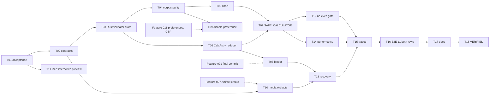

# Implementation Plan - Rich Presentation, Intelligent UI and Generated Media

**Feature:** 016 | **Spec revision:** 0.1
**Status:** IN_REVIEW - authored for owner review; does not authorize implementation until owner acceptance (TASKS T01).

## 1. Delivery strategy

Fix the foundation before adding features. First make one Rust validator the authority and prove the TypeScript mirror agrees with it on a shared corpus; then add the restricted calculation AST, the chart and the one Intelligent UI component; then the production binder, the disable preference, media ingestion and the inert interactive preview; then security gates, recovery, performance and qualification. Wave 2 in the V1 delivery plan. Both release rows can qualify because nothing here needs an Environment provider.

### Language and module placement (optimization)

| Concern | Placement | Reason |
|---|---|---|
| Bounds, allowlist, canonical bytes, digests, CalcAst validation | Rust, new `crates/domain-presentation` | Reject bad documents before they persist; one definition shared by storage and any future publisher; no dependency on SQLite |
| Defensive re-validation in the WebView | TypeScript `rich-presentation.ts` (existing) | Defence in depth at the render boundary; same corpus as Rust |
| Calculator evaluation | TypeScript `calc-reducer.ts` | Runs on view-local state the daemon never sees |
| Chart geometry | TypeScript `chart-model.ts` (pure) + React SVG | No chart library; testable without a DOM |
| Media sniffing and hashing | Rust `media_ingestion.rs` | Bytes never reach the WebView unvalidated |

Existing `serde_json`, `serde_json_canonicalizer` and `sha2` cover the Rust needs; no new crates beyond the workspace member. No new npm dependency.

## 2. Dependency graph

## 3. Phases and exit gates

| Phase | Tasks | Exit gate |
|---|---|---|
| 0 Acceptance | T01 | B-40 decided |
| 1 Contracts | T02 | Schema v2 profile, calc-ast schema, errors, events promoted |
| 2 Validation | T03-T05 | Rust and TypeScript agree on the corpus; drift closed |
| 3 Components | T06-T07 | Chart and calculator accessible and tested |
| 4 Producer and preference | T08-T09 | Production publish after commit; disable path |
| 5 Media and interactive posture | T10-T11 | Provenance Artifacts; inert preview |
| 6 Hardening | T12-T14 | No-exec gate, recovery and performance green |
| 7 Trace and qualification | T15-T16 | E2E-11 USER evidence on Windows x64 and Linux x64 |
| 8 Docs and VERIFIED | T17-T18 | Status rows match evidence |

## 4. Scope and file ownership (candidate paths)

| Area | Paths |
|---|---|
| Rust validator | `crates/domain-presentation/` (new), `Cargo.toml` members |
| Storage | `crates/storage-sqlite/src/rich_presentations.rs`, `crates/storage-core/src/rich_presentation.rs` |
| Daemon | `apps/litecoworkd/src/presentation_binder.rs`, `media_ingestion.rs` (new), `agents/supervisor.rs` (one call each) |
| Desktop | `apps/litecowork-ui/src/presentation/` (`rich-presentation.ts`, `RichResponseView.tsx`, new `ChartBlock.tsx`, `chart-model.ts`, `SafeCalculatorBlock.tsx`, `calc-reducer.ts`), `src/artifacts/ArtifactWorkbench.tsx` |
| Contracts | owner docs and schemas listed in TASKS T02 |

## 5. Persistence, migration, rollout

No new table. The existing `rich_presentations` table and blob purpose `RICH_PRESENTATION` are reused; media provenance rides on Feature 007 ArtifactVersion records. Lowering the document cap from 1 MiB to 512 KiB affects only new publishes; no production rows exist (no producer today). Rollout: the binder is off until T08 lands; renderer contract version 2 is ignored by an older desktop, which falls back to semantic text.

## 6. Operational risks

| Risk | Mitigation |
|---|---|
| Validators drift again | Shared corpus run by both test suites in CI (Feature 019) |
| Chart misrepresents data | Chart only from the bound semantic table; data table always available |
| Calculator mistaken for an action | No submit, no bridge call, view-local state, visible fallback text |
| Image bytes carry an exploit | Magic-byte sniff, size and dimension bounds, no SVG, display through authorized read |
| CSP loosened for images | Feature 011 owns the change; Feature 019 audits it |
| Interactive app pressure | PREVIEW_ONLY until a new accepted revision after E08-S09 evidence |

## 7. Validation command matrix

| Layer | Command |
|---|---|
| Docs | `python3 .specify/scripts/validate_feature_package.py` |
| Rust validator | `cargo test -p domain-presentation --locked` |
| Storage | `cargo test -p storage-sqlite --locked rich_presentation` |
| Daemon | `cargo test -p litecoworkd --locked presentation_binder` |
| Desktop | `pnpm --dir apps/litecowork-ui test` and `pnpm --dir apps/litecowork-ui run build` |
| Feature | `cargo test -p litecoworkd --test rich_presentation_intelligent_ui --locked -- --nocapture` |

## 8. Stop and rollback criteria

Stop if any path executes model content, a rendered element changes host state, the binder runs inside the final-commit transaction, a URL is fetched for media, or Run appears for an interactive Artifact. Roll back by disabling the binder call; stored presentations stay readable and the desktop falls back safely.

## 9. Handoff

Feature 007 consumes the media Artifacts; a later revision (after E08-S09) may open the Interactive Artifact Runtime.
