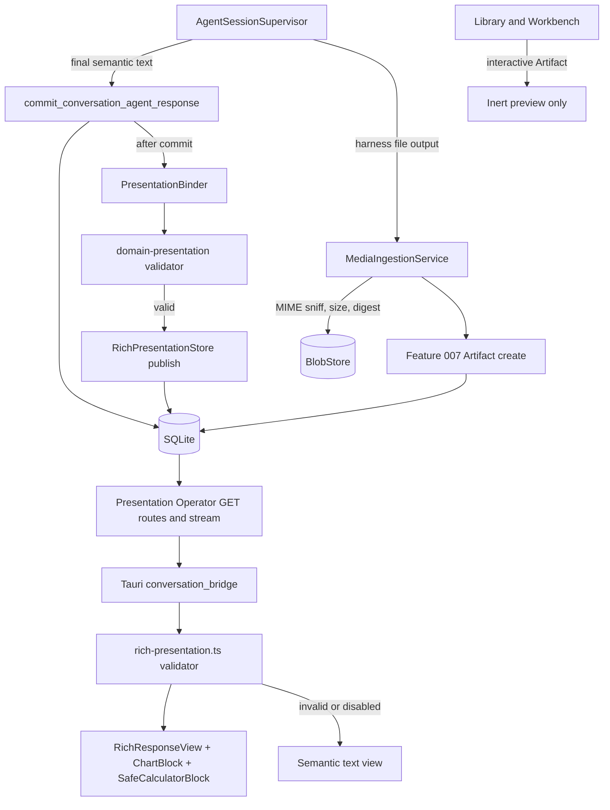

# Feature Specification - Rich Presentation, Intelligent UI and Generated Media

- **Feature ID:** 016 | **Status:** IN_REVIEW | **Revision:** 0.1
- **Owner acceptance:** not yet accepted. This package was created after the 2026-11-09 owner acceptance of [docs/OWNER-ACCEPTANCE-REVIEW-PACKET.md](../../docs/OWNER-ACCEPTANCE-REVIEW-PACKET.md) and is authored complete for review. Blocker B-40 was accepted as proposed by the owner (sarv-projects) on 2026-11-10; the SPEC as a whole is not yet accepted. Nothing here authorizes implementation until the owner accepts it (TASKS 016-T01).
- **Change control:** after acceptance this becomes a locked contract; any later change needs a new revision and renewed owner approval (SPECIFICATION-STANDARD section 7).
- **Target:** LiteCowork V1 local desktop: master plan P10 "Intelligent UI and media", build tasks BT-06.3, BT-06.4 and BT-06.5, E2E-11 "Rich UI response with presentation disabled", release contract section 4 "Workbench and deliverables".
- **Release rows:** Windows 11/10 `x86_64-pc-windows-msvc` with OpenCode v2.0.32 first, Linux x86_64 second. Nothing in this package needs an Environment provider, so both rows can qualify; the Interactive Artifact Runtime stays PREVIEW_ONLY on both rows in V1.
- **Owners:** Presentation Runtime, Conversation, Artifacts, Storage, Operator/API, Desktop UI, Security, Accessibility, Product.
- **Dependencies:** Feature 001 (committed semantic AGENT message is authoritative), Feature 007 (atomic Artifact create with provenance, Conversation association), Feature 011 (WebView CSP, local display preferences, IPC), Feature 019 (CSP audit, release rows).

## 1. Problem and user outcome

LiteCowork answers are committed semantic messages. A RichPresentation is an optional, display-only projection that makes an answer easier to read (cards, callouts, tables, a chart), and generated images are files the user can keep. Today the pieces exist and the two validators agree: the desktop TypeScript validator and the Rust storage validator both accept the five V1 block kinds (TEXT_SLICE, LAYOUT, CARD, CALLOUT, TABLE) under one 512 KiB document cap, which the served wire schema carries too. Nothing in production publishes a RichPresentation, charts and images have no renderer, and there is no Intelligent UI component. P10 asks for a typed, validated, accessible path in which malicious presentation can never mint host state or authority, and in which the semantic answer stays complete when rendering is disabled.

**Outcome:** the user sees a well-formatted answer with tables, a chart that always has an equivalent data table, and one interactive "what-if" calculator whose numbers come from the answer itself. Turning rich presentation off, or any validation failure, shows the full original text. A generated image appears as a Library Artifact with its source Conversation and turn. Interactive app Artifacts open as an inert preview; nothing runs in the chat WebView.

## 2. Goals

- G-01 One server-side Rust validator owns the RichPresentation v1 bounds and block allowlist; the TypeScript validator mirrors it exactly and both pass one shared golden corpus.
- G-02 The V1 block allowlist is closed: TEXT_SLICE, LAYOUT, CARD, CALLOUT, TABLE, CHART, plus one Intelligent UI component (B-40). Every other kind is rejected at publish and falls back to semantic text.
- G-03 Calculations use only a restricted arithmetic AST validated in Rust at publish time and evaluated by a pure TypeScript reducer over view-local state.
- G-04 A CHART is bound to a semantic-message table, drawn by host React components as SVG elements, and always exposes an equivalent accessible data table.
- G-05 A host-side binder publishes RichPresentations after the semantic message commits, outside the commit transaction; presentation failure never blocks or changes turn settlement.
- G-06 The owner can disable rich presentation; the semantic answer remains complete and readable (E2E-11).
- G-07 Generated media is stored as a provenance-bearing Artifact (Conversation, turn, AgentSession, digest) through the Feature 007 create path, never fetched from a model-supplied URL.
- G-08 Interactive Artifacts open PREVIEW_ONLY and inert in V1 until E08-S09 CODE, SYSTEM and owner USER evidence exists for the exact OS and Runtime profile.
- G-09 No executable model content reaches the chat WebView: no eval, no script, no model HTML, CSS or SVG markup, no `dangerouslySetInnerHTML` on agent output, CSP `script-src 'self'` unchanged.

## 3. Non-goals

No DIAGRAM (Mermaid) rendering, MEDIA blocks inside a RichPresentation, HOST_PROJECTION, MCP_APP, CHECKLIST, DELIVERABLE_GROUP or ARTIFACT_COLLECTION in V1. No presentation actions or citations in V1 (arrays stay empty). No Interactive Artifact execution. No SVG image ingestion (no sanitizer is qualified). No image generation by LiteCowork itself (images come from the native harness as files). No change to semantic message storage. No adoption of OpenIntelligentUI's arbitrary HTML/CSS/JavaScript renderer, its eval use or its CSP.

## 4. Current implementation/evidence boundary

Verified against branch `docs/audit-competitor-superset`; highest migration file `docs/schemas/sqlite-v32.sql` (016 plans no migration).

| Capability | Current evidence | Limitation |
|---|---|---|
| Desktop validator | CODE: `apps/litecowork-ui/src/presentation/rich-presentation.ts` (`parseRichPresentationDocument`, `parseRichPresentationResponse`, `resolveRichResponseContent`, `isValidatedRichPresentation`); constants `MAX_DOCUMENT_BYTES = 512 * 1024`, `MAX_SEMANTIC_BYTES = 1024 * 1024`, `MAX_BLOCKS = 200`, `MAX_DEPTH = 8`, `MAX_JSON_VALUES = 30_000`, `MAX_JSON_DEPTH = 32`; accepts TEXT_SLICE, LAYOUT, CARD, CALLOUT, TABLE; RFC 8785 canonical bytes and SHA-256 checks; any failure returns null | Charts, media, host projections and actions are not interpreted; citations and actions must be empty |
| Rust validator | CODE: `validate_metadata`, `validate_document`, `validate_block` in `crates/storage-sqlite/src/rich_presentations.rs`; accepts the same five V1 kinds as the desktop (TEXT_SLICE, LAYOUT, CARD, CALLOUT, TABLE) with the same closed keys, and holds CARD titles, CALLOUT summaries and TABLE headers and cells to the semantic text | CHART and SAFE_CALCULATOR are not accepted yet (renderer contract version 2 belongs to T03) |
| Size cap | `MAX_RICH_PRESENTATION_BYTES: u64 = 524_288` in `crates/storage-core/src/rich_presentation.rs`, matching `MAX_DOCUMENT_BYTES = 512 * 1024` in the desktop validator and `document_size_bytes.maximum` in `docs/schemas/operator-stream.schema.json` | Aligned on all three surfaces; `rich_presentation_document_cap_agrees_with_the_desktop_and_the_wire_schema` fails if any one of them changes alone |
| Store | CODE: `RichPresentationStore` (`publish_rich_presentation`, `read_rich_presentation`, conversation presentation reads) and `SqliteRichPresentationStore`; table from migration `rich_presentation_optional_v12` | `publish_rich_presentation` is called only by tests (`rich_presentation_read_tests` in `apps/litecoworkd/src/presentation_operator.rs`); no production producer |
| Read route | CODE/SERVED: `GET /v1/rich-presentations/{presentation_id}` (`get_rich_presentation`), `GET /v1/conversations/{conversation_id}/presentation`, `POST /v1/stream` in `apps/litecoworkd/src/presentation_operator.rs`; Tauri `get_rich_presentation` and `valid_rich_presentation_response` in `apps/litecowork-ui/src-tauri/src/conversation_bridge.rs` | No publish route (by design: publishing is daemon-internal) |
| Renderer | CODE/UI: `RichResponseView.tsx` renders TEXT_SLICE, LAYOUT, CARD, CALLOUT, TABLE with an accessible table region and a "Read the original response" disclosure; used by `ConversationsPage.tsx` | No chart, image or Intelligent UI rendering |
| Fallback tests | CODE: `apps/litecowork-ui/tests/presentation-runtime-fallback.test.mjs` (escaping, unsupported kinds, malformed payloads for `PresentationRuntime.tsx` and `presentation-types.ts`), `rich-presentation.test.ts`, `rich-response-view-policy.test.ts` | No shared Rust and TypeScript corpus |
| Schemas | `docs/schemas/rich-presentation.schema.json` (13 block kinds, root_blocks 200, accessibility_summary 4000), `docs/schemas/presentation-intent.schema.json` (strategies, elements 40) | No Intelligent UI schema in `docs/schemas`; the IntelligentUiDocument in [docs/INTELLIGENT-UI-AND-IMAGE-CONTENT.md](../../docs/INTELLIGENT-UI-AND-IMAGE-CONTENT.md) is prose only |
| Rust schema library | NOT FOUND: no `jsonschema` crate in `Cargo.lock`; hand-written `closed_object` validation is the repo pattern; `serde_json_canonicalizer` and `sha2` are present | |
| Errors | NOT FOUND: no `PRESENTATION_*` codes; routes use `INVALID_ARGUMENT`, `FORBIDDEN`, `INTEGRITY_FAILURE`, `INTERNAL` | |
| Generated media | NOT FOUND: no ingestion pipeline; Feature 007 B-30 Artifact create is planned (no create route today) | CSP `img-src 'self' asset: http://asset.localhost data:` has no `litecowork-resource:` scheme |
| Interactive Artifact Runtime | NOT FOUND in code; `docs/schemas/interactive-artifact-runtime.schema.json` and `interactive-artifact-package.schema.json` exist; `PresentationRuntime.tsx` renders MCP_APP as "Interactive app content is unavailable in this renderer." | E08-S09 evidence absent |
| CSP | `apps/litecowork-ui/src-tauri/tauri.conf.json`: `default-src 'self'; connect-src ipc: http://ipc.localhost; img-src 'self' asset: http://asset.localhost data:; style-src 'self' 'unsafe-inline'; script-src 'self'` | Must stay at least this strict |

## 5. Decision register

### Inherited LOCKED invariants (canonical owners; not feature approval)

| ID | Invariant | Authority |
|---|---|---|
| L-01 | The committed semantic ConversationMessage is authoritative; RichPresentation is an optional display improvement that never blocks turn completion. | RENDERING-CONFORMANCE-LLD, PRESENTATION-RUNTIME, release contract section 4 |
| L-02 | RichPresentation v1 is a static, display-only subset with a closed block list; it is not an executable UI container. | RICH-RESPONSE "Intelligent UI and image content audit", PRESENTATION-RUNTIME |
| L-03 | No executable JavaScript, no eval, no script tags, no CSS imports and no network URLs in Intelligent UI documents; calculations use a bounded arithmetic-only AST evaluated by a pure reducer. | INTELLIGENT-UI-AND-IMAGE-CONTENT section 3.1 |
| L-04 | Chart binding is required and selects exactly one source; numbers are finite; charts include an accessible summary and a table fallback. | RICH-RESPONSE "Tables and charts" |
| L-05 | Images refer only to authorized pinned Resource or Artifact revisions; direct model URLs are not fetched; autoplay is false; alt text is required. | RICH-RESPONSE "Diagrams and media", INTELLIGENT-UI section 4 |
| L-06 | Interactive Artifact Run is enabled only for an exact qualified OS/Runtime profile after E08-S09 evidence; until then the Workbench remains inert preview or source only. | V1-PRODUCT-RELEASE-CONTRACT section 4, INTERACTIVE-ARTIFACT-RUNTIME |
| L-07 | Do not execute arbitrary model-supplied HTML or JavaScript in the chat WebView. | AGENTS.md section 8 |
| L-08 | Rendered controls cannot forge or settle host state (Approvals, Tasks, Effects, grants). | ACCEPTANCE-AND-E2E-PLAN E2E-11, P10 exit |

### FLEXIBLE

| ID | Choice | Allowed options | Constraint |
|---|---|---|---|
| F-01 | Validator crate shape | New `crates/domain-presentation` or a module inside `storage-core` | One Rust definition of bounds and allowlist; no `storage-sqlite` dependency |
| F-02 | Golden corpus format | JSON files with expected verdicts | Read by both `cargo test` and `node --test` |
| F-03 | Chart drawing | Hand-written React SVG elements | No new npm dependency without RESEARCH justification; no model-supplied SVG |
| F-04 | Media display scheme | Existing `asset:` protocol through an authorized read, or a new scheme added to CSP | CSP change goes through Feature 011 and Feature 019 audit |

### DECISIONS (B-40 accepted as proposed 2026-11-10)

| ID | Topic | Proposed resolution | Canonical authority and consequence |
|---|---|---|---|
| B-40 | First Intelligent UI component and Interactive Artifact Runtime V1 posture | **ACCEPTED as proposed (owner sarv-projects, 2026-11-10).** (1) **First component: `SAFE_CALCULATOR`** (the INTELLIGENT-UI `SafeCalculatorNode` with its `FormInputNode` number inputs): up to 8 labelled numeric inputs whose initial values are bound to cells of a TABLE in the same semantic message, one `formula_ast` from the restricted CalcAst (LITERAL, VARIABLE, BINARY_OP `+ - * / %`, UNARY_OP `-`, FUNCTION `MIN MAX ROUND ABS CLAMP`; at most 64 nodes, depth at most 12, finite literals only), output formats `NUMBER`, `INTEGER`, `PERCENTAGE`, `CURRENCY_USD`, and a required `fallback_text` that states the formula and the result for the original values. State is view-local, never persisted, never sent to the agent and never used as an action. Divide by zero or a non-finite result shows "Cannot calculate with these values" and the fallback text. It is carried as a new block kind `SAFE_CALCULATOR` in RichPresentation renderer contract version 2 (schema version stays 1 for existing kinds), so there is one validated document per message. (2) **CHART** is a static block in the same contract version, bound only to a semantic-message TABLE slice in V1. (3) **Interactive Artifact Runtime V1 posture: PREVIEW_ONLY on both release rows.** Selecting an interactive Artifact opens an inert preview (title, exact version, provenance, package validation result, source view); there is no Run control in V1, only the text "Running interactive apps is not available in this version." Run may be enabled only by a later accepted revision after E08-S09 CODE, SYSTEM and owner USER evidence for the exact packaged build and OS. | [INTELLIGENT-UI-AND-IMAGE-CONTENT.md](../../docs/INTELLIGENT-UI-AND-IMAGE-CONTENT.md), [RICH-RESPONSE.md](../../docs/RICH-RESPONSE.md), [INTERACTIVE-ARTIFACT-RUNTIME.md](../../docs/INTERACTIVE-ARTIFACT-RUNTIME.md). Exercises the restricted AST and reducer (BT-06.4) with the smallest attack surface; keeps BT-06.5 honest. Owner: Presentation Runtime with Product and Security; decision needed from the repository owner. |

B-40 was accepted as proposed on 2026-11-10. This package stays IN_REVIEW until the owner accepts the SPEC as a whole (TASKS 016-T01); implementation and qualification status are tracked in section 4 and [docs/IMPLEMENTATION-STATUS.md](../../docs/IMPLEMENTATION-STATUS.md).

## 6. High-level design



### Trust boundaries

| Boundary | Rule |
|---|---|
| Native harness to daemon | Semantic text, presentation intent and files are untrusted until validated; only the binder creates RichPresentation documents |
| Daemon to WebView | Only validated documents with digest bindings; the WebView validates again and falls back on any mismatch |
| WebView rendering | Host React components only; model strings are rendered as text nodes; no `dangerouslySetInnerHTML`, no eval, no model SVG |
| Media | Bytes are content-addressed and sniffed; displayed only through an authorized Artifact read |

### Actor sequence: rich answer with chart and calculator (target)

1. The native turn settles; `commit_conversation_agent_response` (Feature 001) commits the AGENT message.
2. After commit, `PresentationBinder` derives a document from the semantic text: Markdown tables become TABLE blocks bound by slice digest; an eligible numeric table may add a CHART and, when the harness supplied a valid PresentationIntent naming a calculation, a SAFE_CALCULATOR.
3. `domain-presentation::validate_document` checks bounds, allowlist, bindings and the CalcAst; on success the store publishes and emits `rich.presentation.published.v1`; on failure nothing is published and a counter increments.
4. The desktop reads the Conversation presentation, fetches the document through `get_rich_presentation`, validates again in `rich-presentation.ts` and renders, or shows semantic text.

### Ownership

| Owner | Responsibility | Excluded |
|---|---|---|
| domain-presentation (new Rust crate) | Bounds, allowlist, closed-object checks, CalcAst validation, chart binding checks | Storage, I/O |
| Storage | Publish transaction, idempotency, reads | Interpreting blocks beyond calling the validator |
| PresentationBinder (daemon) | Deterministic derivation from committed semantic content | Changing the semantic message |
| MediaIngestionService (daemon) | Sniff, bound and hash harness files; request Feature 007 Artifact create | Fetching URLs |
| Desktop validator and views | Defensive re-validation, rendering, accessibility, view-local calculator state | Host state, actions |
| Feature 011 | CSP, display preference persistence | Presentation semantics |

## 7. Low-level design and interfaces

### 7.1 Existing CODE signatures (real paths)

```ts
// apps/litecowork-ui/src/presentation/rich-presentation.ts
export async function parseRichPresentationDocument(value: unknown, semanticText: string,
  expectedMessageId: string, expectedSemanticContentDigest: string): Promise<ValidatedRichPresentation | null>;
export async function parseRichPresentationResponse(value: unknown,
  expected: RichPresentationResponseBinding, semanticText: string): Promise<ValidatedRichPresentation | null>;
export function resolveRichResponseContent(semanticText: string, presentation?: ValidatedRichPresentation | null):
  { semanticText: string; presentation: ValidatedRichPresentation | null; primary: "RICH" | "SEMANTIC" };
export type RichBlock = TEXT_SLICE | LAYOUT | CARD | CALLOUT | TABLE;
```

```rust
// crates/storage-core/src/rich_presentation.rs
pub const MAX_RICH_PRESENTATION_BYTES: u64 = 524_288;
pub const RICH_PRESENTATION_MEDIA_TYPE: &str = "application/vnd.litecowork.rich-presentation+json";
pub trait RichPresentationStore { fn publish_rich_presentation(&self, ..) -> ..; fn read_rich_presentation(&self, ..) -> ..; /* conversation reads */ }
// crates/storage-sqlite/src/rich_presentations.rs (private)
fn validate_metadata(..); fn validate_document(..); fn validate_block(..); // TEXT_SLICE, LAYOUT, CARD, CALLOUT, TABLE
```

Served: `GET /v1/rich-presentations/{presentation_id}` (`get_rich_presentation`), Tauri `get_rich_presentation` in `conversation_bridge.rs`.

### 7.2 Accepted-target signatures (PROPOSED in design; not yet in source)

```rust
// crates/domain-presentation/src/lib.rs (new crate)
pub const MAX_DOCUMENT_BYTES: usize = 512 * 1024;   // the single document cap; storage already matches it
pub const MAX_BLOCKS: usize = 200;
pub const MAX_DEPTH: usize = 8;
pub const MAX_JSON_VALUES: usize = 30_000;
pub const MAX_JSON_DEPTH: usize = 32;
pub const MAX_CALC_NODES: usize = 64;
pub const MAX_CALC_DEPTH: usize = 12;
pub const MAX_CALC_INPUTS: usize = 8;
pub enum V1BlockKind { TextSlice, Layout, Card, Callout, Table, Chart, SafeCalculator }
pub enum CalcAstNode { Literal(f64), Variable { field_id: String }, Binary { op: BinaryOp, left: Box<CalcAstNode>, right: Box<CalcAstNode> },
    Unary { op: UnaryOp, operand: Box<CalcAstNode> }, Function { name: CalcFunction, args: Vec<CalcAstNode> } }
pub struct ValidationContext<'a> { pub semantic_text: &'a str, pub message_id: &'a str, pub semantic_content_digest: &'a str }
pub fn validate_document(bytes: &[u8], ctx: &ValidationContext) -> Result<ValidatedDocument, PresentationRejection>;
pub fn validate_calc_ast(node: &CalcAstNode, inputs: &[String]) -> Result<(), PresentationRejection>;
pub enum PresentationRejection { TooLarge, NotCanonical, DigestMismatch, UnknownKey, UnsupportedBlock, DepthExceeded,
    TooManyBlocks, BindingMismatch, NonFiniteNumber, CalcTooComplex, CalcUnknownVariable, ProvenanceInvalid }

// apps/litecoworkd/src/presentation_binder.rs (new)
pub async fn bind_after_commit(&self, committed: &CommittedConversationAgentResponse) -> Result<Option<CommittedRichPresentation>, BindError>;

// apps/litecoworkd/src/media_ingestion.rs (new)
pub async fn ingest_harness_file(&self, origin: MediaOrigin /* conversation_id, turn_id, agent_session_id */, path: &AdmittedPath)
    -> Result<ArtifactVersionRef, MediaRejection>; // png, jpeg, webp, gif; <= 20 MiB; SVG rejected in V1
```

```ts
// apps/litecowork-ui/src/presentation/calc-reducer.ts (new)
export type CalcState = Readonly<Record<string, number>>;
export function evaluateCalc(ast: CalcAstNode, state: CalcState): { ok: true; value: number } | { ok: false; reason: "DIVIDE_BY_ZERO" | "NON_FINITE" };
// apps/litecowork-ui/src/presentation/ChartBlock.tsx, SafeCalculatorBlock.tsx (new)
```

Accepted target error codes: `PRESENTATION_REJECTED` (with a `reason` from `PresentationRejection`), `MEDIA_TYPE_UNSUPPORTED`, `MEDIA_TOO_LARGE`. Accepted target events: existing `rich.presentation.published.v1`; new `rich.presentation.rejected.v1` (ids and reason only). Accepted target schema: `docs/schemas/rich-presentation.schema.json` gains renderer contract version 2 with `SAFE_CALCULATOR` and a V1 allowlist profile; new `docs/schemas/calc-ast.schema.json`. Local display preference `rich_presentation_enabled` (default true) is owned by Feature 011's display preferences.

## 8. Data model and lifecycle

See [DATA-MODEL.md](DATA-MODEL.md). Reuses `rich_presentations` (migration `rich_presentation_optional_v12`), blobs with purpose `RICH_PRESENTATION`, Artifact and ArtifactVersion records from Feature 007. A RichPresentation is immutable per (message_id, presentation_id); a new derivation is a new presentation id. No new SQLite table is required; media provenance fields ride on the Feature 007 ArtifactVersion `provenance` value.

## 9. Wiring

See [WIRING.yaml](WIRING.yaml). Publishing happens after the semantic commit in its own transaction; media blob writes happen before the Artifact create transaction; no external call is inside any transaction.

## 10. Security, trust and privacy

- Model output is data. Every string renders as a React text node. A lint and test gate fails the build on `dangerouslySetInnerHTML`, `eval`, `new Function` or `innerHTML` in `apps/litecowork-ui/src/presentation/`.
- CSP stays `script-src 'self'`; Feature 019 audits it. Adding an image scheme is a Feature 011 change with a test.
- Presentation documents carry no actions, citations, links or host projections in V1; they cannot reach a Tauri command.
- The calculator never sends values anywhere; it is not an action and has no submit.
- Media: magic-byte sniff must match the declared type; size at most 20 MiB; dimensions bounded (at most 16384 pixels per side). Stripping EXIF metadata from a display copy is open question O-03; the original bytes are kept as the Artifact.
- OpenIntelligentUI is a test-idea reference only; its renderer, eval use and CSP are rejected.

## 11. Errors, edge cases and recovery

Full matrix in [contracts/errors-recovery.md](contracts/errors-recovery.md). Key cases: a document at exactly 512 KiB passes and at 512 KiB + 1 byte is rejected on both sides; a TABLE whose cells no longer match the semantic text falls back; a CHART with a non-numeric series cell falls back to its table; a calculator divide by zero shows the reason; a crash after blob write and before Artifact commit leaves an orphan blob that the sweep removes; replay of a publish with the same id and digest returns the stored record, a different digest is a conflict; a stream gap resyncs from the Conversation presentation read.

## 12. Configuration and compatibility

Renderer contract version 1 documents (existing kinds) stay valid; version 2 adds CHART and SAFE_CALCULATOR. A desktop that does not know version 2 falls back to semantic text. `rich_presentation_enabled` defaults to true and is local to the device. Both release rows use the same WebView rules (WebView2 on Windows, WebKitGTK on Linux); rendering conformance is tested on each.

## 13. Observability

Count published, rejected (by reason), fallback-rendered and disabled views; validator duration; media ingest accepted and rejected (by reason). Never log semantic text, document content or media bytes; log ids, digests and reasons.

## 14. EARS acceptance criteria

- AC-001 WHEN the binder publishes a RichPresentation, THE SYSTEM SHALL validate it in Rust with `MAX_DOCUMENT_BYTES` 512 KiB, at most 200 blocks, depth at most 8, closed keys, RFC 8785 canonical bytes and matching document and slice digests, and IF the document is 512 KiB + 1 byte or larger, THEN THE SYSTEM SHALL reject it with `PRESENTATION_REJECTED` (`TooLarge`). Verify: boundary unit tests in `domain-presentation`.
- AC-002 WHEN a document contains a block kind outside the V1 allowlist (TEXT_SLICE, LAYOUT, CARD, CALLOUT, TABLE, CHART, SAFE_CALCULATOR), THE SYSTEM SHALL reject it at publish, and the desktop SHALL render the semantic text for any such document it receives. Verify: corpus tests on both sides.
- AC-003 WHEN the Rust and TypeScript validators process the shared golden corpus, THE SYSTEM SHALL produce identical accept or reject verdicts for every file. Verify: parity test run by `cargo test` and `pnpm test`.
- AC-004 WHILE rich presentation is disabled, missing, invalid or failed to render, THE SYSTEM SHALL show the complete semantic message, and presentation work SHALL NOT delay or change turn settlement. Verify: E2E-11 and a binder fault-injection test.
- AC-005 WHEN any presentation content is rendered, THE SYSTEM SHALL render model strings only as text nodes and SHALL NOT use `dangerouslySetInnerHTML`, `eval`, `new Function`, model-supplied HTML, CSS or SVG markup, or a network URL, and the WebView CSP SHALL keep `script-src 'self'`. Verify: static gate test, hostile corpus test and CSP audit.
- AC-006 IF a document contains actions, citations, links, HOST_PROJECTION or MCP_APP, THEN THE SYSTEM SHALL reject it, and no rendered presentation element SHALL invoke a Tauri command that creates or settles an Approval, Task, Effect or grant. Verify: hostile corpus and bridge-call spy test.
- AC-007 WHEN a SAFE_CALCULATOR is validated, THE SYSTEM SHALL accept only CalcAst nodes LITERAL, VARIABLE, BINARY_OP (`+ - * / %`), UNARY_OP (`-`) and FUNCTION (MIN, MAX, ROUND, ABS, CLAMP) with at most 64 nodes, depth at most 12, finite literals and variables that name declared inputs, and IF evaluation divides by zero or yields a non-finite value, THEN THE SYSTEM SHALL show "Cannot calculate with these values" with the fallback text. Verify: Rust validator tests and TypeScript reducer property tests.
- AC-008 WHEN a CHART is rendered, THE SYSTEM SHALL draw it from host SVG components using only the bound semantic TABLE values, show its accessible summary, and offer an equivalent data table reachable by keyboard; IF the binding does not match the semantic table or a value is not finite, THEN THE SYSTEM SHALL render the table fallback. Verify: chart component tests.
- AC-009 WHEN the SAFE_CALCULATOR renders, THE SYSTEM SHALL label every input, announce the result in an `aria-live="polite"` region, keep state view-local, and SHALL NOT persist the values or send them to the agent. Verify: component test with a bridge-call spy.
- AC-010 WHEN rich content is displayed, THE SYSTEM SHALL meet keyboard operation, visible focus, accessible names, `<th scope>` headers, text contrast 4.5:1 and reduced-motion rules, with no serious or critical axe violations. Verify: accessibility audit in the UI test suite.
- AC-011 WHEN a native harness produces an image file in the admitted Workspace, THE SYSTEM SHALL ingest it only if the sniffed type is PNG, JPEG, WebP or GIF and the size is at most 20 MiB, store the bytes content-addressed, and create an Artifact version through Feature 007 with provenance (Conversation, turn, AgentSession, digest). Verify: ingestion integration test.
- AC-012 IF a media file is SVG, oversized, has a type mismatch, or is referenced only by a URL, THEN THE SYSTEM SHALL reject it with `MEDIA_TYPE_UNSUPPORTED` or `MEDIA_TOO_LARGE`, create no Artifact, fetch nothing and keep the semantic answer. Verify: negative ingestion tests.
- AC-013 WHILE no E08-S09 CODE, SYSTEM and owner USER evidence exists for the exact build and OS, THE SYSTEM SHALL open interactive Artifacts as an inert PREVIEW_ONLY view with no Run control and no script execution. Verify: Workbench component test and packaged check on both rows.
- AC-014 WHEN a publish is replayed with the same presentation id and digest, THE SYSTEM SHALL return the stored record; IF the same id arrives with a different digest, or two publishes race for one message, THEN exactly one SHALL commit and the other SHALL get a conflict with no partial write. Verify: storage concurrency tests.
- AC-015 IF the daemon crashes after a media blob write and before the Artifact commit, or the presentation stream has a gap, THEN THE SYSTEM SHALL remove the orphan blob on the next sweep, and SHALL resync the Conversation presentation from the durable read without duplicating messages. Verify: crash-injection and stream resync tests.
- AC-016 WHEN validating a 512 KiB document, THE SYSTEM SHALL finish the Rust validation within 50 ms and the TypeScript validation within 150 ms at p95, and WHEN rendering 200 blocks THE SYSTEM SHALL not block the main thread for more than 100 ms in a single task on the release-row machine. Verify: benchmark and render trace.
- AC-017 WHEN the binder derives a document, THE SYSTEM SHALL use only committed semantic content and validated PresentationIntent elements with provenance SEMANTIC_MESSAGE or MODEL_INTENT, and SHALL NOT alter the semantic message. Verify: binder unit tests.
- AC-018 WHEN the owner turns rich presentation off in Settings or opens "Read the original response" on a message, THE SYSTEM SHALL show the semantic text immediately, persist the preference locally across restart, and keep the toggle keyboard operable with an accessible name. Verify: preference and UI tests.
- AC-019 WHEN an agent answer renders Markdown (task P-03), THE SYSTEM SHALL degrade per block so that GFM tables, horizontal rules and nested lists render without a whole-message raw fallback, SHALL give each code block a language label, a copy button and lazy highlighting that returns React nodes, SHALL render TEXT_SLICE through the same Markdown renderer, and SHALL emit no HTML strings; a golden corpus of real agent answers SHALL render with no whole-message raw fallback. Verify: per-block degradation and golden-corpus render tests.

## 15. Executable acceptance command

**Canonical feature acceptance command (accepted target; the Rust crate and test target do not exist yet and are created by TASKS 016-T03 and 016-T16):**

```bash
cargo test -p domain-presentation --locked && cargo test -p litecoworkd --test rich_presentation_intelligent_ui --locked -- --nocapture && pnpm --dir apps/litecowork-ui test
```

Do not mark the feature VERIFIED until this passes and covers AC-001 to AC-018 on the Windows x64 row and the Linux x64 row, with E2E-11 USER evidence on each.

## 16. Out-of-bounds paths and side effects

This package is IN_REVIEW and authorizes nothing yet. After acceptance each task names its allowed paths. Out of scope: semantic message storage and the final-commit transaction (Feature 001), Artifact create internals (Feature 007), CSP ownership and Settings shell (Feature 011), Interactive Artifact Runtime execution (later revision after E08-S09), Task presentation (`TaskPresentationPanel.tsx` stays as is). Do not run native harnesses or write user files during design validation.

## 17. Assumptions and open questions

| ID | Question | Evidence/limitation | Owner | Gate |
|---|---|---|---|---|
| O-01 | Does OpenCode v2.0.32 emit any structured presentation intent, or only Markdown? | Binder derives from Markdown first; intent is optional | Presentation Runtime | 016-T08 |
| O-02 | Which image scheme to display Artifacts: `asset:` or a new scheme | CSP today lacks `litecowork-resource:` | Feature 011, Security | 016-T10 |
| O-03 | Should EXIF be stripped from a display copy | Privacy improvement; not required by owner docs | Security | 016-T10 |
| O-04 | Reference machine for AC-016 | Feature 019 defines release-row machines | Release | 016-T14 |
| O-05 | Interactive Artifact Runtime execution timeline after V1 | E08-S09 owns it | Product | B-40 |

## 18. Requirement traceability

| Requirement | Canonical owner | Task | Acceptance |
|---|---|---|---|
| Owner acceptance and B-40 | OWNER-ACCEPTANCE-REVIEW-PACKET, register | 016-T01 | AC-013 |
| Contract promotion | RICH-RESPONSE, SCHEMAS, error registry, EVENTS | 016-T02 | AC-001 / AC-002 / AC-006 |
| Single Rust validator and drift fix | RICH-RESPONSE, PRESENTATION-RUNTIME | 016-T03 | AC-001 / AC-002 / AC-006 |
| Shared corpus and TypeScript parity | RENDERING-CONFORMANCE-LLD | 016-T04 | AC-003 |
| Restricted CalcAst and reducer | INTELLIGENT-UI section 3 | 016-T05 | AC-007 |
| Chart with table fallback | RICH-RESPONSE "Tables and charts" | 016-T06 | AC-008 |
| SAFE_CALCULATOR component | INTELLIGENT-UI, B-40 | 016-T07 | AC-009 / AC-010 |
| Binder and publish after commit | PRESENTATION-RUNTIME, STORAGE | 016-T08 | AC-004 / AC-017 |
| Disable preference and semantic fallback | V1 release contract section 4, E2E-11 | 016-T09 | AC-004 / AC-018 |
| Generated media as provenance Artifacts | INTELLIGENT-UI section 4, ARTIFACTS-EVIDENCE | 016-T10 | AC-011 / AC-012 |
| Interactive Artifact PREVIEW_ONLY | INTERACTIVE-ARTIFACT-RUNTIME | 016-T11 | AC-013 |
| No-executable-content gate and CSP | AGENTS.md section 8, INTELLIGENT-UI section 7 | 016-T12 | AC-005 / AC-006 |
| Failure and recovery | FAILURE-RECOVERY | 016-T13 | AC-014 / AC-015 |
| Performance budgets | BENCHMARKS | 016-T14 | AC-016 |
| Cross-layer traces | AGENTS.md section 4 | 016-T15 | AC-004 / AC-018 |
| Release-row qualification (E2E-11) | ACCEPTANCE-AND-E2E-PLAN | 016-T16 | AC-004 / AC-005 / AC-010 / AC-013 |
| Documentation sync | IMPLEMENTATION-STATUS | 016-T17 | AC-013 |
| Per-block Markdown degradation and code/TEXT_SLICE rendering (P-03) | INTELLIGENT-UI-AND-IMAGE-CONTENT | 016-T18 | AC-019 |
| VERIFIED transition | SPECIFICATION-STANDARD | 016-T19 | AC-001, AC-002, AC-003, AC-004, AC-005, AC-006, AC-007, AC-008, AC-009, AC-010, AC-011, AC-012, AC-013, AC-014, AC-015, AC-016, AC-017, AC-018, AC-019 |
