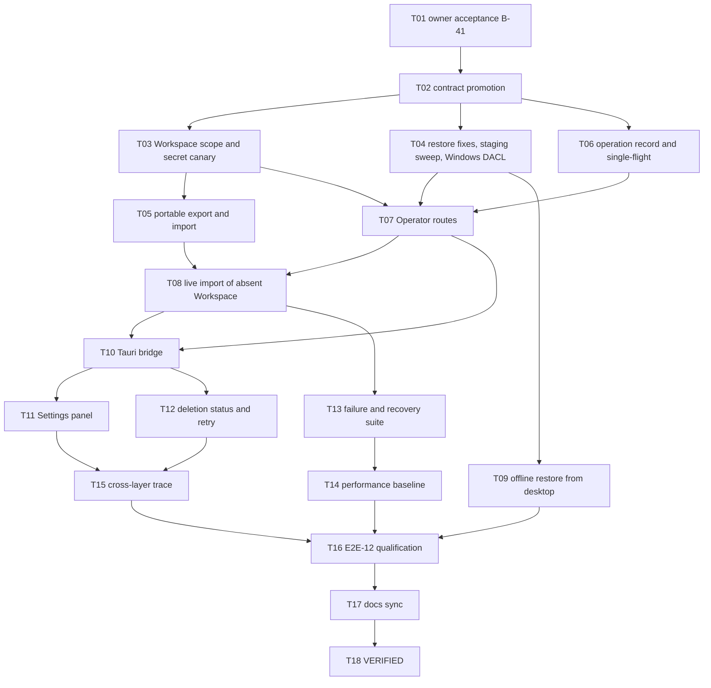

# Implementation Plan - Data Portability, Backup and Restore

**Feature:** 017 | **Spec:** SPEC.md revision 0.1
**Status:** IN_REVIEW - pending owner acceptance of B-41; does not authorize implementation; not a claim of implementation or qualification.
**Updated:** 2026-11-09
**Rule:** the authoritative ordered work list is [TASKS.md](TASKS.md) (017-T01 to 017-T18); the phase table below is a summary. Implementation evidence is recorded separately from qualification.

## 1. Delivery strategy

Promote the existing, tested storage implementation rather than writing a second one. Fix its correctness gaps (Workspace scope, portability, crash staging, Windows DACL, receipt clock) in storage before any route exists, so the first user-visible backup is already scoped and secret-free. Then add the durable operation record, the Operator routes, the Tauri bridge and the Settings panel. Whole-installation restore stays an offline sidecar operation behind the Feature 011 stop/quiescence gate; the live Operator only imports an absent Workspace. Qualify E2E-12 on Windows x64 first and Linux x64 second.

Before implementation, inspect the working tree and worktrees, preserve user changes, and use a clean task worktree. Never run restore against the owner's real installation in tests.

## 2. Dependency graph

## 3. Phases and exit gates

| Phase | Tasks | Outcome | Exit gate |
|---|---|---|---|
| A - acceptance and promotion | T01, T02 | B-41 accepted; routes, errors, events and migration promoted; live restore route withdrawn | Owner decision recorded; validator, architecture and schema checks pass |
| B - storage correctness | T03, T04, T05, T06 | Workspace-scoped, secret-free, portable, crash-safe, cancellable storage | `cargo test -p storage-sqlite --locked backup` green on both OSes |
| C - daemon and bridge | T07, T08, T09, T10 | Authenticated routes, live import, offline restore, Tauri commands | Route tests, served-route inventory shows no live restore |
| D - UI | T11, T12 | Settings Storage & Backup and Deletion status with all states | UI tests, accessibility audit |
| E - recovery and performance | T13, T14 | Crash windows, fuzzing, races; bounded memory baseline | Canonical test target green; baseline recorded |
| F - trace and qualification | T15, T16 | Cross-layer trace; E2E-12 CODE/SYSTEM/USER on each row | Owner USER sign-off per row |
| G - sync and close | T17, T18 | Status docs, ledgers, register; VERIFIED | Validator and inventory audit pass |

## 4. Ownership and allowed paths

Each task in TASKS.md lists exact allowed paths. Summary: storage work in `crates/storage-core/src/backup.rs` and `crates/storage-sqlite/src/backup*.rs`; daemon work in new `apps/litecoworkd/src/backup_routes.rs`, `runtime.rs` (startup sweep) and `backup_operator.rs`; desktop work in new `apps/litecowork-ui/src-tauri/src/backup_bridge.rs` and `apps/litecowork-ui/src/settings/storage-backup/`; owner docs and schemas only in T02 and T17.

## 5. Migrations

One forward-only migration (the next free `docs/schemas/sqlite-vNN.sql` at implementation time; v28 is the latest today) adds `backup_operations` and its partial unique index on nonterminal state. `workspace_backup_manifests` stays immutable and unchanged. No migration ships while the package is IN_REVIEW.

## 6. Rollout

- The Settings category appears only when the routes it calls are served on that release row; otherwise it is omitted (no inert control).
- Offline restore appears only on rows where the Feature 011 quiescence gate is qualified.
- Portable export appears only after T05 passes on that row.
- No automatic backup schedule in V1.

## 7. Risks

| Risk | Mitigation |
|---|---|
| Table map misses a table and leaks or drops data | Completeness test over `sqlite_master` after all migrations (T03) |
| Plaintext staging left on disk | Startup sweep, owner-only directory on both OSes (T04) |
| Lost passphrase | No-recovery warning before create; verify immediately after create |
| Restore over live data | No live restore route; import only for absent Workspace (B-41) |
| Large Workspace blocks the daemon | `spawn_blocking`, chunk-bounded streaming, progress and cancel (T06, T14) |
| Windows keystore differs per user | Portable mode re-encrypts under new local keys (T05) |
