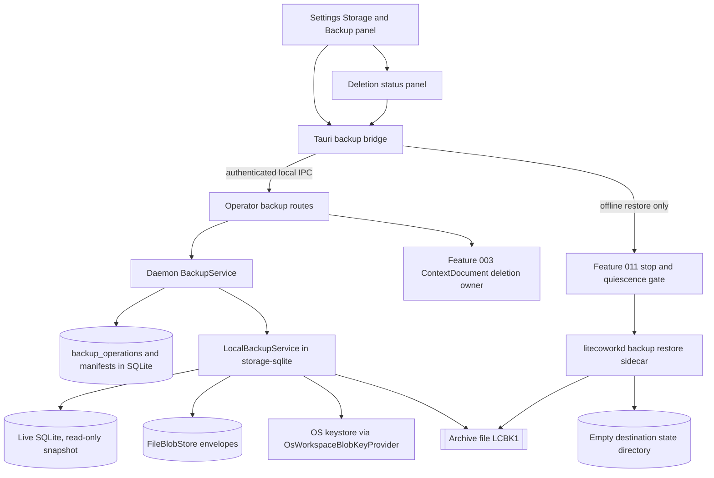

# Feature Specification - Data Portability, Backup and Restore

- **Feature ID:** 017 | **Status:** IN_REVIEW | **Revision:** 0.1
- **Created / Updated:** 2026-11-09 / 2026-11-09
- **Owner acceptance:** not yet accepted. This package was authored after the owner acceptance of 2026-11-09 recorded in [docs/OWNER-ACCEPTANCE-REVIEW-PACKET.md](../../docs/OWNER-ACCEPTANCE-REVIEW-PACKET.md), so its decision B-41 was accepted as proposed by the owner (sarv-projects) on 2026-11-10; the SPEC as a whole is not yet accepted. IN_REVIEW does not authorize implementation.
- **Change control:** once accepted, this becomes a locked contract; any later change needs a new revision and renewed owner approval (SPECIFICATION-STANDARD section 7).
- **Target:** LiteCowork V1 local desktop, release matrix rows Windows 11/10 `x86_64-pc-windows-msvc` first and Linux x86_64 second.
- **Owners:** Storage (backup/restore service), Operator/API, Desktop UI (Settings "Storage & Backup"), Security/Trust (secret exclusion, passphrase handling), Runtime Lifecycle (offline restore and quiescence), Product.
- **Dependencies:** Feature 011 (Settings shell, Runtime stop and quiescence gate, Windows named-pipe IPC); data owners 001, 003, 007, 009, 010 and 014 (their records are carried and their tombstones must survive); Feature 019 (release matrix and evidence bundle). Release contract Area 10 "backups/recovery", section 6 invariant 6 (delete fences), master plan P11, gate G, E2E-12.

## 1. Problem and user outcome

LiteCowork is local-first, so the user's Workspace data (Conversations, Tasks, Artifacts, Evidence, ContextDocuments and their deletion state) lives only on their machine. The release contract Area 10 requires "backups/recovery", and E2E-12 requires "Backup/export -> restore/import -> inspect provenance" with data integrity, secret exclusion, tombstone and evidence preservation.

The checkout already contains a serious storage implementation, but no user can reach it from the desktop:

- `apps/litecoworkd/src/backup_operator.rs` implements `litecoworkd backup create|verify|restore|upgrade-check` as a CLI on the daemon binary (dispatched from `apps/litecoworkd/src/main.rs` line 55). Its header states that restore "must never be reachable over the Operator socket".
- `crates/storage-sqlite/src/backup.rs` (`LocalBackupService`) writes an encrypted `LCBK1` container (XChaCha20-Poly1305 per 1 MiB chunk, PBKDF2-HMAC-SHA256 key at 600,000 iterations), verifies it by reading it back, registers an immutable `workspace_backup_manifests` row, and restores all-or-nothing into an empty destination after re-verifying every digest and blob, revoking `capability_grants` and refusing a live Runtime lock.
- `docs/schemas/operator-api.openapi.yaml` declares `listWorkspaceBackups`, `createWorkspaceBackup`, `getWorkspaceBackup` and `restoreWorkspaceBackup` (`POST /recovery/backups/{backupId}/restore`), all `target_only` in `docs/schemas/served-route-inventory.json`.
- `apps/litecowork-ui/src/settings/SettingsView.tsx` serves only four categories (`general`, `workspaces`, `agents`, `runtime`); there is no "Storage & Backup" category.

Source reading also found defects that block a truthful V1 claim (section 4): the database snapshot is not filtered to the requested Workspace, a portable restore on another machine is impossible because blob keys stay in the source OS keystore, a crash during create can leave a plaintext staging snapshot, and the restore receipt reports the manifest verification time as `restored_at`.

**Outcome:** from Settings, the owner can create, verify and list encrypted Workspace backups; export a portable archive; import it into another installation; restore an installation offline after a safe Runtime stop; and inspect that deletions, tombstones, Evidence and provenance survived, while no secret, credential, native handle or live authority is ever carried.

## 2. Goals

- G-01 Promote the existing backup create/verify/list/upgrade-check capability to authenticated Operator routes, Tauri bridge commands and the Settings "Storage & Backup" category.
- G-02 A backup contains exactly one Workspace's durable truth and nothing from other Workspaces.
- G-03 Secrets are never in a backup: OS keyring material, Workspace blob keys, provider credentials, SecretStore bytes, OAuth tokens, native session handles, the Runtime identity HMAC key and the backup passphrase.
- G-04 Portable export and import: an exported archive restores on a different installation whose OS keystore never held the source keys.
- G-05 Restore and import are all-or-nothing and never overwrite live data (B-41 restore-over-live policy).
- G-06 Tombstones, purge plans and receipts, Evidence, Artifact provenance and event history survive; purged content is never reintroduced; pre-backup authority (grants, leases, sessions) is never live again.
- G-07 Corrupted, truncated, wrong-passphrase, foreign-schema and partial archives fail with typed errors and no mutation.
- G-08 Deletion and purge status is visible per Workspace with an owner-route retry, and the UI never claims "purged" before the owner acknowledges it.
- G-09 Crash, cancellation, duplicate replay and concurrent requests have deterministic recovery.

## 3. Non-goals

No cloud, remote or scheduled off-device backup; no automatic backup schedule in V1 (a later Automation may call the same route); no multi-Workspace or whole-installation export through the live Operator; no merge of a backup into an existing live Workspace; no restore over a live installation; no replication or cross-device continuation (V2); no backup of native harness private state, native config or provider transcripts (the harness owns them); no LiteSPM package inventory backup (LiteSPM owns it); no passphrase recovery or escrow; no new delete semantics (Feature 014 owns Conversation delete, Feature 003 owns ContextDocument purge).

## 4. Current implementation and evidence boundary

| Capability | Current evidence | Limitation |
|---|---|---|
| Encrypted container format | CODE: `storage_core::backup` constants (`BACKUP_CONTAINER_MAGIC` `LCBK1\0`, `BACKUP_CONTAINER_VERSION` 1, XChaCha20-Poly1305, PBKDF2-HMAC-SHA256, `BACKUP_KDF_DEFAULT_ITERATIONS` 600,000, minimum 100,000, 64 MiB chunk cap, 8 MiB manifest cap) | PBKDF2 is hand-written (`pbkdf2_hmac_sha256` in `crates/storage-sqlite/src/backup.rs`), not the audited RustCrypto crate; no test vector against RFC 6070-style published values was found |
| Create, verify, restore, upgrade-check | CODE via CLI only: `backup_operator.rs` `create`, `verify`, `restore`, `upgrade_check`; tests in `crates/storage-sqlite/src/backup.rs` (`backup_and_restore_round_trip_preserves_the_workspace_and_its_blobs`, `verification_rejects_a_corrupt_archive`, `verification_rejects_the_wrong_passphrase`, `a_failed_restore_leaves_the_destination_untouched`, `a_restore_refuses_a_non_empty_destination`, `a_restore_refuses_a_live_runtime_lock`, `the_upgrade_check_refuses_an_unknown_schema_version`, `a_restore_refuses_a_manifest_that_declares_a_foreign_schema`, `the_passphrase_never_appears_in_the_archive_or_its_name`, `a_failed_backup_leaves_no_usable_archive_or_staging_area`) | No Operator route, no Tauri command, no UI. `apps/litecoworkd/tests/cli.rs` covers help/version only, not backup |
| Excluded tables and revoked authority | CODE: `BACKUP_EXCLUDED_TABLES` (26 Runtime-local, registry and live-authority tables), `BACKUP_REVOKED_ON_RESTORE_TABLES` (`capability_grants`), `revoke_live_authority` also marks `runtime_incarnations` STOPPED; test `the_filtered_snapshot_drops_runtime_local_tables_and_keeps_workspace_rows` | Exclusion is a deny list: a new table added by a later migration is carried by default |
| Workspace scoping of the snapshot | NOT ENFORCED: `build_filtered_snapshot` runs `VACUUM INTO` on the whole database and empties only the excluded tables; blobs and event cursors are filtered by `workspace_id`, rows are not | A backup "of Workspace A" carries the rows of every other Workspace in the installation |
| Portability across installations | NOT POSSIBLE: blob envelopes are copied verbatim and the manifest carries only `BackupKeyReference` (key version, purpose); `verify_restored_blobs` needs the same `OsWorkspaceBlobKeyProvider` keys | Restore works only where the source OS keystore keys exist; a fresh machine cannot decrypt blobs |
| Staging crash safety | PARTIAL: create removes `.backup-staging-<backup_id>` on every normal exit path | A process crash leaves a plaintext snapshot in the state directory; no startup sweep exists |
| Private directory on Windows | GAP: `ensure_private_directory` creates 0700 directories on Unix, but on Windows (`#[cfg(not(unix))]`) calls plain `fs::create_dir_all` with no owner-only DACL | On the first GA row the plaintext staging snapshot and the `backups` folder inherit the parent ACL |
| Restore receipt | DEFECT: `restore_into_staging` sets `restored_at: manifest.verified_at` and `new_runtime_identity_required: true` but registers no new Runtime identity | Receipt time is wrong; the new identity must be minted on first start of the restored installation |
| Manifest table | CODE: `workspace_backup_manifests` in `docs/schemas/sqlite-v1.sql` with immutability trigger `immutable_workspace_backup_manifest_update` | No backup operation (job) record, no progress, no cancellation; latest migration is `sqlite-v32.sql` |
| OpenAPI | TARGET_ONLY: list/get/create backups and `POST /recovery/backups/{backupId}/restore` (`RestoreWorkspaceBackupRequest.confirm_empty_installation`) | The restore operation contradicts the CLI header rule that restore never runs over the Operator socket (resolved by B-41 below) |
| ContextDocument deletion status | SERVED per Resource: `GET/POST /v1/resources/{resource_id}/context-document/deletion` (`apps/litecoworkd/src/operator.rs`), Tauri `context_document_deletion_bridge.rs` | No Workspace-level list of pending purge targets and no retry surface in Settings |
| Settings category | ABSENT: `SettingsCategory` in `SettingsView.tsx` is `general`, `workspaces`, `agents`, `runtime` | "Storage & Backup" (IA category 13) is target only |

Nothing in this package is SERVED, INTEGRATED or QUALIFIED today.

## 5. Decision register

### Inherited LOCKED invariants (canonical owners)

| ID | Invariant | Authority |
|---|---|---|
| L-01 | A backup is verified (read back, every digest rechecked) before it is advertised as restorable. | STORAGE "Backup and disaster recovery" |
| L-02 | The snapshot is a Workspace-filtered serialization, not a byte copy of the live database; Runtime-local handles, local registries and live leases are excluded. | STORAGE |
| L-03 | Restore registers a new Runtime identity and never resurrects old ExecutionLease epochs or grants. | STORAGE, TRUST |
| L-04 | ContextDocument tombstones, sealed purge target manifests and per-target acknowledgement states are carried; acknowledged purged content blobs are never reintroduced. | STORAGE (E13-S01) |
| L-05 | Secret bytes live in the SecretStore or OS keystore, never in SQLite, events, logs or backups. | SECURITY "Secrets", STORAGE |
| L-06 | Data scope, ownership, revocation and delete fences apply to retrieval, context, memory, logs and artifacts. | V1-PRODUCT-RELEASE-CONTRACT section 6 invariant 6 |
| L-07 | Every Settings control maps to one owner, scope, enabled condition and failure path; no inert control. | V1-SETTINGS-CONTRACT-LEDGER (`previewBackup`, `exportWorkspace`, `verifyManifest`, `importBackup`, `previewRestore`, `confirmRestore`, `inspectStorageUsage`) |
| L-08 | Unknown is not success; an ambiguous outcome is reconciled before retry. | ARCHITECTURE, FAILURE-RECOVERY |

### FLEXIBLE

| ID | Choice | Allowed options | Constraint |
|---|---|---|---|
| F-01 | Operation execution | Daemon worker thread with durable operation row, or `spawn_blocking` per request with the same row | Exactly one active backup/import operation per installation; progress and cancellation observable |
| F-02 | Archive location | `<data-dir>/backups` (current) or an owner-chosen folder through the Tauri save dialog | Destination is a regular local file; never a network URL; daemon writes, UI never handles archive bytes |
| F-03 | KDF implementation | Keep PBKDF2-HMAC-SHA256 via the RustCrypto `pbkdf2` crate with identical output, or add Argon2id in a container version 2 | Container v1 archives remain readable; iteration floor never lowered |
| F-04 | Progress transport | Poll `GET` operation, or the existing Operator stream | Progress is observation, never success |

### Blocking decision (B-41 accepted as proposed 2026-11-10)

| ID | Topic | PROPOSED resolution | Owner and consequence |
|---|---|---|---|
| B-41 | Backup scope, encryption at rest and restore-over-live policy | **ACCEPTED as proposed (owner sarv-projects, 2026-11-10).** (1) **Scope:** one Workspace per container. The snapshot keeps only rows owned by that Workspace, classified by a complete table map in `storage-core` (`BACKUP_WORKSPACE_SCOPED_TABLES`, `BACKUP_INSTALLATION_TABLES`, `BACKUP_EXCLUDED_TABLES`); a table missing from the map fails the build-time test, so a new migration cannot silently widen a backup. Carried: Workspace, Conversations and messages, Tasks/Attempts/Evidence, Artifacts and Resource revisions with their blobs, ContextDocuments with tombstones, purge plans and receipts, Coworkers, Automations, event history through the recorded cursors, immutable receipts. Never carried: everything in `BACKUP_EXCLUDED_TABLES`, `RESOURCE_UPLOAD_CHUNK` bytes, and all secret material (OS keyring entries, Workspace blob keys, provider credentials, SecretStore bytes, OAuth tokens, native session handles, the Runtime identity HMAC key, the passphrase). Restored `capability_grants` are REVOKED and Connections require re-authentication. (2) **Encryption at rest:** keep the `LCBK1` container (XChaCha20-Poly1305 per chunk, passphrase-derived key, PBKDF2-HMAC-SHA256 at least 600,000 iterations); the passphrase is entered in the desktop, sent once over authenticated local IPC in a no-store request, held in `Zeroizing` memory, never persisted, logged or echoed, and has no recovery. Two archive modes: **installation backup** copies blob envelopes verbatim with key references (restorable only where the same OS keystore keys exist), and **portable export** decrypts each blob with the local key and re-encrypts its plaintext inside the container stream under the container key, so import on another machine re-encrypts it under freshly generated local keys; key material never leaves the keystore in either mode. (3) **Restore-over-live:** never. The live Operator offers only **import of a Workspace whose `workspace_id` is absent** from the installation, staged and verified fully, then committed in one storage transaction; an existing Workspace is never overwritten or merged. **Whole-installation restore** runs only offline: the desktop requests the Feature 011 stop/quiescence gate, then runs the sidecar `litecoworkd backup restore` into an empty directory and swaps it in; `POST /recovery/backups/{backupId}/restore` is withdrawn from the live Operator OpenAPI in the promotion task. | Storage, Security, Runtime Lifecycle, Product. Without this decision the backup claim either leaks other Workspaces, fails on a new machine, or risks overwriting live data. Accepting it binds tasks 017-T02 to 017-T09. |

B-41 was accepted as proposed on 2026-11-10. Do not infer acceptance of the SPEC as a whole from this, from a passing validator or from the existing CLI code. Implementation and qualification status are tracked in section 4, [TASKS.md](TASKS.md) and [docs/IMPLEMENTATION-STATUS.md](../../docs/IMPLEMENTATION-STATUS.md).

## 6. High-level design



### Trust boundaries

1. WebView to Tauri: the WebView sends typed commands only; it never sees archive bytes, keys or file system paths beyond the owner-chosen destination label.
2. Tauri to daemon: authenticated local IPC (Windows named pipe with DACL, Linux 0600/0700 socket) per [LOCAL-OPERATOR-IPC.md](../../docs/LOCAL-OPERATOR-IPC.md); the passphrase crosses this boundary once per request.
3. Daemon to OS keystore: keys are read for decryption only and never serialized.
4. Archive file: untrusted on read. Magic, version, sizes, chunk count, manifest authentication and every digest are checked before any key is derived or any row is staged.
5. Restore destination: written only offline, after the Runtime lock is released.

### Actor sequence (create, target)

1. Owner opens Settings > Storage & Backup and selects Create backup (installation backup or portable export).
2. UI shows a preview (Workspace name, estimated size, included and excluded classes, secret exclusion statement) from `previewWorkspaceBackup`.
3. Owner enters and confirms the passphrase; UI sends `create_workspace_backup` with a stable Idempotency-Key.
4. Operator authenticates, checks Workspace ownership, admits one `backup_operations` row QUEUED (single-flight per installation) and returns 202 with the operation id.
5. BackupService runs `LocalBackupService::create_backup` outside any SQLite write transaction, reporting phases (SNAPSHOT, BLOBS, SEAL, VERIFY) and checking the cancellation token between chunks.
6. On verified read-back, storage commits manifest row, operation SUCCEEDED, `workspace.backup.created.v1` and receipt atomically.
7. UI polls or streams the operation and shows the verified backup with size, digest prefix and time.

### Ownership

| Owner | Responsibility | Excluded responsibility |
|---|---|---|
| Settings UI | Preview, passphrase entry, confirmations, progress and states | Archive bytes, keys, authority |
| Tauri backup bridge | Typed commands, save/open dialogs, offline restore orchestration via sidecar | Encryption, snapshot logic |
| Operator | Authentication, Workspace scope, idempotency, typed errors | Long-running work inside handlers |
| BackupService (daemon) | Operation admission, single-flight, progress, cancellation, receipt | Snapshot format details |
| LocalBackupService (storage-sqlite) | Snapshot, container, verification, staging, restore, import | Network, UI, Runtime stop |
| Feature 011 Runtime lifecycle | Stop and quiescence gate before offline restore, restart after | Backup content |
| Feature 003 / 014 data owners | Delete and purge semantics, purge retry route | Backup format |

## 7. Low-level design and interfaces

### 7.1 Existing CODE signatures (verified in source)

`crates/storage-sqlite/src/backup.rs`:

```rust
pub struct BackupPassphrase(Zeroizing<String>); // Debug prints a redaction marker
pub struct BackupCreateRequest {
    pub backup_id: String,
    pub workspace_id: String,
    pub passphrase: BackupPassphrase,
    pub kdf_iterations: u32,
    pub now: String,
}
impl LocalBackupService {
    pub fn new(state_directory: impl Into<PathBuf>) -> Self;
    pub fn current_schema_version(&self) -> Result<i64, StoreError>;
    pub fn check_upgrade_compatibility(&self) -> Result<SchemaCompatibility, StoreError>;
    pub fn create_backup(&self, keys: &dyn WorkspaceBlobKeyProvider,
        request: &BackupCreateRequest) -> Result<BackupCreateOutcome, StoreError>;
    pub fn verify_backup(&self, archive_path: &Path, passphrase: &BackupPassphrase)
        -> Result<BackupVerification, StoreError>;
    pub fn restore_backup(&self, archive_path: &Path, passphrase: &BackupPassphrase,
        destination: &Path, keys: &dyn WorkspaceBlobKeyProvider,
        runtime_lock: Option<&Path>) -> Result<BackupRestoreOutcome, StoreError>;
}
```

`crates/storage-core/src/backup.rs`: `BackupArchiveManifest`, `BackupBlobDescriptor`, `BackupKeyReference`, `BackupEventCursor`, `BackupPayloadDescriptor`, `SchemaCompatibility` (`is_compatible`, `reason`), `check_schema_compatibility`, `BackupVerification`, `BackupRestoreOutcome`, `BackupCreateOutcome`, `BackupIntegrityPayload`, `backup_integrity_payload`, `BACKUP_EXCLUDED_TABLES`, `BACKUP_EXCLUDED_BLOB_PURPOSES`, `BACKUP_REVOKED_ON_RESTORE_TABLES`.

`apps/litecoworkd/src/backup_operator.rs`: `pub fn run(arguments: &[String]) -> ExitCode` dispatching `create`, `verify`, `restore`, `upgrade_check`; `RUNTIME_LOCK_FILE = "runtime.lock"`; passphrase read from a file by `read_passphrase`.

### 7.2 PROPOSED target signatures (not yet in source)

Storage core (`crates/storage-core/src/backup.rs`):

```rust
pub enum BackupArchiveMode { InstallationBackup, PortableExport }
pub const BACKUP_WORKSPACE_SCOPED_TABLES: &[(&str, &str)]; // (table, workspace predicate column or join)
pub const BACKUP_INSTALLATION_TABLES: &[&str];             // carried as installation metadata, never foreign Workspace rows
pub enum BackupOperationKind { Create, Verify, Import }
pub enum BackupOperationState { Queued, Running, Succeeded, Failed, Cancelled }
pub struct BackupOperationRecord {
    pub operation_id: String, pub workspace_id: String, pub kind: BackupOperationKind,
    pub mode: Option<BackupArchiveMode>, pub state: BackupOperationState,
    pub phase: Option<String>, pub progress_bytes: u64, pub total_bytes: Option<u64>,
    pub backup_id: Option<String>, pub error_code: Option<String>,
    pub created_at: String, pub updated_at: String, pub version: u64,
}
pub trait BackupProgress: Send + Sync {
    fn phase(&self, name: &str, done_bytes: u64, total_bytes: Option<u64>);
    fn cancelled(&self) -> bool;
}
pub trait BackupOperationStore: Send + Sync {
    fn admit_backup_operation(&self, principal_id: &str, request_id: &str,
        record: BackupOperationRecord) -> Result<BackupOperationRecord, StoreError>; // BUSY if another is nonterminal
    fn settle_backup_operation(&self, settlement: BackupOperationSettlement)
        -> Result<BackupOperationRecord, StoreError>; // manifest + state + event + receipt atomically
    fn list_backup_manifests(&self, principal_id: &str, workspace_id: &str,
        cursor: Option<&str>, limit: usize) -> Result<Vec<WorkspaceBackupManifestView>, StoreError>;
}
```

Storage SQLite: `LocalBackupService::create_backup_with(&self, keys, request, mode, progress: &dyn BackupProgress)`; `LocalBackupService::import_workspace(&self, archive, passphrase, keys, progress) -> Result<WorkspaceImportOutcome, StoreError>`; `sweep_backup_staging(state_directory) -> Result<usize, StoreError>` called from daemon startup.

Operator routes (PROPOSED, `apps/litecoworkd/src/backup_routes.rs` (new)):

| Method and path | Operation id | Notes |
|---|---|---|
| `GET /v1/workspaces/{workspace_id}/backups` | `listWorkspaceBackups` (existing OpenAPI name) | Verified manifests only; archive presence observed (PRESENT, MISSING) |
| `GET /v1/workspaces/{workspace_id}/backups/{backup_id}` | `getWorkspaceBackup` (existing) | Manifest view, no key material |
| `GET /v1/workspaces/{workspace_id}/backup-preview` | `previewWorkspaceBackup` (new) | Size estimate, included/excluded classes |
| `POST /v1/workspaces/{workspace_id}/backups` | `createWorkspaceBackup` (existing, body added: `mode`, `passphrase`, `destination_ref`) | 202 with operation; Idempotency-Key required |
| `POST /v1/backup-verifications` | `verifyBackupArchive` (new) | Read-only verification of an archive the owner selected |
| `POST /v1/workspace-imports` | `importWorkspaceBackup` (new) | Only when the archive's `workspace_id` is absent locally |
| `GET /v1/backup-operations/{operation_id}` | `getBackupOperation` (new) | Progress and outcome |
| `POST /v1/backup-operations/{operation_id}/cancel` | `cancelBackupOperation` (new) | If-Match version; ignored after the commit point |
| `GET /v1/runtime/data-compatibility` | `checkDataCompatibility` (new) | Wraps `check_upgrade_compatibility`; read by Feature 019 updater pre-flight |
| `GET /v1/workspaces/{workspace_id}/deletion-status` | `listWorkspaceDeletionStatus` (new) | Pending purge targets across owners; retry uses the owner route |
| `POST /recovery/backups/{backupId}/restore` | `restoreWorkspaceBackup` (existing target) | **Withdrawn** from the live Operator per B-41; offline restore replaces it |

Tauri commands (PROPOSED, `apps/litecowork-ui/src-tauri/src/backup_bridge.rs` (new)): `preview_workspace_backup`, `create_workspace_backup`, `list_workspace_backups`, `get_backup_operation`, `cancel_backup_operation`, `verify_backup_archive`, `import_workspace_backup`, `restore_installation_offline`, `list_workspace_deletion_status`, `check_data_compatibility`.

### 7.3 Request ordering and transaction owner

- Admission (`tx-backup-operation-admission`): operation row plus receipt in one IMMEDIATE transaction; rejects with `BACKUP_OPERATION_IN_PROGRESS` if another nonterminal operation exists.
- Work: snapshot via `VACUUM INTO` (consistent read, no writer lock held for the copy), row filter on the copy, blob streaming, container seal and read-back verification. No SQLite write transaction is held during file I/O or key derivation.
- Settlement (`tx-backup-manifest-publish`): manifest row, operation SUCCEEDED, event and receipt in one transaction. A failure settles FAILED with a typed code and deletes the partial archive first.
- Import (`tx-workspace-import-commit`): staged database verified, then rows of the absent Workspace inserted with foreign keys checked, blobs re-encrypted under new local keys before commit, grants REVOKED, operation SUCCEEDED and `workspace.imported.v1` in one transaction.

## 8. Data model and lifecycle

See [DATA-MODEL.md](DATA-MODEL.md). Summary: existing `workspace_backup_manifests` (immutable) plus a PROPOSED `backup_operations` table (operation lifecycle QUEUED -> RUNNING -> SUCCEEDED | FAILED | CANCELLED) in `sqlite-v45.sql` (allocated). Archives are files, not rows. Manifests reference archives by backup id and local relative path; a missing file is an observation (MISSING), not a deletion of the manifest.

## 9. Wiring

See [WIRING.yaml](WIRING.yaml). All edges are target; none is served today. The CLI path (`main.rs` -> `backup_operator::run` -> `LocalBackupService`) is the only CODE path.

## 10. Security, trust and privacy

- Only the authenticated local Workspace owner may create, list, verify or import; the principal comes from the IPC peer, never the body.
- Secret exclusion is enforced twice: by the table and blob classification (B-41) and by a test-time canary scan of the staged plaintext snapshot and of the decrypted container for seeded secret values (keyring entry, SecretStore bytes, OAuth token, native handle, passphrase).
- The passphrase is `Zeroizing`, never logged (requests to these routes are excluded from request logging), never in the archive name, never in the operation row, never in a receipt, and never stored in React state after submit.
- Minimum passphrase policy: at least 12 characters, checked in the daemon (UI hint only); there is no recovery path and the UI says so before create.
- The staged plaintext snapshot lives in a private directory (0700 on Linux, owner-only DACL on Windows) inside the state directory and is swept at startup.
- Archive input is untrusted: bounded sizes, chunk counts and descriptor counts are checked before allocation; paths inside the container are relative and validated against traversal.
- Restore never resurrects live authority: grants REVOKED, leases dropped, Runtime incarnations STOPPED, new Runtime identity minted at first start, Connections require re-authentication.
- Restore of the whole installation is never reachable over the Operator socket.
- Delete fences hold across restore: purged content blobs whose purge was acknowledged are absent, and a restored Runtime resumes pending purge reconciliation before serving retrieval.

## 11. Errors, edge cases and recovery

See [contracts/errors-recovery.md](contracts/errors-recovery.md). Key rules: no partial archive is ever advertised; no restore or import mutates live data before full verification; a crash at any point leaves either the previous state or the complete new state; an uncertain create is reconciled by reading the operation row and the archive digest, never by creating a second archive under the same idempotency key.

## 12. Configuration and compatibility

- Container format version 1 remains readable for the whole V1 line; a new format needs a new `BACKUP_CONTAINER_VERSION` and a reader for both.
- `check_schema_compatibility`: an archive with a newer schema than the Runtime is refused; an older schema is accepted only if the migration chain from `MINIMUM_SUPPORTED_SCHEMA_VERSION` (1) can take it forward, and migration runs on the staged copy before commit.
- Limits: `BACKUP_MAX_CHUNK_BYTES` 64 MiB, `BACKUP_MAX_MANIFEST_BYTES` 8 MiB, `BACKUP_MAX_BLOB_DESCRIPTORS` 1,000,000, `BACKUP_MAX_PAYLOAD_CHUNKS` 1,000,000; container chunk size 1 MiB.
- Windows: archive and staging directories must get an owner-only DACL (target; today `ensure_private_directory` applies none on Windows, see section 4) using the helpers in `crates/windows-local-security`; reserved device names (CON, NUL, COM1 and similar) must be rejected in backup ids and archive names.
- Linux: 0700 directories, 0600 files.
- No automatic schedule, retention or rotation of archives in V1; the owner deletes archive files explicitly.

## 13. Observability

Record operation id, Workspace id, kind, mode, phase, durations, byte counts, blob count, outcome and typed error code. Never record passphrase, key material, archive plaintext, row content or owner file paths beyond the archive file name. Feature 018 reads these as operational log entries; backups are not usage.

## 14. EARS acceptance criteria

- AC-001 WHEN the authenticated Workspace owner confirms Create backup with a valid passphrase, THE SYSTEM SHALL write an encrypted container, verify it by read-back, and atomically publish one immutable manifest, a SUCCEEDED operation, a `workspace.backup.created.v1` event and a receipt. Verify: daemon route integration test and storage settlement test.
- AC-002 WHEN any backup or export is created, THE SYSTEM SHALL exclude OS keyring entries, Workspace blob keys, provider credentials, SecretStore bytes, OAuth tokens, native session handles, the Runtime identity HMAC key and the passphrase from the staged snapshot, the container and the manifest. Verify: canary secret scan over staged and decrypted payloads.
- AC-003 WHEN a backup of Workspace A is created in an installation that also holds Workspace B, THE SYSTEM SHALL carry no row, blob or event of Workspace B, and IF a table is not classified in the backup table map, THEN the storage test suite SHALL fail. Verify: two-Workspace snapshot test and table-map completeness test.
- AC-004 IF an archive is truncated, corrupted, has foreign magic or version, wrong passphrase, oversized manifest or chunk, or a path that escapes the container, THEN THE SYSTEM SHALL return a typed verification error and SHALL NOT stage rows or derive keys beyond the header check. Verify: fuzzed and fixture-based negative tests.
- AC-005 IF restore or import fails at any stage, THEN THE SYSTEM SHALL leave the live installation and the destination unchanged and remove its staging area. Verify: fault injection after each restore phase.
- AC-006 IF an import targets a `workspace_id` that already exists, or a whole-installation restore is requested while the Runtime lock is held, THEN THE SYSTEM SHALL refuse with `WORKSPACE_IMPORT_CONFLICT` or `RUNTIME_RUNNING` and SHALL NOT overwrite or merge. Verify: negative route and CLI tests.
- AC-007 WHEN a restore or import completes, THE SYSTEM SHALL have every restored grant REVOKED, every lease dropped, prior Runtime incarnations STOPPED, a new Runtime identity minted on first start and every Connection marked re-authentication required. Verify: post-restore inspection test.
- AC-008 WHEN a Workspace with ContextDocument tombstones, acknowledged purges, pending purge targets, Evidence and Artifact revisions is backed up and restored, THE SYSTEM SHALL preserve tombstones, purge plans and receipts and Evidence/provenance digests byte-identically, SHALL NOT reintroduce acknowledged purged content, and SHALL resume pending purge reconciliation before serving retrieval. Verify: E2E-12 fixture and storage test.
- AC-009 WHEN a portable export from installation A is imported into installation B whose OS keystore never held A's keys, THE SYSTEM SHALL decrypt every blob from the container and re-encrypt it under B's new local keys, and the restored Artifacts SHALL open with identical digests. Verify: two-keystore integration test on each release row.
- AC-010 IF an archive declares a schema newer than the Runtime, THEN THE SYSTEM SHALL refuse it; WHEN it declares an older supported schema, THE SYSTEM SHALL migrate the staged copy before commit, and `checkDataCompatibility` SHALL report the same verdict as `check_upgrade_compatibility`. Verify: schema fixture tests.
- AC-011 WHILE a backup, verify or import operation is nonterminal, THE SYSTEM SHALL reject another admission with `BACKUP_OPERATION_IN_PROGRESS`, and WHEN the same Idempotency-Key is replayed, THE SYSTEM SHALL return the original operation without starting new work; concurrent Workspace writes during create SHALL produce a transactionally consistent snapshot. Verify: concurrency tests with parallel admission and writer load.
- AC-012 IF the daemon crashes during create, verify or import, THEN on the next start THE SYSTEM SHALL remove every `.backup-staging-*` and partial archive, settle the operation FAILED with `BACKUP_INTERRUPTED`, and SHALL NOT advertise a manifest for it. Verify: kill-at-phase restart tests.
- AC-013 WHEN a passphrase is supplied, THE SYSTEM SHALL enforce the minimum length in the daemon, hold it in zeroizing memory, and SHALL NOT write it to logs, archive name, operation row, receipt, events, crash records or UI state after submit. Verify: log capture, archive byte scan and UI state test.
- AC-014 WHEN the owner opens Settings > Storage & Backup, THE SYSTEM SHALL render loading, empty ("No backups yet"), list, progress, error, denied, offline and stale states with real handlers only, keyboard reachable controls, accessible names, a polite live region for progress, and a typed confirmation for import and offline restore. Verify: UI component tests and accessibility audit.
- AC-015 WHEN the owner opens Deletion status, THE SYSTEM SHALL list pending, failed and acknowledged purge targets with their owner and age, offer Retry only through the owning route with a stable idempotency key, and SHALL NOT show "Purged" until the owner acknowledgement is committed. Verify: projection test and UI test.
- AC-016 WHEN a backup of the reference Workspace fixture (recorded in RESEARCH) is created and verified, THE SYSTEM SHALL keep daemon memory growth bounded by chunk size rather than archive size, report progress at least once per phase, and leave unrelated Operator reads responsive; measured values SHALL be recorded as the baseline before numeric thresholds are set. Verify: performance harness with RSS sampling.
- AC-017 IF a request comes from a principal that does not own the Workspace, or targets a whole-installation restore over the Operator, THEN THE SYSTEM SHALL deny it before any work with `FORBIDDEN` or `NOT_FOUND` and SHALL NOT reveal whether the archive exists. Verify: foreign principal and route inventory tests.
- AC-018 WHEN the owner cancels a nonterminal operation before its commit point, THE SYSTEM SHALL stop at the next chunk boundary, delete the partial archive and settle CANCELLED; IF cancellation arrives after the commit point, THEN THE SYSTEM SHALL report the committed outcome. Verify: cancellation race tests.
- AC-019 WHEN backups are listed, THE SYSTEM SHALL return only verified manifests of the selected Workspace and SHALL mark a manifest whose archive file is absent as MISSING and not restorable. Verify: list route test with deleted archive file.
- AC-020 WHEN the owner performs offline whole-installation restore from the desktop, THE SYSTEM SHALL first pass the Feature 011 stop and quiescence gate, run the restore into an empty directory, swap only after success, restart the Runtime and show the restore receipt; IF quiescence is not observed, THEN THE SYSTEM SHALL abort without touching data. Verify: packaged desktop E2E-12 run on each release row.

## 15. Executable acceptance command

**Canonical feature acceptance command (target; the test target is created by 017-T13 and does not exist yet):**

```bash
cargo test -p storage-sqlite --locked backup && cargo test -p litecoworkd --test backup_restore --locked -- --nocapture && pnpm --dir apps/litecowork-ui test
```

Today only `cargo test -p storage-sqlite --locked backup` has tests to run (the storage tests listed in section 4). Do not mark the package VERIFIED until the canonical command covers AC-001 to AC-020 and passes on Windows x64 and Linux x64 with E2E-12 USER evidence.

## 16. Out-of-bounds paths and side effects

This package is IN_REVIEW and authorizes no implementation. After acceptance, each task in [TASKS.md](TASKS.md) names its allowed paths; anything else is out of bounds for that task. Candidate paths: `crates/storage-core/src/backup.rs`, `crates/storage-sqlite/src/backup.rs`, `apps/litecoworkd/src/backup_operator.rs`, a new `apps/litecoworkd/src/backup_routes.rs`, `apps/litecoworkd/src/runtime.rs` (startup sweep), a new `apps/litecowork-ui/src-tauri/src/backup_bridge.rs`, a new `apps/litecowork-ui/src/settings/storage-backup/` folder, adjacent tests, and the owner docs and schemas promoted by 017-T02.

Out of scope: delete semantics (014, 003), LiteSPM inventory, native harness state, cloud or scheduled backup, replication, updater (019).

Do not run a restore against the owner's real installation, delete archives, or read real keystore entries during design validation.

## 17. Assumptions and open questions

| ID | Question | Evidence or limitation | Owner | Gate |
|---|---|---|---|---|
| O-01 | Exact per-table Workspace predicate for every table in the current schema. | `sqlite-v1.sql` to `sqlite-v32.sql` define the tables; some rows are installation-level (runtimes, schema ledger). | Storage | B-41 / 017-T03 |
| O-02 | Whether Conversation delete (Feature 014, B-38) produces tombstones that need the same purge-ack carry rule as ContextDocuments. | 014 is being authored in parallel; B-38 is open. | Storage, Conversation | 017-T12 |
| O-03 | Whether the Feature 011 stop/quiescence gate can be called by the desktop before a sidecar restore on Windows. | No authenticated Operator stop exists (`main.rs` HELP). | Runtime Lifecycle | 017-T09 |
| O-04 | Reference fixture size for the performance baseline. | No profiling baseline exists; the telemetry LLD forbids hard-coded SLOs before a baseline. | Storage, Release | 017-T14 |
| O-05 | Whether Argon2id should replace PBKDF2 in a container v2 before GA. | F-03; PBKDF2 at 600,000 iterations meets the current minimum in source. | Security | B-41 |
| O-06 | Whether Feature 019's updater pre-flight consumes `checkDataCompatibility`. | 019 is being authored in parallel. | Release | 017-T07 |

## 18. Requirement traceability

| Requirement | Canonical owner | Task | Acceptance |
|---|---|---|---|
| Owner acceptance of B-41 | OWNER-ACCEPTANCE-REVIEW-PACKET, CONTRADICTION-AND-ALIGNMENT-REGISTER | 017-T01 | AC-001 to AC-020 (gate for all) |
| Contract promotion (OpenAPI, errors, events, migration, withdrawn restore route) | API, SCHEMAS, EVENTS, STORAGE | 017-T02 | AC-006 / AC-017 |
| Workspace row filter and table map | STORAGE | 017-T03 | AC-003 |
| Secret exclusion canary scan | SECURITY, STORAGE | 017-T03 | AC-002 / AC-013 |
| Restore correctness fixes, staging sweep and Windows private directories | STORAGE, FAILURE-RECOVERY, SECURITY | 017-T04 | AC-007 / AC-012 / AC-013 |
| Portable export and import re-encryption | STORAGE, SECURITY | 017-T05 | AC-009 |
| Durable operation record, single-flight, progress, cancellation | STORAGE, API | 017-T06 | AC-011 / AC-018 |
| Operator routes and authorization | API, LOCAL-OPERATOR-IPC | 017-T07 | AC-001 / AC-010 / AC-017 / AC-019 |
| Live import of an absent Workspace | STORAGE, API | 017-T08 | AC-005 / AC-006 / AC-008 |
| Offline whole-installation restore | RUNTIME-LIFECYCLE, STORAGE | 017-T09 | AC-020 |
| Tauri bridge | DESKTOP-SHELL-LLD | 017-T10 | AC-013 / AC-014 |
| Settings Storage & Backup UI | V1-UI-SCREEN-CONTRACT, V1-SETTINGS-CONTRACT-LEDGER | 017-T11 | AC-014 |
| Deletion and purge status and retry | STORAGE, release contract section 6.6 | 017-T12 | AC-015 / AC-008 |
| Failure and recovery suite | FAILURE-RECOVERY | 017-T13 | AC-004 / AC-005 / AC-012 / AC-018 |
| Performance baseline | TESTING | 017-T14 | AC-016 |
| Cross-layer trace | AGENTS.md section 4 | 017-T15 | AC-001 / AC-014 / AC-020 |
| Qualification E2E-12 on both rows | ACCEPTANCE-AND-E2E-PLAN | 017-T16 | AC-008 / AC-009 / AC-020 |
| Documentation sync | IMPLEMENTATION-STATUS | 017-T17 | AC-019 |
| Package VERIFIED | SPECIFICATION-STANDARD | 017-T18 | AC-001, AC-002, AC-003, AC-004, AC-005, AC-006, AC-007, AC-008, AC-009, AC-010, AC-011, AC-012, AC-013, AC-014, AC-015, AC-016, AC-017, AC-018, AC-019, AC-020 |
