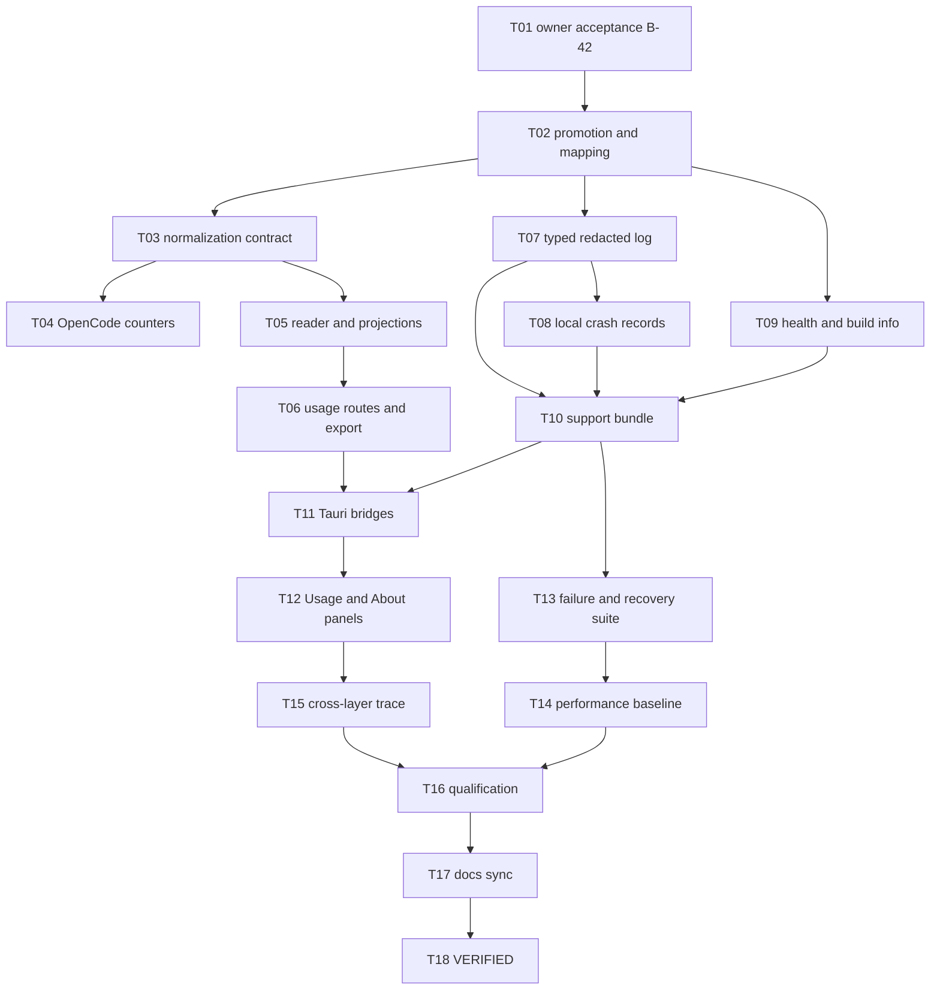

# Implementation Plan - Usage, Diagnostics and Observability

**Feature:** 018 | **Spec:** SPEC.md revision 0.1
**Status:** IN_REVIEW - pending owner acceptance of B-42; does not authorize implementation; not a claim of implementation or qualification.
**Updated:** 2026-11-09
**Rule:** the authoritative ordered work list is [TASKS.md](TASKS.md) (018-T01 to 018-T18); the phase table below is a summary.

## 1. Delivery strategy

Two tracks share one package.

- **Usage track:** land the pure normalization contract (T03) early so Feature 001 can write usage records in its settlement transaction during Wave 1. Then add OpenCode counter extraction (T04), the leaf-additive reader (T05), routes (T06), bridges (T11) and the Usage panel (T12). The honest empty state ships first; numbers appear only when real records exist.
- **Diagnostics track:** replace `eprintln!` with a typed bounded log (T07), add local crash records (T08), health and build info (T09), then the B-42 support bundle (T10) and the About panel (T12).

Both tracks qualify on Windows x64 + OpenCode v2.0.32 first and Linux x64 second. Before implementation, inspect the working tree and worktrees and preserve user changes.

## 2. Dependency graph

## 3. Phases and exit gates

| Phase | Tasks | Outcome | Exit gate |
|---|---|---|---|
| A - acceptance and promotion | T01, T02 | B-42 accepted; routes, errors and vocabulary mapping promoted | Owner decision; validator and architecture check |
| B - usage data | T03, T04, T05, T06 | Normalizer used by 001; counters from OpenCode or proven absent; leaf-additive reads; routes | Storage and route tests on both OSes |
| C - diagnostics | T07, T08, T09, T10 | Typed log, crash records, health, build info, support bundle | Canary and no-network tests |
| D - desktop | T11, T12 | Bridges and two Settings panels with all states | UI and accessibility tests |
| E - recovery and performance | T13, T14 | Canonical test target; baseline | Restart, backpressure, query plan |
| F - trace and qualification | T15, T16 | Cross-layer trace; CODE/SYSTEM/USER per row | Owner USER sign-off |
| G - sync and close | T17, T18 | Status docs, ledgers, register; VERIFIED | Inventory audit and validator |

## 4. Ownership and allowed paths

Each task lists exact allowed paths. Summary: `crates/storage-core/src/usage.rs` and `crates/storage-sqlite/src/usage.rs` (new); `apps/litecoworkd/src/usage_operator.rs`, `diagnostics_operator.rs` and `diagnostics/` (new); the existing `eprintln!` sites; `opencode_server.rs` for typed counters only (coordinated with Feature 001); Tauri `usage_bridge.rs` and `diagnostics_bridge.rs` (new); `apps/litecowork-ui/src/settings/usage/` and `about/` (new).

## 5. Migrations

The usage record table is created by Feature 001's migration. This package adds at most one forward-only migration (next free `sqlite-vNN.sql`) for a covering index if 001's migration lacks one. Logs and crash records are files, not tables. No migration ships in IN_REVIEW.

## 6. Rollout

- Usage panel ships with the honest empty state even before the first record exists.
- Run provider diagnostic stays unavailable until an AgentModule declares a qualified probe.
- Support bundle appears only after T10 passes the canary and no-network tests on that row.
- No upload path exists in V1.

## 7. Risks

| Risk | Mitigation |
|---|---|
| Fabricated zeros or 100% coverage | Literal-search UI test (AC-002); UNKNOWN by default (AC-003) |
| Content leaks into logs | Typed entry without free text (AC-011) |
| Bundle leaks secrets | Allowlist plus canary plus secret scan (AC-012) |
| Telemetry slows turns | Bounded channel, drop debug entries (AC-015) |
| Vocabulary drift between 001 and the LLD | Mapping promoted with 001 in one change (T02) |
| OpenCode exposes no counters | Fall back to ESTIMATED_LOCAL labelled "(est.)"; never present it as measured |
