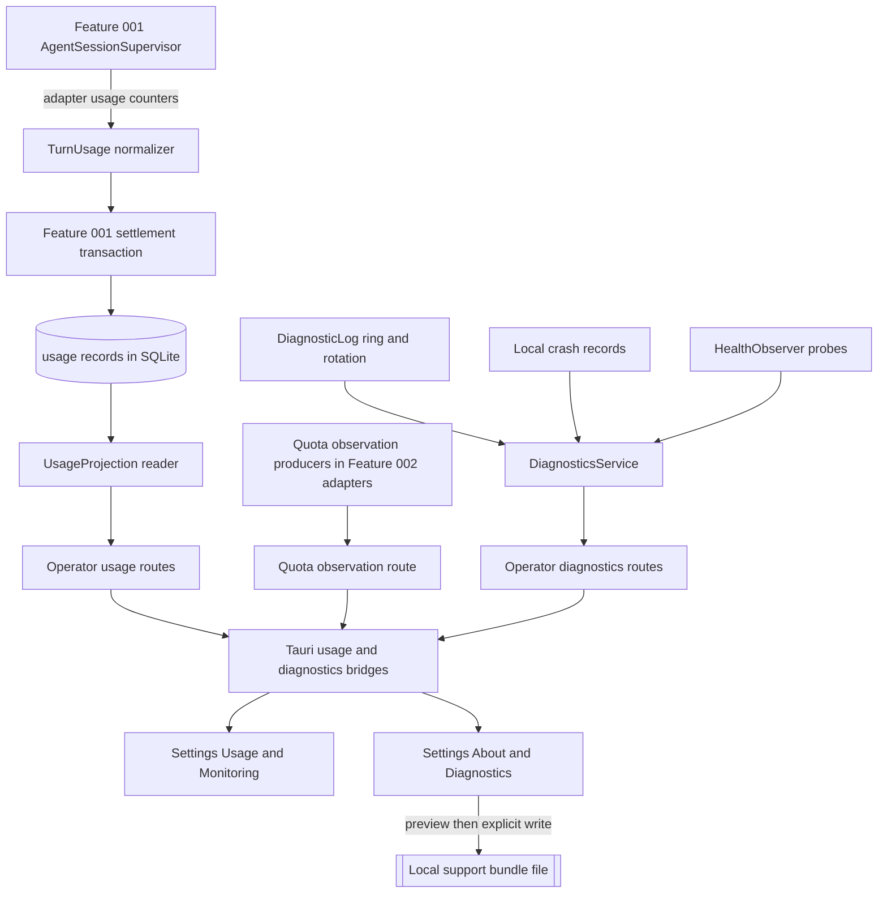

# Feature Specification - Usage, Diagnostics and Observability

- **Feature ID:** 018 | **Status:** IN_REVIEW | **Revision:** 0.1
- **Created / Updated:** 2026-11-09 / 2026-11-09
- **Owner acceptance:** not yet accepted. This package was authored after the owner acceptance of 2026-11-09 recorded in [docs/OWNER-ACCEPTANCE-REVIEW-PACKET.md](../../docs/OWNER-ACCEPTANCE-REVIEW-PACKET.md), so its decision B-42 is PROPOSED and pending owner review. IN_REVIEW does not authorize implementation.
- **Change control:** once accepted, this becomes a locked contract; any later change needs a new revision and renewed owner approval (SPECIFICATION-STANDARD section 7).
- **Target:** LiteCowork V1 local desktop, release matrix rows Windows 11/10 `x86_64-pc-windows-msvc` + OpenCode v2.0.32 first and Linux x86_64 second.
- **Owners:** Observability (usage ledger reader, projections, diagnostics), Operator/API, Desktop UI (Settings "Usage & Monitoring" and "About & Diagnostics"), Security/Trust (redaction), Agent Runtime (usage counter normalization), Product.
- **Dependencies:** Feature 001 (B-10 accepted: 001 writes the per-turn usage record inside its settlement transaction; this package owns the normalization contract, the reader and the dashboard); Feature 002 (AgentBinding identity, quota observation producers); Feature 011 (Settings shell, Runtime readiness, IPC); Feature 019 (release matrix, evidence bundle, secret scan). Release contract Area 10 "usage/diagnostics", master plan P11, gate G.

## 1. Problem and user outcome

The release contract Area 10 requires "usage/diagnostics". The owner design in [V1-TELEMETRY-USAGE-RESILIENCE-LLD.md](../../docs/V1-TELEMETRY-USAGE-RESILIENCE-LLD.md) and Settings categories 14 (Usage & Monitoring) and 16 (About & Diagnostics) in [V1-UI-SCREEN-CONTRACT.md](../../docs/V1-UI-SCREEN-CONTRACT.md) are detailed, but almost nothing exists in source:

- No usage record exists in any Rust source: `grep -rn "usage_records\|UsageRecord\|UsageSummary\|QuotaSnapshot"` over `apps`, `crates` and `docs/schemas` finds only the generated TypeScript type `ConversationUsageSummary` in `apps/litecowork-ui/src/api/operator-api.ts`. The OpenCode adapter (`apps/litecoworkd/src/agents/opencode_server.rs`) parses no token or cost field.
- `GET /conversations/{conversationId}/usage` (`getConversationUsage`) and `GET /tasks/{taskId}/usage` (`listTaskUsage`) are declared in OpenAPI and are `target_only`.
- `GET /v1/agent-bindings/{agent_binding_id}/quota-observation` is served by `apps/litecoworkd/src/agent_quota_observation_operator.rs` and always returns JSON `null` because no AgentModule publishes an authoritative quota observation. `apps/litecowork-ui/src/agents/QuotaObservation.tsx` renders "No qualified usage observation." for null and "Unknown" for expired or future observations.
- Daemon diagnostics are 12 `eprintln!` calls across `main.rs`, `operator.rs`, `conversation_operator.rs`, `agents/supervisor.rs`, `backup_operator.rs` and one test; there is no structured log, ring buffer, rotation, log export, panic hook or crash record in `apps/litecoworkd` or `apps/litecowork-ui/src-tauri`.
- `SettingsView.tsx` serves only `general`, `workspaces`, `agents`, `runtime`.

**Outcome:** the owner can open Settings > Usage & Monitoring and see honest, source-labelled usage per Workspace, Conversation, agent and day, with unknown and estimated values clearly separated and never shown as `$0.00`, `0 tokens` or `100%` by default; can see quota observations only when an agent reports one; and can open About & Diagnostics to see real build information, health probes, redacted logs, local crash records and a previewed, allowlisted support bundle that is written locally and never uploaded.

## 2. Goals

- G-01 Define the per-turn usage normalization contract that Feature 001's settlement writes (B-10) and read it into leaf-additive UsageSummary and UsageItems projections.
- G-02 Never fabricate: missing counters are UNKNOWN, estimates are labelled and kept out of measured totals, empty state is "No measured usage yet", and no default `$0.00`, `0 tokens` or `100%` coverage.
- G-03 Serve `getConversationUsage` and a Workspace usage summary with coverage, source, confidence and currency separation.
- G-04 Show quota observations per AgentBinding only from a typed source; never convert quota into money.
- G-05 Replace ad-hoc `eprintln!` diagnostics with a bounded, redacted, structured operational log with rotation and owner-initiated export.
- G-06 Record crashes locally (daemon and desktop) and show them after restart; never upload.
- G-07 Provide a support bundle with preview, allowlisted categories and explicit owner action (B-42).
- G-08 Show Runtime health probes (READY, DEGRADED, BLOCKED, UNKNOWN, OFFLINE) with observation age, keeping serving distinct from execution readiness.
- G-09 Prompts, completions, reasoning, file contents, secrets, tokens, cookies and native handles never enter usage rows, logs, crash records, diagnostics or bundles.

## 3. Non-goals

No cloud telemetry, analytics upload or remote crash service; no PriceBook, price editing, budget enforcement, quota reset or billing account connection in V1 (cost lanes render "Not priced" unless a provider-billed value is reported); no invasive native session extraction or parsing of native auth state; no prompt-content matching for deduplication; no OpenTelemetry exporter; no gateway or model-router integration; no historical backfill from native transcripts; no Task usage before Feature 005 Attempts exist (`listTaskUsage` stays target-only); no `setTelemetryRetention` or `setDiagnosticSampling` control (LLD keeps them service policy in V1).

## 4. Current implementation and evidence boundary

| Capability | Current evidence | Limitation |
|---|---|---|
| Usage records | ABSENT: no table, writer or reader in Rust source (grep) | Feature 001 B-10 is accepted and its write task is NOT STARTED |
| Usage counters from OpenCode v2.0.32 | ABSENT: `opencode_server.rs` parses no token, cost or usage field | First row has no PROVIDER_REPORTED source yet; only ESTIMATED_LOCAL or UNKNOWN would be possible |
| `getConversationUsage`, `listTaskUsage` | TARGET_ONLY in OpenAPI and served-route inventory; `ConversationUsageSummary`, `ConversationCurrencyCost`, `ConversationAgentUsage`, `UsageObservation` schemas exist | No handler |
| Quota observation read | SERVED: `agent_quota_observation_operator.rs` `get_agent_quota_observation` (owner check, `no-store`, returns `null`); Tauri `agent_quota_bridge.rs` `get_agent_quota_observation`; UI `QuotaObservation.tsx` | No producer; `null` always |
| Structured logs | ABSENT: 12 `eprintln!` sites; no `tracing` dependency in `apps/litecoworkd/Cargo.toml` (only transitive in `Cargo.lock`) | Nothing to export; no redaction layer |
| Crash records | ABSENT: no `panic::set_hook` in daemon or Tauri | Crashes leave no local record |
| Health probes | PARTIAL: `GET /v1/runtime-lifecycle` served from `operator.rs`; `litecoworkd status`; Tauri `runtime_lifecycle_bridge.rs` | No per-probe health projection with age |
| Build info | PARTIAL: `litecoworkd --version` (test `version_matches_the_built_package` in `apps/litecoworkd/tests/cli.rs`); `tauri.conf.json` `"version": "0.1.0"` | No About surface |
| Settings categories | ABSENT for Usage and About; `SettingsCategory` = `general | workspaces | agents | runtime` | Target IA categories 14 and 16 only |

Nothing in this package is SERVED, INTEGRATED or QUALIFIED today except the null-returning quota read, which is SERVED but has no producer.

## 5. Decision register

### Inherited LOCKED invariants (canonical owners)

| ID | Invariant | Authority |
|---|---|---|
| L-01 | One immutable leaf per actual inference; rollups derive from leaves only; no rollup of rollups; no cross-currency sum. | V1-TELEMETRY-USAGE-RESILIENCE-LLD |
| L-02 | Missing counters are UNKNOWN, not zero; subscription usage is not a $0 bill; estimates are not billing. | LLD, V1-UI-SCREEN-CONTRACT "Usage and monitoring dashboard" |
| L-03 | Empty state says "No measured usage yet"; never render `$0.00`, `0 tokens` or `100%` coverage as a default. | V1-UI-SCREEN-CONTRACT |
| L-04 | Usage readers and diagnostics never ingest prompts, completions, reasoning, secrets or raw transcripts. | LLD "Hard rule for these readers", OBSERVABILITY |
| L-05 | A support bundle requires preview, visible redaction categories and explicit user action. | LLD "Telemetry classes and privacy boundaries" |
| L-06 | Deduplication only by verified identity; replays increment observation version, not spend. | LLD |
| L-07 | Feature 001 writes the per-turn usage record in its settlement transaction; settlement never blocks on missing telemetry (B-10 accepted 2026-11-09). | specs/001 SPEC B-10 |
| L-08 | Usage dashboard surfaces are read-only in V1; filters are not permissions. | V1-UI-SCREEN-CONTRACT, V1-SETTINGS-CONTRACT-LEDGER |
| L-09 | Native handles and credentials never enter public projections, events or ordinary logs. | ARCHITECTURE, AGENTS.md section 2 |

### FLEXIBLE

| ID | Choice | Allowed options | Constraint |
|---|---|---|---|
| F-01 | Log implementation | `tracing` with a custom allowlist layer, or a small in-house typed ring | Typed fields only; no free-form interpolation of user content; bounded |
| F-02 | Timezone bucketing | UI computes half-open UTC boundaries from the IANA zone and sends them; or daemon uses a tz database | Storage stays UTC; DST correct; half-open intervals |
| F-03 | Bundle container | Single JSON-lines file plus manifest, or a directory | Manifest with per-file digest; size cap; local only |
| F-04 | Health refresh | Poll with single-flight cache, or push on the Operator stream | Each probe has an age and stale cutoff |

### Vocabulary mapping (resolves a cross-package term mismatch; promoted in 018-T02 with Feature 001's promotion)

Feature 001 B-10 names `attribution_source` values `PROVIDER_REPORTED` and `ESTIMATED_LOCAL`; the LLD names `UsageConfidence` values `PROVIDER_BILLED`, `NATIVE_REPORTED`, `GATEWAY_REPORTED`, `TOKENIZER_ESTIMATE`, `UNKNOWN`. This package maps them without a parallel schema: `PROVIDER_REPORTED` (harness reported tokens in its final response) -> confidence `NATIVE_REPORTED`, cost basis `UNKNOWN`; `ESTIMATED_LOCAL` (`max(1, utf8_bytes / 4)`) -> confidence `TOKENIZER_ESTIMATE`, shown only in the estimate lane; absent -> `UNKNOWN`. A per-turn record is a turn-level observation, not a verified inference leaf: `inference_count` stays `null` unless the harness reports response identities.

### PROPOSED blocking decision (pending owner)

| ID | Topic | PROPOSED resolution | Owner and consequence |
|---|---|---|---|
| B-42 | Support-bundle contents and redaction allowlist | **PROPOSED (pending owner).** Deny by default; only allowlisted fields enter a bundle. **Allowed categories** (each shown in the preview with item counts, each deselectable): (1) build info: app and daemon versions, schema version, OS family and version, architecture, WebView version, release row label; (2) Runtime health probes: probe name, state, age, reason code; (3) startup blockers: codes only; (4) structured operational log entries: timestamp, level, component, event code, reason code, opaque local correlation ids (Workspace, Conversation, turn, operation), duration; free-form message text is never stored, so it can never be bundled; (5) local crash records: build, OS, timestamp, panic location (file and line in LiteCowork source), redacted panic class, symbol-only backtrace frames; (6) agent installation observations: harness key, version, compatibility verdict, probe outcome code, with home-directory prefixes replaced by `~` and no other path; (7) served-route inventory version and enabled Settings categories. **Always excluded:** prompts, messages, completions, reasoning, file and Resource contents, Resource paths and URLs, environment variables, command lines with arguments, OAuth codes, tokens, cookies, keyring data, SecretStore bytes, native session handles, usage token counts and costs (usage has its own export), backup passphrases, IP addresses and host names. **Process:** preview lists every file and field class; the owner selects categories; the daemon writes one bundle file (cap 10 MiB, manifest with per-file SHA-256) to an owner-chosen local path; no network call exists in the diagnostics module; a canary test fails the build if a seeded secret, prompt or path reaches any bundle category. **Crash reports stay local:** written under `<data-dir>/diagnostics/crashes/`, newest 20 kept, shown in About & Diagnostics, included in a bundle only when the owner selects category 5. | Observability, Security, Product. Without it the support bundle and log export cannot ship because nothing defines what is safe. Accepting it binds 018-T06, 018-T07 and 018-T09. |

B-42 is PROPOSED and pending owner review. Do not infer owner sign-off from this package or from a passing validator. Implementation and qualification status are tracked in section 4, [TASKS.md](TASKS.md) and [docs/IMPLEMENTATION-STATUS.md](../../docs/IMPLEMENTATION-STATUS.md).

## 6. High-level design



### Trust boundaries

1. Native adapter output is untrusted: counters are bounded nonnegative integers parsed from typed fields; any text field is dropped.
2. Daemon to WebView: only aggregated or leaf metadata (counts, sources, ids, timestamps), never content.
3. Diagnostics module: no network client; writes only to `<data-dir>/diagnostics/` and to the owner-chosen bundle path.
4. Crash hook: runs in a panicking process; it writes a fixed-shape record with bounded size and never allocates unbounded strings from the panic payload.

### Actor sequence (usage, target)

1. A turn settles in Feature 001; the supervisor passes adapter usage counters (if any) to `normalize_turn_usage`.
2. Feature 001's settlement transaction stores the normalized record (L-07).
3. Owner opens Settings > Usage & Monitoring; UI computes the half-open UTC range for the chosen quick range and timezone.
4. UI calls `get_workspace_usage_summary`; the Operator authenticates, checks Workspace ownership and runs a leaf-additive query.
5. UI renders headline metrics with coverage and source, an estimate lane labelled "(est.)", "Not priced" cost lanes, and the accessible table. With no records it renders "No measured usage yet; some agents do not expose token counts".

### Ownership

| Owner | Responsibility | Excluded |
|---|---|---|
| Feature 001 | Persist the usage record in settlement | Aggregation, UI |
| This package (Observability) | Normalization contract, reader, projections, diagnostics log, crash records, health projection, support bundle, Settings panels | Turn settlement, adapter protocol |
| Feature 002 | Quota observation producers per AgentModule | Dashboard |
| Feature 011 | Settings shell, Runtime lifecycle | Usage semantics |
| Feature 019 | Release matrix, secret scan in CI | Bundle contents |

## 7. Low-level design and interfaces

### 7.1 Existing CODE signatures (verified in source)

- `apps/litecoworkd/src/agent_quota_observation_operator.rs`: `pub(super) fn routes() -> Router<ApiState>` mounting `GET /v1/agent-bindings/{agent_binding_id}/quota-observation` with `super::authenticate` and `no_store_middleware`; `async fn get_agent_quota_observation(State<ApiState>, HeaderMap, Path<String>) -> Result<Response, Response>` validating the id (non-empty, at most 256 chars, no control chars), calling `ensure_workspace_owner_for` and `get_agent_binding`, and returning `Json(Option::<Value>::None)`.
- `apps/litecowork-ui/src-tauri/src/agent_quota_bridge.rs`: `#[tauri::command] pub(crate) async fn get_agent_quota_observation`, `decode_observation` rejecting cross-binding data.
- `apps/litecowork-ui/src/agents/QuotaObservation.tsx`: `QuotaObservationSummary({ observation, now })`, `isQuotaObservationExpired` from `agent-quota-api.ts`.
- OpenAPI schemas: `ConversationUsageSummary` (`coverage` COMPLETE | PARTIAL | UNKNOWN, `observation_count`, `inference_count` nullable, `unknown_inference_count`, `costs_by_currency[]`, `agent_bindings[]`, `last_observed_at`), `ConversationCurrencyCost` (decimal strings, nullable), `UsageObservation`, `QuotaObservation` (`state` NORMAL | LOW | EXHAUSTED | UNKNOWN, `source`, `observed_at`, `expires_at`, `remaining_hint`, `reset_at`).

### 7.2 PROPOSED target signatures (not yet in source)

Normalization (`crates/storage-core/src/usage.rs` (new)), called by Feature 001:

```rust
pub enum UsageAttribution { ProviderReported, EstimatedLocal, Unknown }
pub struct AdapterUsageCounters { // bounded, from typed adapter fields only
    pub input_tokens: Option<u64>, pub output_tokens: Option<u64>,
    pub cache_read_input_tokens: Option<u64>, pub cache_write_input_tokens: Option<u64>,
    pub reasoning_output_tokens: Option<u64>, pub model_id: Option<String>,
    pub provider_response_id: Option<String>,
}
pub struct TurnUsageDraft {
    pub attribution: UsageAttribution, pub input_tokens: Option<u64>,
    pub output_tokens: Option<u64>, pub cache_read_input_tokens: Option<u64>,
    pub cache_write_input_tokens: Option<u64>, pub reasoning_output_tokens: Option<u64>,
    pub model_id: Option<String>, pub provider_response_id: Option<String>,
    pub completeness: UsageCompleteness,
}
pub fn normalize_turn_usage(counters: Option<&AdapterUsageCounters>,
    response_utf8_bytes: usize) -> TurnUsageDraft;
pub const USAGE_MAX_TOKEN_COUNT: u64 = 1 << 40; // rejects absurd values as UNKNOWN
```

Reader (`crates/storage-core/src/usage.rs`, `crates/storage-sqlite/src/usage.rs` (new)):

```rust
pub struct UsageWindow { pub start_utc: String, pub end_utc: String, pub buckets_utc: Vec<String> }
pub struct UsageFilter { pub agent_binding_ids: Vec<String>, pub conversation_id: Option<String>,
    pub attribution: Vec<UsageAttribution>, pub outcome: Vec<String> }
pub enum UsageGrouping { Day, Conversation, AgentBinding, Model }
pub trait UsageLedgerReader: Send + Sync {
    fn workspace_usage_summary(&self, principal_id: &str, workspace_id: &str,
        window: &UsageWindow, filter: &UsageFilter) -> Result<UsageSummaryView, StoreError>;
    fn workspace_usage_items(&self, principal_id: &str, workspace_id: &str,
        window: &UsageWindow, filter: &UsageFilter, grouping: UsageGrouping,
        cursor: Option<&str>, limit: usize) -> Result<UsageItemsPage, StoreError>;
    fn conversation_usage(&self, principal_id: &str, workspace_id: &str,
        conversation_id: &str) -> Result<ConversationUsageSummaryView, StoreError>;
}
```

Diagnostics (`apps/litecoworkd/src/diagnostics/` (new): `log.rs`, `crash.rs`, `health.rs`, `bundle.rs`):

```rust
pub struct DiagnosticEntry { pub at_utc: String, pub level: Level, pub component: &'static str,
    pub event_code: &'static str, pub reason_code: Option<&'static str>,
    pub correlation: CorrelationIds, pub duration_ms: Option<u64> } // no free-form text field
pub struct DiagnosticLog; // bounded ring (default 2,000 entries) + rotation (default 5 files x 5 MiB)
pub fn install_crash_hook(diagnostics_dir: &Path, build: &BuildInfo);
pub struct HealthProbeView { pub probe: &'static str, pub state: ProbeState,
    pub observed_at: String, pub stale_after_ms: u64, pub reason_code: Option<String> }
pub enum SupportBundleCategory { BuildInfo, Health, StartupBlockers, OperationalLog,
    CrashRecords, AgentInstallations, RouteInventory }
pub fn preview_support_bundle(selection: &[SupportBundleCategory]) -> SupportBundlePreview;
pub fn write_support_bundle(selection: &[SupportBundleCategory], destination: &Path)
    -> Result<SupportBundleReceipt, DiagnosticsError>;
```

Operator routes (PROPOSED):

| Method and path | Operation id | Notes |
|---|---|---|
| `GET /v1/conversations/{conversation_id}/usage` | `getConversationUsage` (existing target) | Cross-binding, deduplicated, coverage explicit |
| `GET /v1/workspaces/{workspace_id}/usage-summary` | `getWorkspaceUsageSummary` (new) | `start`, `end`, `bucket` boundaries, filters |
| `GET /v1/workspaces/{workspace_id}/usage-items` | `listWorkspaceUsageItems` (new) | Grouping, cursor; leaf metadata only |
| `POST /v1/workspaces/{workspace_id}/usage-exports` | `exportWorkspaceUsageReport` (new) | Owner-initiated local file; bounded; redacted |
| `GET /v1/agent-bindings/{agent_binding_id}/quota-observation` | `getAgentQuotaObservation` (existing, served) | Unchanged until a producer exists |
| `GET /v1/diagnostics/build-info` | `getBuildInfo` (new) | Versions, schema, OS, arch |
| `GET /v1/diagnostics/health` | `listHealthProbes` (new) | Probe states with age |
| `GET /v1/diagnostics/log` | `listDiagnosticLogEntries` (new) | Bounded page of typed entries |
| `GET /v1/diagnostics/crashes` | `listCrashRecords` (new) | Local records, newest first |
| `GET /v1/diagnostics/support-bundle-preview` | `previewSupportBundle` (new) | Categories, counts, field classes |
| `POST /v1/diagnostics/support-bundles` | `writeSupportBundle` (new) | Explicit owner action; Idempotency-Key |

Tauri commands (PROPOSED, `apps/litecowork-ui/src-tauri/src/usage_bridge.rs` and `diagnostics_bridge.rs` (new)): `get_workspace_usage_summary`, `list_workspace_usage_items`, `get_conversation_usage`, `export_workspace_usage_report`, `get_build_info`, `list_health_probes`, `list_diagnostic_log_entries`, `list_crash_records`, `preview_support_bundle`, `write_support_bundle`, plus a desktop-side `record_desktop_crash` panic hook in the Tauri process.

### 7.3 Request ordering and transaction owner

- Usage write: owned by Feature 001's final-response transaction; this package adds no write path for turns.
- Usage reads: read-only snapshot queries with a covering index on `(workspace_id, observed_at)`; no transaction holds across response serialization.
- Log writes: in-memory ring append (lock-free or short mutex) plus buffered file append on a background thread; a full channel drops debug entries and increments a dropped counter, never blocks the caller.
- Crash record: synchronous small file write inside the panic hook; no allocation of the panic payload beyond a 512-byte bound.
- Support bundle: assembled in memory up to the cap, then written with create-new semantics; receipt returned after fsync.

## 8. Data model and lifecycle

See [DATA-MODEL.md](DATA-MODEL.md). The usage record table is created by Feature 001's migration with the columns this package's normalization defines; this package adds only read indexes if 001 did not. Logs and crash records are files under `<data-dir>/diagnostics/`, not SQLite rows, so clearing them never touches domain events, audit or Evidence.

## 9. Wiring

See [WIRING.yaml](WIRING.yaml). The only served edge today is the quota observation read; everything else is target.

## 10. Security, trust and privacy

- Usage rows hold counters, ids, timestamps, model id and attribution only. A canary test seeds prompt text, completion text, a token and a path into adapter output and asserts none reaches the usage table, logs, crash records or bundles.
- `DiagnosticEntry` has no free-form string field; component, event and reason codes are `&'static str` from code, so user data cannot be interpolated into logs by construction.
- Correlation ids are local opaque ids; they appear in logs and bundles, never in metric labels.
- Home-directory prefixes are replaced with `~`; no other path is allowed in diagnostics.
- The diagnostics module has no HTTP client dependency; a test asserts the module does not reference `reqwest`.
- All usage and diagnostics routes are owner-scoped, `Cache-Control: no-store`, local IPC only. All Workspaces scope requires an explicit selector and per-Workspace ownership.
- Usage export and support bundle are explicit owner actions with a preview; no background write.

## 11. Errors, edge cases and recovery

See [contracts/errors-recovery.md](contracts/errors-recovery.md). Key rules: a missing or malformed counter becomes UNKNOWN, never zero; telemetry failure never blocks turn settlement; log backpressure drops debug entries only; a crash during bundle write leaves no partial file advertised; projections are rebuildable from records after restart.

## 12. Configuration and compatibility

- Defaults (proposed, owner may change at acceptance): log ring 2,000 entries; rotation 5 files x 5 MiB; crash records newest 20; support bundle cap 10 MiB; usage export cap 10 MiB; usage items page limit 200.
- Quick ranges Today, Last 7 days, Last 1 month, Last 3 months, Last 1 year, All time; advanced YTD and Custom; half-open `[start, end)`; storage UTC; display in the viewer's IANA timezone.
- Money is a decimal string; tokens are integers bounded by `USAGE_MAX_TOKEN_COUNT`; the UI checks `Number.isSafeInteger` before formatting.
- Windows: diagnostics directory owner-only DACL (`windows_local_security::secure_current_user_directory`); Linux 0700.

## 13. Observability

This package is the observability owner for the desktop. Its own health: dropped log entry counter, log write latency, crash hook success flag, usage query duration. These are shown in About & Diagnostics, never sent anywhere.

## 14. EARS acceptance criteria

- AC-001 WHEN a Feature 001 turn settles with adapter counters, THE SYSTEM SHALL produce a normalized usage draft with attribution PROVIDER_REPORTED mapped to confidence NATIVE_REPORTED, and WHEN counters are absent, THE SYSTEM SHALL produce ESTIMATED_LOCAL (`max(1, utf8_bytes / 4)`) mapped to TOKENIZER_ESTIMATE, and SHALL NOT block or fail settlement in either case. Verify: normalizer unit tests and Feature 001 settlement integration test.
- AC-002 WHILE a Workspace has no usage records in the selected window, THE SYSTEM SHALL show "No measured usage yet; some agents do not expose token counts" and SHALL NOT render `$0.00`, `0 tokens` or `100%` coverage. Verify: UI test that searches the rendered output for those literals.
- AC-003 IF a counter is missing, negative, non-integer or above `USAGE_MAX_TOKEN_COUNT`, THEN THE SYSTEM SHALL record it as UNKNOWN, mark completeness PARTIAL, and count it in `unknown_inference_count`, never as zero. Verify: boundary tests.
- AC-004 WHEN usage includes ESTIMATED_LOCAL records, THE SYSTEM SHALL show them only in a lane labelled "(est.)" and SHALL exclude them from measured token totals and coverage. Verify: projection and UI tests.
- AC-005 WHEN a final-response commit is replayed or an observation arrives twice with the same provider response identity, THE SYSTEM SHALL count it once, and WHEN a retry made a real new inference, THE SYSTEM SHALL count it separately. Verify: dedupe tests with Feature 001 replay fixtures.
- AC-006 WHEN costs are shown, THE SYSTEM SHALL group them by currency, keep provider-billed and estimated amounts separate, render "Not priced" when no price source exists, and SHALL NOT sum across currencies. Verify: projection tests with two currencies.
- AC-007 WHEN a range is selected, THE SYSTEM SHALL query the half-open UTC interval derived from the viewer's timezone so that a 30-day window across a DST change and a year boundary neither drops nor duplicates a record. Verify: bucket tests with fixed zones.
- AC-008 IF the caller does not own the Workspace, or requests All Workspaces without the explicit scope selector, THEN THE SYSTEM SHALL deny the read and SHALL NOT reveal counts of other Workspaces. Verify: foreign principal tests.
- AC-009 WHEN an AgentBinding has no quota observation, THE SYSTEM SHALL show "Not reported by this agent"; WHEN an observation is expired or future-dated, THE SYSTEM SHALL show Unknown with the reason; quota SHALL NOT be converted into money or added to usage totals. Verify: existing `QuotaObservation.tsx` behavior extended with dashboard tests.
- AC-010 WHEN the owner opens About & Diagnostics, THE SYSTEM SHALL show app, daemon and schema versions, OS and architecture from real build metadata, and Copy build info SHALL copy exactly those fields. Verify: route test against `CARGO_PKG_VERSION` and UI test.
- AC-011 WHEN any daemon component logs, THE SYSTEM SHALL write a typed entry with no free-form text into a bounded ring and rotated files, and a canary prompt, completion, token, cookie, native handle or path SHALL NOT appear in any entry. Verify: log canary test and compile-time type check.
- AC-012 WHEN the owner requests a support bundle, THE SYSTEM SHALL show a preview of categories, item counts and field classes, write only the selected allowlisted categories to the owner-chosen local file within the size cap with a manifest of digests, and make no network request. Verify: bundle canary test, size cap test and a no-network assertion.
- AC-013 IF the daemon or desktop process panics, THEN THE SYSTEM SHALL write a bounded local crash record (build, OS, time, LiteCowork source location, symbol-only frames, redacted class) and show it after restart; crash records SHALL NOT be uploaded. Verify: panic injection test and restart UI test.
- AC-014 WHEN health is shown, THE SYSTEM SHALL report each probe as READY, DEGRADED, BLOCKED, UNKNOWN or OFFLINE with observation age, and SHALL show "Serving" separately from execution readiness. Verify: probe projection tests.
- AC-015 IF the log sink is slow or unavailable, THEN THE SYSTEM SHALL drop debug entries, increment a dropped counter and keep turn admission and settlement latency unaffected. Verify: backpressure test with a blocked sink.
- AC-016 WHEN the Usage or About panels render, THE SYSTEM SHALL provide loading, empty, partial, error, denied, offline and stale states, an accessible table for every chart, keyboard navigation and screen-reader labels that include source and confidence. Verify: UI component tests and accessibility audit.
- AC-017 WHEN the owner exports a usage report, THE SYSTEM SHALL write only the current filter's leaf metadata (counts, ids, attribution, timestamps) to a bounded local file and SHALL NOT include prompt or response content. Verify: export test.
- AC-018 WHEN the daemon restarts, THE SYSTEM SHALL serve the same usage summary from durable records, keep rotated log files within the cap, and show crash records from the previous incarnation. Verify: restart test.
- AC-019 WHEN the usage summary is computed over the reference fixture, THE SYSTEM SHALL use the covering index (query plan check) and record the measured latency as the baseline before any numeric threshold is set. Verify: query plan test and performance harness.
- AC-020 WHILE no qualified provider diagnostic exists for an AgentBinding, THE SYSTEM SHALL show Run provider diagnostic as unavailable with the reason and SHALL NOT report a passing provider test. Verify: UI test.
- AC-021 WHEN `getConversationUsage` is called for a Conversation whose turns used several AgentBindings, THE SYSTEM SHALL sum each distinct record once across bindings, keep per-binding drill-down, and return `inference_count` as null unless response identities are verified. Verify: route test with two bindings.
- AC-022 WHEN the operator API client types are built (task P-18), THE SYSTEM SHALL generate `operator-api.ts` and its TypeScript validators from the Rust wire types following the NeuralAgent pattern, keeping one source of truth, and a drift gate SHALL fail if the generated file diverges from the Rust types; the generated file SHALL NOT be hand-edited. Verify: generation and drift-gate test.

## 15. Executable acceptance command

**Canonical feature acceptance command (target; the test target is created by 018-T13 and does not exist yet):**

```bash
cargo test -p storage-sqlite --locked usage && cargo test -p litecoworkd --test usage_diagnostics --locked -- --nocapture && pnpm --dir apps/litecowork-ui test
```

Nothing in this command has tests today. Do not mark the package VERIFIED until it covers AC-001 to AC-021 and passes on Windows x64 + OpenCode v2.0.32 and Linux x64 with owner USER evidence.

## 16. Out-of-bounds paths and side effects

This package is IN_REVIEW and authorizes no implementation. After acceptance, each task in [TASKS.md](TASKS.md) names its allowed paths. Candidate paths: new `crates/storage-core/src/usage.rs`, new `crates/storage-sqlite/src/usage.rs`, new `apps/litecoworkd/src/usage_operator.rs`, new `apps/litecoworkd/src/diagnostics/`, `apps/litecoworkd/src/main.rs` (crash hook install), the `eprintln!` sites, new Tauri bridges, new `apps/litecowork-ui/src/settings/usage/` and `apps/litecowork-ui/src/settings/about/`, adjacent tests and owner docs promoted by 018-T02.

Out of scope: the Feature 001 settlement transaction body (001 owns it), adapter protocol beyond typed counter fields, PriceBook, budgets, upload of any kind.

Do not read the owner's real native session files or credentials during design validation.

## 17. Assumptions and open questions

| ID | Question | Evidence or limitation | Owner | Gate |
|---|---|---|---|---|
| O-01 | Does OpenCode v2.0.32 report token counters in its server event stream? | The adapter parses none today; the LLD says OpenCode exposes per-session tokens through `opencode stats` and its server store. | Agent Runtime | 018-T04 |
| O-02 | Keep `QuotaObservation` (OpenAPI, served) as the wire name and treat the LLD `QuotaSnapshot` as its ledger concept, or add a new schema? | Two names exist for one concept. Proposed: keep `QuotaObservation`; no parallel schema. | Observability, API | 018-T02 |
| O-03 | No E2E-xx in ACCEPTANCE-AND-E2E-PLAN covers usage or diagnostics. | E2E-01 to E2E-13 list none. Proposed: qualify under E2E-01 (usage after a real Send) plus a new diagnostics journey added by the orchestrator. | Product, QA | 018-T16 |
| O-04 | Should the opt-in usage-only local reader (LLD) ship in V1 for OpenCode? | Requires a pinned reader contract; privacy review. Proposed: not in V1 unless O-01 finds no stream counters. | Observability, Security | 018-T04 |
| O-05 | Reference fixture size for the usage query baseline. | No baseline exists. | Observability | 018-T14 |

## 18. Requirement traceability

| Requirement | Canonical owner | Task | Acceptance |
|---|---|---|---|
| Owner acceptance of B-42 | OWNER-ACCEPTANCE-REVIEW-PACKET, CONTRADICTION-AND-ALIGNMENT-REGISTER | 018-T01 | AC-001 to AC-021 (gate for all) |
| Contract promotion and vocabulary mapping | OBSERVABILITY, API, SCHEMAS, LLD | 018-T02 | AC-001 / AC-008 |
| Usage normalization for Feature 001 | LLD, specs/001 B-10 | 018-T03 | AC-001 / AC-003 / AC-005 |
| OpenCode counter extraction | AGENT-CONTROL, LLD | 018-T04 | AC-001 / AC-005 |
| Usage reader and projections | LLD, STORAGE | 018-T05 | AC-004 / AC-006 / AC-007 / AC-021 |
| Usage Operator routes and export | API | 018-T06 | AC-008 / AC-017 / AC-021 |
| Structured redacted log | OBSERVABILITY | 018-T07 | AC-011 / AC-015 |
| Local crash records | OBSERVABILITY, SECURITY | 018-T08 | AC-013 / AC-018 |
| Health probes and build info | RUNTIME-LIFECYCLE, OBSERVABILITY | 018-T09 | AC-010 / AC-014 |
| Support bundle (B-42) | OBSERVABILITY, SECURITY | 018-T10 | AC-012 |
| Tauri bridges | DESKTOP-SHELL-LLD | 018-T11 | AC-016 |
| Settings Usage & Monitoring UI | V1-UI-SCREEN-CONTRACT, V1-SETTINGS-CONTRACT-LEDGER | 018-T12 | AC-002 / AC-004 / AC-009 / AC-016 |
| Settings About & Diagnostics UI | V1-UI-SCREEN-CONTRACT, V1-SETTINGS-CONTRACT-LEDGER | 018-T12 | AC-010 / AC-013 / AC-020 |
| Failure, recovery and canonical target | FAILURE-RECOVERY | 018-T13 | AC-015 / AC-018 |
| Performance baseline | TESTING | 018-T14 | AC-019 |
| Cross-layer trace | AGENTS.md section 4 | 018-T15 | AC-002 / AC-012 |
| Qualification on both rows | ACCEPTANCE-AND-E2E-PLAN | 018-T16 | AC-001 / AC-002 / AC-012 / AC-013 |
| Documentation sync | IMPLEMENTATION-STATUS | 018-T17 | AC-008 |
| Generated operator-api.ts and TS validators with drift gate (P-18) | ARCHITECTURE boundaries, audit X-04 | 018-T18 | AC-022 |
| Package VERIFIED | SPECIFICATION-STANDARD | 018-T19 | AC-001, AC-002, AC-003, AC-004, AC-005, AC-006, AC-007, AC-008, AC-009, AC-010, AC-011, AC-012, AC-013, AC-014, AC-015, AC-016, AC-017, AC-018, AC-019, AC-020, AC-021, AC-022 |
