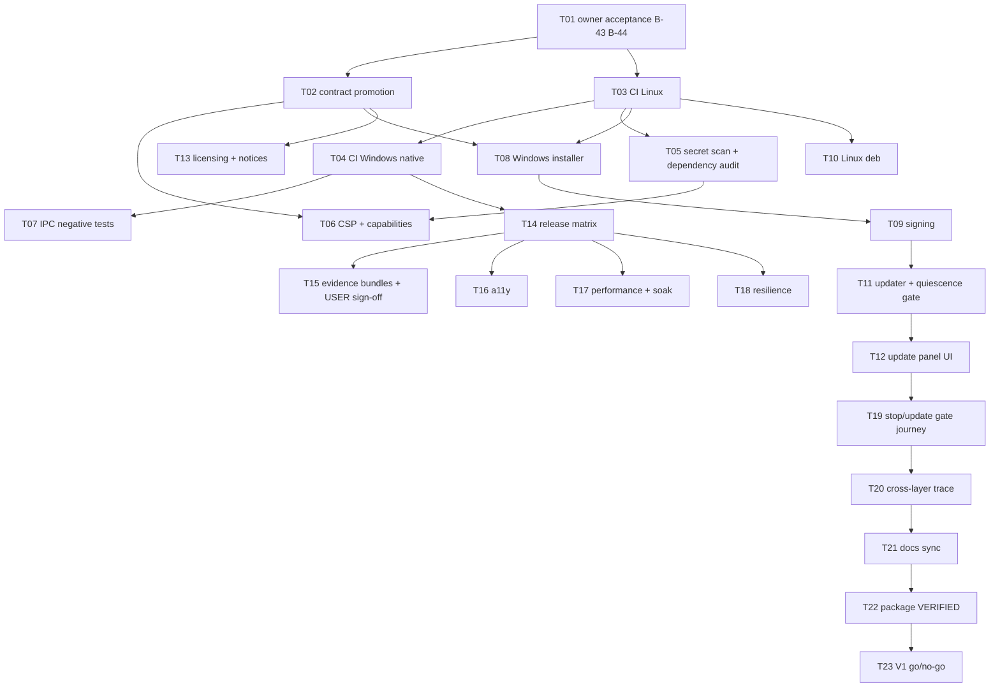

# Implementation Plan - Release Engineering and V1 Qualification

**Feature:** 019 | **Spec:** SPEC.md revision 0.1
**Status:** IN_REVIEW - not owner-accepted; authorizes no implementation; not a claim of implementation or qualification.
**Updated:** 2026-11-09
**Rule:** the authoritative ordered work list is [TASKS.md](TASKS.md) (T01 to T23). This plan is the summary view.

## 1. Delivery strategy

Build the release machinery in the same order as the delivery waves. Wave 0 starts CI, the native Windows runner, the secret scan and dependency audit and the declared release rows so every other package can produce row-scoped evidence early. Installers and signing follow once the shell and daemon run packaged on Windows (Feature 011). The updater is last among the build tasks because it depends on the Feature 011 authenticated stop and update quiescence gate. Qualification work (a11y, performance, resilience, stop/update gate) runs per row in Wave 6, and the go/no-go closes V1.

CI pipeline files are added only through reviewed pull requests. Nothing in this plan signs, publishes or uploads during design validation.

## 2. Dependency graph

## 3. Phases and exit gates

| Phase | Tasks | Outcome | Exit gate |
|---|---|---|---|
| A - acceptance and promotion | T01, T02 | B-43/B-44 decided; schemas, ADR skeleton and owner-doc edits promoted | Owner record; validator and schema fixture tests pass |
| B - Wave 0 gates | T03, T04, T05, T14 rows file | CI on native Linux and Windows; secret and dependency gates; declared rows | Failing PR is blocked; WSL2 run is NOT_COUNTED |
| C - hardening | T06, T07 | CSP/capability audit; IPC negative tests on packaged build | Regression fixtures fail; foreign peers rejected |
| D - packaging | T08, T09, T10, T13 | Signed NSIS/MSI; Linux deb with signed checksums; LICENSE and notices | Install/upgrade/uninstall scripts pass on clean images |
| E - update | T11, T12 | Updater gated on Feature 011 quiescence; update panel states | Refusal, tamper, downgrade, interruption and race tests pass |
| F - qualification | T14, T15, T16, T17, T18, T19 | Matrix, bundles, a11y, performance, resilience and the stop/update gate per row | Per-row reports with USER sign-off |
| G - closure | T20, T21, T22, T23 | Traces, docs sync, package VERIFIED, V1 go/no-go | Release gate prints GO and the owner records the decision |

## 4. Scope and file ownership (candidate paths, re-inspect before implementation)

| Area | Paths | Owner | Guardrail |
|---|---|---|---|
| CI | `.github/workflows/*.yml` (new), `.github/CODEOWNERS` (new), `scripts/check.sh`, `scripts/check.ps1` (new) | Release Engineering | Pull request only; actions pinned by SHA; no fork secrets |
| Security gates | `scripts/v1_secret_scan.py`, `deny.toml` (new), `apps/litecowork-ui/src-tauri/deny.toml` (new), `scripts/v1_csp_audit.py` (new) | Security | Findings block; exceptions expire |
| Bundling | `apps/litecowork-ui/src-tauri/tauri.conf.json` (`bundle`, `plugins.updater`, `app.security`), `tauri.bundle.conf.json`, `capabilities/default.json`, `apps/litecowork-ui/scripts/run-tauri.mjs`, `build-daemon-sidecar.mjs` | Release Engineering, Desktop Shell | No WebView permission beyond reviewed set |
| Updater | `apps/litecowork-ui/src-tauri/src/updater_bridge.rs` (new), `src-tauri/Cargo.toml`, `src/updates/` (new) | Desktop Shell | Gate before install; Rust-side only |
| Qualification tools | `scripts/v1_platform_matrix.py`, `scripts/v1_evidence_bundle.py` (new), `scripts/v1_release_gate.py` (new), `crates/storage-sqlite/tests/` (new soak/resilience tests) | QA | Never invent PASSED |
| Release docs | `docs/release/` (new), `docs/adr/` (licensing ADR) | Release Engineering, Product | No user content committed |

## 5. Migrations

None. This package owns no daemon table. The daemon's own forward-only migrations run on first start of an updated version and are tested in T18.

## 6. Rollout

1. Land CI in report-only mode for one week of PRs, then make it required.
2. Produce unsigned Windows and Linux packages labelled `UNSIGNED-DEV` for internal rows.
3. Enable signing on protected release tags after B-43 acceptance.
4. Ship the first signed release with the updater compiled in but the endpoint disabled until the Feature 011 gate is served; enable the endpoint only after T11 and T19 pass on the Windows row.
5. Publish the matrix and evidence index with each release candidate; run the go/no-go.

## 7. Risks

| Risk | Mitigation |
|---|---|
| Hosted Windows runners are Windows Server, not the client OS | Self-hosted Windows 11 runner for packaged and USER-adjacent jobs (O-01) |
| Signing key exposure | HSM-backed signing service; protected environment; log secret scan |
| Updater replaces a running sidecar on Windows (file lock) | Authenticated Runtime stop and STOPPED proof before installer handoff |
| Gate dependencies on other packages slip | Matrix shows BLOCKED/UNAVAILABLE honestly; go/no-go stays NO-GO |
| Host-dependent tests red in containers | TESTING B-28 rule: only the real OS settles them |

## DeepSeek Harness proposals (PROPOSED, owner review required)

PROPOSED only; see the matching section in [TASKS.md](TASKS.md). Nothing here changes the accepted design of this package. Owner review is required first.

- **P-34 Updater coordinator spec (generation token, single-flight verbs, no auto-install, backoff ladder, refuse after unclean exit)** (owns the proposed row). Class **ADAPT (update-schedule arithmetic is an ADOPT candidate)**. Design impact if accepted: T11, T12 of package 019; T14 of package 011. Deferral: DEFERRED with B-43: the daemon and Tauri half cannot be exercised without a signed build and a feed. Upstream: [src/update-coordinator.ts](https://github.com/deepseek-ai/deepseek-harness/blob/fcc0ad462172522aaf5c93a7b2e01f6b9f0b0159/apps/desktop/src/update-coordinator.ts), [src/update-schedule.ts](https://github.com/deepseek-ai/deepseek-harness/blob/fcc0ad462172522aaf5c93a7b2e01f6b9f0b0159/apps/desktop/src/update-schedule.ts), [src/update-presentation.ts](https://github.com/deepseek-ai/deepseek-harness/blob/fcc0ad462172522aaf5c93a7b2e01f6b9f0b0159/apps/desktop/src/update-presentation.ts), [src/update-attention.ts](https://github.com/deepseek-ai/deepseek-harness/blob/fcc0ad462172522aaf5c93a7b2e01f6b9f0b0159/apps/desktop/src/update-attention.ts). Study: [desktop study](../../docs/DEEPSEEK-HARNESS-DESKTOP-DEEP-DIVE-2026-11.md) Sections 10 and 14 (row P-34).
- **P-35 Sealed per-file runtime inventory written after signing, packaged smoke against a private data root, distinct unsigned artifact names** (owns the proposed row). Class **ADAPT**. Design impact if accepted: T08, T09, T10, T14, T15 of package 019. Deferral: Linux deb scripts exist (`scripts/qualify-linux-package.sh`); the signed run is DEFERRED with B-43. Read `scripts/smoke-runtime.ts` in full before this becomes a design. Upstream: [src/runtime-tree.ts](https://github.com/deepseek-ai/deepseek-harness/blob/fcc0ad462172522aaf5c93a7b2e01f6b9f0b0159/apps/desktop/src/runtime-tree.ts), [scripts/electron-builder-config.mjs](https://github.com/deepseek-ai/deepseek-harness/blob/fcc0ad462172522aaf5c93a7b2e01f6b9f0b0159/apps/desktop/scripts/electron-builder-config.mjs), [scripts/package-target.ts](https://github.com/deepseek-ai/deepseek-harness/blob/fcc0ad462172522aaf5c93a7b2e01f6b9f0b0159/apps/desktop/scripts/package-target.ts), [scripts/smoke-runtime.ts](https://github.com/deepseek-ai/deepseek-harness/blob/fcc0ad462172522aaf5c93a7b2e01f6b9f0b0159/apps/desktop/scripts/smoke-runtime.ts). Study: [desktop study](../../docs/DEEPSEEK-HARNESS-DESKTOP-DEEP-DIVE-2026-11.md) Sections 11 and 14 (row P-35); Section 15 lists what stays unread.
- **P-36 Publication discipline and rollback (plan validated before credentials, artifacts before manifest, reconcile unknown writes, feed-only rollback)** (owns the proposed row). Class **ADAPT**. Design impact if accepted: T10, T15 and T23 of package 019. Deferral: DEFERRED with B-43 and B-44 (distribution endpoint undecided). Upstream: [scripts/desktop-upload-plan.ts](https://github.com/deepseek-ai/deepseek-harness/blob/fcc0ad462172522aaf5c93a7b2e01f6b9f0b0159/apps/desktop/scripts/desktop-upload-plan.ts), [scripts/desktop-publish.ts](https://github.com/deepseek-ai/deepseek-harness/blob/fcc0ad462172522aaf5c93a7b2e01f6b9f0b0159/apps/desktop/scripts/desktop-publish.ts), [scripts/desktop-publish-record.ts](https://github.com/deepseek-ai/deepseek-harness/blob/fcc0ad462172522aaf5c93a7b2e01f6b9f0b0159/apps/desktop/scripts/desktop-publish-record.ts), [scripts/desktop-release-store.ts](https://github.com/deepseek-ai/deepseek-harness/blob/fcc0ad462172522aaf5c93a7b2e01f6b9f0b0159/apps/desktop/scripts/desktop-release-store.ts), [scripts/desktop-rollback.ts](https://github.com/deepseek-ai/deepseek-harness/blob/fcc0ad462172522aaf5c93a7b2e01f6b9f0b0159/apps/desktop/scripts/desktop-rollback.ts), [scripts/desktop-cos.ts](https://github.com/deepseek-ai/deepseek-harness/blob/fcc0ad462172522aaf5c93a7b2e01f6b9f0b0159/apps/desktop/scripts/desktop-cos.ts), [scripts/desktop-purge-recovery.ts](https://github.com/deepseek-ai/deepseek-harness/blob/fcc0ad462172522aaf5c93a7b2e01f6b9f0b0159/apps/desktop/scripts/desktop-purge-recovery.ts). Study: [desktop study](../../docs/DEEPSEEK-HARNESS-DESKTOP-DEEP-DIVE-2026-11.md) Sections 11 (11.4) and 14 (row P-36).
- **P-39 Release approval bound to a digest of manifest plus plan; allowlisted release configuration** (owns the proposed row). Class **ADAPT**. Design impact if accepted: T09, T10, T15 of package 019. Deferral: DEFERRED with B-43. Upstream: [scripts/publish-desktop-ci.ts](https://github.com/deepseek-ai/deepseek-harness/blob/fcc0ad462172522aaf5c93a7b2e01f6b9f0b0159/apps/desktop/scripts/publish-desktop-ci.ts), [scripts/desktop-package-environment.mjs](https://github.com/deepseek-ai/deepseek-harness/blob/fcc0ad462172522aaf5c93a7b2e01f6b9f0b0159/apps/desktop/scripts/desktop-package-environment.mjs), [scripts/desktop-publish-route.ts](https://github.com/deepseek-ai/deepseek-harness/blob/fcc0ad462172522aaf5c93a7b2e01f6b9f0b0159/apps/desktop/scripts/desktop-publish-route.ts), [scripts/resolve-retained-desktop-publish-ci.ts](https://github.com/deepseek-ai/deepseek-harness/blob/fcc0ad462172522aaf5c93a7b2e01f6b9f0b0159/apps/desktop/scripts/resolve-retained-desktop-publish-ci.ts). Study: [desktop study](../../docs/DEEPSEEK-HARNESS-DESKTOP-DEEP-DIVE-2026-11.md) Sections 11 and 14 (row P-39).
- **P-40 Signed-file completion protocol (sign once, timestamp on fresh copies, compare normalized bytes, same-volume rename, never retry signing)** (owns the proposed row). Class **ADAPT**. Design impact if accepted: T09 of package 019. Deferral: DEFERRED; needs the Windows laptop and a signing identity (B-43). Upstream: [scripts/windows-timestamp.mjs](https://github.com/deepseek-ai/deepseek-harness/blob/fcc0ad462172522aaf5c93a7b2e01f6b9f0b0159/apps/desktop/scripts/windows-timestamp.mjs), [scripts/windows-sign.mjs](https://github.com/deepseek-ai/deepseek-harness/blob/fcc0ad462172522aaf5c93a7b2e01f6b9f0b0159/apps/desktop/scripts/windows-sign.mjs), [scripts/windows-signing-state.mjs](https://github.com/deepseek-ai/deepseek-harness/blob/fcc0ad462172522aaf5c93a7b2e01f6b9f0b0159/apps/desktop/scripts/windows-signing-state.mjs). Study: [desktop study](../../docs/DEEPSEEK-HARNESS-DESKTOP-DEEP-DIVE-2026-11.md) Sections 11 (11.1) and 14 (row P-40).
- **P-41 Installer and uninstaller safety matrix (data-home overlap, known-folder blocklist, handle pinning, no reparse traversal, honest progress)** (owns the proposed row). Class **ADAPT (as test cases only)**. Design impact if accepted: T08 of package 019; T04 of package 017. Deferral: DEFERRED; Windows laptop. Upstream: [installer/uninstall-data.h](https://github.com/deepseek-ai/deepseek-harness/blob/fcc0ad462172522aaf5c93a7b2e01f6b9f0b0159/apps/desktop/installer/uninstall-data.h), [installer/uninstall.nsh](https://github.com/deepseek-ai/deepseek-harness/blob/fcc0ad462172522aaf5c93a7b2e01f6b9f0b0159/apps/desktop/installer/uninstall.nsh), [installer/path.nsh](https://github.com/deepseek-ai/deepseek-harness/blob/fcc0ad462172522aaf5c93a7b2e01f6b9f0b0159/apps/desktop/installer/path.nsh), [installer/extract.h](https://github.com/deepseek-ai/deepseek-harness/blob/fcc0ad462172522aaf5c93a7b2e01f6b9f0b0159/apps/desktop/installer/extract.h), [installer/progress.h](https://github.com/deepseek-ai/deepseek-harness/blob/fcc0ad462172522aaf5c93a7b2e01f6b9f0b0159/apps/desktop/installer/progress.h), [tests/expected/windows-uninstall.json](https://github.com/deepseek-ai/deepseek-harness/blob/fcc0ad462172522aaf5c93a7b2e01f6b9f0b0159/apps/desktop/tests/expected/windows-uninstall.json), [tests/expected/windows-installer.json](https://github.com/deepseek-ai/deepseek-harness/blob/fcc0ad462172522aaf5c93a7b2e01f6b9f0b0159/apps/desktop/tests/expected/windows-installer.json). Study: [desktop study](../../docs/DEEPSEEK-HARNESS-DESKTOP-DEEP-DIVE-2026-11.md) Sections 11 (11.7) and 14 (row P-41).
- **P-42 Journal-derived installed-update evidence (strict per-process journal, milestone inspector that prints what it cannot prove)** (owns the proposed row). Class **ADAPT**. Design impact if accepted: T14, T15 and T19 of package 019. Deferral: DEFERRED; Windows laptop first, then Linux. Upstream: [src/update-journal.ts](https://github.com/deepseek-ai/deepseek-harness/blob/fcc0ad462172522aaf5c93a7b2e01f6b9f0b0159/apps/desktop/src/update-journal.ts), [scripts/installed-update-qualification.ts](https://github.com/deepseek-ai/deepseek-harness/blob/fcc0ad462172522aaf5c93a7b2e01f6b9f0b0159/apps/desktop/scripts/installed-update-qualification.ts), [scripts/installed-update-publication.ts](https://github.com/deepseek-ai/deepseek-harness/blob/fcc0ad462172522aaf5c93a7b2e01f6b9f0b0159/apps/desktop/scripts/installed-update-publication.ts). Study: [desktop study](../../docs/DEEPSEEK-HARNESS-DESKTOP-DEEP-DIVE-2026-11.md) Sections 8, 11 (11.5) and 14 (row P-42).
- **P-43 Lifecycle-script allowlist and classified patch policy for dependencies** (owns the proposed row). Class **ADAPT**. Design impact if accepted: Package 013 (DEFERRED); T13 of package 019. Deferral: DEFERRED with LiteSPM (package 013). Upstream: [scripts/runtime-patch-policy.ts](https://github.com/deepseek-ai/deepseek-harness/blob/fcc0ad462172522aaf5c93a7b2e01f6b9f0b0159/apps/desktop/scripts/runtime-patch-policy.ts), [src/project-manager.ts](https://github.com/deepseek-ai/deepseek-harness/blob/fcc0ad462172522aaf5c93a7b2e01f6b9f0b0159/apps/desktop/src/project-manager.ts). Study: [desktop study](../../docs/DEEPSEEK-HARNESS-DESKTOP-DEEP-DIVE-2026-11.md) Sections 11 and 14 (row P-43).
- **P-45 Default-deny webview and session permissions, including the main one, plus a guest network filter** (owns the proposed row). Class **ADAPT**. Design impact if accepted: T06 of package 019; T04 and T06 of package 008. Deferral: Needs a packaged webview run on the Windows laptop and native Linux; DEFERRED with B-43. Upstream: [src/browser-guests.ts](https://github.com/deepseek-ai/deepseek-harness/blob/fcc0ad462172522aaf5c93a7b2e01f6b9f0b0159/apps/desktop/src/browser-guests.ts), [src/microphone-permissions.ts](https://github.com/deepseek-ai/deepseek-harness/blob/fcc0ad462172522aaf5c93a7b2e01f6b9f0b0159/apps/desktop/src/microphone-permissions.ts), [src/policy-test-auth.ts](https://github.com/deepseek-ai/deepseek-harness/blob/fcc0ad462172522aaf5c93a7b2e01f6b9f0b0159/apps/desktop/src/policy-test-auth.ts). Study: [desktop study](../../docs/DEEPSEEK-HARNESS-DESKTOP-DEEP-DIVE-2026-11.md) Sections 9 and 14 (row P-45).
- **P-31 QuiescenceReport (one "interruptible work" predicate; unknown means busy; lock then learn; inspect once)** (touches this package; row owned by package 011). Class **ADAPT**. Design impact if accepted: T12, T13, T14 of package 011; T11 of package 019; T10 of package 010. Deferral: Daemon half (`RuntimeLifecycleStore`, served `previewLocalRuntimeStop`) can be built and tested on Linux; the packaged quit path needs the Windows laptop. Not started. Upstream: [src/host-process.ts](https://github.com/deepseek-ai/deepseek-harness/blob/fcc0ad462172522aaf5c93a7b2e01f6b9f0b0159/apps/desktop/src/host-process.ts), [src/quit-confirmation.ts](https://github.com/deepseek-ai/deepseek-harness/blob/fcc0ad462172522aaf5c93a7b2e01f6b9f0b0159/apps/desktop/src/quit-confirmation.ts). Study: [desktop study](../../docs/DEEPSEEK-HARNESS-DESKTOP-DEEP-DIVE-2026-11.md) Sections 3 and 14 (row P-31).
- **P-32 Per-request deadlines with defined meaning-on-timeout for destructive shell-to-daemon calls** (touches this package; row owned by package 011). Class **ADAPT**. Design impact if accepted: T04 and T13 of package 011; T07 of package 019. Deferral: Not started. Needs the operator IPC and Tauri bridge decisions in package 011 first. Upstream: [src/host-process.ts](https://github.com/deepseek-ai/deepseek-harness/blob/fcc0ad462172522aaf5c93a7b2e01f6b9f0b0159/apps/desktop/src/host-process.ts), [src/welcome-window.ts](https://github.com/deepseek-ai/deepseek-harness/blob/fcc0ad462172522aaf5c93a7b2e01f6b9f0b0159/apps/desktop/src/welcome-window.ts), [src/update-dialog.ts](https://github.com/deepseek-ai/deepseek-harness/blob/fcc0ad462172522aaf5c93a7b2e01f6b9f0b0159/apps/desktop/src/update-dialog.ts). Study: [desktop study](../../docs/DEEPSEEK-HARNESS-DESKTOP-DEEP-DIVE-2026-11.md) Sections 2, 6 and 14 (row P-32).
- **P-37 Golden files for user-visible dialog copy and golden scenario lists for installer tests** (touches this package; row owned by package 011). Class **ADAPT**. Design impact if accepted: T19 of package 011; T16 and T08 of package 019. Deferral: UI golden tests can run on Linux; installer goldens wait for the Windows laptop. Upstream: [tests/expected/](https://github.com/deepseek-ai/deepseek-harness/tree/fcc0ad462172522aaf5c93a7b2e01f6b9f0b0159/apps/desktop/tests/expected), [tests/expected/windows-installer.json](https://github.com/deepseek-ai/deepseek-harness/blob/fcc0ad462172522aaf5c93a7b2e01f6b9f0b0159/apps/desktop/tests/expected/windows-installer.json), [tests/expected/windows-uninstall.json](https://github.com/deepseek-ai/deepseek-harness/blob/fcc0ad462172522aaf5c93a7b2e01f6b9f0b0159/apps/desktop/tests/expected/windows-uninstall.json), [src/locale.ts](https://github.com/deepseek-ai/deepseek-harness/blob/fcc0ad462172522aaf5c93a7b2e01f6b9f0b0159/apps/desktop/src/locale.ts). Study: [desktop study](../../docs/DEEPSEEK-HARNESS-DESKTOP-DEEP-DIVE-2026-11.md) Sections 12 and 14 (row P-37).
- **P-44 Streaming secret redactor for subprocess output that holds back a buffer whose prefix could still become a secret** (touches this package; row owned by package 018). Class **ADOPT (algorithm port)**. Design impact if accepted: T07 of package 018; T03 of package 017. Deferral: Not started. Rust unit tests with a secret split at every byte offset run on Linux. Upstream: [scripts/packaging-run.mjs](https://github.com/deepseek-ai/deepseek-harness/blob/fcc0ad462172522aaf5c93a7b2e01f6b9f0b0159/apps/desktop/scripts/packaging-run.mjs), [scripts/packaging-step.mjs](https://github.com/deepseek-ai/deepseek-harness/blob/fcc0ad462172522aaf5c93a7b2e01f6b9f0b0159/apps/desktop/scripts/packaging-step.mjs). Study: [desktop study](../../docs/DEEPSEEK-HARNESS-DESKTOP-DEEP-DIVE-2026-11.md) Sections 8 and 14 (row P-44).

