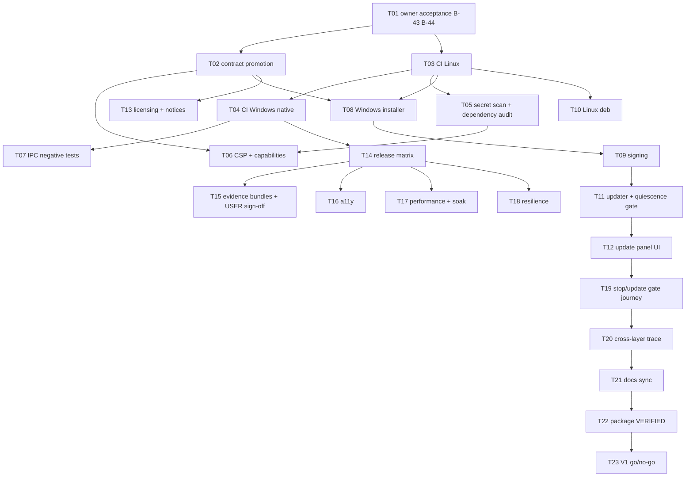

# Implementation Plan - Release Engineering and V1 Qualification

**Feature:** 019 | **Spec:** SPEC.md revision 0.1
**Status:** IN_REVIEW - not owner-accepted; authorizes no implementation; not a claim of implementation or qualification.
**Updated:** 2026-11-09
**Rule:** the authoritative ordered work list is [TASKS.md](TASKS.md) (T01 to T23). This plan is the summary view.

## 1. Delivery strategy

Build the release machinery in the same order as the delivery waves. Wave 0 starts CI, the native Windows runner, the secret scan and dependency audit and the declared release rows so every other package can produce row-scoped evidence early. Installers and signing follow once the shell and daemon run packaged on Windows (Feature 011). The updater is last among the build tasks because it depends on the Feature 011 authenticated stop and update quiescence gate. Qualification work (a11y, performance, resilience, stop/update gate) runs per row in Wave 6, and the go/no-go closes V1.

CI pipeline files are added only through reviewed pull requests. Nothing in this plan signs, publishes or uploads during design validation.

## 2. Dependency graph

## 3. Phases and exit gates

| Phase | Tasks | Outcome | Exit gate |
|---|---|---|---|
| A - acceptance and promotion | T01, T02 | B-43/B-44 decided; schemas, ADR skeleton and owner-doc edits promoted | Owner record; validator and schema fixture tests pass |
| B - Wave 0 gates | T03, T04, T05, T14 rows file | CI on native Linux and Windows; secret and dependency gates; declared rows | Failing PR is blocked; WSL2 run is NOT_COUNTED |
| C - hardening | T06, T07 | CSP/capability audit; IPC negative tests on packaged build | Regression fixtures fail; foreign peers rejected |
| D - packaging | T08, T09, T10, T13 | Signed NSIS/MSI; Linux deb with signed checksums; LICENSE and notices | Install/upgrade/uninstall scripts pass on clean images |
| E - update | T11, T12 | Updater gated on Feature 011 quiescence; update panel states | Refusal, tamper, downgrade, interruption and race tests pass |
| F - qualification | T14, T15, T16, T17, T18, T19 | Matrix, bundles, a11y, performance, resilience and the stop/update gate per row | Per-row reports with USER sign-off |
| G - closure | T20, T21, T22, T23 | Traces, docs sync, package VERIFIED, V1 go/no-go | Release gate prints GO and the owner records the decision |

## 4. Scope and file ownership (candidate paths, re-inspect before implementation)

| Area | Paths | Owner | Guardrail |
|---|---|---|---|
| CI | `.github/workflows/*.yml` (new), `.github/CODEOWNERS` (new), `scripts/check.sh`, `scripts/check.ps1` (new) | Release Engineering | Pull request only; actions pinned by SHA; no fork secrets |
| Security gates | `scripts/v1_secret_scan.py`, `deny.toml` (new), `apps/litecowork-ui/src-tauri/deny.toml` (new), `scripts/v1_csp_audit.py` (new) | Security | Findings block; exceptions expire |
| Bundling | `apps/litecowork-ui/src-tauri/tauri.conf.json` (`bundle`, `plugins.updater`, `app.security`), `tauri.bundle.conf.json`, `capabilities/default.json`, `apps/litecowork-ui/scripts/run-tauri.mjs`, `build-daemon-sidecar.mjs` | Release Engineering, Desktop Shell | No WebView permission beyond reviewed set |
| Updater | `apps/litecowork-ui/src-tauri/src/updater_bridge.rs` (new), `src-tauri/Cargo.toml`, `src/updates/` (new) | Desktop Shell | Gate before install; Rust-side only |
| Qualification tools | `scripts/v1_platform_matrix.py`, `scripts/v1_evidence_bundle.py` (new), `scripts/v1_release_gate.py` (new), `crates/storage-sqlite/tests/` (new soak/resilience tests) | QA | Never invent PASSED |
| Release docs | `docs/release/` (new), `docs/adr/` (licensing ADR) | Release Engineering, Product | No user content committed |

## 5. Migrations

None. This package owns no daemon table. The daemon's own forward-only migrations run on first start of an updated version and are tested in T18.

## 6. Rollout

1. Land CI in report-only mode for one week of PRs, then make it required.
2. Produce unsigned Windows and Linux packages labelled `UNSIGNED-DEV` for internal rows.
3. Enable signing on protected release tags after B-43 acceptance.
4. Ship the first signed release with the updater compiled in but the endpoint disabled until the Feature 011 gate is served; enable the endpoint only after T11 and T19 pass on the Windows row.
5. Publish the matrix and evidence index with each release candidate; run the go/no-go.

## 7. Risks

| Risk | Mitigation |
|---|---|
| Hosted Windows runners are Windows Server, not the client OS | Self-hosted Windows 11 runner for packaged and USER-adjacent jobs (O-01) |
| Signing key exposure | HSM-backed signing service; protected environment; log secret scan |
| Updater replaces a running sidecar on Windows (file lock) | Authenticated Runtime stop and STOPPED proof before installer handoff |
| Gate dependencies on other packages slip | Matrix shows BLOCKED/UNAVAILABLE honestly; go/no-go stays NO-GO |
| Host-dependent tests red in containers | TESTING B-28 rule: only the real OS settles them |
