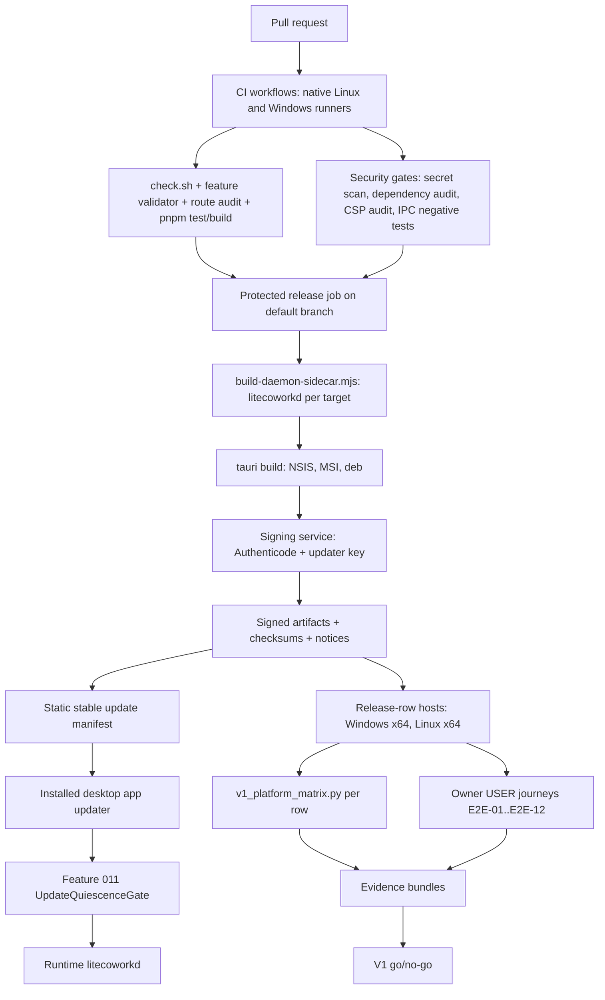

# Feature Specification - Release Engineering and V1 Qualification

- **Feature ID:** 019 | **Status:** IN_REVIEW | **Revision:** 0.1
- **Created / Updated:** 2026-11-09 / 2026-11-09
- **Review state:** authored complete after the owner acceptance of packages 001 to 012 (2026-11-09, [docs/OWNER-ACCEPTANCE-REVIEW-PACKET.md](../../docs/OWNER-ACCEPTANCE-REVIEW-PACKET.md)). This package did not exist when that packet was accepted, so it is IN_REVIEW: nothing here is owner-accepted, and blockers B-43 and B-44 are PROPOSED, pending owner. A passing structural validator is not owner approval.
- **Target:** LiteCowork V1 local desktop release (gate G of [docs/V1-PRODUCT-RELEASE-CONTRACT.md](../../docs/V1-PRODUCT-RELEASE-CONTRACT.md) section 7)
- **Release matrix rows:** Windows 11/10 `x86_64-pc-windows-msvc` + OpenCode v2.0.32 first; Linux x86_64 desktop + OpenCode v2.0.32 second. WSL2 never counts as either row.
- **Owners:** Release Engineering, Security, Desktop Shell (Tauri), Runtime, QA/Accessibility, Product (licensing and sign-off)
- **Dependencies:** Feature 011 (IPC profile, authenticated Runtime stop, update quiescence gate), every V1 package 001 to 020 (for the go/no-go decision), [ACCEPTANCE-AND-E2E-PLAN.md](../../docs/ACCEPTANCE-AND-E2E-PLAN.md), [TESTING.md](../../docs/TESTING.md), [SECURITY.md](../../docs/SECURITY.md), [NETWORK-SECURITY.md](../../docs/NETWORK-SECURITY.md), [BENCHMARKS.md](../../docs/BENCHMARKS.md), [LITECOWORK-BUILD-TASKS.md](../../docs/LITECOWORK-BUILD-TASKS.md) BT-00 and BT-10.5.

## 1. Problem and user outcome

V1 is a local desktop product. Before anyone can install it, the repository needs a reproducible, signed, auditable way to build, test, package, update and qualify the desktop app and its daemon on the exact release rows. Today none of that is owned by a package:

- There is no CI. `.github/` does not exist in the checkout, so `scripts/check.sh`, the feature validator, the served-route audit and the frontend tests only run when someone runs them by hand.
- `apps/litecowork-ui/src-tauri/tauri.conf.json` sets `"targets": "all"`, so the bundle target set is whatever the build host supports, not a declared Windows MSI/NSIS or Linux deb set. `apps/litecowork-ui/scripts/run-tauri.mjs` `tauriBuildArgs` already refuses Linux AppImage ("disabled until the daemon service executable path is persistent") and defaults Linux to `--bundles deb`. There is no signing configuration and no updater plugin (`apps/litecowork-ui/src-tauri/Cargo.toml` has no `tauri-plugin-updater`).
- The repository has no `LICENSE` file and no `license` field in any `Cargo.toml` or `package.json`, while release contract section 1 requires the licensing/packaging implementation decision to be "separately recorded before release".
- Release scripts exist with no owner: `scripts/v1_packaging_check.py`, `scripts/v1_platform_matrix.py`, `scripts/v1_resilience_matrix.py`, `scripts/v1_soak_harness.py`, `scripts/v1_secret_scan.py`. Several of them are not usable on the Windows GA row as written (section 4).
- App-wide accessibility and performance have no qualification owner, and the main JS bundle is 1.05 MB minified with a Vite size warning ([IMPLEMENTATION-STATUS.md](../../docs/IMPLEMENTATION-STATUS.md)).

**Outcome:** an owner can install a signed LiteCowork build on Windows 11/10 x64 (and then Linux x64), update it only when the Runtime proves it is quiescent, and read a release qualification matrix in which every claimed cell links to CODE, SYSTEM and owner USER evidence for that exact row. The V1 release decision is an explicit go/no-go that lists every package's VERIFIED evidence.

## 2. Goals

- G-01 Continuous integration on native Windows x64 and native Linux x64 runners that runs the existing gates (BT-00.2, BT-00.5, BT-00.6) and blocks merges on failure. CI pipeline files are added only through a reviewed pull request.
- G-02 Security hardening as release gates: secret scan of source, binaries, bundles and evidence; dependency advisory and license audit over both Cargo lockfiles and the pnpm lockfile; CSP and Tauri capability audit; IPC peer-identity negative tests on each row.
- G-03 A Windows `x86_64-pc-windows-msvc` installer (NSIS per-user, MSI for managed deployment) that ships the desktop shell and the `litecoworkd` sidecar, with Authenticode signing and timestamping (B-43).
- G-04 A Linux x64 deb (rpm optional) with the existing systemd user unit and signed checksums. AppImage stays disabled, as `run-tauri.mjs` already enforces, until the daemon executable path is persistent.
- G-05 An update channel and updater that refuses to install unless the Feature 011 update quiescence gate returns positive quiescence, verifies update signatures, refuses downgrades and recovers from interrupted installs (B-43).
- G-06 A recorded licensing/packaging decision (B-44) with LICENSE and generated third-party notices in every installer.
- G-07 A release qualification matrix generated per declared row and per E2E journey, never inventing a PASSED cell, and never counting WSL2, a container or CI image as a desktop row.
- G-08 A CODE/SYSTEM/USER evidence bundle process implementing [ACCEPTANCE-AND-E2E-PLAN.md](../../docs/ACCEPTANCE-AND-E2E-PLAN.md) section 6, including the owner USER sign-off record.
- G-09 App-wide accessibility qualification and performance qualification (BENCHMARKS "Desktop responsiveness and mediation overhead", soak, resilience) on both rows.
- G-10 An explicit V1 release go/no-go decision (BT-10.5) that requires every package 001 to 020 to be VERIFIED for the rows it claims.

## 3. Non-goals

No macOS row in V1 (the matrix may list it as UNSUPPORTED); no Microsoft Store or Linux distribution repository publication; no hosted LiteCowork account, licence server or telemetry upload; no bundling of native agent harnesses (OpenCode, Claude Code, Codex stay user-installed, BYOA); no auto-update on the Linux row in V1; no beta or nightly public channel; no change to any package's domain semantics; no cloud Runtime; no crash upload (crash reporting stays local, owned by Feature 018); no claim that a Job Object or cgroup is a sandbox.

## 4. Current state and evidence

| Capability | Current evidence | Limitation |
|---|---|---|
| CI | ABSENT. `.github/` does not exist (verified with `ls -la .github`). | No automated gate; BT-00.2/BT-00.5/BT-00.6 run only by hand. |
| Local gate script | CODE. `scripts/check.sh` pins uv (`.uv-version`), Python (`.python-version`) and Rust 1.98.1 (`rust-toolchain.toml`), then runs fmt, clippy, `cargo test --workspace`, build, Python tests, contract audits with freshness checks, the served-route audit, architecture validation and `git diff --check`. `--preflight` skips Rust. | Does not run `.specify/scripts/validate_feature_package.py`, the frontend tests or build, the secret scan, the packaging check, or anything under the separate `apps/litecowork-ui/src-tauri` Cargo workspace (it declares its own `[workspace]` and `Cargo.lock`). |
| Bundle configuration | CODE. `tauri.conf.json`: identifier `app.litecowork.desktop`, version 0.1.0, `bundle.targets: "all"`, `beforeBuildCommand: "pnpm build && pnpm build:daemon-sidecar"`. `tauri.bundle.conf.json`: `externalBin: ["binaries/litecoworkd"]`. | Targets undeclared; no Windows installer options (install mode, WebView2 mode), no signing, no third-party notices resource. |
| Daemon sidecar build | CODE. `apps/litecowork-ui/scripts/build-daemon-sidecar.mjs` validates the target triple, runs `cargo build --locked --release -p litecoworkd --target <triple>` and copies `litecoworkd-<triple>[.exe]` into `src-tauri/binaries/` with symlink and containment checks. | Unsigned output; no reproducibility check. |
| CSP | CODE. `default-src 'self'; connect-src ipc: http://ipc.localhost; img-src 'self' asset: http://asset.localhost data:; style-src 'self' 'unsafe-inline'; script-src 'self'`. Capability `capabilities/default.json` grants only `core:default`. | No `object-src`, `base-uri`, `frame-ancestors`, `form-action` directives; `style-src 'unsafe-inline'` is unreviewed; no regression test. |
| Updater | ABSENT. No `tauri-plugin-updater` in `src-tauri/Cargo.toml`, no `plugins.updater` in `tauri.conf.json`. `scripts/v1_packaging_check.py` `check_installer_metadata` passes (non-blocking) only because no endpoint is configured. | No update channel or install path; the Feature 011 `UpdateQuiescenceGate` is an accepted target interface, not in source. |
| Packaging check | CODE. `v1_packaging_check.py` checks bundle config, icons (`icon.png`, `icon.ico` exist), daemon `--version`, `backup --help`, `0o700`/`0o600` strings in `runtime.rs`, the systemd unit (`scripts/packaging/systemd/litecoworkd.service`), updater trust and build inputs. | Looks only for `target/release/litecoworkd` (no `.exe`), so it cannot pass on Windows; the permission check is a source-string grep, not a Windows DACL check. |
| Release matrix | CODE. `v1_platform_matrix.py` probes the host, toolchains, 25 agent executables, browsers, secret service, backup, packaging and secret scan; it never reports PASSED for an unprobed cell. | Default `--out` is `implementation/QUALIFICATION-MATRIX.md` and its roster comment cites `implementation/AGENT-PORTFOLIO-2026-10-21.md`, both in the retired `implementation/` tree; rows are OS only (no agent version tuple, no E2E-01..E2E-12 cells); lists macOS aarch64; has no WSL2 detection. |
| Resilience matrix | CODE. `v1_resilience_matrix.py` runs restart-mid-write, kill-during-drain, disk-full, corrupt-blob and stale-lock cases against a Python `sqlite3` store built from `docs/schemas`. | Imports `fcntl`, so it does not run on Windows; it exercises Python `sqlite3`, not the `storage-sqlite` Rust code the daemon ships. |
| Soak harness | CODE. `v1_soak_harness.py` (deterministic seed, bounded duration, WAL checkpoint cadence, `PRAGMA integrity_check`). | Same Python-not-daemon limitation; no daemon RSS/handle/latency measurement; no UI responsiveness. |
| Secret scan | CODE. `v1_secret_scan.py` scans the daemon binary, desktop bundle output, backups and optionally `--source`; it prints redacted previews only. | Not wired into any gate; evidence bundles are not a scan target. |
| IPC peer identity | CODE. `crates/operator-ipc/src/windows.rs` (named pipe; `bind`/`accept`/`connect`), `crates/windows-local-security/src/lib.rs` (`current_logon_sid`, `create_operator_pipe`, `connect_operator_pipe`), Unix peer UID in `crates/operator-ipc/src/unix.rs`. | Qualification of the profiles belongs to Feature 011; release-gate negative tests on the packaged build are not run. |
| Licensing | ABSENT. No `LICENSE`, no license fields, no third-party notices. | Release contract section 1 requirement unmet. |
| Frontend size | Recorded in IMPLEMENTATION-STATUS: main JS 1.05 MB minified / 287 KB gzip, Vite warns over 500 KB. `apps/litecowork-ui/src/App.tsx` is 4,523 lines with no `React.lazy` route splitting. | No performance budget gate. |
| Evidence bundles | ABSENT. ACCEPTANCE section 6 lists fields; no schema, generator or storage rule exists. The c7e9c05 archive matrix records all core journeys BLOCKED. | No reproducible bundle. |

## 5. Decision register

### Inherited LOCKED invariants (canonical owners; not feature approval)

| ID | Invariant | Authority |
|---|---|---|
| L-01 | QUALIFIED requires CODE + SYSTEM + owner USER evidence on the exact OS/build/agent/provider/auth/protocol, including negative and recovery behavior. | ACCEPTANCE-AND-E2E-PLAN sections 1, 7; AGENTS.md section 5 |
| L-02 | WSL2, a container or a CI image is not native Windows or native Linux desktop evidence. | ACCEPTANCE section 7; TESTING "Host qualification checklist (B-28)" |
| L-03 | Desktop update must not proceed without positive quiescence evidence; window close is not Runtime stop. | ACCEPTANCE "Desktop stop/update qualification gate"; RUNTIME-LIFECYCLE; Feature 011 |
| L-04 | Evidence bundles never contain credentials, tokens, SecretLease bytes, private prompts or unredacted user content. | ACCEPTANCE section 6; SECURITY "Secrets" |
| L-05 | No mandatory LiteCowork subscription or hosted account for core local functionality; native sign-in and provider billing stay with the harness. | V1 release contract section 1 |
| L-06 | Do not execute arbitrary model-supplied HTML/JavaScript in the chat WebView; CSP alone is not an isolation boundary. | AGENTS.md section 8; NETWORK-SECURITY "Interactive Artifact renderer" |
| L-07 | Localhost TCP is not an identity boundary; no loopback HTTP/bearer fallback in the desktop client or daemon listener. | NETWORK-SECURITY "Local Operator IPC" |
| L-08 | A unit pass, mocked UI, schema, catalog row, probe or mounted route is not a user-journey qualification. | ACCEPTANCE section 1 |

### FLEXIBLE

| ID | Choice | Allowed options | Constraint |
|---|---|---|---|
| F-01 | CI provider | GitHub Actions hosted runners plus a self-hosted native Windows 11 runner for packaged USER-adjacent jobs | Runners must be native OS; pinned toolchains from committed files; no secrets exposed to fork PRs |
| F-02 | Dependency audit tool | `cargo-deny` (advisories, licenses, bans, sources) or `cargo-audit` plus a license tool | Must cover both `Cargo.lock` files and `apps/litecowork-ui/pnpm-lock.yaml` |
| F-03 | Accessibility audit engine | Existing `apps/litecowork-ui/scripts/check-rendered-ui.mjs` extended, or an added axe-core dev dependency | Automated audit never replaces the screen-reader USER walkthrough |
| F-04 | Evidence storage | Redacted bundle index committed under `docs/release/`; screenshots/video kept in owner-controlled storage referenced by digest | Bundle content passes the secret scan before it is referenced |

### Blocking decisions (PROPOSED, pending owner)

| ID | Topic | Proposed resolution | Consequence |
|---|---|---|---|
| B-43 | Signing identity and update channel | **PROPOSED, pending owner.** (1) Windows: Authenticode-sign the NSIS and MSI installers and every shipped PE (`LiteCowork.exe`, `litecoworkd-x86_64-pc-windows-msvc.exe`) with an organization-validated code-signing certificate whose private key lives only in a cloud HSM signing service (for example Azure Trusted Signing), invoked through Tauri `bundle.windows.signCommand`, with RFC 3161 timestamping. The key never exists on a developer machine, in the repository or in CI logs; only a protected release job on the default branch may sign. Unsigned local builds are labelled `UNSIGNED-DEV` in About and can never be attached to a release. (2) Update channel: one `stable` channel served as a static, signed Tauri updater manifest from a LiteCowork-controlled HTTPS origin pinned in `tauri.conf.json`; update artifacts are signed with a separate Ed25519 Tauri updater key (public key embedded in the app), independent of the Authenticode key so one compromise does not imply the other. (3) The updater checks only on explicit owner action or at most once per 24 h, never installs silently, refuses downgrades and channel changes, and calls the Feature 011 `UpdateQuiescenceGate` before download-to-install; without positive quiescence it does nothing and shows what is running. (4) Linux row in V1: no in-app updater; deb packages are published with SHA-256 checksums signed by the release key, and upgrade is a manual reinstall that preserves user data. (5) Key rotation and revocation are documented in the licensing/packaging decision record before the first signed release. | Without B-43 accepted, T09 (signing), T10 (Linux checksums) and T11/T12 (updater) stay BLOCKED and the release matrix shows install/update cells UNAVAILABLE. |
| B-44 | Licensing and packaging decision (release contract section 1) | **PROPOSED, pending owner.** (1) Record the decision as a new ADR in `docs/adr/` before any release build: LiteCowork Core local functionality ships without a mandatory subscription, account or licence key, and no licence-check network call exists. (2) The repository source licence is chosen by the owner; the proposed default is Apache-2.0 (permissive, patent grant, compatible with the Apache-2.0/MIT reference sources listed in REFERENCE-IMPLEMENTATIONS), added as a root `LICENSE` with matching `license` fields in every `Cargo.toml` and `apps/litecowork-ui/package.json`. Any other choice (for example a source-available licence) must be recorded in the same ADR with its consequences. (3) Third-party notices are generated from `Cargo.lock`, `apps/litecowork-ui/src-tauri/Cargo.lock` and `pnpm-lock.yaml` and bundled as a Tauri resource; a dependency whose licence is outside the reviewed allowlist fails the dependency audit. (4) Packaging: Windows ships an NSIS per-user installer (no elevation; matches the per-user named-pipe DACL and per-user state directory) as the qualified V1 artifact plus an MSI for managed deployment that is built and signed but qualified only after the NSIS row; WebView2 uses the embedded bootstrapper. Linux ships deb (rpm optional); AppImage stays disabled until the daemon service executable path is persistent. `bundle.targets` lists these explicitly instead of `"all"`. (5) No native agent harness, model, or third-party agent binary is bundled; the installer only detects user-installed harnesses. | Without B-44 accepted, T13 is BLOCKED and the go/no-go (T23) is NO-GO by AC-017. |

Neither decision is accepted. The package stays IN_REVIEW until the owner accepts this SPEC and B-43/B-44 (TASKS T01). Acceptance would authorize implementation only; it would not make anything implemented, SERVED, INTEGRATED or QUALIFIED.

## 6. High-level design



### Trust boundaries

1. Pull request code is untrusted until reviewed; fork PRs never receive signing or publishing secrets.
2. The signing service is the only holder of private keys; the release job sends digests or files and receives signatures.
3. The update manifest and artifacts cross the network and are untrusted until the embedded updater public key verifies them.
4. The installed app, the WebView and the daemon keep the existing boundaries: WebView has only `core:default` plus reviewed plugin permissions, and daemon access is through OS-authenticated IPC only.
5. Evidence bundles may contain user content; they are redacted and secret-scanned before they leave the owner's machine.

### Actor sequence: update install (target)

1. Owner opens Settings > Advanced (Feature 011 host) and the `UpdatePanel` (this package) asks the Tauri command `check_for_update`.
2. The Rust updater fetches the pinned HTTPS manifest, verifies its signature, compares versions (downgrade refused) and returns `UpdateAvailable { version, notes_digest }` or `UpToDate`.
3. Owner selects Install. The Rust command `install_update` calls the Feature 011 `check_update_quiescence` command first.
4. `NotQuiescent(reasons)` ends the flow with the reasons shown and a Retry control. `PositiveQuiescence` lets the updater download and verify the artifact.
5. The updater requests the Feature 011 authenticated Runtime stop and waits for STOPPED (the Windows sidecar executable is locked while running), then hands off to the signed installer in passive mode.
6. On next launch the shell starts the new daemon, which runs forward-only migrations; About shows the new version and the update receipt.

### Ownership

| Owner | Responsibility | Excluded |
|---|---|---|
| Release Engineering | CI workflows, release job, bundling targets, signing integration, update manifest publication, matrix and evidence tooling | Domain semantics of any package |
| Security | Secret scan, dependency audit policy, CSP/capability policy, IPC negative tests, key custody review | Implementing IPC (Feature 011) |
| Desktop Shell (Tauri) | Updater plugin and Rust commands, About version display, installer first-run handoff | Runtime quiescence decision (Feature 011) |
| Runtime (Feature 011) | `UpdateQuiescenceGate`, authenticated stop, keep-awake | Update download or install |
| QA/Accessibility | App-wide a11y audit, performance and soak runs, resilience matrix on rows | Fixing defects inside other packages (filed against their owners) |
| Product | Licensing decision, release go/no-go sign-off | Overriding missing evidence |

## 7. Low-level design and interfaces

### 7.1 Existing CODE signatures (verified paths)

- `apps/litecowork-ui/scripts/build-daemon-sidecar.mjs`: `validateTargetTriple(value)`, `parseRustHostTriple(output)`, `parseCargoTargetDirectory(output)`, `resolveTargetTriple(tauriTarget, explicitTarget, hostTarget)`, `daemonSidecarPaths(repositoryRoot, targetTriple, cargoTargetDirectory)`, `daemonBuildArgs(targetTriple)`, `ensureDaemonSidecarDirectory(repositoryRoot)`.
- `scripts/v1_packaging_check.py`: `check_bundle_configuration`, `check_icons`, `check_daemon_binary`, `check_recovery_surface`, `check_state_directory_permissions`, `check_service_manager_unit`, `check_installer_metadata`, `check_desktop_source_build_inputs`, `main(--json)`.
- `scripts/v1_platform_matrix.py`: `AGENT_EXECUTABLES`, `HOSTED_AGENT_PROVIDERS`, `CAPABILITIES`, `SUPPORTED_PLATFORMS`, `Cell(state, command, observation, reason)`, `Evidence`, `probe_host`, `probe_toolchains`, `probe_agents`, `probe_packaging`, `probe_secret_scan`, `render`, `main(--out, --evidence-out, --skip-slow-probes)`.
- `scripts/v1_resilience_matrix.py`: `case_restart_mid_write`, `case_kill_during_drain`, `case_disk_full`, `case_corrupt_blob`, `case_stale_lock`, `run_matrix`, `main(--report)`.
- `scripts/v1_soak_harness.py`: `workload`, `run`, `main(--duration-seconds, --max-iterations, --seed, --restart-every, --checkpoint-every, --state-dir, --report)`.
- `scripts/v1_secret_scan.py`: `EXCLUDED_DIRECTORY_NAMES`, `redact`, `scan_file`, `iter_files`, `main(--source, --extra-path, --json)`.
- `crates/windows-local-security/src/lib.rs`: `current_logon_sid() -> io::Result<LogonSid>`, `create_operator_pipe(..)`, `connect_operator_pipe(..)`, `secure_current_user_directory`, `secure_current_user_file`, `spawn_kill_on_drop_job` (process lifetime only).
- `crates/operator-ipc/src/windows.rs`: `WindowsIpcEndpoint::derive(private_data_dir)`, `bind() -> WindowsIpcListener`, `connect() -> AuthenticatedWindowsConnection`, `WindowsIpcListener::accept()`.
- Feature 011 (accepted target interface, not yet in source): `UpdateQuiescenceGate::check(incarnation) -> PositiveQuiescence | NotQuiescent(reasons)` and the Tauri command `check_update_quiescence`.

### 7.2 Proposed signatures (PROPOSED in design; not in source)

```rust
// apps/litecowork-ui/src-tauri/src/updater_bridge.rs (new)
#[tauri::command]
async fn check_for_update(app: AppHandle) -> Result<UpdateCheckOutcome, UpdateError>;
#[tauri::command]
async fn install_update(app: AppHandle, expected_version: String, request_id: String)
    -> Result<UpdateInstallOutcome, UpdateError>;

enum UpdateCheckOutcome { UpToDate { current: String }, Available { version: String, notes_digest: String, channel: String } }
enum UpdateInstallOutcome { Refused { reasons: Vec<String> }, InProgress { request_id: String }, Handoff { version: String } }
enum UpdateError { ManifestUnreachable, SignatureInvalid, Downgrade, ChannelMismatch, AlreadyInProgress, QuiescenceUnavailable, RuntimeStopFailed, InstallerFailed }
```

```text
scripts/v1_release_matrix_rows.json (new)   declared rows: id, os, arch, build, agent, agent_version, auth_mode, protocol
scripts/v1_evidence_bundle.py (new)         assemble + validate one journey bundle against docs/schemas/release-evidence-bundle.schema.json (new)
scripts/v1_csp_audit.py (new)               parse tauri.conf.json CSP and capabilities; fail on regression
scripts/v1_release_gate.py (new)            go/no-go: read matrix, bundles and package statuses; print GO or NO-GO with reasons
```

`v1_platform_matrix.py` gains `--rows scripts/v1_release_matrix_rows.json`, WSL2 detection (`WSL_DISTRO_NAME`, `/proc/sys/kernel/osrelease` containing `microsoft`) that marks the run `NOT_COUNTED`, and per-row E2E-01..E2E-12 cells. Its default `--out` moves to `docs/release/QUALIFICATION-MATRIX.md` (new).

### 7.3 Request ordering and transaction owner

There is no LiteCowork SQLite transaction in this package. The only durable local state is the update attempt record held by the Tauri shell (`InProgress` request id persisted under the app data directory so a relaunch can tell an interrupted install from a fresh one) and the daemon's own forward-only migration on first start of a new version, which belongs to Storage. The update ordering is fixed: verify manifest, quiescence gate, download, verify artifact, authenticated stop, installer handoff. No step may be reordered and no network call happens while the daemon holds a write transaction.

## 8. Data model and lifecycle

See [DATA-MODEL.md](DATA-MODEL.md). Records: ReleaseRow, QualificationCell, EvidenceBundle, UpdateManifest, UpdateAttempt, SigningRecord, LicensingDecision. Lifecycles: QualificationCell `NOT_RUN -> RUNNING -> PASSED | FAILED | BLOCKED | UNAVAILABLE | NOT_COUNTED`; UpdateAttempt `IDLE -> CHECKING -> AVAILABLE -> GATING -> DOWNLOADING -> STOPPING_RUNTIME -> HANDOFF -> COMPLETED | REFUSED | FAILED`; release decision `OPEN -> NO_GO | GO`.

## 9. Wiring

See [WIRING.yaml](WIRING.yaml). CI calls the existing scripts; the release job calls the sidecar script, `tauri build` and the signing service; the installed app calls the update manifest and the Feature 011 gate; matrix and bundle tools read hosts and write evidence.

## 10. Security, trust and privacy

- Signing keys only in the signing service; release job on protected default branch; required reviewers for workflow changes; fork PRs get no secrets; workflow permissions default to `contents: read`.
- Third-party CI actions are pinned to full commit SHAs, not tags.
- Updater: HTTPS only to one pinned origin; signature verified with the embedded public key before any file is executed; downgrade and channel switch refused; no silent install; quiescence gate before install.
- CSP target adds `object-src 'none'; base-uri 'none'; frame-ancestors 'none'; form-action 'none'` and keeps `script-src 'self'` with no `unsafe-eval`; any `style-src 'unsafe-inline'` retention needs a recorded reason (React inline style props) and a later nonce/hash plan. `frame-src` stays unset (defaults to `'self'`) unless Feature 008 records a reviewed origin list for its preview.
- Tauri capabilities: `core:default` plus only the updater permissions this package needs, each reviewed; no shell, fs or http plugin permission is added for the WebView.
- IPC negative tests: a client running as another OS user, a remote pipe client and a non-owner Unix UID must be rejected before any request frame is parsed.
- Secret scan covers the daemon binary, the bundle output, backups, `--source` and every evidence bundle; findings block release and the report never prints secret bytes.
- Evidence bundles: redacted logs only; screenshots reviewed by the owner before attachment; no private prompts or tokens.

## 11. Errors, edge cases and recovery

See [contracts/errors-recovery.md](contracts/errors-recovery.md). Key cases: CI runner is WSL2 or a container (NOT_COUNTED); flaky host-dependent tests (TESTING B-28 checklist: re-run on the real OS, never mark green from a sandbox); signing service outage (release blocked, never ship unsigned); manifest unreachable (UpToDate is not claimed; show "Could not check"); signature mismatch; downgrade; quiescence UNKNOWN; Runtime stop timeout; installer killed mid-run; migration failure on first start of the new version (daemon reports DEGRADED with a startup blocker and the owner restores from a Feature 017 backup); disk full during download; two update requests at once.

## 12. Configuration and compatibility

- Toolchains pinned by committed files: Rust 1.98.1 (`rust-toolchain.toml`, workspace `rust-version` 1.89 floor), uv and Python (`.uv-version`, `.python-version`), Node `>=22.20.0` with pnpm 12.10.1 (`apps/litecowork-ui/package.json`, `.node-version`).
- Bundle targets: Windows `nsis`, `msi`; Linux `deb` (and optionally `rpm`); `appimage` is refused by `run-tauri.mjs`. Tauri product version and daemon `--version` must match the release tag.
- Windows: Windows 10 22H2 and Windows 11 23H2+ x64; WebView2 Evergreen via embedded bootstrapper; per-user NSIS install under the user profile.
- Linux: x86_64 glibc desktop with WebKitGTK 4.1; systemd user unit optional and enabled only by the owner.
- Update check cadence: on owner action, plus at most once per 24 h when the owner enables automatic checks (default off in V1).
- Performance budgets from BENCHMARKS are design budgets; a miss is reported with p50/p95 and cause, not hidden.

## 13. Observability

Each CI and release run records: commit SHA, dirty status, runner OS/build/arch, toolchain versions, stage durations (already printed by `run_stage` in `scripts/check.sh`), test counts and artifacts digests. The updater records UpdateAttempt transitions with request id, versions and refusal reasons in the local diagnostics log (Feature 018 owns the viewer). The matrix and bundle tools write machine-readable JSON beside the Markdown. No secret bytes, prompts or user content are logged.

## 14. EARS acceptance criteria

- AC-001 WHEN a pull request targets the default branch, THE SYSTEM SHALL run `scripts/check.sh`, `.specify/scripts/validate_feature_package.py`, `scripts/audit_served_routes.py`, `pnpm --dir apps/litecowork-ui test` and `pnpm --dir apps/litecowork-ui run build` on a native Linux x64 runner and the Rust workspace tests on a native Windows x64 runner, and SHALL block merge when any stage fails. Verify: CI run on a PR with an injected failing test.
- AC-002 IF a qualification run executes under WSL2, a container or a CI image, THEN THE SYSTEM SHALL mark that run NOT_COUNTED for every Windows and Linux desktop row and SHALL NOT report any cell PASSED from it. Verify: matrix generator test with simulated WSL2 markers.
- AC-003 WHEN a release candidate is built, THE SYSTEM SHALL run `scripts/v1_secret_scan.py` over the source tree, the daemon binary, the bundle output and every referenced evidence bundle, SHALL block the release on any finding, and SHALL NOT print matched secret bytes. Verify: seeded fake-token fixture in CI.
- AC-004 WHEN dependencies change, THE SYSTEM SHALL audit `Cargo.lock`, `apps/litecowork-ui/src-tauri/Cargo.lock` and `apps/litecowork-ui/pnpm-lock.yaml` for advisories and licences, and IF an advisory or a licence outside the B-44 allowlist has no recorded reviewed exception, THEN THE SYSTEM SHALL fail the gate. Verify: CI dependency-audit job with a pinned vulnerable fixture crate.
- AC-005 WHILE the shipped `tauri.conf.json` is built, THE SYSTEM SHALL enforce a CSP with `script-src 'self'`, no `unsafe-eval`, no remote script origin, `object-src 'none'`, `base-uri 'none'` and `frame-ancestors 'none'`, and capabilities limited to `core:default` plus reviewed plugin permissions, failing the audit on any regression. Verify: `scripts/v1_csp_audit.py` unit tests.
- AC-006 IF a client running as another OS user, a remote named-pipe client or a non-owner Unix UID connects to the packaged daemon endpoint, THEN THE SYSTEM SHALL reject the connection before parsing any request frame. Verify: packaged-build IPC negative test on each row.
- AC-007 WHEN the NSIS installer runs per-user on Windows 11/10 x64, THE SYSTEM SHALL install the desktop shell and `litecoworkd-x86_64-pc-windows-msvc.exe`, register an uninstaller and start first run, and WHEN the owner uninstalls, THE SYSTEM SHALL remove binaries and preserve the user data directory unless the owner explicitly chooses removal. Verify: install/upgrade/uninstall script on a clean Windows VM image plus owner USER run.
- AC-008 WHEN release artifacts are produced, THE SYSTEM SHALL Authenticode-sign and timestamp every shipped PE and installer, and IF any signature is missing or fails `signtool verify /pa`, THEN THE SYSTEM SHALL fail the release job; unsigned local builds SHALL show `UNSIGNED-DEV` in About. Verify: release job signature verification step.
- AC-009 WHEN the owner chooses Install for an available update, THE SYSTEM SHALL call the Feature 011 update quiescence gate first, and IF the gate returns NotQuiescent or is unavailable, THEN THE SYSTEM SHALL NOT download-to-install, SHALL list what is running or unknown and SHALL offer Retry. Verify: updater command tests with a stubbed gate and the packaged stop/update journey.
- AC-010 IF an update manifest or artifact signature fails verification, the offered version is not greater than the installed version, the channel differs from `stable`, or the endpoint is not the pinned HTTPS origin, THEN THE SYSTEM SHALL refuse the update and leave the installed version unchanged. Verify: updater negative tests with tampered fixtures.
- AC-011 IF an update install is interrupted (process kill, power loss or installer failure), THEN on next launch THE SYSTEM SHALL run either the previous version or the completed new version, the daemon database SHALL pass `PRAGMA integrity_check`, and a migration SHALL be either fully applied or not applied. Verify: interrupted-install fault injection on the Windows row.
- AC-012 WHEN the release matrix is generated, THE SYSTEM SHALL emit one row per declared tuple (Windows x64 + OpenCode v2.0.32; Linux x64 + OpenCode v2.0.32) with a cell per E2E-01 to E2E-12 and per capability, and SHALL report PASSED only for a cell observed on that host with linked evidence; every other cell SHALL be NOT_RUN, BLOCKED, UNAVAILABLE or NOT_COUNTED with a reason. Verify: generator unit tests and a real-host run.
- AC-013 WHEN an evidence bundle is assembled, THE SYSTEM SHALL validate it against the release evidence bundle schema (journey id, requirement ids, SHA and dirty status, OS/build/arch, agent/provider versions and protocol, CODE commands, SYSTEM trace, USER links, negative cases, limitations, reviewer, date) and IF a required field is missing or the secret scan reports a finding, THEN THE SYSTEM SHALL reject the bundle. Verify: `scripts/v1_evidence_bundle.py` tests.
- AC-014 WHILE a release row lacks a recorded owner USER sign-off for a journey, THE SYSTEM SHALL keep that journey cell below QUALIFIED for that row. Verify: release gate test.
- AC-015 WHILE the packaged app runs on a release row, THE SYSTEM SHALL make every interactive control on the E2E journey screens keyboard reachable with visible focus and an accessible name, honor reduced motion, report zero serious automated audit violations, and record a Narrator (Windows) or Orca (Linux) walkthrough. Verify: rendered-UI audit plus owner USER walkthrough.
- AC-016 WHEN performance qualification runs on a named hardware profile, THE SYSTEM SHALL report p50/p95 for composer input acknowledgement (budget p95 <= 100 ms), local admission receipt (<= 250 ms), mediation overhead before adapter dispatch (<= 200 ms) and small artifact first paint (<= 1 s), plus a bounded-footprint soak with a passing integrity check, and SHALL report any miss with its cause. Verify: performance and soak reports per row.
- AC-017 IF the licensing/packaging decision record (B-44) is absent, or an installer lacks LICENSE and generated third-party notices, or any native agent harness binary is bundled, THEN THE SYSTEM SHALL fail the release gate. Verify: packaging check extension and installer content listing.
- AC-018 IF two update installs, or a stop and an update, are requested concurrently, THEN THE SYSTEM SHALL let exactly one proceed and return AlreadyInProgress to the other, with no second installer launch. Verify: concurrent command test.
- AC-019 WHEN the Linux deb is installed on Linux x64, THE SYSTEM SHALL install the shell and `litecoworkd`, create the state directory 0700 and database 0600, keep the systemd user unit disabled until the owner enables it, and publish SHA-256 checksums signed by the release key. Verify: Linux install script plus `systemd-analyze verify`.
- AC-020 WHEN the V1 release decision is evaluated, THE SYSTEM SHALL return GO only when every package 001 to 020 is VERIFIED for each row it claims and no claimed matrix cell lacks evidence; otherwise THE SYSTEM SHALL return NO-GO listing each missing package, row and cell. Verify: `scripts/v1_release_gate.py` tests and the owner sign-off record.
- AC-021 WHEN the resilience matrix runs on a release row, THE SYSTEM SHALL execute restart-mid-write, kill-during-WAL, disk-full, corrupt-blob and stale-lock cases natively on that OS against the shipped `storage-sqlite` code and SHALL report a case BLOCKED (not PASSED) when it cannot run. Verify: resilience report per row, including Windows.

## 15. Executable acceptance command

**Canonical feature acceptance command (proposed target; `scripts/v1_release_gate.py` does not exist yet and is created by TASKS T23):**

```bash
uv run --locked python scripts/v1_release_gate.py --rows scripts/v1_release_matrix_rows.json --matrix docs/release/QUALIFICATION-MATRIX.json --strict
```

Supporting commands that exist today: `scripts/check.sh`, `python3 .specify/scripts/validate_feature_package.py`, `uv run --locked python scripts/v1_packaging_check.py --json`, `uv run --locked python scripts/v1_platform_matrix.py --skip-slow-probes`, `uv run --locked python scripts/v1_secret_scan.py --source`. None of them qualifies a row by itself.

## 16. Out-of-bounds paths and side effects

This package is IN_REVIEW and authorizes nothing yet. After owner acceptance, each task in [TASKS.md](TASKS.md) names its allowed paths; anything else is out of bounds for that task. CI workflow files under `.github/workflows/` are added only through a reviewed pull request, never pushed directly to the default branch. Do not sign, publish, upload or create an external resource during design validation. Do not modify other packages' domain code to make a gate pass; file the defect against the owning package. Do not delete or rewrite `archives/`, worktrees or ignored local data. Do not bundle any native agent harness.

## 17. Assumptions and open questions

| ID | Question | Evidence/limitation | Owner | Gate |
|---|---|---|---|---|
| O-01 | Is a self-hosted native Windows 11 runner available for packaged-install jobs, or only hosted `windows-latest` (Windows Server)? | Hosted runners are Windows Server, not Windows 11/10 client; they can run CODE and some SYSTEM jobs but are not the USER row. | Release Engineering | T04 |
| O-02 | Which signing service and certificate type (OV vs EV) for B-43? | SmartScreen reputation differs by certificate type; key custody must be HSM-backed. | Product/Security | B-43 / T09 |
| O-03 | Source licence choice for B-44. | No LICENSE exists; Apache-2.0 proposed. | Product (owner) | B-44 / T13 |
| O-04 | Does Feature 008 need an iframe origin for its preview, which would require a `frame-src` entry? | Current CSP has no `frame-src`; preview is iframe-based per the gap analysis. | Security with Feature 008 | T06 |
| O-05 | Named hardware profiles for performance budgets. | BENCHMARKS requires a named supported profile. | QA | T17 |
| O-06 | Should the Python store harnesses be retired once Rust equivalents exist? | Python harness measures Python `sqlite3`, not the daemon. | QA/Storage | T18 |

## 18. Requirement traceability

| Requirement | Canonical owner | Task | Acceptance |
|---|---|---|---|
| Owner acceptance of SPEC, B-43, B-44 | SPECIFICATION-STANDARD section 7 | 019-T01 | AC-017 / AC-020 |
| Promote release contracts (evidence schema, rows, ADR, TESTING/SECURITY/ACCEPTANCE edits) | ACCEPTANCE-AND-E2E-PLAN, TESTING, SECURITY, docs/schemas | 019-T02 | AC-012 / AC-013 |
| CI skeleton on native Linux | BT-00.2, BT-00.5, BT-00.6 | 019-T03 | AC-001 |
| Native Windows CI runner | B-28 rider, TESTING B-28 checklist | 019-T04 | AC-001 / AC-002 |
| Secret scan and dependency audit gates | SECURITY, NETWORK-SECURITY | 019-T05 | AC-003 / AC-004 |
| CSP and capability hardening | NETWORK-SECURITY, PRESENTATION-RUNTIME | 019-T06 | AC-005 |
| IPC negative release tests | LOCAL-OPERATOR-IPC, Feature 011 | 019-T07 | AC-006 |
| Windows installer | V1 release contract Area 10 | 019-T08 | AC-007 |
| Windows code signing | B-43 | 019-T09 | AC-008 |
| Linux packages | B-28 second row | 019-T10 | AC-019 |
| Updater gated on quiescence | B-43, RUNTIME-LIFECYCLE, Feature 011 | 019-T11 | AC-009 / AC-010 / AC-011 / AC-018 |
| Update UI states | V1-UI-SCREEN-CONTRACT, Feature 011 Advanced tab | 019-T12 | AC-009 / AC-015 |
| Licensing/packaging decision and notices | V1 release contract section 1, B-44 | 019-T13 | AC-017 |
| Release qualification matrix | ACCEPTANCE section 7 | 019-T14 | AC-002 / AC-012 |
| Evidence bundle process and USER sign-off | ACCEPTANCE sections 2, 6 | 019-T15 | AC-013 / AC-014 |
| App-wide accessibility qualification | V1 release contract Area 10, BT-10.4 | 019-T16 | AC-015 |
| Performance and soak qualification | BENCHMARKS | 019-T17 | AC-016 |
| Resilience matrix on both rows | TESTING fault injection, ACCEPTANCE section 5 | 019-T18 | AC-021 / AC-011 |
| Desktop stop/update gate journey | ACCEPTANCE stop/update gate | 019-T19 | AC-009 / AC-018 |
| Cross-layer trace | AGENTS.md section 4 | 019-T20 | AC-007 / AC-009 |
| Documentation sync | IMPLEMENTATION-STATUS, BUILD-TASKS | 019-T21 | AC-012 |
| Package VERIFIED | SPECIFICATION-STANDARD lifecycle | 019-T22 | AC-001 to AC-021 (AC-001, AC-002, AC-003, AC-004, AC-005, AC-006, AC-007, AC-008, AC-009, AC-010, AC-011, AC-012, AC-013, AC-014, AC-015, AC-016, AC-017, AC-018, AC-019, AC-020, AC-021) |
| V1 release go/no-go | V1 release contract section 7 gate G, BT-10.5 | 019-T23 | AC-020 / AC-014 |
