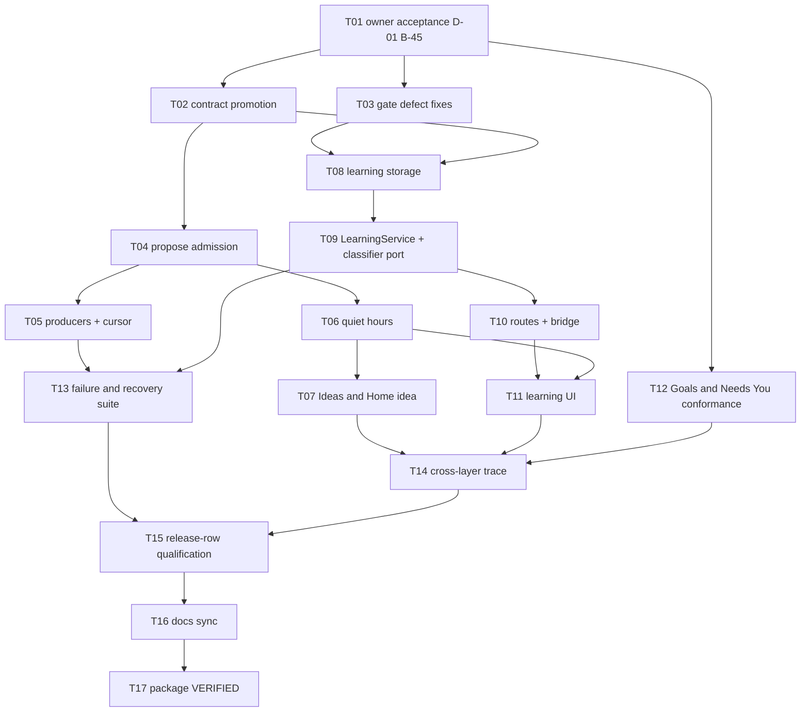

# Implementation Plan - Proactivity and Quiet Learning

**Feature:** 020 | **Spec:** SPEC.md revision 0.1
**Status:** IN_REVIEW - not owner-accepted; authorizes no implementation; not a claim of implementation or qualification.
**Updated:** 2026-11-09
**Rule:** the authoritative ordered work list is [TASKS.md](TASKS.md) (T01 to T17). This plan is the summary view.

## 1. Delivery strategy

Two tracks share one owner. The Suggestion track adopts the served Ideas, Goals and Needs You surfaces, adds the missing `propose` admission and two deterministic producers, and applies quiet hours; it needs only owner acceptance of the SPEC and D-01. The learning track fixes the pure gates, adds storage, the service, routes and UI, and needs B-45 plus Feature 009's Coworker-owned Conversations. Both stay off the Send path. This package is Wave 4 (gate E) in the V1 delivery waves; the gate fixes (T03) and the Goals/Needs You conformance tests (T12) can land earlier because they change no behavior visible to users.

## 2. Dependency graph

## 3. Phases and exit gates

| Phase | Tasks | Outcome | Exit gate |
|---|---|---|---|
| A - acceptance and promotion | T01, T02 | D-01 and B-45 decided; routes, events, errors, tables and the learning journey promoted | Owner record; schema and migration tests |
| B - safe groundwork | T03, T12 | Gate defects fixed; Goals and Needs You conformance tests | Regression tests pass |
| C - Suggestions | T04, T05, T06, T07 | Real proposals, budgets, quiet hours, complete Ideas UI | Outcome, race and quiet-hours tests |
| D - learning core | T08, T09 | Candidate storage, service, in-transaction recheck | Race, eligibility and outage tests |
| E - learning surface | T10, T11 | Routes, bridge, review list, notice, policy, memory | Route negative tests; UI state and a11y tests |
| F - recovery and trace | T13, T14 | Canonical integration target; traces | Crash-window tests; complete trace rows |
| G - qualification and closure | T15, T16, T17 | Both release rows with USER sign-off; docs; VERIFIED | Evidence bundles; validator |

## 4. Scope and file ownership (candidate paths, re-inspect before implementation)

| Area | Paths | Owner | Guardrail |
|---|---|---|---|
| Suggestion domain/storage | `crates/domain-responsibility/src/suggestions.rs`, `crates/storage-sqlite/src/suggestions.rs` | Responsibility, Storage | One admission transaction; no candidate text on suppression |
| Producers | `apps/litecoworkd/src/suggestion_producers.rs`, `suggestion_producer_worker.rs` (new) | Responsibility | Deterministic; committed state only |
| Learning gates | `crates/storage-core/src/coworker_learning.rs` | Responsibility, Security | Never widen eligibility |
| Learning service/storage | `crates/domain-responsibility/src/learning.rs`, `crates/storage-sqlite/src/learning.rs` (new) | Responsibility, Storage | Resource-backed payloads; recheck in transaction |
| Learning routes/bridge | `apps/litecoworkd/src/learning_operator.rs`, `apps/litecowork-ui/src-tauri/src/learning_bridge.rs` (new) | Operator/API | Idempotency, If-Match, no-store |
| UI | `apps/litecowork-ui/src/suggestions/`, `apps/litecowork-ui/src/learning/` (new), named slots in `App.tsx`, `ConversationsPage.tsx`, `CoworkerSettings.tsx`, `HomeCoworkerOnboarding.tsx` | Desktop UI | No authority logic in the WebView |

## 5. Migrations

One forward-only migration (next free `sqlite-vNN.sql`, promoted in T02) adds `learning_candidates`, `coworker_learning_policies`, `memory_records`, `learning_work_items` and `suggestion_producer_cursors`, plus a partial index on `suggestions(workspace_id, proposed_by, created_at)`. Existing Coworkers get no policy row, which reads as REVIEW_ALL (AC-021). No existing table changes shape.

## 6. Rollout

1. Land T03 and T12 (no user-visible change).
2. Enable producers behind a Runtime setting default on for new Workspaces only after T04 to T07 pass; existing Workspaces see the first proposals only after the owner opens Ideas once (no surprise push).
3. Ship learning with REVIEW_ALL for existing Coworkers and the onboarding choice for new ones (B-45 item 4).
4. Enable the optional extractor only per Coworker by explicit owner choice.

## 7. Risks

| Risk | Mitigation |
|---|---|
| Proposals feel noisy | Budgets, mute per kind, 30-day cooldown, projection limits, quiet hours |
| Extractor cost on user quota | Opt-in, rate limits, deterministic owner actions first |
| Prompt-injected "remember this" | Channel eligibility enforced in code; verbatim-span check; third-party channels rejected |
| Feature 009 Coworker Conversations slip | Learning stays visibly unavailable; Suggestion track ships independently |
| English-only CONFIRMED lexicon | Other locales go to review, never auto-commit |
