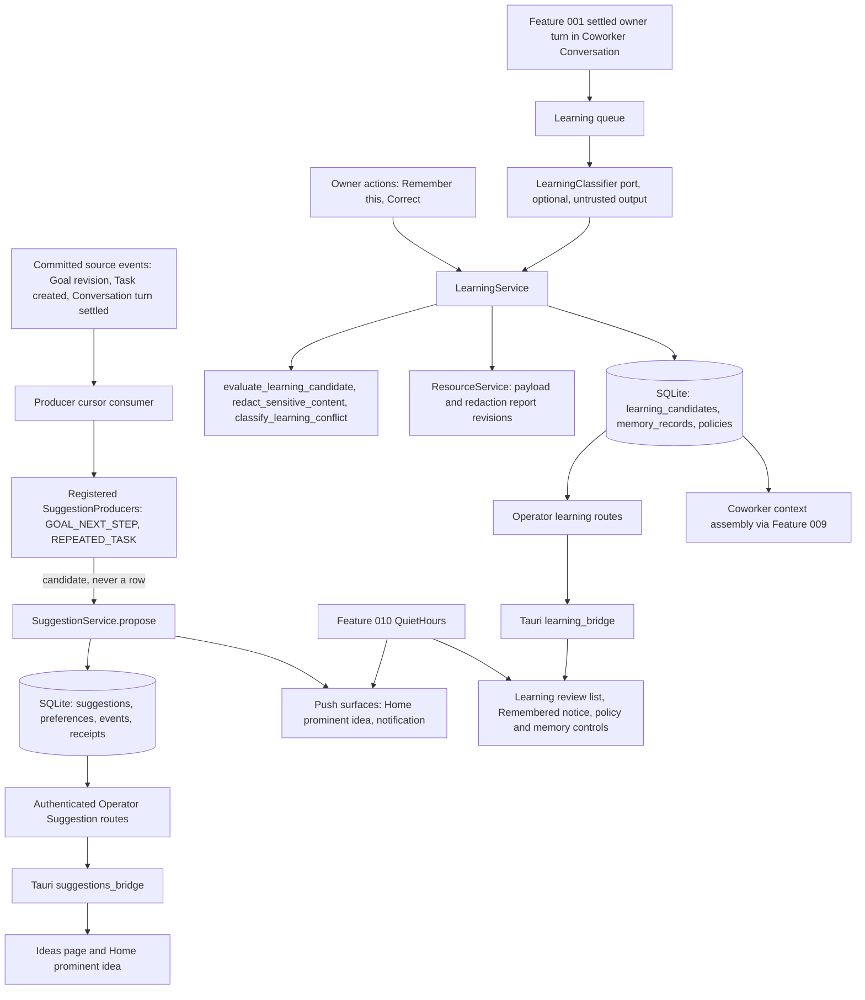

# Feature Specification - Proactivity and Quiet Learning

- **Feature ID:** 020 | **Status:** IN_REVIEW | **Revision:** 0.1
- **Created / Updated:** 2026-11-09 / 2026-11-09
- **Review state:** authored complete after the owner acceptance of packages 001 to 012 (2026-11-09, [docs/OWNER-ACCEPTANCE-REVIEW-PACKET.md](../../docs/OWNER-ACCEPTANCE-REVIEW-PACKET.md)). This package did not exist when that packet was accepted, so it is IN_REVIEW: blocker B-45 is PROPOSED, pending owner. A passing structural validator is not owner approval. It uses the A-20/A-34 `LearningCandidate` vocabulary that the owner accepted as written on 2026-11-09 and does not reintroduce the superseded `MemoryCandidate` state set.
- **Target:** LiteCowork V1, Area 7 "bounded proactive suggestions", Area 8 "quiet eligible learning only within accepted policy", gate E (learning half).
- **Release matrix rows:** Windows 11/10 x64 + OpenCode v2.0.32 first; Linux x64 + OpenCode v2.0.32 second.
- **Owners:** Responsibility domain (Suggestions, Goals, learning), Coworker, Storage, Operator/API, Desktop UI, Security/Trust, Product.
- **Dependencies:** Feature 009 (Coworker-owned Conversations, COWORKER_NOTES re-widen, Coworker memory surface), Feature 010 (quiet hours, notification delivery), Feature 005 (Task admission after a TASK Suggestion is accepted), Feature 003 (Resource revisions for payloads and source refs), Feature 001 (settled turns as learning checkpoints), Feature 011 (Settings shell). Owner docs: [RESPONSIBILITIES.md](../../docs/RESPONSIBILITIES.md), [LEARNING.md](../../docs/LEARNING.md), [ADR-0016](../../docs/adr/0016-coworker-goal-and-suggestion-authority-boundary.md), [ADR-0023](../../docs/adr/0023-host-guidance-is-not-capability-authority.md), [ADR-0024](../../docs/adr/0024-optional-chat-first-coworkers.md).

## 1. Problem and user outcome

LiteCowork already serves Suggestions ("Ideas"), Goals and the Needs You inbox, but no package owns them, nothing produces a Suggestion, and learning exists only as pure functions with no caller:

- `apps/litecoworkd/src/suggestions_operator.rs` mounts list, resolve, accept-task, snooze and preference routes. The domain file `crates/domain-responsibility/src/suggestions.rs` says "proposal production remains separate", and no production code inserts a row into `suggestions`. The Ideas page is therefore always empty in a real install.
- `goal_operator.rs` serves passive, revisioned Goals ("Goal commands record intent and references only; they never schedule work"). `needs_you_operator.rs` serves a read-only, no-store Needs You projection over Approval, UserRequest and TaskBlocker rows.
- `crates/storage-core/src/coworker_learning.rs` (1,711 lines, 30 tests) implements source eligibility, redaction, conflict classification, the candidate state machine and event payload shape, but has no production caller, no storage, no service, no route and no UI (LEARNING.md "Current implementation checkpoint"). Feature 009 defers automatic learning (B-24) and names this package as the owner of the `LearningCandidate` pipeline.

**Outcome:** a user sees a few relevant, explained ideas that never act on their own, can mute or snooze them, and is not interrupted during quiet hours. A Coworker remembers the user's explicit, low-risk private preferences without a modal, shows a subtle "Remembered" notice with Undo, sends anything riskier to a review list, and never learns from third-party or model content.

## 2. Goals

- G-01 Take ownership of the served Suggestions, Goals and Needs You surfaces and keep their existing guarantees under test.
- G-02 Implement `SuggestionService.propose` and a registry of deterministic `SuggestionProducer`s with mute, cooldown, dedupe, expiry, source visibility and per-Workspace budgets in one admission transaction.
- G-03 Bound proactivity: projection limits (one prominent Home idea, three in the drawer), producer budgets, and Feature 010 quiet hours for every push surface.
- G-04 Implement the `LearningCandidate` pipeline: candidate persistence with Resource-backed payloads, the existing deterministic gates, an in-transaction recheck, quiet auto-commit of eligible Coworker-private memory, and a review path for everything else (B-45).
- G-05 Learning review list, "Remembered" notice with View/Undo/Correct, learning policy control and memory revoke, all accessible.
- G-06 Failure isolation: learning and producers never block Conversation Send, Task completion or Suggestion listing.
- G-07 Qualify on both release rows with CODE, SYSTEM and owner USER evidence, including denial and recovery.

## 3. Non-goals

No autonomous background agent that polls or plans; no Suggestion that executes, schedules, grants, installs or sends; no learning from TEMPORARY Conversations, plain (non-Coworker) Conversations, third-party messages, imported documents, web content, tool descriptions, model or worker output, or connector events; no automatic Instruction, Skill, Routine, Automation or permission change; no shared or Workspace-scope learned memory; no `AUTO_CONFIRMED_AND_LOW_RISK_INFERRED_PRIVATE` mode in V1; no embeddings or vector store; no editing of native harness memory or configuration; no second scheduler (Feature 010 owns triggers); no new crate tree such as `crates/domain-learning/` (LEARNING.md section 23).

## 4. Current state and evidence

| Capability | Current evidence | Limitation |
|---|---|---|
| Suggestion routes | SERVED. `suggestions_operator.rs` `routes()`: `GET /v1/suggestions`, `POST /v1/suggestions/{id}/resolve`, `/accept-task`, `/snooze`, `GET /v1/workspaces/{id}/suggestion-preferences`, `PUT .../{kind}`. Listing first runs bounded `SuggestionService::settle_expired` (batch limit `SUGGESTION_EXPIRY_BATCH_LIMIT` = 100). In served-route inventory. | No producer, so no rows exist outside tests. |
| Suggestion domain and storage | CODE. `crates/domain-responsibility/src/suggestions.rs`: `Suggestion`, `SuggestionKind` (TASK_OPPORTUNITY, ROUTINE_OPPORTUNITY, AUTOMATION_OPPORTUNITY), `SuggestionAction`, `SuggestionStatus` (PROPOSED, ACCEPTED, DISMISSED, EXPIRED), `SuggestionService::{settle_expired, owner_action, kind_preferences, set_kind_preference}`. `crates/storage-sqlite/src/suggestions.rs`: `SqliteSuggestionStore` list/get, preference store, `SuggestionExpiryStore`, `SuggestionOwnerActionStore`, and `SuggestionTaskAcceptanceStore::create_task_from_suggestion` (atomic READY Task + ACCEPTED Suggestion). Schema `sqlite-v1.sql`: `suggestions` with `uq_suggestions_open_dedupe` (one PROPOSED per Workspace/dedupe key), dismissal cooldown index, `suggestion_preferences`. Events `suggestion.proposed.v1`, `.resolved.v1`, `.visibility.changed.v1`, `.preference.changed.v1` exist in `docs/schemas/domain-event.schema.json`. | No `propose` method, no `SuggestionProducer`, `suggestion.proposed.v1` has no producer. |
| Suggestion bridge and UI | CODE. `apps/litecowork-ui/src-tauri/src/suggestions_bridge.rs`: `list_suggestions`, `suggestion_owner_action` (dismiss, snooze, unsnooze), `accept_suggestion_task`, `list_suggestion_preferences`, `set_suggestion_preference`, registered in `lib.rs`. `apps/litecowork-ui/src/suggestions/SuggestionsPage.tsx` (Ideas page) with visibility tabs, preference mute controls, unresolved-mutation recovery and a polite live region. Tests: `tests/desktop-suggestion-api.test.ts`, `tests/suggestion-request-scope.test.ts`. | Home prominent idea and Ideas drawer limits are documented but not verified; no quiet-hours behavior. |
| Goals | SERVED. `goal_operator.rs`: `GET/POST /v1/goals`, `GET /v1/goals/{id}`, `POST .../revisions`, `POST .../status`; `GoalService`, `GoalProgressProjection` with `verified_task_count`, `linked_task_count`; UI `apps/litecowork-ui/src/goals/GoalsPage.tsx`. | No package owner; no negative test that Goal commands create no Task or schedule. |
| Needs You | SERVED. `needs_you_operator.rs` `GET /v1/needs-you` with `Cache-Control: no-store`; kinds `APPROVAL`, `USER_REQUEST`, `TASK_BLOCKER` (`crates/storage-core/src/needs_you.rs`); UI `apps/litecowork-ui/src/needs-you/TaskAttentionPage.tsx`; tests `apps/litecoworkd/src/needs_you_operator_tests.rs` and UI `needs-you-*` tests. | No package owner. |
| Learning gates | CODE, no caller. `crates/storage-core/src/coworker_learning.rs`: `LearningCandidate`, `LearningCandidateKind`, `LearningSourceKind`, `LearningSourceChannel`, `LearningCandidateState`, `CoworkerLearningPolicy::{default_for_coworker, allows_certainty}`, `evaluate_learning_candidate`, `classify_learning_conflict`, `redact_sensitive_content`, `learning_candidate_event_payload`. `redact_sensitive_content` is reused by `crates/storage-core/src/skill.rs`. | No persistence, service, classifier, route, event producer or UI. Defects found while reading (section 7.1). |
| Quiet hours | CODE in Feature 010 domain. `crates/domain-responsibility/src/notifications.rs` `QuietHours::{parse, contains}`; stored per Workspace and event class in `notification_preferences.quiet_hours_json`. `NotificationEventClass` has only Automation, Task and Dependency classes. | No Suggestion or learning event class; quiet-hours editor is owned by Feature 010 and not built (register A-28/A-35). |
| Coworker status | CODE. `CoworkerStatus` Active, Paused, Archived (`crates/domain-responsibility/src/models.rs`); Suggestion owner actions reject an ARCHIVED Coworker head (`suggestions_operator.rs` line 728). | Paused Coworker does not fence producers or learning yet. |

## 5. Decision register

### Inherited LOCKED invariants (canonical owners; not feature approval)

| ID | Invariant | Authority |
|---|---|---|
| L-01 | Coworkers, Goals and Suggestions do not own execution. Suggestions require explicit user action; Goals never schedule or complete work. | ADR-0016 |
| L-02 | A Suggestion never silently executes, schedules, authorizes, installs a package or sends a message. Accepting TASK creates one READY Task atomically; editor actions persist nothing until the owner saves through the Routine/Automation service. | RESPONSIBILITIES "Suggestions" |
| L-03 | Suggestion candidates come only from registered SuggestionProducers; a producer cannot commit a Suggestion; suppressed candidates create no durable row and retain no candidate text. | RESPONSIBILITIES "Operator API and services" |
| L-04 | Memory, Instruction, Skill, Routine, Automation and Permission are separate; a change in one never silently changes another. Only a narrowly qualified Coworker-private memory may commit automatically. | LEARNING sections 1, 2, 6 |
| L-05 | The single candidate vocabulary is `LearningCandidate` (NEW, CLASSIFIED, NEEDS_REVIEW, AUTO_COMMIT_ELIGIBLE, COMMITTED, DISMISSED, REJECTED, SUPERSEDED); `MemoryRecordMetadata.status` (ACTIVE, SUPERSEDED, REVOKED, PURGE_PENDING) is the committed-record lifecycle. | LEARNING vocabulary note (A-20/A-34, accepted 2026-11-09) |
| L-06 | Event payloads carry identifiers, digests, reason codes and bounded metadata, never candidate text. | LEARNING sections 3, 19 |
| L-07 | TEMPORARY Conversations never learn; third-party, imported, web, tool, model, worker and connector content cannot create memory. | LEARNING sections 4, 16 |
| L-08 | A Coworker memory change cannot grant permissions, add a Connection, install a package or enable a schedule. | V1 release contract section 6.4; ADR-0024 item 6 |
| L-09 | Host guidance is not capability authority; a learned instruction never becomes a HostSkill or grant. | ADR-0023 |
| L-10 | Learning outage must not fail ordinary Conversation or Task completion; the chat path never waits on learning. | LEARNING sections 21, 22 |

### FLEXIBLE

| ID | Choice | Allowed options | Constraint |
|---|---|---|---|
| F-01 | Producer trigger | Event-journal cursor consumer after commit, or synchronous hook after the source commit | Never inside the source transaction; restart-safe cursor |
| F-02 | Learning worker shape | Bounded Tokio task with a durable queue table, or poll of NEW candidates | Finite batch; never on Send path |
| F-03 | Payload storage | Coworker-scoped ContextDocument Resource revision (Feature 009 COWORKER_NOTES) or a dedicated Resource kind | Resource-backed; same purge/revoke semantics |
| F-04 | Module location of the pure gates | Keep in `crates/storage-core/src/coworker_learning.rs`, or move to `crates/domain-responsibility/src/learning_gates.rs` with a re-export | One canonical definition; no `domain-learning` crate |

### PROPOSED design decision accepted with this package (D-01)

**D-01 First Suggestion producers (PROPOSED, accepted only with T01).** Two deterministic producers, no model call: (1) `GOAL_NEXT_STEP`: an ACTIVE Goal revision with zero nonterminal linked Tasks for 7 days proposes a `TASK_OPPORTUNITY` whose `proposed_task_spec` copies only owner-authored Goal revision text and pins the Goal revision; (2) `REPEATED_TASK`: three or more owner-created Tasks in 14 days with the same normalized intent digest propose an `AUTOMATION_OPPORTUNITY` with action `OPEN_AUTOMATION_EDITOR`. Budgets: each producer at most 3 new Suggestions per Workspace per 24 h; at most 20 PROPOSED Suggestions per Workspace; default expiry 7 days, maximum 30 days.

### Blocking decision (PROPOSED, pending owner)

| ID | Topic | Proposed resolution | Consequence |
|---|---|---|---|
| B-45 | First learning source and auto-commit eligibility policy | **PROPOSED, pending owner.** (1) **First source:** committed owner USER messages (channel `OWNER_MESSAGE`, source kind `USER_EXPLICIT`) and owner feedback actions (channel `OWNER_FEEDBACK`, kinds `USER_FEEDBACK`/`USER_CORRECTION`) in NORMAL Conversations owned by an ACTIVE Coworker (Feature 009 Coworker-owned Conversation admission). Plain Conversations without a Coworker, TEMPORARY Conversations and every other channel are ineligible in V1; `TASK_OUTCOME`, `REPEATED_PATTERN` and `DEMONSTRATION` sources are not enabled in V1. (2) **Candidate creation:** (a) deterministic owner actions first: "Remember this" on the owner's own message and "Correct" on a Remembered notice create a CONFIRMED candidate whose payload the owner sees before saving; (b) optional quiet extraction second, behind a `LearningClassifier` port, run only when the owner enabled it, at most once per settled turn and batched at most once per 5 minutes per Coworker, after the turn commit and never on the Send path. Extractor output is untrusted `MODEL_OUTPUT` that only proposes payloads. A proposed memory is CONFIRMED only when its cited span is a verbatim substring of the committed owner message and matches the explicit first-person statement lexicon (English only in V1, for example "remember that", "I prefer", "please always"); otherwise it is INFERRED and goes to NEEDS_REVIEW. (3) **Auto-commit eligibility:** only `MEMORY_FACT` or `MEMORY_PREFERENCE`, certainty CONFIRMED, sensitivity LOW, scope COWORKER_PRIVATE, clean redaction, no Trust or label exclusion, and conflict None, Supports or Supersedes-inferred, under policy `AUTO_CONFIRMED_PRIVATE`; Duplicate dedupes; Conflicting goes to NEEDS_REVIEW. Every other kind always goes to NEEDS_REVIEW. `AUTO_CONFIRMED_AND_LOW_RISK_INFERRED_PRIVATE` is not offered in V1: the UI hides it and the API rejects it with a typed error. (4) **Default policy:** a Coworker created after this feature ships shows the LEARNING section 4 explanation at onboarding with REVIEW_ALL, OFF and AUTO_CONFIRMED_PRIVATE; AUTO_CONFIRMED_PRIVATE is preselected only after the explanation is shown. Coworkers that existed before get REVIEW_ALL, so nothing starts learning silently. (5) **Notices:** commit notices follow `notify_on_memory_commit` (default IMPORTANT_ONLY) and Feature 010 quiet hours. (6) **Gate fix before first use:** the deterministic gate must stop accepting `USER_EXPLICIT` from the `VERIFIED_TASK_OUTCOME` channel (section 7.1). | Until B-45 is accepted, T08 to T11 are BLOCKED and the learning UI stays visibly "Learning is not available in this build" (the current Coworker Settings disclosure). Suggestion work (T03 to T07) can proceed after T01 accepts the SPEC and D-01. |

The package stays IN_REVIEW until the owner accepts this SPEC, D-01 and B-45 (TASKS T01). Acceptance would authorize implementation only.

## 6. High-level design



### Trust boundaries

1. Source content (Conversation text, Goal text, Task titles) is untrusted input to producers and extractors; it cannot grant authority.
2. Producers and the extractor are inside the daemon but produce candidates only; SuggestionService and LearningService are the only writers.
3. Extractor output from the native harness crosses the provider boundary and is treated as `MODEL_OUTPUT`: never trusted for certainty or eligibility without the deterministic checks.
4. The WebView renders projections and sends typed owner commands only through Tauri bridges; it never chooses URLs, Workspace authority or principal.

### Actor sequence: quiet memory commit (target)

1. Owner sends "Please remember that I prefer one-page weekly summaries" in a NORMAL Conversation owned by an ACTIVE Coworker; Feature 001 settles the turn.
2. After the settle commit, the learning queue records one work item (turn id, Coworker id, policy revision). Send returned long before this.
3. The worker runs the extractor (if enabled) or picks up a "Remember this" owner action; it writes the payload and redaction report as Resource revisions, then commits a NEW candidate with `learning.candidate.created.v1`.
4. The worker calls `evaluate_learning_candidate` with the current policy, channel `OWNER_MESSAGE`, redaction report and current memories.
5. For `AutoCommit`, one SQLite IMMEDIATE transaction re-reads candidate version, policy revision, source message existence, Coworker status and current memory; if all match, it inserts the MemoryRecord (ACTIVE), moves the candidate to COMMITTED and appends `learning.memory.committed.v1`. Any mismatch moves the candidate to NEEDS_REVIEW or SUPERSEDED.
6. If `notify_on_memory_commit` allows and quiet hours are not active, the Conversation shows "Remembered: You prefer weekly reports as a one-page summary. [View]". During quiet hours the notice waits for the next owner view.

### Ownership

| Owner | Responsibility | Excluded |
|---|---|---|
| SuggestionService (`domain-responsibility`) | propose, expiry, owner actions, preferences, budgets | Producing candidates; Task execution |
| SuggestionProducer registry (`litecoworkd`) | Deterministic candidate rules over committed state | Writing Suggestions; model calls |
| LearningService (`domain-responsibility`, new module) | Candidate lifecycle, gate evaluation, in-transaction recheck, commit/review/revoke | Classifying free text; Trust grants |
| LearningClassifier port | Propose payloads from an owner message | Certainty, eligibility, commit |
| Storage (`storage-sqlite`) | Transactions, CAS, idempotency receipts, events | External calls |
| ResourceService (Feature 003) | Payload and redaction report revisions, purge | Learning decisions |
| Feature 009 | Coworker-owned Conversations, COWORKER_NOTES ContextDocument, Coworker Memory view host | Learned-memory decisions |
| Feature 010 | QuietHours contract, notification event classes and delivery | Suggestion or learning semantics |
| Desktop UI | Ideas, Home prominent idea, Learning review list, Remembered notice, policy control | Authority or eligibility logic |

## 7. Low-level design and interfaces

### 7.1 Existing CODE signatures (verified)

```rust
// crates/domain-responsibility/src/suggestions.rs
pub struct SuggestionService<S, C> { /* store, clock */ }
impl<S, C> SuggestionService<S, C> {
    pub fn new(store: S, clock: C) -> Self;
    pub fn settle_expired(/* workspace scope, limit */);
    pub fn owner_action(/* id, SuggestionOwnerAction, expected_version, request_id */);
    pub fn kind_preferences(/* workspace */);
    pub fn set_kind_preference(/* workspace, kind, muted, expected_version, request_id */);
}
pub trait SuggestionExpiryStore; pub trait SuggestionOwnerActionStore; pub trait SuggestionPreferenceStore;
pub const SUGGESTION_EXPIRY_BATCH_LIMIT: usize = 100;
pub const SUGGESTION_SERVICE_PRINCIPAL_ID: &str = "service:suggestion-service";

// crates/storage-core/src/coworker_learning.rs
pub fn evaluate_learning_candidate(candidate: &LearningCandidate, context: &LearningEvaluationContext) -> LearningEvaluation;
pub fn classify_learning_conflict(/* payload, current memories */) -> LearningConflict;
pub fn redact_sensitive_content(body: &str) -> RedactionReport;
pub fn learning_candidate_event_payload(candidate: &LearningCandidate, evaluation: &LearningEvaluation) -> Value;
pub const LEARNING_PAYLOAD_PREVIEW_MAX_BYTES: usize = 16 * 1024;
impl CoworkerLearningPolicy { pub fn default_for_coworker(coworker_id: &str, created_at: &str) -> Self; pub fn allows_certainty(&self, certainty: LearningCertainty) -> bool; }

// crates/domain-responsibility/src/notifications.rs (Feature 010 domain)
impl QuietHours { pub fn parse(value: &serde_json::Value) -> Result<Self, DomainError>; pub fn contains(&self, now_epoch_ms: i64) -> Result<bool, DomainError>; }
```

Defects found in the gates (fixed by TASKS T03 before any caller exists):

- `source_kind_matches_channel` accepts `LearningSourceKind::UserExplicit` from `LearningSourceChannel::VerifiedTaskOutcome`. Because the default policy lists `USER_EXPLICIT` as eligible and deliberately omits `TASK_OUTCOME`, a Task-outcome candidate labelled `USER_EXPLICIT` passes the source-kind check that LEARNING section 16 intends to close. The mapping must be one kind per channel.
- `LearningSourceChannel::permitted_source_kind` has no caller and maps every untrusted channel to `UserExplicit`, the most privileged kind. Remove it or return `Option<LearningSourceKind>` with `None` for untrusted channels.
- `learning_candidate_event_payload` writes `"disposition": format!("{:?}", evaluation.disposition)`, so the wire value depends on Rust `Debug` formatting (`AutoCommit`, not a SCREAMING_SNAKE_CASE token). Add `LearningDisposition::as_str` and use it before the event schema is promoted.

### 7.2 Proposed signatures (PROPOSED in design; not in source)

```rust
// crates/domain-responsibility/src/suggestions.rs (extend)
pub struct SuggestionCandidate {
    pub workspace_id: String, pub coworker_id: Option<String>, pub producer: SuggestionServiceRef,
    pub proposed_action: SuggestionAction, pub reason: String,           // bounded, owner-safe text
    pub source_refs: Vec<SuggestionResourceRef>, pub goal_refs: Vec<SuggestionGoalRef>,
    pub proposed_task_spec: Option<Value>, pub expires_at: String, pub request_id: String,
}
pub enum ProposeOutcome { Created(Suggestion), SuppressedMuted, SuppressedCooldown, SuppressedDuplicate, SuppressedBudget, SuppressedScope }
pub trait SuggestionProposalStore { fn propose(&self, candidate: &SuggestionCandidate, now: &str) -> Result<ProposeOutcome, SuggestionServiceError>; }
impl<S: SuggestionProposalStore, C: SuggestionClock> SuggestionService<S, C> { pub fn propose(&self, candidate: SuggestionCandidate) -> Result<ProposeOutcome, SuggestionServiceError>; }

// apps/litecoworkd/src/suggestion_producers.rs (new)
pub trait SuggestionProducer: Send + Sync {
    fn id(&self) -> &'static str;                       // "service:producer:goal-next-step"
    fn on_event(&self, event: &CommittedEventRef, reader: &dyn ProducerReadStore) -> Vec<SuggestionCandidate>;
}

// crates/domain-responsibility/src/learning.rs (new)
pub struct LearningService<S, R, C> { /* store, resources, clock */ }
impl LearningService<..> {
    pub fn record_owner_action(&self, cmd: RememberCommand) -> Result<CommittedCandidate, LearningError>;
    pub fn observe_settled_turn(&self, item: LearningWorkItem, classifier: &dyn LearningClassifier) -> Result<Vec<CommittedCandidate>, LearningError>;
    pub fn evaluate_and_settle(&self, candidate_id: &str, expected_version: u64) -> Result<CandidateSettlement, LearningError>;
    pub fn approve(&self, candidate_id: &str, expected_version: u64, request_id: &str) -> Result<CandidateSettlement, LearningError>;
    pub fn dismiss(&self, candidate_id: &str, expected_version: u64, request_id: &str) -> Result<CandidateSettlement, LearningError>;
    pub fn revoke_memory(&self, memory_id: &str, expected_version: u64, request_id: &str) -> Result<MemoryRecordMetadata, LearningError>;
    pub fn revise_policy(&self, coworker_id: &str, expected_revision: u64, policy: CoworkerLearningPolicy, request_id: &str) -> Result<CoworkerLearningPolicy, LearningError>;
}
pub trait LearningClassifier: Send + Sync {
    fn propose(&self, source: &OwnerMessageView, budget: ClassifierBudget) -> Result<Vec<ProposedMemory>, ClassifierError>; // output is MODEL_OUTPUT
}
```

Operator routes (target, from LEARNING section 18; promoted by T02): `GET /v1/coworkers/{id}/learning-candidates`, `GET .../{candidate_id}`, `POST .../{candidate_id}/approve`, `POST .../{candidate_id}/dismiss`, `GET /v1/coworkers/{id}/learning-policy`, `POST /v1/coworkers/{id}/learning-policy/revisions`, `GET /v1/coworkers/{id}/memory`, `POST /v1/coworkers/{id}/memory/{memory_id}/revoke`, plus `POST /v1/conversations/{conversation_id}/messages/{message_id}/feedback` for "Remember this" and "Correct". Each mutation takes `Idempotency-Key` and `If-Match`.

### 7.3 Request ordering and transaction owner

- Propose: producer reads committed state outside any transaction, builds a bounded candidate, then `SqliteSuggestionStore::propose` runs one IMMEDIATE transaction: Workspace active, Coworker (if any) ACTIVE, source and Goal revisions visible, preference not muted, no DISMISSED row with the same dedupe key in 30 days, no open PROPOSED row with that key, budget counts below limits, expiry within bounds; insert row, append `suggestion.proposed.v1`, write receipt. Suppression writes nothing except a counter in diagnostics (no text).
- Learning: classifier and Resource writes happen outside SQLite; the candidate insert, gate result, and any MemoryRecord commit are separate IMMEDIATE transactions, each re-reading what it depends on.

## 8. Data model and lifecycle

See [DATA-MODEL.md](DATA-MODEL.md). New tables (PROPOSED, next free `sqlite-vNN.sql`): `learning_candidates`, `coworker_learning_policies`, `memory_records`, `learning_work_items`, `suggestion_producer_cursors`. Lifecycles: Suggestion (existing), LearningCandidate (L-05), MemoryRecord ACTIVE -> SUPERSEDED | REVOKED -> PURGE_PENDING.

## 9. Wiring

See [WIRING.yaml](WIRING.yaml).

## 10. Security, trust and privacy

- Suggestions and learning never create grants, Connections, installs, schedules or sends (L-02, L-08); TASK acceptance stays the existing atomic READY Task path through ordinary Trust checks.
- Producer identity: only registered producer ids in `proposed_by`; an unregistered id is rejected.
- Source eligibility for learning is enforced by deterministic code, never by extractor claims; extractor output is `MODEL_OUTPUT`.
- Forbidden content (tokens, private keys, authorization headers, payment cards, government identifiers) never reaches a payload Resource; detection uncertainty fails to review or reject.
- Event payloads and diagnostics carry ids, digests and reason codes only (L-06); suppressed Suggestion text is discarded.
- Workspace and Coworker scope on every read and write; no cross-Workspace or cross-Coworker leakage; Coworker handoff excludes private memory.
- Paused or Archived Coworker fences producers, learning commits and memory injection for that Coworker.
- Needs You stays `no-store`; learning list responses are also `no-store`.

## 11. Errors, edge cases and recovery

See [contracts/errors-recovery.md](contracts/errors-recovery.md). Key cases: mute racing propose (mute wins atomically); duplicate producer delivery (open-key uniqueness); clock skew at expiry (service clock wins); producer crash mid-batch (cursor not advanced); classifier timeout or unavailable (skip, Conversation unaffected); candidate payload Resource missing (REJECTED, never infer from digest); owner correction while extraction in flight (current source version wins, stale candidate SUPERSEDED); policy revised between evaluation and commit (recheck fails, NEEDS_REVIEW); Coworker archived mid-flight (no commit); source message deleted (Feature 014 delete fence) before commit (REJECTED); queue full (bounded drop with a visible "learning skipped" count).

## 12. Configuration and compatibility

- Budgets and limits (D-01, B-45): producer 3 per Workspace per 24 h; 20 open PROPOSED per Workspace; expiry default 7 days, maximum 30; extractor at most once per settled turn and once per 5 minutes per Coworker; candidate preview `LEARNING_PAYLOAD_PREVIEW_MAX_BYTES` (16 KiB); reason codes `LEARNING_REASON_CODE_MAX` (32); learning queue bound 1,000 items per Workspace; candidate retention `candidate_retention_days` (default 30).
- Quiet hours: read from Feature 010 per Workspace; this package asks Feature 010 to add notification event classes for Suggestions and memory commits rather than defining its own.
- Lexicon for CONFIRMED extraction: English only in V1; other locales produce INFERRED (review).
- Policy schema follows `CoworkerLearningPolicy`; the V1 API rejects `AUTO_CONFIRMED_AND_LOW_RISK_INFERRED_PRIVATE`.

## 13. Observability

Counters per Workspace (no text): proposals created, suppressed by reason, expired, accepted, dismissed; learning candidates by state and reason code; auto-commits; reviews; revokes; classifier latency p50/p95, timeouts and skips; queue depth. Correlation ids: request, Workspace, Coworker, producer, candidate, memory. Feature 018 owns the diagnostics viewer.

## 14. EARS acceptance criteria

- AC-001 WHEN a registered producer submits a candidate, THE SYSTEM SHALL, in one storage transaction, validate producer identity, Workspace and Coworker scope, pinned source and Goal revisions, size and expiry bounds, mute preference, 30-day dismissal cooldown, open dedupe key and budgets, and SHALL return exactly one of Created, SuppressedMuted, SuppressedCooldown, SuppressedDuplicate, SuppressedBudget or SuppressedScope. Verify: storage tests per outcome.
- AC-002 IF a candidate is suppressed, THEN THE SYSTEM SHALL write no Suggestion row, event or receipt containing candidate text and SHALL record only a reason counter. Verify: storage and event-journal assertions.
- AC-003 WHEN the owner accepts a TASK Suggestion, THE SYSTEM SHALL create exactly one READY Task and the ACCEPTED Suggestion atomically through the existing acceptance path and SHALL NOT create a Plan, AgentSession, grant, package install, schedule or outbound message; WHEN the owner accepts an editor action, THE SYSTEM SHALL persist nothing until the owner saves in the Routine or Automation editor. Verify: acceptance tests asserting no other aggregate changed.
- AC-004 WHILE a Workspace has 20 PROPOSED Suggestions, or a producer has created 3 in the last 24 h, THE SYSTEM SHALL suppress further candidates from that producer or Workspace with SuppressedBudget. Verify: boundary tests at 2/3 and 19/20/21.
- AC-005 WHILE Feature 010 quiet hours are active for the Workspace, THE SYSTEM SHALL NOT show a new Suggestion as the Home prominent idea, SHALL NOT emit a notification for it or for a memory commit, and SHALL still list it on the Ideas page when the owner opens it. Verify: clock-controlled projection and notification tests.
- AC-006 WHEN Suggestions are listed, THE SYSTEM SHALL settle due expiries with the service clock before returning, hide snoozed proposals until `snoozed_until`, let expiry win over snooze, and never create a Task by snoozing. Verify: existing expiry/snooze tests kept green plus a clock-advance test (BENCHMARKS B61).
- AC-007 IF two producers propose the same dedupe key concurrently, or a mute races a propose, THEN THE SYSTEM SHALL leave at most one PROPOSED row and, for the mute race, SHALL either reject the proposal or resolve it MUTED_KIND in the same transaction as the preference change. Verify: concurrent storage tests (BENCHMARKS B62).
- AC-008 WHEN an eligible owner message or owner feedback action under B-45 is observed, THE SYSTEM SHALL persist one NEW LearningCandidate whose payload and redaction report are Resource revisions, SHALL emit `learning.candidate.created.v1` without candidate text, and SHALL evaluate it with `evaluate_learning_candidate`. Verify: service and event-payload tests.
- AC-009 WHEN evaluation returns AutoCommit, THE SYSTEM SHALL re-read candidate version, policy revision, source message, Coworker status and current memory inside one transaction and SHALL commit the MemoryRecord ACTIVE, the candidate COMMITTED and `learning.memory.committed.v1` together only if all still match; otherwise it SHALL move the candidate to NEEDS_REVIEW or SUPERSEDED with a reason code. Verify: race tests that revise the policy, archive the Coworker or edit memory between evaluation and commit.
- AC-010 IF the source channel is third-party, imported, web, tool, model, worker or connector content, the Conversation is TEMPORARY or not Coworker-owned, or the source kind does not match the channel (including `USER_EXPLICIT` from a Task-outcome channel), THEN THE SYSTEM SHALL NOT auto-commit and SHALL keep only metadata and digest for a REJECTED candidate. Verify: gate tests plus a regression test for the channel-mapping defect.
- AC-011 IF a proposed payload contains forbidden secret-shaped content, THEN THE SYSTEM SHALL store no payload body and reject the candidate; IF it contains review-required content, THEN THE SYSTEM SHALL route it to NEEDS_REVIEW with the redacted preview only. Verify: redaction fixtures (LEARNING section 22 test 4).
- AC-012 WHEN a candidate is an INSTRUCTION_PATCH, SKILL_PROPOSAL, ROUTINE_PROPOSAL or AUTOMATION_PROPOSAL, THE SYSTEM SHALL route it to NEEDS_REVIEW, and approving a Routine or Automation proposal SHALL open the existing editor without enabling anything. Verify: kind-routing and approval tests.
- AC-013 WHEN the learning review list, Remembered notice, policy control and memory list render, THE SYSTEM SHALL show loading, empty, error, denied, offline, stale and unavailable states with specific reasons, SHALL make every control keyboard reachable with an accessible name, and SHALL announce commits and undo through a polite live region without a modal. Verify: UI component tests and accessibility audit.
- AC-014 WHEN the owner revokes or undoes a learned memory, THE SYSTEM SHALL move it to REVOKED, exclude it from all future Coworker context assembly, keep historical Task and Conversation records unchanged, and emit `learning.memory.revoked.v1`. Verify: revoke plus context-assembly test after restart.
- AC-015 IF the classifier is unavailable, times out, or the learning queue is full, THEN THE SYSTEM SHALL complete the Conversation turn and any Task normally, skip or defer learning with a visible skipped count, and SHALL never put learning on the Send path. Verify: fault-injection tests with Send latency assertion.
- AC-016 IF the daemon restarts with candidates in NEW, CLASSIFIED or AUTO_COMMIT_ELIGIBLE, or with an unprocessed producer cursor, THEN THE SYSTEM SHALL resume idempotently and SHALL NOT create a duplicate MemoryRecord or Suggestion (dedupe by normalized memory key and source lineage, and by Suggestion dedupe key). Verify: crash-window injection tests.
- AC-017 WHILE a Coworker is PAUSED or ARCHIVED, THE SYSTEM SHALL create no Suggestion scoped to it and no learning commit for it, and SHALL keep its history readable. Verify: status-fence tests.
- AC-018 WHEN any Goal command is executed, THE SYSTEM SHALL record intent and references only and SHALL NOT create, schedule or complete a Task, and Goal progress SHALL count only verified linked Task outcomes. Verify: Goal command negative tests (BENCHMARKS B54).
- AC-019 WHEN Needs You is listed, THE SYSTEM SHALL return a Workspace-scoped, read-only projection with `Cache-Control: no-store` on success and error responses and SHALL NOT resolve an Approval, UserRequest or TaskBlocker. Verify: existing `needs_you_operator_tests.rs` plus a no-mutation assertion.
- AC-020 WHEN propose admission and learning evaluation are measured on a release row, THE SYSTEM SHALL keep propose p95 at or below 50 ms and evaluation p95 at or below 20 ms excluding the classifier, and SHALL add no measurable latency to Conversation Send (submit-to-202 p95 unchanged within noise). Verify: performance probe per row.
- AC-021 IF a policy revision requests `AUTO_CONFIRMED_AND_LOW_RISK_INFERRED_PRIVATE` in V1, or a Coworker created before this feature has no explicit policy, THEN THE SYSTEM SHALL reject the mode with a typed error and SHALL treat the missing policy as REVIEW_ALL. Verify: policy route tests and migration default test.
- AC-022 WHEN a Suggestion is shown, THE SYSTEM SHALL display why it appeared, which pinned sources were considered, what acceptance will create and what permissions may be required, and SHALL label it as a proposal that does not start work. Verify: Ideas card component test (BENCHMARKS B65, B72).

## 15. Executable acceptance command

**Canonical feature acceptance command (proposed target; the test target does not exist yet and is created by TASKS T15):**

```bash
cargo test -p litecoworkd --test proactivity_quiet_learning --locked -- --nocapture
```

Existing narrow evidence only: `cargo test -p storage-core --locked coworker_learning` exercises the pure gates; `cargo test -p storage-sqlite --locked suggestion` and `cargo test -p litecoworkd --locked needs_you` exercise the served storage and routes. None of them proves a producer, a learning pipeline or a USER journey.

## 16. Out-of-bounds paths and side effects

This package is IN_REVIEW and authorizes nothing yet. After acceptance, each task in [TASKS.md](TASKS.md) names its allowed paths. Out of scope: Task planning or execution (Feature 005), trigger scheduling (Feature 010), Coworker identity and owner-authored memory (Feature 009), Resource storage internals (Feature 003), native harness configuration or memory, LiteSPM, Connections, any new crate tree. Do not run a native prompt, alter user native profiles or create real Suggestions in a user Workspace during design validation.

## 17. Assumptions and open questions

| ID | Question | Evidence/limitation | Owner | Gate |
|---|---|---|---|---|
| O-01 | Does Feature 009 Coworker-owned Conversation admission land before T09? | B-45 source requires `ConversationRecord` Coworker origin, absent today. | Feature 009 | T09 |
| O-02 | Which Feature 010 notification event classes will carry Suggestion and memory notices? | `NotificationEventClass` has no such class. | Feature 010 | T06 |
| O-03 | Is the native lead route an acceptable extractor cost for users (quota)? | Extraction uses the user's harness account. | Product | B-45 |
| O-04 | Should the pure gates move to `domain-responsibility` (F-04)? | They live in a storage port crate today. | Responsibility/Storage | T03 |
| O-05 | `SuppressedDuplicate`, `SuppressedBudget`, `SuppressedScope` extend the three outcomes in RESPONSIBILITIES; owner doc must change with them. | RESPONSIBILITIES lists CREATED, SUPPRESSED_MUTED, SUPPRESSED_COOLDOWN. | Responsibility | T02 |
| O-06 | ACCEPTANCE has no learning journey id; a proposed journey (quiet learning on a Coworker) must be added to ACCEPTANCE by T02. | E2E-09 covers Coworker scope, not learning. | QA | T02 |

## 18. Requirement traceability

| Requirement | Canonical owner | Task | Acceptance |
|---|---|---|---|
| Owner acceptance of SPEC, D-01, B-45 | SPECIFICATION-STANDARD section 7 | 020-T01 | AC-010 / AC-021 |
| Promote propose, learning routes, events, errors, tables, journey | RESPONSIBILITIES, LEARNING, API, EVENTS, SCHEMAS, ACCEPTANCE | 020-T02 | AC-001 / AC-008 |
| Gate defect fixes and module placement | LEARNING sections 6, 16 | 020-T03 | AC-010 / AC-011 |
| SuggestionService.propose and store | RESPONSIBILITIES | 020-T04 | AC-001 / AC-002 / AC-004 / AC-007 |
| Deterministic producers and cursor | RESPONSIBILITIES, D-01 | 020-T05 | AC-001 / AC-016 / AC-017 |
| Quiet hours on push surfaces | Feature 010 quiet hours, COWORKER-FLOWS CF14 | 020-T06 | AC-005 |
| Ideas and Home idea UI completion | V1-UI-SCREEN-CONTRACT, RESPONSIBILITIES | 020-T07 | AC-006 / AC-022 / AC-003 |
| Learning storage | LEARNING sections 3, 7, 20; STORAGE | 020-T08 | AC-008 / AC-016 |
| LearningService and classifier port | LEARNING sections 6, 11, B-45 | 020-T09 | AC-009 / AC-010 / AC-011 / AC-012 / AC-015 |
| Learning routes and Tauri bridge | LEARNING section 18, API | 020-T10 | AC-014 / AC-021 |
| Learning UI | LEARNING section 17 | 020-T11 | AC-013 / AC-014 |
| Goals and Needs You owner conformance | ADR-0016, RESPONSIBILITIES | 020-T12 | AC-018 / AC-019 |
| Failure and recovery suite | FAILURE-RECOVERY, LEARNING section 21 | 020-T13 | AC-015 / AC-016 / AC-017 |
| Cross-layer trace | AGENTS.md section 4 | 020-T14 | AC-003 / AC-013 |
| Release-row qualification | ACCEPTANCE, BENCHMARKS B18, B55, B61, B62, B72 | 020-T15 | AC-020 / AC-005 / AC-009 |
| Documentation sync | IMPLEMENTATION-STATUS, register | 020-T16 | AC-019 |
| Package VERIFIED | SPECIFICATION-STANDARD lifecycle | 020-T17 | AC-001 to AC-022 (AC-001, AC-002, AC-003, AC-004, AC-005, AC-006, AC-007, AC-008, AC-009, AC-010, AC-011, AC-012, AC-013, AC-014, AC-015, AC-016, AC-017, AC-018, AC-019, AC-020, AC-021, AC-022) |
